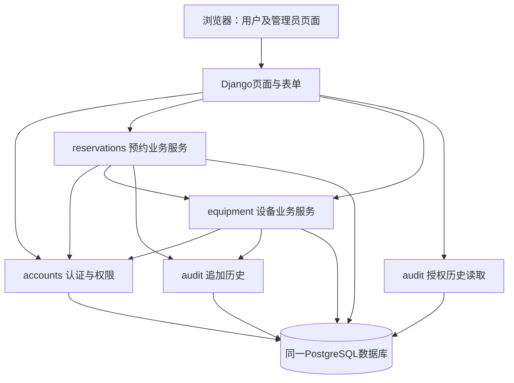

# BMAD 6.12.4 Step 2 - Acceptance Auditor independent session handoff

This archives the reviewer input, not findings. The original concurrent launch returned
agent thread limit reached. The recovery reviewer ran in a clean independent context after
a slot opened and returned findings recorded in story-1-4-independent-review.md. Neither
the failed launch nor this input itself constitutes findings.

You are an Acceptance Auditor. Review the provided diff against the implementation spec and
loaded context. Check violations of acceptance criteria, deviations from spec intent, missing
behavior and contradictions between constraints and actual code. Output Markdown-list findings,
each with a one-line title, the AC/constraint violated, and diff evidence. Do not invoke any
skill, spawn subagents, or route findings through another tool. Static, defensive review only.
No application tests, database access, grants, patch operations, source edits, or status changes.
If no violation is supported, explicitly report that result and its scope. Team historical tests
are not independent execution evidence.

Baseline: e200fee335536941e0705c112aefbf6751b244c3
Frozen original diff SHA-256: 819EEC784495D5E9A5D9699A244A509733D2E5C75B4DABCF3BDE054FA0C9FE8D
The formal criteria and relevant decisions below are authoritative. Additional original evidence,
if the repo is available, is in story-1-4-dev-evidence.md, the original team verification log,
the formal PRD and Sprint plan, sprint-status.yaml, and deferred-work.md.

## Formal Story 1.4 from epics.md

### Story 1.4: 管理员维护设备基础信息并保护设备身份

As a 实验室管理员，
I want 修改设备名称、类别、位置和说明，同时保持设备唯一身份和当前状态，
So that 设备资料能够及时更新，并持续关联同一件实物，不破坏后续预约与历史追溯。

| 项目 | 内容 |
| --- | --- |
| 状态 | draft；负责人已批准故事设计，软件测试及环境验证均未执行 |
| 人工确认 | 负责人在当前会话有条件批准，要求修正AC-2：业务编号不可改、伪造请求整体拒绝、数据库保证唯一，不预定触发器或列级权限；完成修正后批准本Story，不代表三名成员共同表决 |
| FR | FR-016的基础信息维护、编号不可修改、无物理删除及关联保护；FR-002的维护权限 |
| NFR | NFR-002仅基础信息编辑入口及合法对照，不代表完整权限测试已通过 |
| ADR | ADR-002、ADR-003；身份与关联保护遵守ADR-006，数据库验证遵守ADR-008 |
| PC | PC-003、PC-006的编号约束、PC-008、PC-009的关联及删除边界、PC-011、PC-014 |
| 涉及模块 | equipment、accounts权限检查、编辑表单及设备详情页面 |
| 前置Story | Story 1.1、1.2、1.3；实施时须已完成对应能力，目前不冒充已实现 |

**范围：** 仅编辑名称、类别、位置和说明。编号、设备状态只读；维修/停用/恢复仍由Epic 3交付。只修改既有设备记录，不通过删除重建实现编辑。

**本次编号保护澄清：** 正式PC-006原文保留；本Story按负责人本次明确边界落实为正常业务操作中编号不可修改、编辑页面与服务端共同限制、数据库保证编号唯一。撤去前次草案对业务数据库角色直接更新编号也必须被数据库拒绝的预设，不强制触发器或列级权限。如后续认为必须增加此类机制，先说明必要性及成本并由负责人确认，不据本Story批准自动引入复杂机制。

**Acceptance Criteria:**

**AC-1：管理员成功修改基础信息**

**Given** 管理员已登录，目标设备存在
**When** 提交合法的新名称、类别、位置和说明
**Then** 更新原设备对应字段，详情页面及重新读取数据库所得内容一致
**And** 设备主键、唯一编号和当前状态保持不变，设备记录总数不变。

**AC-2：正常业务操作不能修改已有编号**

**Given** 已存在编号为EQ-001的设备，管理员打开其编辑页面
**When** 查看可编辑字段
**Then** 设备编号为只读，不属于允许修改的字段。

**Given** 已存在编号为EQ-001的设备，并已保存其全部字段
**When** 管理员通过伪造编辑请求提交不同编号，即使同时提交其他合法基础信息
**Then** 服务端拒绝整个非法修改，明确提示设备编号不可修改
**And** 原设备所有字段保持不变，不部分保存其他变更；不得以删除重建绕过编号保护。

**Given** 数据库已存在设备记录
**When** 检查设备编号约束并尝试写入重复编号
**Then** 数据库唯一约束拒绝重复编号，不仅依靠提交前查询。编号不可通过正常业务操作修改；不预先强制触发器或列级权限机制。

**AC-3：编辑入口不能改变设备状态**

**Given** 目标设备处于可用、维修或停用状态
**When** 管理员通过基础信息编辑请求伪造不同设备状态
**Then** 拒绝该非法修改，不部分保存该请求中的其他变更
**And** 设备状态保持原值，不产生状态转换历史或预约处理。

**AC-4：服务端限制编辑权限并保留CSRF防护**

**Given** 已存在目标设备和合法编辑资料
**When** 未登录请求、学生或教师直接访问编辑表单或提交修改
**Then** 均拒绝访问或引导登录，不泄露编辑入口的受限内容，不改变业务数据
**And** 管理员使用有效CSRF凭据的合法对照按AC-1成功；管理员缺失或使用无效CSRF凭据时拒绝修改。

**AC-5：目标不存在时不创建替代记录**

**Given** 管理员已登录，请求的设备标识不存在
**When** 访问编辑页面或直接提交修改
**Then** 明确返回设备不存在的结果
**And** 不创建设备、不修改其他设备，也不把编辑操作转换成新增。

**AC-6：旧表单不能覆盖当前设备状态**

**Given** 管理员打开编辑表单时设备可用，随后测试夹具模拟另一已提交事务将其状态改为维修或停用
**When** 管理员提交仅包含合法基础信息的修改
**Then** 基础信息按提交更新，设备状态保留数据库中的维修或停用值
**And** 设备写入在短事务中先锁设备、锁后重读，仅更新允许的基础字段，不从旧对象回写状态。

该场景通过夹具及独立事务验证，无需实现Epic 3的状态修改入口。

**AC-7：基础维护不提供设备物理删除**

**Given** 系统存在目标设备
**When** 检查基础维护入口，并尝试通过业务请求删除该设备
**Then** 不存在可执行设备物理删除的业务路径，请求不能删除设备
**And** 正常编辑始终保留原设备主键及编号，不采用删除后重新创建的方式。

**AC-8：准确处理数据库失败与提交结果未知**

**Given** 管理员提交合法修改，且已确认本次事务失败或回滚
**When** 返回处理结果
**Then** 不返回修改成功，本次变更不部分持久化。

**Given** 服务端与PostgreSQL在COMMIT前后连接中断，且服务端无法确认本次事务是否已持久化
**When** 返回处理结果（客户端响应通道仍可用）
**Then** 提示结果待核查，不直接声称修改成功、已回滚或原值必然未变
**And** 不自动重试覆盖数据，不把连接、锁或其他数据库异常伪装成编号重复。

**后续测试与证据要求（均待执行）：**

- 对应1.4-AC-1～1.4-AC-8建立测试记录，保存角色、输入、预期/实际响应及设备前后数据；编号伪造请求检查原设备全部字段不变，数据库唯一性独立验证，不预设触发器/列级权限。
- 使用真实PostgreSQL验证数据库唯一约束、设备锁、旧表单状态保护及事务异常；状态夹具不增加业务状态转换入口。
- 当前以主键不变、原记录原位更新验证设备身份保护；Epic 2创建预约实体时增加既有预约关联的集成回归。本Story不依赖未来预约实体才能交付，不提前创建全部关联表。
- NFR-002仅本编辑入口：未授权同时检查拒绝、无泄露、无业务变化，目标100%；合法对照单列。T-03继续登记实现后的实际路由及成对案例。
- R-01/R-03保持既定确认节点；显式Read Committed仍在相关事务Story进入ready前确认。T-01～T-04均未完成；软件测试及环境验证未执行。
- Story保持draft，不标记ready、done或测试通过。本次只保存故事设计，尚未批准转入Epic 2。


## D-024

## D-024 2026-11-25 负责人批准显式 Read Committed

1. **触发**。BMAD 6.12.4 Build Step 2 准备 Story 1.2 的 Checkpoint 1。Sprint 计划要求在本 Story 进入 ready 前确认 ADR-003／AD-3 的隔离级别建议。 [Sprint 计划](_bmad-output/planning-artifacts/sprint-plan.md)
2. **AI 建议及风险**。建议由 Django PostgreSQL `OPTIONS` 统一设置 `IsolationLevel.READ_COMMITTED`，避免部署环境或角色默认值漂移改变事务语义。备选是继续依赖默认值并逐模式核查，改动较小，但检查之间仍有漂移可能。显式配置会影响三个模式的所有新应用连接，配置有误可能阻止连接。仅看到隔离级别正确也无法验证编号竞争结果，仍需执行 AC-6。
3. **人工判断与依据**。项目负责人在本次对话明确批准方案 1。runtime、migration、test 使用同一 Django 连接级设置，PostgreSQL 服务器级、数据库级和角色级设置保持原样。负责人同时明确后续由三位组员共同参与 Codex 开发、检查与验收，按实际参与和人工决定留证。本条只记录本次负责人决定。
4. **结果**。已将批准的设置和验证要求纳入 Story 1.2 实施规格。规格仍为草稿，Sprint 状态仍为 `backlog`，设置在规格批准后的开发阶段实施。 [实施规格](_bmad-output/implementation-artifacts/spec-1-2-create-equipment.md)
5. **验证方式与当前证据**。变更前三个 Django 模式分别以 `lab_booking_app`、`lab_booking_migrator` 连接 `lab_booking`，以 `lab_booking_test` 连接 `test_lab_booking`。实际目标均为 PostgreSQL 17.12、`127.0.0.1:5433`，只读事务中 `SHOW default_transaction_isolation` 和 `SHOW transaction_isolation` 均为 `read committed`。实施后以新连接逐模式核对库、角色、版本和事务内 `SHOW transaction_isolation`，业务库核对保持只读。AC-6／AC-7 在隔离测试库另行取得实际证据。实施后验证尚未发生。


## D-032

## D-032 2026-11-25 负责人批准 Story 1.4 实施规格

1. **触发**。BMAD 6.12.4 Build Checkpoint 1，核对前置 1.1～1.3 为 done，提交正式 AC-1～AC-8 对应规格。 [检查点](_bmad-output/implementation-artifacts/story-1-4-checkpoint-1.md)
2. **AI 建议**。复用现有设备及角色基础，短事务取设备锁、重读并原位更新四列。建议批准实施规格，四列 UPDATE 留给独立评审后的正式库批准。
3. **人工判断与依据**。负责人回复「批准并继续」，明确以 AC-1～AC-8、D-024 和 Story 1.2 事务验证为依据，原则接受四列授权但不批准本次正式库 GRANT。要求真实隔离锁、异常和 55 项基线回归，权限受阻则提供普通 PowerShell 执行方案，不提前进入 review。
4. **结果**。规格获批进入 ready-for-dev，按正式 Build Step 3 开始实施后进入 in-progress。三位组员共同操作及审阅，不代写个人判断。未批准业务库访问、Git 操作或最终验收。 [实施规格](_bmad-output/implementation-artifacts/spec-1-4-edit-equipment-basics.md)
5. **事后验证**。待以原 Python 3.13.17 以及指定隔离库完成实际测试后补证，历史 55/55 不替代本轮结果，实验 A 条件及数据不变。

   **2026-11-25 事后取证**。三位组员共同操作及审阅，团队在普通 PowerShell 应用补丁并用原 Python 3.13.17 在指定隔离库完成测试。按名称核对原回归 55/55、新增 12/12，零跳过，真实事务探针 8/8，正式 AC-1～AC-8 均有开发自测证据。Codex 仅核对差异和日志，未复跑。Sprint 进入 `review` 待新会话独立评审，不代表最终验收。没有执行正式业务库 GRANT 或迁移，没有变更实验 A。本补记不新增人类决定。 [开发证据](_bmad-output/implementation-artifacts/story-1-4-dev-evidence.md) · [团队原始日志](_bmad-output/implementation-artifacts/story-1-4-verification-20261125-221855-930.txt)


## Implementation specification

---
title: 'Story 1.4 管理员维护设备基础信息并保护设备身份'
type: 'feature'
created: '2026-11-25'
status: 'in-review'
route: 'dispatch'
review_loop_iteration: 0
baseline_commit: 'e200fee335536941e0705c112aefbf6751b244c3'
context: ['{project-root}/_bmad-output/planning-artifacts/project-context.md', '{project-root}/docs/course-requirements.md']
---

<frozen-after-approval reason="human-owned intent — do not modify unless human renegotiates">

## Intent

让启用的业务管理员原位维护同一台设备的名称、类别、位置和说明。[正式 AC-1～AC-8](../planning-artifacts/epics.md#story-14-管理员维护设备基础信息并保护设备身份)是唯一验收口径，追溯 FR-016／002、NFR-002 本入口、ADR-002／003／006／008。

## Boundaries & Constraints

**必须**保留主键、唯一编号、当前状态和记录数量。按 D-024 使用 Read Committed，短事务设备行锁、锁后重读，仅更新四列。服务端角色与 CSRF 拒绝无泄露、无业务变化。

**不做**删除和重建、状态转换、预约／历史实体、FR-018、迁移或业务库改动。未知提交不重试。只用原 .venv 和隔离测试库，完成自测停在 review，另开会话独立评审。不提前 done、commit 或 push。

</frozen-after-approval>

## Code Map

- `accounts/models.py:Role`、`equipment/views.py:require_equipment_admin`、设置中的 CSRF 中间件提供现有边界。不以 Django staff 推导业务角色。
- `equipment/models.py:Equipment` 复用具名唯一约束和状态枚举；`services.py:create_equipment` 提供事务分类先例，编辑不报告重号。
- `lab_booking/settings.py`、`postgresql/base.py`、`test_runner.py` 复用连接守卫；运行器禁止 flush。[前置核验与探针设计](story-1-4-checkpoint-1.md)。

## Tasks & Acceptance

**Execution**

- [x] `equipment/forms.py`、`views.py`、`urls.py` 与设备模板接入管理员 GET/POST `/equipment/<pk>/edit/`。详情仅管理员见链接。编号、状态只展示，不作表单字段。拒绝受保护键、其他额外键或重复键，不部分保存。
- [x] `equipment/services.py` 先授权，最外层事务按主键取锁、独立语句重读、原位更新四列，确认提交才跳转详情。无效表单只读确认目标；404 不写。失败和未知分别提示，未知只引导核查。
- [x] `equipment/test_edit.py` 加回滚式 AC／T-03 测试；`equipment/management/commands/verify_equipment_edit_transactions.py` 加隔离 T-01／异常探针，不改现有 runner。
- [x] `README.md` 记录入口与运行授权边界；`story-1-4-dev-evidence.md` 记录实际命令、AC、回归、夹具清理和 review 交接。

**Acceptance Criteria**

1. **AC-1** 已登录管理员提交合法四字段时，详情及重读匹配输入，主键、编号、状态和总数不变。
2. **AC-2** 已有设备编号只读。提交不同编号时整体拒绝、明确提示、全字段不变；真实数据库拒绝重复编号。
3. **AC-3** 对任一合法状态伪造状态时整体拒绝，不保存任何变更，不处理预约或历史。
4. **AC-4** 匿名、学生、教师直达 GET/POST 时拒绝且无泄露、无业务变化；有效 CSRF 管理员成功，缺失或错配则拒绝。
5. **AC-5** 管理员 GET 或通过 CSRF 的 POST 指向不存在的目标时明确 404，不创建记录也不影响其他设备。
6. **AC-6** 旧表单打开后，独立事务提交维修／停用时，合法提交更新四字段且保留最新状态；取得设备锁后重读。
7. **AC-7** 检查维护入口并尝试删除时，无可执行删除路径；编辑保留原记录、主键和编号。
8. **AC-8** 确认失败时不报成功、无部分持久化；COMMIT 结果不明时仅提示待核查，不断言回滚，不重试或冒报重号。

## Implementation Notes

- 2026-11-25 项目负责人明确批准 Checkpoint 1 并继续，原则接受四列最小授权方案但未批准正式库变更。见 [D-032](../../decision-log.md#d-032-2026-11-25-负责人批准-story-14-实施规格)。
- 2026-11-25 Step 3 已准备 [实现补丁](story-1-4-edit-equipment-basics.patch)，但当前会话无法写入实际 `equipment/`，原解释器亦未能启动。通过补丁预检查，不等于应用或测试通过。普通 PowerShell 续跑见 [开发证据](story-1-4-dev-evidence.md)。继续保持 `in-progress`，未把任何 AC 记为通过。
- 2026-11-25 团队在普通 PowerShell 应用补丁和实际自测。当前 9 个业务及测试文件完整匹配补丁，未重复应用。AC-1～AC-8 开发自测通过，原 55/55、新增 12/12，无跳过，真实探针 8/8。状态转为 `in-review`，Sprint 同步为 `review`，等待新会话独立 `bmad-code-review`。本会话仅核验日志与差异，未复跑或进行独立评审。 [开发证据](story-1-4-dev-evidence.md)

## Spec Change Log

## Review Triage Log

## Verification

- 仅 `127.0.0.1:5433/test_lab_booking`。原 .venv Python 3.13.17，`manage.py check`、`makemigrations --check --dry-run`、`test --keepdb --parallel 1 -v 2` 启用既有 Chrome R1，原 55 项与新增用例分别计数。
- 上述隔离探针单独串行运行，观察实际锁等待、确认回滚和两种未知提交；比对完整末态、尝试次数与零夹具残留。合法对照与 T-03 拒绝分母分列。
- 若沙箱不允许执行原解释器或访问受保护密码文件，保留 `in-progress`。提供普通 PowerShell 的完整隔离验证命令或脚本，保存未经代跑的真实输出，绝不替换解释器或降低验证。禁止用本次批准执行正式 GRANT。
- 实测在原 Python 3.13.17、PostgreSQL 17.12、指定隔离库完成。T-03 同时满足拒绝、无泄露、无业务变化 6/6，管理员合法对照和 CSRF 拒绝单列。T-01 4/4，含两组真实锁等待；AC-8 4/4，区分回滚、明确拒绝、提交前断连及提交后丢确认。夹具清理通过。 [团队原始日志](story-1-4-verification-20261125-221855-930.txt)


## Project context

---
title: 实验室设备预约管理系统 Project Context
status: final
created: 2026-11-11
updated: 2026-11-21
finalized: 2026-11-11
baseline_commit: 30c014c944740dd99e6fb2576046b50d64db5e8b
review_status: 负责人已人工审核最终检查结果并正式批准Finalize；已定稿，未提交或推送
---

# 实验室设备预约管理系统 Project Context

## 1. 状态、用途与依据

本文件是课程PPT第33页要求的独立交付物，供后续Story设计、开发和评审显式读取，并为实验A记录规则违反情况提供稳定编号。当前为final，负责人于2026-11-11正式批准Finalize；本次正式定稿修改尚未Git提交或推送。草稿生成时，负责人仅接受整理方案，生成稿尚待人工审核；2026-11-11负责人明确表示已人工检查GitHub草稿，原则认可14条约束，无需重新讨论或增加数量，并要求完成收尾检查后等待明确批准才改为final。这不代表三名成员重新共同表决通过。没有运行软件或测试，不声明规则已由实现满足。

依据为[课程基线第4节][course]、[定稿Product Brief][brief]、[定稿PRD][prd]、[定稿Architecture及8条ADR][architecture]、[原始Architecture Spine][spine]及其[memlog][memlog]、[根目录decision-log.md][decisions]、[M2架构总结][summary]和[审核意见处理记录][disposition]。ADR-001～008与AD-1～8一一对应。本文不改写18条FR、2条NFR或定稿ADR；具体实现细节的后续确认单列于第4节。

定稿时的人工依据为负责人“我们对这次project-context的整理方案提出以下确认意见”消息的第一至六部分：接受五部分结构和PC-001～PC-014；接受R-01模块与唯一角色字段原则；有条件接受R-02；接受R-05不挂载Admin URL；R-03环境前确认，R-04继承既有决定。理由包括职责清晰、减少无关锁及重复入口、保持失效和历史一致、控制课程范围。2026-11-21 的后续 R-01 决定和 R-03 实测记录见第 2、4 节。

草稿生成时核对基线为当时本地HEAD [30c014c94474][baseline]，与负责人当时提供的GitHub main核对提交一致；生成时未联网复核远端。草稿随后已入库，真实提交为[02eec258a3ac][draft-commit]（完整SHA：`02eec258a3ac768fe68753914fa77ac994620197`，提交说明：`docs: add M2 project-context draft for review`，Git提交时间：2026-11-11 09:59:09 +08:00），该提交仅新增本文件。本次由本地Git对象及HEAD核实提交；GitHub草稿可见性依据负责人本次已人工检查的明确陈述，未自行联网复核远端。`baseline_commit`保留生成基线，不冒充草稿提交。M1及M2第一轮已正式定稿，不重跑这些工作流。2026-11-05老师通知优先：取消老师M1～M4阶段验收和实验B，保留实验A、内部就绪检查及其他未取消课程要求。

当前安装的BMAD为6.12.4，入口来自[本地bmad-help目录][catalog]：`[PC] bmad-project-context`主要管理AGENTS.md区块，`[CE] bmad-create-epics-and-stories`拆分故事，`[SP] bmad-sprint-planning`执行规划就绪检查和Sprint规划。本次按负责人明确要求，参考[PC技能][skill]的证据核验方法创建独立文件；不迁移、覆盖或更新AGENTS.md，不以其代替课程交付物。

## 2. 技术栈、版本与环境状态

| 项目 | 已选择的系列或形态 | 当前事实及后续核验 |
| --- | --- | --- |
| Python | 3.13.x，标准64位发行 | Python.org 3.13.17 x86-64 已用于项目 `.venv` |
| Django | 5.2 LTS | 5.2.19 已安装，依赖与 PostgreSQL 后端导入已核验 |
| PostgreSQL | 17.x，本机服务 | 17.12，`127.0.0.1:5433`。已验证业务／测试库、分离角色及 Django PostgreSQL 连接，应用迁移待实施 |
| psycopg | 3.x且至少3.1.8 | 3.3.9，CPython 3.13 Windows x86-64 binary wheel 已核验 |
| 时区数据 | Python `zoneinfo`，业务时区Asia/Shanghai | `tzdata` 2026.6（IANA 2026f），UTC／北京时间往返与 Django 转换已核验 |
| 页面 | Django Templates、HTML/CSS、必要JavaScript | 同源服务端页面，不增加React/Vue或前端构建平台 |
| 架构与运行 | 分层模块化单体；Windows、venv、本机PostgreSQL、runserver | runserver仅限开发和本机演示；不是已验证的生产部署 |

技术栈依据 ADR-001／007／008 及 Architecture 第 3 节。本机为 Windows 11 专业版 25H2、64 位。安装来源、检查命令及数据库待办见 [Sprint 1 环境准备记录](../../docs/team/sprint-1-environment-preparation.md)，已核验的 Python 包补丁见 [requirements.txt](../../requirements.txt)。第二台机器复现待验证。

## 3. 具体开发约束

以下PC编号保持稳定；每条包含禁止行为、必须做法、正式依据及待执行检查。检查方法不是已通过结果。第4节中尚未确认的细节不得借本节升级为已决定事项。

### PC-001 本地部署边界

- **禁止／必须：** 不引入Docker、云端必需服务、Redis、Celery、消息队列、微服务或独立前端；采用Windows本地venv、Django模板和本机PostgreSQL，runserver仅用于开发演示。
- **依据与理由：** ADR-001/AD-1、Architecture第3节；三人课程项目优先控制部署和集成成本，并满足评审机器按README启动的要求。
- **检查：** 核对依赖、配置及启动说明；后续在另一台Windows机器按README安装、迁移、初始化并启动，保存完整版本与实际输出。当前未验证。

### PC-002 真实PostgreSQL及测试隔离

- **禁止／必须：** 不将业务或并发事务集成数据库改为SQLite，不在配置缺失时静默回退；业务和并发集成均使用PostgreSQL 17.x，测试库与业务库分离。纯规则单元测试不能冒充数据库验证。
- **依据与理由：** ADR-001/008、NFR-001；设备锁、数据库时钟及事务结论需要真实目标数据库证据。
- **检查：** 核对数据库配置、实际服务器版本和测试目标；集成报告记录独立连接及最终数据。数据库角色的具体设置依R-03确认。

### PC-003 所有状态写入口共用设备锁协议

- **禁止／必须：** 不只查冲突后直接写入，不先锁预约再锁设备，不用加锁前旧对象覆盖状态，不用`skip_locked`把跳过视为空闲。申请、批准、拒绝、取消、失效及设备状态变化均经统一业务服务和短事务：先锁设备行，锁后重读，再修改预约或设备状态，最后追加历史，持锁至提交；多设备按主键升序逐个锁。跨模块辅助函数不得提前提交；事务中不等待输入、调用外部服务或渲染模板。修改设备描述不得从旧表单回写旧状态。
- **依据与理由：** FR-005/007/008/010～018、ADR-003及Architecture第5节；用同一设备互斥点防止并发插入、终态覆盖和停用交错。Read Committed的确认状态见第4节。
- **检查：** 枚举所有业务写入口并审查调用和事务边界；真实独立连接验证申请竞争、批准/取消/失效/停用交错，并检查不同设备和同设备不同时段的合法申请。不承诺严格公平或永不死锁。

### PC-004 锁后唯一业务判定时刻

- **禁止／必须：** 不以请求到达、事务开始、提交时间或客户端时间作判定，不以`CURRENT_TIMESTAMP`代替锁后实际时钟；取得本操作全部相关设备锁并重新读取状态后，独立调用一次PostgreSQL `clock_timestamp()`取得`t_decision`，本事务全部业务时间判断复用它。正式运行不得由客户端或普通配置替换时间来源。
- **依据与理由：** FR-006/008/010/012～014/018、ADR-004；锁等待可能跨越预约边界，不能沿用旧时间。
- **检查：** 审查采样位置和复用路径；测试专用可控时间覆盖开始前、相等、之后及已批准结束边界；真实数据库验证等锁跨开始、锁后采样、判定早于开始但成功提交跨开始仍有效。证据区分规则模拟与真实采样，不改系统时钟。

### PC-005 授权范围内按需失效及查询候选

- **禁止／必须：** 不增加定时任务或后台扫描，不仅在页面虚拟显示失效，不扫无关设备。先授权并按稳定条件固定本次候选记录ID及其设备；候选中有待审核记录的设备按主键升序锁定，锁后重读并统一判定，失效与历史在一次范围内短事务中提交，再做待审核、有效、尚未结束等动态筛选。不得凭锁前时间跳过尚未到点的待审核候选，也不得漏掉已结束但仍待审核的候选。无待审核候选不额外锁设备。
- **禁止／必须：** 本人查询限本人；设备占用限目标设备/日期；管理员限本次实际授权范围。未授权请求不得触发业务状态或业务历史变化。重读不扩入并发新增记录；明确结果对应本次候选范围及判定时刻，新增记录下次查询可见，不声称全库实时快照。管理员主动广泛查询可涉及较多相关设备，不锁无关设备、不静默截断或增加分页。
- **依据与理由：** FR-002/004/007～009/011/018、ADR-005；候选冻结细节由本次负责人R-02有条件接受。减少无关锁，同时保持失效和历史一致。此机制不替代提交预约时锁后重新检查相关失效、冲突和有效占用。
- **检查：** 用多设备、多归属、多状态及已结束待审核记录核对初始候选与返回范围；验证并发新增不混入未锁结果、重复查询不重复转换、未授权访问不改数据，以及提交仍执行完整冲突检查。

### PC-006 具体设备与区间冲突

- **禁止／必须：** 不自动分配同型号设备，不增加人级重叠限制、缓冲时间、候补、排队或优先级。按具体设备唯一编号及`startA < endB && startB < endA`判断有效占用；申请成功即待审核并占用，冲突判断前按FR-018处理相关待审核记录。首尾相邻允许，同人同时预约不同设备允许；页面显示空闲不保证稍后提交成功。
- **依据与理由：** Brief、PRD第3节、FR-005/007/008及D-008；资源是具体实物，不能擅自扩展分配或公平性规则。
- **检查：** 验证相同、相交、包含及被包含均冲突，相邻允许，同人跨设备允许；无效占用状态不阻塞新的合法未来申请。数据库负责设备编号唯一且不可修改，检查重复编号拒绝。

### PC-007 维修停用保留预约并人工处置

- **禁止／必须：** 不因维修或停用自动取消既有预约，不自动把已批准改为异常或失效，不因恢复可用复活终态。维修/停用后拒绝新申请及批准，既有预约保留供管理员按FR-014人工处理，待审核仍独立适用FR-018。本人查询同时区分预约状态与设备当前状态；不新增故障处理期限、超时取消、提醒或处罚。
- **依据与理由：** FR-008/009/011/012/014/017、ADR-003/006、D-009；设备状态与预约状态不能混为一谈。
- **检查：** 验证停用先提交与申请先成功两种顺序、维修/恢复不复活、设备筛选范围正确、本人页面状态同步且详情权限不变。

### PC-008 服务端角色、归属及单一业务入口

- **禁止／必须：** 不只靠隐藏按钮授权，不信任表单中的申请人，不由`is_staff/is_superuser`推导或豁免业务角色。使用Django会话及一个明确业务角色字段区分学生、教师、管理员；统一业务服务先检查角色与对象归属，再执行副作用，锁后复核。学生教师仅按规则管理本人，管理员不能提交预约；普通占用查询不返回他人受限详情，保留会话及CSRF防护。
- **禁止／必须：** 页面接收参数、调用服务、展示结果，不直接写业务模型；遵守第4节已确认模块调用方向。首版不挂载Django Admin URL；管理员从专用业务页面处理，业务数据和历史不向Admin开放直接编辑；预置账号经初始化创建，不增加注册或账号管理业务。
- **账号模型与默认权限：** 首次迁移前配置 `AUTH_USER_MODEL = 'accounts.User'`，由 `accounts` 的首个迁移创建继承 `AbstractUser` 的用户模型。必填 `role` 仅允许 `student`、`teacher`、`admin`，无默认值，并由数据库约束保证。受保护业务默认拒绝，按登录状态、有效角色、操作权限和对象归属授权。三类预置账号的 `is_staff`、`is_superuser` 均为 `False`，Django 组和直接权限留空。迁移获准并成功后，预置操作按唯一用户名只补齐缺失账号，使用 Django 密码哈希，同名异角色时回滚整批。见 [R-01 初始化及验证规则](../../docs/team/sprint-1-environment-preparation.md#r-01-首次迁移与预置账号规则)。
- **依据与理由：** FR-001/002/004/009～017、ADR-002/005及本次R-01/R-05确认；防止授权分散和绕过锁、失效、历史的双入口。
- **检查：** 审查全部URL、表单和服务入口；验证直接访问、换对象ID、伪造申请人、普通用户审核维护、管理员申请均受控；核对未挂载Admin URL及无业务直写旁路，合法对照单列。

### PC-009 历史关联完整且与状态共同提交

- **禁止／必须：** 不编辑或删除业务历史，不通过正常业务物理删除预约、设备和历史。每条历史恰好关联一个实际存在的预约或设备，对象类型一致且无悬空关联，由数据库约束保证；不提前指定两个可空外键或其他具体模型。保留对象类型/编号、动作、前后状态、执行者类型与账号、适用原因、`t_decision`及实际变更记录时间；预约创建保留申请人、设备、时段和申请时间。
- **禁止／必须：** 实际批准、拒绝、取消、失效及设备状态变化追加历史并与状态同事务提交；原因从历史读取，不另建可独立修改的重复原因。系统失效执行者为系统，原因固定“开始时间已到仍待审核”，不冒充触发用户的人工操作；记录时间不声称提交时间，不倒填预约开始时间。普通查询及无变化失败不额外记作状态转换，重复失效不重复记历史。
- **依据与理由：** FR-015/018、ADR-006、D-012；对象可追溯、单对象关联、状态和审计数据一致是已接受约束。
- **检查：** 核对每次转换的记录数量、字段及主体；验证数据库拒绝零对象、双对象、悬空或类型不符的关联，业务路径无物理删除/历史编辑；历史写入失败时状态共同回滚。具体约束机制实现后实测。

### PC-010 NFR-001真实竞争验收

- **禁止／必须：** 不通过全部拒绝、同一连接串行、模拟并发或伪造结果满足指标，不将异常、无返回请求算作明确冲突。真实PostgreSQL中，设备可用且每轮无有效冲突，20个已登录有权限请求以同一合法未来设备/区间统一启动，各用独立连接，连续10轮隔离数据；每轮恰好1成功、19明确冲突，最终恰好1条待审核有效占用，10/10轮满足。边界交错另组，不能污染标准竞争条件。
- **依据与理由：** NFR-001、FR-005/007/008/018、ADR-008；不能用拒绝全部申请或伪并发掩盖一致性问题。
- **检查：** 保存机器、完整环境版本、请求输入、实际启动时间分布、全部结果及最终预约/占用记录；逐轮核对1与19，任何数据库错误或无结果都不达标。不把该测试解释为响应速度或整体性能证明。

### PC-011 NFR-002权限验收及合法对照

- **禁止／必须：** 不拒绝全部操作掩盖权限错误，不把合法对照混入未授权分母。按权限矩阵列明学生甲/乙、教师、管理员、未登录及不同归属状态用例；每个未授权用例同时满足拒绝、无受限详情泄露、预约/设备/有效占用/业务历史不变，全部通过率100%；合法对照单列并按对应FR成功。
- **依据与理由：** NFR-002、FR-001/002/009～018、ADR-002/005/008；查询失效也可能越权写数据，必须检查全部副作用。
- **检查：** 保存角色、对象归属、输入、预期/实际响应、操作前后数据、实际未授权总数、通过数及失败明细；包括直接URL、他人详情/取消、普通用户维护/审核、管理员申请、设备筛选、本人设备状态及查询失效。Django会话技术数据不冒充业务状态，也不能成为漏查业务变化的理由。

### PC-012 北京时间及预约时间边界

- **禁止／必须：** 不存含义不明的无时区业务时间，不依赖浏览器/主机本地解释，不直接截UTC日期判断业务同日，不截断`t_decision`到整点。采用`USE_TZ=True`、`TIME_ZONE=Asia/Shanghai`、PostgreSQL `timestamptz`；输入由服务端按北京时间解释和校验，页面统一显示北京时间。开始结束整点、同一自然日、至少1小时、结束不晚于23:00、开始严格晚于判定时刻；允许今天未来时段及未来日期，不新增提前天数或开放窗口。
- **依据与理由：** PRD第3节、FR-006、ADR-007及D-008；统一时间点和业务日期，避免时区漂移改变失效或冲突结论。
- **检查：** 验证22:00～23:00合法、非整点/零时长/跨日/开始已到拒绝，保存重读显示一致、主机和数据库会话异时区仍正确；证据带UTC偏移或时区标签，Windows时区数据可用性待核验。

### PC-013 状态转换与禁止编辑重开

- **禁止／必须：** 不增加已完成/异常等状态，不直接编辑预约设备或时段，不重新打开已拒绝、已取消、已失效申请。按PRD第5节状态表执行：本人只能开始前取消待审核/已批准；管理员批准须开始前待审核且设备可用，拒绝须开始前待审核且非空原因，取消待审核须开始前、取消已批准须结束前且非空原因；已批准撤销用取消，不用拒绝。待审核判定达到开始时间只能失效，已批准不按FR-018失效。修改内容重新申请，独立接受原有校验。
- **依据与理由：** FR-008/010/012～014/018、PRD第5节、D-007/008；防止终态复活或擅自扩展业务路径。
- **检查：** 按角色、原状态、开始/结束前相等后及原因建立转换断言；验证表外转换拒绝、批准不重复创建、终态不复活、新申请不继承旧占用或审核结果。

### PC-014 区分业务拒绝与数据库失败

- **禁止／必须：** 不用导致整笔回滚的异常表达“已合法失效后业务动作被拒绝”；发生合法失效时，正常提交失效及历史，再返回批准/取消等动作的业务拒绝。数据库异常、历史写入或提交失败则整体回滚，从事务边界外处理，不返回成功，不把锁失败伪装成冲突。结果未知须明确失败/待核查，不自动重试创建造成重复，不新增业务幂等承诺。
- **依据与理由：** ADR-005/006、Architecture第5节；失效收尾与后续动作的拒绝不同于数据库事务失败。
- **检查：** 验证到点待审核被失效后批准/取消拒绝，失效与历史仍留存；注入历史写入及提交异常，核对状态与历史共同回滚、响应无成功，并检查无盲目创建重试。

## 4. Deferred处理及后续确认节点

本节记录本次后续确认，不追改已定稿Architecture或历史审核。架构中的“待确认”是其定稿时状态；本次接受的细节以本节和当前会话人工意见为依据，不声称架构原文当时已批准。

| 项目 | 当前状态 | 后续事项与节点 |
| --- | --- | --- |
| R-01 模块与角色 | 负责人批准 `accounts.User` 与唯一业务角色字段，见[决策日志 D-015](../../decision-log.md#d-015-2026-11-21-负责人批准-r-01-自定义账号模型) | 按 PC-008 实现，首次迁移前核对模型依赖，随后验证必填角色、预置账号与业务权限 |
| R-02 查询候选 | 本次负责人有条件接受；PC-005保留完整条件 | Story验收须覆盖初始待审核候选不遗漏、已结束收尾、先授权、锁后重读、范围声明、并发新增下次可见及提交独立冲突重检；尚未实现验证，不承诺全局快照，不增加分页 |
| R-03 环境与初始化 | 负责人批准环境方案，独立 17.12 集群与项目库已初始化，连接及隔离已验证。见 [Sprint 1 环境准备记录](../../docs/team/sprint-1-environment-preparation.md#r-03-批准后执行记录) | 应用迁移和预置账号写入按各自节点确认。保存迁移、初始化与第二台机器复现证据，初始化保留已有密码、角色及历史 |
| R-04 历史设计 | 继承D-012及ADR-006，不重复决策 | 数据模型实现前选定可靠关联和数据库约束机制；实现后真实验证PC-009/014的关联完整性、原子性、重复失效及回滚，尚无结果 |
| R-05 Admin入口 | 本次负责人接受首版不挂载Admin URL；PC-008执行 | 实现后核对路由清单、无业务直写旁路及专用页面权限；初始化创建预置账号，不增加账号管理 |

R-01已接受的职责与调用方向如下，不据此声称目录或代码已创建：

| 模块/入口 | 职责及允许依赖 |
| --- | --- |
| accounts | 预置账号、会话登录、固定业务角色和归属策略；依赖Django认证，不依赖预约或设备服务 |
| equipment | 设备主数据、状态及设备锁；依赖accounts、audit、公共时间/事务辅助，不反向调用reservations |
| reservations | 申请、查询、审批、取消、FR-018及冲突规则；拥有预约状态写入，依赖accounts、equipment、audit、公共时间/事务辅助 |
| audit | 历史统一追加及授权读取；依赖账号/对象关联模型，不调用上游业务服务、不自行触发业务变更 |
| 页面/表单 | 参数解析、格式校验、调用业务服务和展示，不直接写业务模型；数据构造完成且事务结束后渲染，不在模板惰性执行新的业务读取 |

补充未决项：ADR-003/AD-3中的显式Read Committed仍为AI配置建议，本次人工意见没有明确接受该隔离级别。不得写为已批准或已配置；在相关事务Story ready前确认实际隔离级别并核对PC-003/005的查询与加锁语义。不新增ADR编号，也不因此自行修改Architecture。

T-01～T-04仍未完成。周何馨继续按既有记录跟踪：T-01相关Story ready前固定交错场景；T-02沿原记录节点核定时间边界及取证，本轮不以架构已定稿倒填完成；T-03权限设计/验收前补成对案例及实际路由；T-04并发设计/首次运行前隔离标准竞争与边界组。具体技术负责人姓名未指定，不虚构分派。

## 5. 使用、验证与课程核对边界

后续Story设计、实现和评审任务须显式提供本文件及相关PRD/ADR；不能假定独立文件自动进入智能体上下文。Story引用适用PC编号、FR/NFR及ADR，并将本节检查方法细化成验收断言和真实证据。检查未运行时保持待完成；发现改变FR/NFR、ADR、Sprint或实验条件的需要，先说明影响并由团队确认。

实验A沿课程基线执行：X提供PRD、ADR、本文及故事卡，Y使用全新干净会话仅给一句功能需求，不人为泄漏X规划上下文；同人、同日、同宿主、同模型、难度相当及相同评审标准不变。记录违反PC规则时回指稳定编号及实际证据，不预填次数，不把整理14条规则当成14条人工决策；具体统计记录须保留真实上下文和口径，不擅自改变实验条件。本轮不开展实验A，不开展已取消的实验B。

文档一致性检查范围为：独立文件及final状态和实际定稿批准依据、技术系列与待核验事实、PC-001～PC-014连续唯一编号和依据/检查字段、与18FR/2NFR/8ADR及本次确认的一致性、Deferred状态和来源链接。课程PPT第33页要求依据仓库课程基线第4节摘录核对，不声称本次直接复核PPT原页。

本稿具备技术栈及版本系列和14条具体开发规则，满足上述摘录的文档内容要求。草稿生成时，人工审核、Finalize及Git入库均未完成；后续Git入库和负责人对生成稿的人工检查已发生，证据见第1节，历史事实不追改。实际补丁锁定、Windows安装与环境核验、数据库连接迁移、第二台机器复现、运行测试及T-01～T-04仍未完成；本文已按负责人正式批准完成Finalize，该批准不表示上述验证已完成。不得据文档内容核对宣布整项课程验收通过或软件达标。

2026-11-11收尾静态核对结果：五部分结构保留；11个相对链接目标均存在，引用式链接定义完整；PC-001～PC-014连续且唯一，14条均保留禁止／必须、依据与理由、检查方法。Python 3.13.x、Django 5.2 LTS、PostgreSQL 17.x、psycopg 3.x且至少3.1.8及页面／运行形态与Architecture第3节、ADR-001/007/008一致；补丁和Windows时区数据仍待实机核验。FR-001～018、NFR-001/002、ADR-001～008及AD-1～8引用与正式来源核对未见阻塞性冲突；D-007/008/009/012均有真实记录。R-01/02/05保留本轮既有确认及条件，R-03保留环境前确认，R-04保留模型设计与实现验证节点；Read Committed仍待相关事务Story ready前确认，T-01～T-04仍按第4节节点跟踪。

定稿前收尾记录（历史状态）：未发现阻碍本文定稿的文档问题；当时status保持draft，等待负责人明确批准后才可改为final。本次只修正本文件状态表述、补充真实草稿提交与人工检查依据及静态核对结果，不修改14条约束、FR/NFR、ADR、Sprint范围或实验条件；不修改AGENTS.md、定稿PRD、Architecture、Spine、memlog或决策日志，不生成业务代码、不运行测试、不进入Epic/Story、不执行Finalize、commit或push。本次收尾修改尚未提交。

2026-11-11正式定稿记录：负责人在本次会话明确表示已人工审核最终检查结果，确认五部分结构、14条PC约束、技术栈及版本、FR/NFR/ADR映射和Deferred处理符合当前课程要求，并明确批准project-context.md Finalize。据此将status改为final，记录实际定稿日期和审核状态；第2～4节及PC-001～PC-014原文、稳定编号均保留。R-03、Read Committed、实际补丁、Windows环境、数据库连接迁移、第二台机器复现及T-01～T-04仍按原节点确认和验证。正式定稿尚无Git提交，02eec258a3ac仅为草稿提交，不作定稿提交证据。本次同步README的M2第二轮进度；Epic/Story、就绪检查及Sprint计划尚未开始，不启动后续工作流，不编写业务代码、不运行测试、不执行commit或push，不修改已定稿Product Brief、PRD、Architecture及原始BMAD历史。

[course]: ../../docs/course-requirements.md
[brief]: product-brief.md
[prd]: PRD.md
[architecture]: architecture.md
[spine]: architecture/architecture-bmad-lab-booking-system-2026-11-05/ARCHITECTURE-SPINE.md
[memlog]: architecture/architecture-bmad-lab-booking-system-2026-11-05/.memlog.md
[decisions]: ../../decision-log.md
[summary]: ../../docs/team/m2-architecture-summary.md
[disposition]: ../../docs/team/m2-architecture-review-disposition.md
[baseline]: https://github.com/yatongwu578-hub/bmad-lab-booking-system/commit/30c014c944740dd99e6fb2576046b50d64db5e8b
[catalog]: ../../_bmad/_config/bmad-help.csv
[skill]: ../../.agents/skills/bmad-project-context/SKILL.md

[draft-commit]: https://github.com/yatongwu578-hub/bmad-lab-booking-system/commit/02eec258a3ac768fe68753914fa77ac994620197


## Architecture

---
title: 实验室设备预约管理系统架构（正式定稿）
status: final
created: 2026-11-05
updated: 2026-11-10
workflow: bmad-architecture Create / Coaching
review_status: 负责人已批准定稿；罗思婕、周何馨审核意见已逐项处理；Reviewer Gate通过
---

# 实验室设备预约管理系统架构（正式定稿）

## 1. 用途、来源和证据边界

本文件是 M2 第一轮Architecture课程交付版。负责人已人工批准定稿；罗思婕和周何馨已分别提交真实审核，意见处置见[审核意见处理记录](../../docs/team/m2-architecture-review-disposition.md)。BMAD原生契约见[ARCHITECTURE-SPINE.md](architecture/architecture-bmad-lab-booking-system-2026-11-05/ARCHITECTURE-SPINE.md)，逐次讨论见[memlog](architecture/architecture-bmad-lab-booking-system-2026-11-05/.memlog.md)，课程五要素决策证据见[根目录decision-log.md](../../decision-log.md)。AD-1～AD-8与ADR-001～ADR-008一一对应，编号稳定。

依据：[定稿PRD](PRD.md)、[Product Brief](product-brief.md)、[根目录决策日志](../../decision-log.md)、[课程基线](../../docs/course-requirements.md)及本次真实Coaching对话。M1材料已读取，原审查与决定不追改。老师2026-11-05通知优先：取消老师阶段门禁和实验B，保留实验A、5ADR、18FR/2NFR及其他未取消课程要求。未来Epic/Story、project-context、两个Sprint与测试证据仍待对应工作流，不在本次生成。

下列ADR记录架构约束、真实候选及取舍，不宣称三位成员共同投票批准。用户明确接受或有条件接受的决定按证据标注；模块命名、候选集合固定、初始化细节等仍为AI实现建议，具体状态见Deferred。未安装或检查本机技术环境，未运行功能、并发、权限或时间测试；补丁版本未固定，本文不构成可复现运行证明。

## 2. 架构形态、模块与数据归属

采用必要分层的模块化单体：同源浏览器页面、一个Django应用进程体系、一个本机PostgreSQL服务。以下模块划分和调用规则是AI细化建议，尚未单独人工确认。

| 模块 | 职责与数据归属 | 允许依赖 |
| --- | --- | --- |
| accounts | 预置账号、会话登录、固定业务角色和归属策略 | Django认证；不依赖预约或设备服务 |
| equipment | 设备主数据、唯一编号、状态维护及设备锁获取 | accounts、audit、公共时间/事务辅助 |
| reservations | 申请、查询、审批、取消、FR-018及冲突规则；拥有预约状态写入 | accounts、equipment、audit、公共时间/事务辅助 |
| audit | 预约与设备状态历史的追加及授权读取；不自行触发业务变更 | 账号/对象关联模型；不调用上游业务服务 |
| 页面与表单 | 参数解析、格式校验、调用服务、模板展示 | 各业务服务；不直接写业务模型 |



箭头表示允许调用方向；equipment不得反向调用reservations，以免循环依赖。设备改状态本身不自动处理预约，受影响预约通过reservations查询和管理员人工取消处理。跨模块操作共享同一外层事务，辅助函数不能提前提交；事务结束及数据构造完成后才渲染模板，不让惰性查询在模板中重新触发业务读取。

核心数据为账号、设备、预约、操作历史。预约关联申请人及具体设备；设备编号唯一且不可变，引用关系阻止业务删除。预约设备和时段不可编辑；状态只有待审核、已批准、已拒绝、已取消、已失效。设备只有可用、维修、停用。无独立占用表、完成状态、异常状态或重开路径。申请时间、申请人、时段保留在预约；处理原因以历史为来源。业务服务对历史只追加和读取，不提供更新或删除。

## 3. 技术版本与Windows部署设计（未安装核验）

| 项目 | 技术系列约束 | 核验结论与后续事项 |
| --- | --- | --- |
| Python | 3.13.x、标准64位发行 | Django5.2兼容Python3.13；具体补丁及Windows可获取安装包待核验 |
| Django | 5.2 LTS | 维持该LTS系列，补丁在实际安装兼容性确认后固定 |
| PostgreSQL | 17.x | 符合Django5.2要求的14及以上；本机服务与测试均使用该系列 |
| psycopg | 3.x且至少3.1.8 | 仍须选实际支持Python3.13及Windows的补丁；AI建议使用psycopg[binary]以避免本机编译 |
| 时区数据 | zoneinfo使用的tzdata | Windows IANA数据来源须验证；AI建议显式记录并锁定tzdata依赖 |
| 页面 | Django Templates、HTML/CSS、必要JavaScript | 不增加前端构建平台，不引入React/Vue |

官方核验是兼容性文档核对，不等于本机环境验证。安装时记录Python完整版本、Windows版本与架构、PostgreSQL服务器版本、Django/psycopg/tzdata及实际依赖版本。不得把3.13.x或3.x直接当作可复现锁文件；依赖文件及后续project-context应固定同一组实测补丁。Windows安装包、wheel可用性、连接、迁移和第二台机器复现均待后续授权执行。

计划部署：Windows本地Python虚拟环境运行Django，以本地回环连接PostgreSQL；浏览器访问本机runserver。runserver仅用于开发与本机演示，不宣称生产部署。数据库与浏览器不需云服务。无Docker、Redis、Celery、消息队列、微服务、后台扫描和额外部署平台。

初始化设计（AI建议，尚无脚本或命令实现）：

1. 安装约定的64位Python及PostgreSQL；记录安装来源、服务器版本、服务名称、端口和数据库编码UTF-8。
2. 建立venv，按未来锁定依赖安装；可以直接调用虚拟环境解释器，避免依赖PowerShell激活脚本策略。
3. 创建专用业务数据库与非超级用户项目角色；另设独立测试数据库/测试角色，测试角色可在明确隔离的本地实例创建测试库，业务运行角色无需CREATEDB权限。
4. 本地环境变量配置数据库名、用户名、口令、主机端口及Django密钥；仅提交无真实密钥的示例和字段说明，真实配置与数据库导出不入Git。缺少必需配置明确报错，不静默退回SQLite。
5. 执行未来Django迁移并创建预置账号。初始化按固定账号标识幂等创建，重复执行不重置既有口令、角色、预约或历史；检测不一致时报告人工处理。密码由本地配置/交互提供，使用Django密码哈希。
6. 重建仅针对清楚命名的专用演示/测试数据库，明确目标并由操作者显式执行；正常启动绝不自动清库。迁移和账号初始化可重复执行，已有历史不会因重跑丢失。
7. 启动本机runserver；后续README列出新电脑完整步骤与常见服务未启动、端口占用、连接失败排查。当前不创建这些实现或宣称启动成功。

## 4. ADR记录（架构已正式审核并定稿；延期实现细节见第7节）

### ADR-001 / AD-1：技术栈与本机部署

- **背景、关联：** 约58名计划用户、三人课程项目，要求易部署、测试和评审机复现；关联全部FR、NFR-001/002及课程启动要求。
- **真实候选：** Django模板+PostgreSQL；Spring Boot服务端页面；独立前后端；SQLite；Docker/云部署；无Docker本机服务。
- **采用方案：** 用户初步确定Python3.13.x、Django5.2LTS、PostgreSQL17.x、psycopg3.x、模块化单体，Windows+venv，本机runserver限演示；补丁后续实测锁定。
- **被否决方案及理由：** Spring Boot对当前项目没有明显收益；独立前后端增加接口、认证与联调；SQLite不作为本项目正式或并发测试数据库；Docker/云及额外服务增加无需求支撑的部署成本。不是断言这些方案一般不可靠。
- **影响：** 每台评审机需安装和初始化PostgreSQL；不能通过切换SQLite规避部署失败；实际依赖须可复现。binary发行及初始化流程属延期AI实现建议，在环境初始化前确认，见R-03。
- **可验证性：** 后续按README在另一台Windows机器安装、迁移、初始化、启动；保存完整版本与输出。当前仅官方文档兼容性核验。
- **来源：** 用户技术栈初步方向及本轮Windows版本组合消息；memlog对应direction/version条目。

### ADR-002 / AD-2：会话、业务角色与单一业务入口

- **背景、关联：** FR-001/002、FR-009～017、NFR-002要求服务端角色及归属隔离，查询失效不能成为越权写入入口。
- **真实候选：** Django会话+统一业务服务；复杂自建认证/额外权限框架；页面各自实现规则；Django Admin直接管理业务模型。
- **采用方案：** 用户接受Django认证会话、服务统一权限与事务，管理员用专门页面；预置账号初始化，不开放注册。固定业务角色必须唯一明确，申请人由登录账号确定，不能信任表单账号字段。具体角色存储方式作为延期实现细节，在Epic/Story及project-context准备前确认，见R-01；不由is_staff/is_superuser推导业务管理员。
- **被否决方案及理由：** 自建认证及新框架增加成本；页面分散规则容易不一致；Admin编辑绕过设备锁、失效及历史。AI建议首版不启用Admin URL，用户已决定不把它作为业务入口，具体关闭方式作为延期实现细节在Epic/Story及project-context准备前确认，见R-05。
- **影响：** 所有入口含直接URL/伪造提交均先授权；学生教师只读/取消本人，管理员不能提交预约；普通占用查询仅返回区间。保留Django会话及CSRF防护，不增加账号管理业务。
- **可验证性：** NFR-002逐项测试直接访问、换对象编号、伪造申请人、普通用户审核维护、管理员申请等；每项检查拒绝、无泄露、业务及历史无变化，合法对照单列。
- **来源：** 用户权限边界及Django Admin明确取舍消息。

### ADR-003 / AD-3：设备行作为一致性互斥点

- **背景、关联：** FR-005/007/008、FR-010～018、NFR-001；只查不存在的冲突预约无法阻止同时插入。
- **真实候选：** 按设备行锁；数据库排斥约束；Serializable及重试；只查后写。
- **采用方案：** 用户接受设备为单位；短atomic事务中设备先锁、预约后更新、历史最后写。所有申请/审批/取消/失效/设备状态变化共用协议，持锁至提交；锁后重读，不使用旧对象。AI建议显式维持Read Committed。多设备按主键升序逐个锁，禁止反向预约先锁再设备。普通只读无无谓写锁。
- **被否决方案及理由：** 只查后写不能保证并发；排斥约束暂不首选，因动态失效仍需统一服务且迁移/异常处理复杂；Serializable重试增加复杂度，暂不采用。排斥约束保留未来复审条件，不声称已实现数据库层重叠约束。
- **影响：** 同设备不同时段短暂串行，不同设备尽量互不阻塞。所有写入口必须守约，直接SQL/Admin绕过无法靠此方案保证。事务不渲染页面、不等待输入、不调用外部服务；不用skip_locked把跳过当空闲。数据库死锁/锁失败回滚并明确报错，不能伪装成冲突或成功，不承诺绝无死锁。
- **可验证性：** 真实独立连接验证20请求竞争和六类交错；另测不同时段及不同设备合法申请。NFR出现数据库错误或无结果仍失败。
- **来源：** 用户按设备加锁选择、六类交错及固定锁顺序讨论。

### ADR-004 / AD-4：锁后唯一业务判定时刻

- **背景、关联：** FR-006/008/010/012～014/018、T-02、NFR-001；锁等待可能跨越开始或结束边界。
- **真实候选：** 请求到达时间、事务开始时间、事务提交时间、锁后实际采样。
- **采用方案：** 用户原则接受：所有相关设备锁取得、状态重新读取后，独立调用clock_timestamp()采样一次t_decision；事务内所有业务时间判断统一使用它。正式运行不可从客户端或普通配置注入。
- **被否决方案及理由：** 请求/事务开始时间可能过期；CURRENT_TIMESTAMP固定为事务开始时间，不适合作等待后的时钟；要求提交前完成增加边界实现复杂度。用户明确不以提交时间判断。
- **影响：** 判定尚未开始且其他条件满足、提交成功，即使提交跨开始仍有效；判定已到开始且仍待审核则只能失效。已批准不按FR-018失效，管理员可在判定尚未结束时取消。提交失败全部回滚且不返回成功。
- **可验证性：** 开始前/相等/之后的可控时间规则测试；真实数据库等锁跨开始及判定后提交跨开始测试，保存实际时间和状态；不要求线程偶然精确命中相等。
- **来源：** 用户t_decision补充约束及T-02指定覆盖消息。

### ADR-005 / AD-5：授权范围内按需失效与查询事务

- **背景、关联：** FR-002/004/007～009/011/018、NFR-001/002；查询可能写状态，不能越权、遗漏历史或误锁全系统。
- **真实候选：** 周期后台扫描；只在页面显示虚拟失效而不落库；跨设备逐个提交；一个范围内短事务整体提交。
- **采用方案：** 用户有条件接受一个请求一个短事务一个t_decision；先授权和范围限定，仅锁相关待审核记录所属设备；锁后检查、失效与历史一起提交，动态状态筛选在失效后。本人仅本人；设备占用仅目标设备/日期；管理员按本次实际范围，不顺便扫描无关设备。
- **延期AI实现细节（R-02）：** 进入查询时按授权和稳定过滤条件固定本次候选记录ID及其设备，候选中有待审核记录的设备按序锁定；重读只处理固定候选，不把并发新增的未锁设备记录扩进结果。结果体现本次候选范围及判定时刻，不承诺全库瞬时快照；下一次访问可见新申请。候选中待审核即使当时尚未到点也需锁后判断，不能凭锁前时间跳过。尚未结束/有效/待审核等动态过滤在收尾后执行，已结束的待审核候选也须失效。无待审核候选则无额外设备锁。
- **被否决方案及理由：** 后台扫描在范围外；虚拟显示不满足持久化历史；逐设备提交产生多个判定时刻及部分提交；无条件锁全部设备造成无关等待。管理员主动查全部时相关设备仍可能很多，用户已接受该边界，不偷偷截断或新增分页承诺。
- **影响：** 查询失败可能整体回滚；合法失效后批准/取消业务拒绝仍需提交失效和历史，不能通过抛出导致整笔回滚的异常表达该拒绝。未授权请求不更新业务状态或业务历史。批量查询所持设备锁随相关范围增长。
- **可验证性：** 多设备多归属和多状态列表；未授权访问到期记录不改数据；已结束待审核收尾；并发新记录不混入未锁结果；重复访问不重复失效；无关设备操作不被人为设备锁阻塞。
- **来源：** 用户查询范围有条件接受及历史设计确认；候选冻结仍为AI实现建议，已作为R-02延期至Epic/Story及project-context准备前确认，不影响本轮架构定稿。

### ADR-006 / AD-6：当前状态与追加式历史共同提交

- **背景、关联：** FR-009/012～018，NFR-001/002；原因及历史必须可查，不能因简化遗漏操作者或系统失效依据。
- **真实候选：** 当前状态+独立操作历史；单独占用表；仅覆盖最后原因；记录每次普通查询/失败；完整事件溯源。
- **采用方案：** 用户接受预约当前状态加独立历史，无占用表。每次实际审批、拒绝、取消、失效及设备状态变化写历史。每条历史记录必须关联且只关联一个实际存在的预约或设备；对象类型须与关联对象一致，不得有无效或悬空关联。预约、设备和操作历史不得通过正常业务操作物理删除。数据库必须提供相应关联完整性约束；具体数据模型可在后续设计中选择可靠实现，不在本轮预定两个可空外键或其他特定方案。最小字段：对象类型/编号、动作、前后状态、执行者类型与账号、适用原因、t_decision、实际变更记录时间。系统失效执行者为系统，原因固定“开始时间已到仍待审核”，不冒充触发用户的人工操作。预约创建保留申请人/设备/时段/申请时间。
- **被否决方案及理由：** 占用表增加同步副本；只存最后原因不能追溯；普通查询/无变化失败历史没有当前需求；事件溯源增加无必要复杂度（AI备选，不冒充用户曾逐项否决）。
- **影响：** 原因从历史读取，不另设可独立修改的重复原因。历史时间不声称提交时间，不倒填成预约开始时间。数据库关联完整性约束须确保历史记录恰好指向一个有效预约或设备且对象类型相符；具体约束形式留待数据模型设计。无业务物理删除及历史编辑接口；状态与历史写入任一步或提交异常一起回滚；重复失效不重复写历史。设备故障仅改变设备状态，原预约保留，由管理员按FR-014处理。
- **可验证性：** 检查每次真实转换历史数量、主体/前后状态/原因；拒绝和管理员取消空原因不执行动作；模拟历史写入和提交异常；失效+业务拒绝正常提交；设备维修/恢复不复活或自动取消预约。
- **来源：** 用户明确接受最小历史方案及四项保留原则；2026-11-10用户接受本ADR补充，理由为支持FR-015追溯、保持单对象关联及控制复杂度，具体数据库实现延后至数据模型设计。

### ADR-007 / AD-7：带时区时间点与北京时间业务规则

- **背景、关联：** FR-004/006～014/018、T-02，PRD第3节已固定Asia/Shanghai。
- **真实候选：** 带时区时间点、统一转换；直接保存无时区北京时间；依赖主机/浏览器时区解释。
- **采用方案：** 用户接受USE_TZ=True、TIME_ZONE=Asia/Shanghai；输入服务端按该时区解释并校验，同日/整点/至少1小时/23:00上限后转换；PostgreSQL timestamptz保存时间点，比较使用一致基准；所有页面显示北京时间。
- **被否决方案及理由：** 无时区值让含义依赖入口/服务器配置；浏览器本地解释可能改变业务日期和失效结论。用户明确否决直接保存无时区北京时间。
- **影响：** timestamptz内部统一时间点，不存原始时区名称，工具显示受会话时区影响；证据含UTC偏移/时区标签。不得对UTC值直接截日期当业务日期，不截断t_decision到整点。新申请开始严格晚于判定；22:00～23:00合法，23:00～次日00:00拒绝；相邻区间无冲突，跨设备同人同时预约允许。
- **可验证性：** 10点保存重读仍显示10点；同日/整点/23点边界；主机与数据库会话异时区；开始相等失效及对应历史。Windows的IANA时区数据依赖待核验。
- **来源：** 用户统一时区取舍及五类测试取证要求。

### ADR-008 / AD-8：真实数据库与双层时间验证

- **背景、关联：** NFR-001/002、FR-008/018、T-01～04及课程真实证据要求；设计推导不能当测试结果。
- **真实候选：** 仅模拟时间；依靠线程碰巧命中整点；SQLite替代事务测试；可控规则时间+真实PostgreSQL集成。
- **采用方案：** 用户接受双层验证：单元测试用测试专用时间精确验证前/等/后；真实PostgreSQL独立连接验证锁、时钟、提交及回滚。NFR-001标准竞争与边界交错分组，NFR-002合法对照和未授权分母分开。技术负责人实现/运行，周何馨跟踪T-02设计，未指定技术负责人姓名。
- **被否决方案及理由：** 仅模拟不能证明锁/数据库行为；线程碰巧相等不稳定；SQLite不能替代本方案的真实PostgreSQL验证；不改系统时钟、不新增时间管理或后台扫描。
- **影响：** 测试库与业务库分离；规则时间控制不暴露给接口或普通配置。纯单元测试不声称证明回滚；集成需要实际数据库。采用TransactionTestCase等适合事务验证的方式，不能让普通TestCase外层事务掩盖锁使用错误。
- **可验证性：** 第6节验证计划；保存机器/版本/输入/启动分布/判定时刻/预期实际/最终数据历史。所有结果待运行，不添加性能/稳定性阈值。
- **来源：** 用户双层验证最终取舍及本轮测试数据库约束。

## 5. 关键运行协议与边界推演（不是测试结果）

申请服务：授权→锁设备→重读→采样→相关待审核失效→检查设备可用与FR-006→按startA < endB且startB < endA检查有效预约→创建待审核→提交。相同/交叠/包含均拒绝，相邻允许；同设备不同时段等待后仍按规则成功，不因串行错误判冲突。唯一编号和必要外键/字段完整性约束由数据库承担，但重叠规则主保证来自统一设备锁协议。

处理服务：授权和归属→锁设备→重读→采样→目标待审核按需失效→按当前状态执行动作。取消先成功则批准不复活；批准先成功后取消仍按本人开始前/管理员结束前条件。已批准开始后只能管理员在结束前取消，不能用拒绝撤销。

设备服务：授权→锁设备→重读→采样→修改设备状态与历史→提交。停用先提交则后续申请/批准拒绝；申请先成功则保留，查询同时展示设备当前状态，管理员人工处理；恢复不复活终态。设备描述修改不得从旧表单回写旧状态。

异常：业务拒绝若已发生合法失效，正常提交该转换后返回拒绝；数据库异常/提交失败从事务边界外处理，全部回滚、不给成功响应。未知结果需明确失败/待核查，不自动重试创建造成重复；不增加业务幂等承诺。短事务和固定顺序降低死锁风险，不声称数据库永不死锁。

## 6. FR/NFR一致性核对及验证计划

以下保留AI文档核对与待运行计划；成员正式审核及定稿结论见第8节和审核意见处理记录，本节不构成运行测试报告。18条FR、2条NFR编号及目标未改。

| 需求 | 架构落点 | ADR | 后续验证重点 |
| --- | --- | --- | --- |
| FR-001 | accounts/预置初始化 | 001、002 | 有效无效凭据与会话访问，无注册 |
| FR-002 | 服务权限、归属、字段投影 | 002、005 | 直接访问/换ID，拒绝无泄露无业务变更 |
| FR-003 | equipment查询 | 001、002 | 编号名称类别位置说明和三种状态 |
| FR-004 | reservations设备日期占用 | 003、005、007 | 失效后占用、相邻、隐私、空闲不保证提交 |
| FR-005 | reservations申请 | 002、003、004 | 本人关联、成功待审核即时占用、失败原因 |
| FR-006 | 时间校验及clock | 004、007 | 整点同日至少1小时23点上限、未来及严格晚于判定 |
| FR-007 | 设备锁内冲突查询 | 003、005、007 | 相交包含拒绝、相邻及同人跨设备允许 |
| FR-008 | 所有状态写入统一协议 | 003、004、005 | 六类交错、无复活、停用先后、不承诺公平 |
| FR-009 | 本人查询与原因投影 | 002、005、006 | 本人全部历史、预约和设备当前状态分开 |
| FR-010 | 本人取消 | 002、003、004、006 | 本人、开始前、待审核/批准；到点拒绝 |
| FR-011 | 管理员查询及设备筛选 | 002、005 | 先失效后筛选目标设备尚未结束有效记录，完整历史可查 |
| FR-012 | 批准 | 003、004、006 | 开始前、待审核、设备可用、不重复创建 |
| FR-013 | 拒绝 | 003、004、006 | 开始前待审核、非空原因、释放与申请人可见 |
| FR-014 | 管理员取消 | 002、003、004、006 | 待审核开始前/批准结束前，必须原因 |
| FR-015 | audit共同事务 | 002、006 | 主体/时间/对象/前后状态/原因、恰好关联一个存在且类型相符的预约或设备、数据库关联完整性、禁止删除 |
| FR-016 | equipment主数据 | 002、003、006 | 重复编号拒绝、编号不改、无物理删除、关联保留 |
| FR-017 | 设备状态维护及人工处置 | 003、006 | 禁新申请/批准、保留既有预约、恢复不复活、无自动处罚 |
| FR-018 | 范围失效、clock与audit | 003～008 | 已结束待审核收尾、相等边界、重复不重复、未授权不改、历史关联完整 |
| NFR-001 | PostgreSQL并发集成 | 003、004、008 | 20请求×10轮每轮恰好1成功19冲突；边界交错另组 |
| NFR-002 | 真实角色/归属权限用例 | 002、005、008 | 所有未授权三项断言通过率100%；合法对照单列 |

NFR-001标准夹具：设备可用、每轮无有效冲突，合法未来同设备同区间，20已登录授权请求通过统一启动点且各用独立连接，记录实际启动分布；10轮用隔离数据。查询及数据库最终记录核对恰好1条待审核占用、19个明确冲突；全部拒绝、异常、无返回均不达标。不得复用同一连接把并发悄悄变串行。容量/连接配置需满足实际运行，不先给未经测量的性能承诺。

T-02：单元规则用可控时间精确覆盖开始前/等/后、已批准结束边界；真实数据库覆盖等锁跨开始、锁后采样、判定后提交跨开始、异常状态历史共同回滚、合法失效后审批拒绝仍保留。测试可协调执行顺序，不修改系统时钟、不让普通配置替换正式时间来源。证据明确区分模拟时间与真实采样。

NFR-002：学生甲/乙、教师、管理员及未登录，覆盖详情/占用/取消/审核/维护/筛选/历史/管理员提交。每个未授权用例同时满足拒绝、无受限详情泄露、预约设备占用及业务历史不变，分母为列明的未授权用例总数，目标100%；合法对照单独成功。Django会话技术数据不等同于业务状态，但不得以此为借口漏查业务失效写入。

跟踪：周何馨跟踪T-01交错场景、T-02时间取证、T-03成对权限案例、T-04稳定竞争与边界组隔离，具体技术实现由后续实际技术负责人完成；不虚构已分派姓名或运行结果。原节点保留：T-01相关Story ready前，T-02相关ADR批准/边界用例确定前，T-03权限设计验收前，T-04并发首次运行前。

核对结论：设计方向覆盖18FR/2NFR，无意图上的新增FR/NFR；本轮架构已完成成员审核及负责人定稿确认。尚存实现风险为所有写入口守约、查询候选范围、提交异常、Windows实际依赖安装及权限矩阵完整性，需后续实现核验和真实测试后判断，不能据文档覆盖宣布达标。

## 7. Deferred与后续验证

R-01～R-05已在本轮审核处理中保留为延期实现细节，不影响当前架构一致性和正式定稿结论，也不表示这些具体实现方案已获人工批准。R-01、R-02、R-05在Epic/Story及project-context准备前复访，R-03在环境初始化前复访；R-04设计审核已完成，继续跟踪实现验证。

- R-01：AI建议的accounts/equipment/reservations/audit模块和调用方向、角色唯一表示方式需确认；不新增权限框架。
- R-02：固定查询候选ID、不扩入并发新记录的范围语义需确认；若未来要求强全局快照或分页，再评估锁范围，不能静默改成全库串行。
- R-03：psycopg[binary]、tzdata、非超级用户业务角色/独立测试角色、初始化幂等不覆盖密码与历史是延期AI实现建议，在环境初始化前确认；补丁及安装包/wheel待实机核验。
- R-04：历史字段与FR-015/018对应、系统执行者、两种时间、业务拒绝提交与数据库异常回滚的设计意见已处理，见审核意见处理记录；关联完整性由D-012及ADR-006补充。实现后仍需验证关联约束、原子性、幂等及回滚。
- R-05：首版不启用Admin URL是AI建议，已确认的是“不承担业务操作且不开放直接编辑”，不虚构已批准具体关闭方式。

当前不生成project-context、Epic/Story、Sprint或代码，不执行实验A但保留其真实条件；不做实验B。生产服务器、云/容器、性能可用率指标、排斥约束和复杂优化不在本轮；只有出现真实需求/风险并经团队确认才复审。

## 8. Finalization与核验边界

2026-11-10负责人已人工核对最终审查并批准本Architecture定稿。最终Reviewer Gate包括spine lint（0项发现）、rubric walker、技术现实性审查及adversarial lens；未发现Critical或High。原中等问题“历史记录对象关联不明确”由人工接受的D-012及AD-6/ADR-006补充解决。审核意见逐项处理见[处理记录](../../docs/team/m2-architecture-review-disposition.md)。

本轮未安装环境、未运行软件或测试；T-01～T-04维持未完成。不得把Reviewer Gate、文档映射或课程核对写作软件测试通过。

## 9. 官方核验来源与Git证据

2026-11-05本轮通过以下官方文档核验，主版本系列有兼容依据，未宣称本机可用，网页当前补丁号不作为已固定版本：

- [Django5.2与Python兼容](https://docs.djangoproject.com/en/5.2/faq/install/)：支持Python3.13。
- [Django5.2数据库后端](https://docs.djangoproject.com/en/5.2/ref/databases/)：PostgreSQL14+，psycopg3.1.8+；Read Committed及连接设置。
- [Django支持周期](https://www.djangoproject.com/download/)：5.2为LTS，具体补丁安装时重新核验。
- [psycopg官方安装](https://www.psycopg.org/psycopg3/docs/basic/install.html)：Windows/Python3.13/PostgreSQL17支持范围及binary安装方式。
- [PostgreSQL17支持政策](https://www.postgresql.org/support/versioning/)、[Windows安装入口](https://www.postgresql.org/download/windows/)：本机安装仍待执行。
- [PostgreSQL17行锁](https://www.postgresql.org/docs/17/explicit-locking.html)、[隔离级别](https://www.postgresql.org/docs/17/transaction-iso.html)、[时间函数](https://www.postgresql.org/docs/17/functions-datetime.html)、[时间类型](https://www.postgresql.org/docs/17/datatype-datetime.html)。
- [Django时区](https://docs.djangoproject.com/en/5.2/topics/i18n/timezones/)、[Python3.13 zoneinfo](https://docs.python.org/3.13/library/zoneinfo.html)：Windows时区数据应实际检查。
- [Django行锁与事务测试注意](https://docs.djangoproject.com/en/5.2/ref/models/querysets/#select-for-update)、[认证](https://docs.djangoproject.com/en/5.2/topics/auth/default/)、[Windows安装](https://docs.djangoproject.com/en/5.2/howto/windows/)。

历史草稿阶段记录：草稿生成前只读获取的本地HEAD为[cca8aa7](https://github.com/yatongwu578-hub/bmad-lab-booking-system/commit/cca8aa7c60de7a0e3853e91ee58e1472dda7304c)，origin配置为本项目GitHub URL，当时未联网验证该提交可达性；当时架构草稿尚未提交，计划由负责人检查后提交，再交罗思婕、周何馨正式审核。这是草稿阶段的真实记录，不代表当前状态。M1第二轮证据提交为[63d6fac](https://github.com/yatongwu578-hub/bmad-lab-booking-system/commit/63d6fac8bb815412e2a2e82c058748a5b9e54a97)。

当前正式状态：M2第一轮Architecture已完成内部审核、意见处理和负责人定稿批准，并已提交推送至GitHub，真实提交为[4e2ff4fdbe58](https://github.com/yatongwu578-hub/bmad-lab-booking-system/commit/4e2ff4fdbe58024e4bbfea0c63808f639f03c2a5)。


## CONTENT - original unified diff

diff --git a/README.md b/README.md
index f3027dd..d3caf9f 100644
--- a/README.md
+++ b/README.md
@@ -99,6 +99,10 @@ GRANT SELECT (number, name, category, location, description, status)
 ON TABLE public.equipment_equipment TO lab_booking_app;
 ```
 
+Story 1.4 已进入 `review`。启用的业务管理员可从设备详情点击「编辑设备基础信息」，或直接访问 `/equipment/<主键>/edit/`。仅可保存名称、类别、位置和说明；设备编号、当前状态仅显示，不提供删除。未确认提交时请从详情核查结果，不要直接重提。已完成隔离开发自测，正式库保存权限见下文。
+
+Story 1.4 不新增迁移。按 D-032，本次仅批准实施及隔离自测，未批准正式库授权。业务角色原有读取和新增权限不足以保存编辑。待另行批准后，由对象所有者按 [Checkpoint 1 的授权边界](_bmad-output/implementation-artifacts/story-1-4-checkpoint-1.md#正式库最小授权候选)核对并仅授予设备表四列 `UPDATE (name, category, location, description)`，不授予表级 UPDATE、DELETE 或其他权限。本次隔离验证不需要变更业务库。补丁、普通 PowerShell 运行步骤和当前验证状态见 [Story 1.4 开发证据](_bmad-output/implementation-artifacts/story-1-4-dev-evidence.md)。
+
 使用已迁移的预建隔离库运行完整自动化测试。入口先核验连接与角色权限，检查无待迁移项且账号和会话为空。随后在单进程运行回滚式测试，并比较前后表清单、迁移记录、账号数和会话数。库不存在或核验失败时停止。此入口保留隔离库，不访问维护库，不执行建库、迁移、清库或删库。
 
 ```powershell
diff --git a/_bmad-output/implementation-artifacts/sprint-status.yaml b/_bmad-output/implementation-artifacts/sprint-status.yaml
index f15e589..348c1b2 100644
--- a/_bmad-output/implementation-artifacts/sprint-status.yaml
+++ b/_bmad-output/implementation-artifacts/sprint-status.yaml
@@ -29,7 +29,7 @@
 # - Dev moves story to 'review', then runs code-review (fresh context, different LLM recommended)
 # - Retrospective appends its action items to action_items; the status view surfaces open ones
 generated: 11-17-2026 20:05
-last_updated: 11-25-2026 21:35
+last_updated: 11-25-2026 22:22
 project: bmad-lab-booking-system
 project_key: NOKEY
 tracking_system: file-system
@@ -39,7 +39,7 @@ development_status:
   1-1-使用预置账号登录并获得明确业务身份: done
   1-2-管理员新增具体设备基础档案: done
   1-3-查看设备目录与具体设备详情: done
-  1-4-管理员维护设备基础信息并保护设备身份: backlog
+  1-4-管理员维护设备基础信息并保护设备身份: review
   epic-1-retrospective: optional
 
   epic-2: backlog
diff --git a/decision-log.md b/decision-log.md
index 543ccce..92cf886 100644
--- a/decision-log.md
+++ b/decision-log.md
@@ -273,3 +273,13 @@
 3. **人类判断与依据**。负责人明确批准 Story 1.3 最终验收，接受 AC-1～AC-6、独立 55/55 无跳过、D-030 的 R1 关闭和六列授权、三角色 Chrome 以及只读和设备前后一致证据。确认此前延期和第二台 Windows 复现继续跟踪，并授权检查通过后提交和推送本 Story。不代填其他组员意见。
 4. **结果**。按 BMAD 6.12.4 Build Step 5 将规格归档为 `done`，按负责人最终验收同步 Sprint，Epic 1 保持 `in-progress`，Story 1.4 及其他未开始 Story 保持 `backlog`。更新验收记录、README 和评审处置，保留先前真实证据。 [最终验收](_bmad-output/implementation-artifacts/story-1-3-final-acceptance.md) · [Sprint 跟踪](_bmad-output/implementation-artifacts/sprint-status.yaml)
 5. **事后核对**。沿用独立 55/55 与 D-030 真实运行结果，未重跑测试或访问数据库。既有实验 A 条件不变，本 Story 结果不计入实验 A，第二台 Windows 复现尚未发生。 [延期台账](_bmad-output/implementation-artifacts/deferred-work.md)
+
+## D-032 2026-11-25 负责人批准 Story 1.4 实施规格
+
+1. **触发**。BMAD 6.12.4 Build Checkpoint 1，核对前置 1.1～1.3 为 done，提交正式 AC-1～AC-8 对应规格。 [检查点](_bmad-output/implementation-artifacts/story-1-4-checkpoint-1.md)
+2. **AI 建议**。复用现有设备及角色基础，短事务取设备锁、重读并原位更新四列。建议批准实施规格，四列 UPDATE 留给独立评审后的正式库批准。
+3. **人工判断与依据**。负责人回复「批准并继续」，明确以 AC-1～AC-8、D-024 和 Story 1.2 事务验证为依据，原则接受四列授权但不批准本次正式库 GRANT。要求真实隔离锁、异常和 55 项基线回归，权限受阻则提供普通 PowerShell 执行方案，不提前进入 review。
+4. **结果**。规格获批进入 ready-for-dev，按正式 Build Step 3 开始实施后进入 in-progress。三位组员共同操作及审阅，不代写个人判断。未批准业务库访问、Git 操作或最终验收。 [实施规格](_bmad-output/implementation-artifacts/spec-1-4-edit-equipment-basics.md)
+5. **事后验证**。待以原 Python 3.13.17 以及指定隔离库完成实际测试后补证，历史 55/55 不替代本轮结果，实验 A 条件及数据不变。
+
+   **2026-11-25 事后取证**。三位组员共同操作及审阅，团队在普通 PowerShell 应用补丁并用原 Python 3.13.17 在指定隔离库完成测试。按名称核对原回归 55/55、新增 12/12，零跳过，真实事务探针 8/8，正式 AC-1～AC-8 均有开发自测证据。Codex 仅核对差异和日志，未复跑。Sprint 进入 `review` 待新会话独立评审，不代表最终验收。没有执行正式业务库 GRANT 或迁移，没有变更实验 A。本补记不新增人类决定。 [开发证据](_bmad-output/implementation-artifacts/story-1-4-dev-evidence.md) · [团队原始日志](_bmad-output/implementation-artifacts/story-1-4-verification-20261125-221855-930.txt)
diff --git a/equipment/forms.py b/equipment/forms.py
index 3fda746..a260043 100644
--- a/equipment/forms.py
+++ b/equipment/forms.py
@@ -1,6 +1,8 @@
 from django import forms
+from django.utils.datastructures import MultiValueDict
 
 from .models import Equipment
+from .services import EQUIPMENT_EDIT_FIELDS
 
 
 class EquipmentCreateForm(forms.Form):
@@ -9,3 +11,28 @@ class EquipmentCreateForm(forms.Form):
     category = Equipment._meta.get_field("category").formfield()
     location = Equipment._meta.get_field("location").formfield()
     description = Equipment._meta.get_field("description").formfield()
+
+
+class EquipmentEditForm(forms.Form):
+    name = Equipment._meta.get_field("name").formfield(label="名称")
+    category = Equipment._meta.get_field("category").formfield(label="类别")
+    location = Equipment._meta.get_field("location").formfield(label="位置")
+    description = Equipment._meta.get_field("description").formfield(label="说明")
+
+    def clean(self):
+        cleaned = super().clean()
+        submitted = self.data.keys() | self.files.keys()
+        errors = []
+        if "number" in submitted:
+            errors.append("设备编号不可修改。")
+        if "status" in submitted:
+            errors.append("设备状态不可在此修改。")
+        if submitted - {*EQUIPMENT_EDIT_FIELDS, "csrfmiddlewaretoken", "number", "status"} or self.files:
+            errors.append("提交包含不允许的字段。")
+        if isinstance(self.data, MultiValueDict) and any(len(values) != 1 for _, values in self.data.lists()):
+            errors.append("提交包含重复字段。")
+        if "description" not in submitted:
+            errors.append("请提交说明字段，内容可留空。")
+        if errors:
+            raise forms.ValidationError(errors)
+        return cleaned
diff --git a/equipment/services.py b/equipment/services.py
index 877c6b9..966ffb7 100644
--- a/equipment/services.py
+++ b/equipment/services.py
@@ -18,7 +18,20 @@ class EquipmentCreationUnknown(Exception):
     pass
 
 
+class EquipmentEditFailed(Exception):
+    pass
+
+
+class EquipmentEditUnknown(Exception):
+    pass
+
+
 CATALOG_FIELDS = ("number", "name", "category", "location", "status")
+EQUIPMENT_EDIT_FIELDS = ("name", "category", "location", "description")
+
+
+def is_equipment_admin(user):
+    return user.is_authenticated and user.is_active and user.role == Role.ADMIN
 
 
 def _require_catalog_reader(user):
@@ -80,9 +93,44 @@ def create_equipment(user, values):
     except Error as error:
         if _is_equipment_number_conflict(error):
             raise EquipmentNumberConflict from None
-        sqlstate = getattr(error.__cause__, "sqlstate", None) or ""
-        transaction_rejected = sqlstate.startswith("23") or sqlstate in {"40001", "40002", "40P01"}
-        if ready_to_commit and not transaction_rejected:
+        if ready_to_commit and not _transaction_rejected(error):
             raise EquipmentCreationUnknown from None
         raise EquipmentCreationFailed from None
     return equipment
+
+
+def _transaction_rejected(error):
+    sqlstate = getattr(error.__cause__, "sqlstate", None) or ""
+    return sqlstate.startswith("23") or sqlstate in {"40001", "40002", "40P01"}
+
+
+def edit_equipment(user, pk, values):
+    if not is_equipment_admin(user):
+        raise PermissionDenied
+    if values.keys() != set(EQUIPMENT_EDIT_FIELDS):
+        raise ValueError("只允许更新设备的四项基础信息。")
+
+    connection = transaction.get_connection()
+    ready_to_commit = False
+    try:
+        if not connection.in_atomic_block and not connection.get_autocommit():
+            raise RuntimeError("编辑设备要求由服务管理最外层事务。")
+        with transaction.atomic(durable=True):
+            target = Equipment.objects.filter(pk=pk)
+            try:
+                target.select_for_update().values_list("pk", flat=True).get()
+            except Equipment.DoesNotExist:
+                return False
+            # Read the current row in a separate Read Committed statement after acquiring its lock.
+            current = target.values("id", *CATALOG_FIELDS, "description").get()
+            updated = Equipment.objects.filter(pk=current["id"]).update(
+                **{field: values[field] for field in EQUIPMENT_EDIT_FIELDS}
+            )
+            if updated != 1 or connection.closed_in_transaction or transaction.get_rollback():
+                raise EquipmentEditFailed
+            ready_to_commit = True
+    except Error as error:
+        if ready_to_commit and not _transaction_rejected(error):
+            raise EquipmentEditUnknown from None
+        raise EquipmentEditFailed from None
+    return True
diff --git a/equipment/templates/equipment/detail.html b/equipment/templates/equipment/detail.html
index b3c1ef8..853a6da 100644
--- a/equipment/templates/equipment/detail.html
+++ b/equipment/templates/equipment/detail.html
@@ -11,5 +11,8 @@
         <dt>说明</dt><dd id="equipment-description" style="white-space: pre-wrap">{{ equipment.description|default:"暂无说明" }}</dd>
         <dt>当前状态</dt><dd>{{ equipment.status_label }}</dd>
     </dl>
+    
+        <p><a href="">编辑设备基础信息</a></p>
+    
     <p><a href="">返回设备目录</a></p>
 
diff --git a/equipment/urls.py b/equipment/urls.py
index 28e94df..ca63b37 100644
--- a/equipment/urls.py
+++ b/equipment/urls.py
@@ -1,10 +1,11 @@
 from django.urls import path
 
-from .views import create_equipment_view, equipment_catalog, equipment_detail
+from .views import create_equipment_view, edit_equipment_view, equipment_catalog, equipment_detail
 
 
 urlpatterns = [
     path("equipment/", equipment_catalog, name="equipment-catalog"),
     path("equipment/new/", create_equipment_view, name="equipment-create"),
     path("equipment/<int:pk>/", equipment_detail, name="equipment-detail"),
+    path("equipment/<int:pk>/edit/", edit_equipment_view, name="equipment-edit"),
 ]
diff --git a/equipment/views.py b/equipment/views.py
index 37d416a..4def353 100644
--- a/equipment/views.py
+++ b/equipment/views.py
@@ -1,20 +1,22 @@
 from django.contrib.auth.decorators import login_required
 from django.core.exceptions import PermissionDenied
 from django.http import HttpResponseForbidden
-from django.shortcuts import render
+from django.shortcuts import redirect, render
 from django.views.decorators.cache import never_cache
 from django.views.decorators.http import require_http_methods, require_safe
 
-from accounts.models import Role
-
-from .forms import EquipmentCreateForm
+from .forms import EquipmentCreateForm, EquipmentEditForm
 from .models import EquipmentStatus
 from .services import (
     EquipmentCreationFailed,
     EquipmentCreationUnknown,
+    EquipmentEditFailed,
+    EquipmentEditUnknown,
     EquipmentNumberConflict,
     create_equipment,
+    edit_equipment,
     get_equipment_detail,
+    is_equipment_admin,
     list_equipment,
 )
 
@@ -47,12 +49,15 @@ def equipment_detail(request, pk):
     return render(
         request,
         "equipment/detail.html",
-        {"account": request.user, "equipment": equipment},
+        {
+            "account": request.user, "equipment": equipment,
+            "edit_pk": pk if is_equipment_admin(request.user) else None,
+        },
     )
 
 
 def require_equipment_admin(user):
-    if not user.is_active or user.role != Role.ADMIN:
+    if not is_equipment_admin(user):
         raise PermissionDenied
 
 
@@ -78,3 +83,35 @@ def create_equipment_view(request):
         "equipment/create_form.html",
         {"form": form, "initial_status": EquipmentStatus.AVAILABLE.label},
     )
+
+
+@never_cache
+@require_http_methods(["GET", "POST"])
+@login_required
+def edit_equipment_view(request, pk):
+    require_equipment_admin(request.user)
+    context = {"account": request.user, "equipment_pk": pk}
+    if request.method == "POST":
+        form = EquipmentEditForm(request.POST, request.FILES)
+        if form.is_valid():
+            try:
+                saved = edit_equipment(request.user, pk, form.cleaned_data)
+            except EquipmentEditUnknown:
+                return render(request, "equipment/edit_result.html", {**context, "unknown": True}, status=503)
+            except EquipmentEditFailed:
+                return render(request, "equipment/edit_result.html", context, status=503)
+            if saved:
+                return redirect("equipment-detail", pk=pk)
+            return render(request, "equipment/not_found.html", context, status=404)
+
+    equipment = get_equipment_detail(request.user, pk)
+    if equipment is None:
+        return render(request, "equipment/not_found.html", context, status=404)
+    if request.method == "GET":
+        form = EquipmentEditForm(initial=equipment)
+    return render(
+        request,
+        "equipment/edit_form.html",
+        {**context, "form": form, "equipment": equipment},
+        status=200 if request.method == "GET" else 400,
+    )
diff --git a/_bmad-output/implementation-artifacts/spec-1-4-edit-equipment-basics.md b/_bmad-output/implementation-artifacts/spec-1-4-edit-equipment-basics.md
new file mode 100644
index 0000000..265f142
--- /dev/null
+++ b/_bmad-output/implementation-artifacts/spec-1-4-edit-equipment-basics.md
@@ -0,0 +1,67 @@
+---
+title: 'Story 1.4 管理员维护设备基础信息并保护设备身份'
+type: 'feature'
+created: '2026-11-25'
+status: 'in-review'
+route: 'dispatch'
+review_loop_iteration: 0
+baseline_commit: 'e200fee335536941e0705c112aefbf6751b244c3'
+context: ['{project-root}/_bmad-output/planning-artifacts/project-context.md', '{project-root}/docs/course-requirements.md']
+---
+
+<frozen-after-approval reason="human-owned intent — do not modify unless human renegotiates">
+
+## Intent
+
+让启用的业务管理员原位维护同一台设备的名称、类别、位置和说明。[正式 AC-1～AC-8](../planning-artifacts/epics.md#story-14-管理员维护设备基础信息并保护设备身份)是唯一验收口径，追溯 FR-016／002、NFR-002 本入口、ADR-002／003／006／008。
+
+## Boundaries & Constraints
+
+**必须**保留主键、唯一编号、当前状态和记录数量。按 D-024 使用 Read Committed，短事务设备行锁、锁后重读，仅更新四列。服务端角色与 CSRF 拒绝无泄露、无业务变化。
+
+**不做**删除和重建、状态转换、预约／历史实体、FR-018、迁移或业务库改动。未知提交不重试。只用原 .venv 和隔离测试库，完成自测停在 review，另开会话独立评审。不提前 done、commit 或 push。
+
+</frozen-after-approval>
+
+## Code Map
+
+- `accounts/models.py:Role`、`equipment/views.py:require_equipment_admin`、设置中的 CSRF 中间件提供现有边界。不以 Django staff 推导业务角色。
+- `equipment/models.py:Equipment` 复用具名唯一约束和状态枚举；`services.py:create_equipment` 提供事务分类先例，编辑不报告重号。
+- `lab_booking/settings.py`、`postgresql/base.py`、`test_runner.py` 复用连接守卫；运行器禁止 flush。[前置核验与探针设计](story-1-4-checkpoint-1.md)。
+
+## Tasks & Acceptance
+
+**Execution**
+
+- [x] `equipment/forms.py`、`views.py`、`urls.py` 与设备模板接入管理员 GET/POST `/equipment/<pk>/edit/`。详情仅管理员见链接。编号、状态只展示，不作表单字段。拒绝受保护键、其他额外键或重复键，不部分保存。
+- [x] `equipment/services.py` 先授权，最外层事务按主键取锁、独立语句重读、原位更新四列，确认提交才跳转详情。无效表单只读确认目标；404 不写。失败和未知分别提示，未知只引导核查。
+- [x] `equipment/test_edit.py` 加回滚式 AC／T-03 测试；`equipment/management/commands/verify_equipment_edit_transactions.py` 加隔离 T-01／异常探针，不改现有 runner。
+- [x] `README.md` 记录入口与运行授权边界；`story-1-4-dev-evidence.md` 记录实际命令、AC、回归、夹具清理和 review 交接。
+
+**Acceptance Criteria**
+
+1. **AC-1** 已登录管理员提交合法四字段时，详情及重读匹配输入，主键、编号、状态和总数不变。
+2. **AC-2** 已有设备编号只读。提交不同编号时整体拒绝、明确提示、全字段不变；真实数据库拒绝重复编号。
+3. **AC-3** 对任一合法状态伪造状态时整体拒绝，不保存任何变更，不处理预约或历史。
+4. **AC-4** 匿名、学生、教师直达 GET/POST 时拒绝且无泄露、无业务变化；有效 CSRF 管理员成功，缺失或错配则拒绝。
+5. **AC-5** 管理员 GET 或通过 CSRF 的 POST 指向不存在的目标时明确 404，不创建记录也不影响其他设备。
+6. **AC-6** 旧表单打开后，独立事务提交维修／停用时，合法提交更新四字段且保留最新状态；取得设备锁后重读。
+7. **AC-7** 检查维护入口并尝试删除时，无可执行删除路径；编辑保留原记录、主键和编号。
+8. **AC-8** 确认失败时不报成功、无部分持久化；COMMIT 结果不明时仅提示待核查，不断言回滚，不重试或冒报重号。
+
+## Implementation Notes
+
+- 2026-11-25 项目负责人明确批准 Checkpoint 1 并继续，原则接受四列最小授权方案但未批准正式库变更。见 [D-032](../../decision-log.md#d-032-2026-11-25-负责人批准-story-14-实施规格)。
+- 2026-11-25 Step 3 已准备 [实现补丁](story-1-4-edit-equipment-basics.patch)，但当前会话无法写入实际 `equipment/`，原解释器亦未能启动。通过补丁预检查，不等于应用或测试通过。普通 PowerShell 续跑见 [开发证据](story-1-4-dev-evidence.md)。继续保持 `in-progress`，未把任何 AC 记为通过。
+- 2026-11-25 团队在普通 PowerShell 应用补丁和实际自测。当前 9 个业务及测试文件完整匹配补丁，未重复应用。AC-1～AC-8 开发自测通过，原 55/55、新增 12/12，无跳过，真实探针 8/8。状态转为 `in-review`，Sprint 同步为 `review`，等待新会话独立 `bmad-code-review`。本会话仅核验日志与差异，未复跑或进行独立评审。 [开发证据](story-1-4-dev-evidence.md)
+
+## Spec Change Log
+
+## Review Triage Log
+
+## Verification
+
+- 仅 `127.0.0.1:5433/test_lab_booking`。原 .venv Python 3.13.17，`manage.py check`、`makemigrations --check --dry-run`、`test --keepdb --parallel 1 -v 2` 启用既有 Chrome R1，原 55 项与新增用例分别计数。
+- 上述隔离探针单独串行运行，观察实际锁等待、确认回滚和两种未知提交；比对完整末态、尝试次数与零夹具残留。合法对照与 T-03 拒绝分母分列。
+- 若沙箱不允许执行原解释器或访问受保护密码文件，保留 `in-progress`。提供普通 PowerShell 的完整隔离验证命令或脚本，保存未经代跑的真实输出，绝不替换解释器或降低验证。禁止用本次批准执行正式 GRANT。
+- 实测在原 Python 3.13.17、PostgreSQL 17.12、指定隔离库完成。T-03 同时满足拒绝、无泄露、无业务变化 6/6，管理员合法对照和 CSRF 拒绝单列。T-01 4/4，含两组真实锁等待；AC-8 4/4，区分回滚、明确拒绝、提交前断连及提交后丢确认。夹具清理通过。 [团队原始日志](story-1-4-verification-20261125-221855-930.txt)
diff --git a/_bmad-output/implementation-artifacts/story-1-4-checkpoint-1.md b/_bmad-output/implementation-artifacts/story-1-4-checkpoint-1.md
new file mode 100644
index 0000000..5da1097
--- /dev/null
+++ b/_bmad-output/implementation-artifacts/story-1-4-checkpoint-1.md
@@ -0,0 +1,33 @@
+# Story 1.4 Checkpoint 1
+
+2026-11-25，BMAD 6.12.4 Build Step 2。 [实施规格](spec-1-4-edit-equipment-basics.md)
+
+## 已核对
+
+- 本地 `main` 与本地 `origin/main` 引用均为 `e200fee335536941e0705c112aefbf6751b244c3`，开始时工作树干净。Sprint 中 1.1～1.3 全为 `done`，1.4 为 `backlog`，Epic 1 为 `in-progress`。2.1 与其余后续 Story 未启动。 [Sprint 跟踪](sprint-status.yaml) · [Git 基线](https://github.com/yatongwu578-hub/bmad-lab-booking-system/commit/e200fee335536941e0705c112aefbf6751b244c3)
+- 依据仓库工作约定、课程要求、正式 PRD、Architecture、项目约束、Epics、Sprint 计划、根目录决策日志与延期台账。承接已完成的账号、设备、查询与隔离设施，不改需求、架构、冲刺或原延期裁决。正式 AC 只采用 Epics 中 1.4 的八条。 [工作约定](../../AGENTS.md) · [课程要求](../../docs/course-requirements.md) · [PRD](../planning-artifacts/PRD.md) · [Architecture](../planning-artifacts/architecture.md) · [项目约束](../planning-artifacts/project-context.md) · [Epics](../planning-artifacts/epics.md#story-14-管理员维护设备基础信息并保护设备身份) · [Sprint 计划](../planning-artifacts/sprint-plan.md) · [决策日志](../../decision-log.md) · [延期台账](deferred-work.md)
+- 官方渲染使用既有 `D:/ttAPP/python.exe`（仅 BMAD）、独立临时目录供 uv 使用，退出 0，指向受原渲染器校验的 `13340bf8aef33bedeff3/workflow.md` 快照。未改渲染源或旧缓存。
+- 原 `.venv` 存在，`pyvenv.cfg` 指向 Python 3.13.17。受限执行版本命令退出 103，密码文件路径探测报拒绝访问；只申请了原 `.venv\Scripts\python.exe --version` 的具体执行授权，`sandbox_approval: false` 自动拒绝，没有弹窗。历史证据已证明原解释器可用，不能把本次受限失败判为未安装。未重装、未重建、未连接数据库、实际执行测试 0 项。历史隔离回归 55/55 无跳过不代表本轮结果。 [1.3 独立复审](story-1-3-independent-recheck.md)
+
+## 验证设计
+
+- **AC-6／T-01**。初态为可用，管理员取得旧表单。A 使用隔离夹具与独立事务锁定同一行、改为维修或停用。B 从旧表单只提交四个合法字段。分别验证 A 已提交再发 B，以及 B 在 A 提交前发出且由观察连接证实阻塞于 A。A 提交放行后，B 必须锁后重读并成功更新四列。观察连接读取完整末态，主键、编号、总数及无关设备不变，状态保持 A 的提交。检查 SQL 顺序及 UPDATE 列。没有预约／历史模型，以无相关路由、调用或 SQL 取证，不伪造表或计数。
+- **AC-4／T-03**。对编辑路由冻结六类未授权请求（匿名、学生、教师各 GET/POST），给 POST 配上有效 CSRF，分离角色与中间件拒绝原因。逐次断言拒绝、无编辑模板内容或设备数据泄露、设备全字段与总数不变。另测管理员缺失、错配 CSRF，各自不写；管理员合法 GET 与有效令牌 POST 单列。计划分母不是实测结果。
+- **AC-8**。沿用 Story 1.2 最外层提交及回滚检查。通过真实编辑入口与服务验证写入后回滚、明确 COMMIT 拒绝、COMMIT 前断连及真实提交后丢确认，记录阶段、写入/COMMIT 尝试和独立回读。两种断连都提示待核查，数据库末态可以不同。回滚式 TestCase 不作为实际提交证据。各独立连接先核实库、角色、地址、版本及 Read Committed，再操作当次专属夹具；使用有限等待，在 `finally` 清理当次夹具并核对前后状态。不放开既有 flush 守卫。 [Story 1.2 独立复审](story-1-2-independent-recheck.md)
+
+## 正式库最小授权候选
+
+D-026 与 D-030 的实际核验记录表明，`lab_booking_app` 对设备表有七列 SELECT 和原六列 INSERT，在已核验基线没有 UPDATE。行锁也需要至少一列 UPDATE 权限，拟写入的四列 UPDATE 已满足这个前提，不需为锁另扩权限。现况结论来自留档，不是在本轮重查业务库。 [业务库授权留档](story-1-3-runtime-evidence.md#授权边界与结果) · [PostgreSQL 17 SELECT 权限](https://www.postgresql.org/docs/17/sql-select.html)
+
+```sql
+GRANT UPDATE (name, category, location, description)
+ON TABLE public.equipment_equipment TO lab_booking_app;
+```
+
+仅供另批后执行。届时由原表所有者以单事务核对目标、角色、版本、对象归属及有效权限，若漂移即停止。前后校验四列 UPDATE、既有读写权限不变，及编号、状态、主键不可由该角色 UPDATE。不得授予表级 UPDATE、DELETE、TRUNCATE、DDL 或转授权，不改测试角色。此次没有连接正式库或执行 GRANT。
+
+## 课程与人工检查点
+
+第 26 页按 FR→ADR／PC→正式 AC→计划证据复核一致性。第 27 页保留真实 Story 状态，开发自测后停在 review 交独立会话。第 33 页保留规格、测试、状态及对应 Git 基线证据。第 34 页实验 A 条件不变，1.4 不记入对照。第 36 页等实际人工决定再登记，不预写审批。PPT 原件未在本次仓库核验中找到，页码按课程基线及已归档团队记录执行。三位组员共同操作与审阅，不另派个人任务。
+
+规格无未决需求，建议批准并继续。当前环境访问缺口阻止测试验证，不阻止批准规格。要继续到 review，需先让具体安全命令可在原解释器和隔离测试库执行，或由团队在本机按同样边界运行并提供原始输出。正式库授权与最终验收不是本检查点的批准对象。目前只新增规格和本记录，未改业务代码、Sprint 状态或决策日志，未提交或推送。
diff --git a/_bmad-output/implementation-artifacts/story-1-4-dev-evidence.md b/_bmad-output/implementation-artifacts/story-1-4-dev-evidence.md
new file mode 100644
index 0000000..37deeb0
--- /dev/null
+++ b/_bmad-output/implementation-artifacts/story-1-4-dev-evidence.md
@@ -0,0 +1,118 @@
+# Story 1.4 开发证据与本机交接
+
+2026-11-25 · **review**。三位组员共同操作与审阅，团队在普通 PowerShell 应用补丁并实际执行隔离自测。Codex 只核对当前差异、原始日志及断言，没有在沙箱执行测试或重复应用补丁。下文保留先前沙箱受阻的历史记录。 [实施规格](spec-1-4-edit-equipment-basics.md) · [Checkpoint 1](story-1-4-checkpoint-1.md) · [课程要求](../../docs/course-requirements.md)
+
+## 实际补丁与运行结果
+
+[Git 补丁](story-1-4-edit-equipment-basics.patch) 基于 `e200fee335536941e0705c112aefbf6751b244c3`。只读 `git apply --reverse --check` 退出 0，当前 9 个 `equipment/` 文件逐个以 `git hash-object --no-filters` 与补丁目标 Git 对象核对，全部相符。未重新应用或反向应用补丁，未修代码或重跑已有效的测试。没有模型或迁移、测试 runner、预约／历史、删除路径或状态转换改动。补丁 SHA-256 为 `7555350E0921677272A65A84517833638EA7DC4FDFD855251DBEFA7BF120AA5C`。
+
+团队日志记录 2026-11-25 22:18:55 +08:00 开始，使用原 `.venv` 的 Python **3.13.17**，校验通过的实际目标为 `lab_booking_test@127.0.0.1:5433/test_lab_booking`、PostgreSQL 17.12，事务探针确认 Read Committed。版本、系统检查、迁移差异检查、Django 全量及真实探针五条命令均退出 0。系统检查无问题，迁移差异为 `No changes detected`。Django **67/67**，18.671 秒、零跳过，包含 Chrome R1。按测试方法全名与 Story 1.3 的有效独立基线比较，原 **55/55** 无增减，新增 **12/12**。Django 前后均为 10 张表、17 条迁移、0 个账号、0 条会话。日志中的两行 `System.Management.Automation.RemoteException` 是 PowerShell 合流输出中夹在 unittest 分隔线与总结旁的记录，未见失败／错误／跳过条目，实际总结为 `OK`，进程退出 0。原始日志不改写。 [本轮原始日志](story-1-4-verification-20261125-221855-930.txt) · [55 项历史基线](story-1-3-independent-recheck-output.txt)
+
+原始日志 SHA-256 为 `26770FF8C36734614B7AFAC73990F05D7A33104E895329C4E2ACBD795A5D89A9`。
+
+## 正式 AC 逐项开发自测
+
+| 正式 AC | 团队实际验证结果 |
+| --- | --- |
+| AC-1 | 通过。管理员 GET 200、有效 CSRF POST 302 到原详情。详情与重读的四字段均匹配提交，主键、编号、状态、总数及无关设备保持不变。 |
+| AC-2 | 通过。编号只展示；伪造编号返回 400「设备编号不可修改」，整笔不写。直接写入重复编号由 PostgreSQL 的 `equipment_number_unique` 约束拒绝。 |
+| AC-3 | 通过。可用、维修、停用各以两种不同状态伪造，共六种组合均拒绝。设备前后全字段相同，设备 SQL 无写入或加锁，无预约／历史调用。 |
+| AC-4／T-03 | 通过。匿名 GET、有效 CSRF POST 均 302 到登录，学生、教师各两种请求均 403。六项均无设备读取、受限内容泄露或业务变化（6/6）。管理员缺失和错配 CSRF 均 403 且不写（2/2）；合法 GET 200 与 POST 302（2/2）另计。教师的 Django staff/superuser 不授予编辑权。 |
+| AC-5 | 通过。不存在的目标 GET、有效 CSRF 的合法 POST 与非法字段 POST 均明确 404，不新增或修改设备。 |
+| AC-6／T-01 | 通过。短事务按主键 `FOR UPDATE`、独立 SELECT 重读，再按主键更新四列。四组交错均保留另一个事务提交的维修或停用状态，旧表单只更新四字段。两组真实等待由 `pg_blocking_pids` 证实。 |
+| AC-7 | 通过。编辑及详情的 DELETE 返回 405，删除路由及 Django Admin 不可达。正常编辑原位更新，主键与编号不变，无删除重建。 |
+| AC-8 | 通过。四种异常的响应、提交尝试数、SQLSTATE 和独立末态均匹配，未知不自动重试，无成功、回滚承诺或重号误报。 |
+
+额外的表单边界、服务角色／白名单、拒绝普通外层事务也通过。相关断言可在 [12 项 Django 测试](../../equipment/test_edit.py) 与 [隔离事务探针](../../equipment/management/commands/verify_equipment_edit_transactions.py) 核对。
+
+## 独立事务实测细节
+
+T-01 四组均以旧表单显示可用为初态，覆盖维修及停用分别在编辑提交前已生效，以及编辑先阻塞再放行。两组实际阻塞为维修 B=40892 等 A=7432、停用 B=17292 等 A=38936。观察连接 PID 35188 与各事务独立。四组均保持原记录身份和数量，独立读回四个字段的新值及夹具提交的最新状态。
+
+| AC-8 实测探针 | 应用响应 | UPDATE／COMMIT 路径次数 | 诊断与独立回读 |
+| --- | --- | --- | --- |
+| UPDATE 后回滚 | 503 设备编辑失败 | 1／0 | `23514`，仍为原四字段 |
+| 明确拒绝 COMMIT | 503 设备编辑失败 | 1／1 | `23505`，仍为原四字段，未冒报设备编号冲突 |
+| COMMIT 前断连 | 503 提交结果待核查 | 1／1 | 无 SQLSTATE，仍为原四字段 |
+| 真实 COMMIT 后丢确认 | 503 提交结果待核查 | 1／1 | 无 SQLSTATE，四字段已提交 |
+
+探针合计 **8/8**（T-01 四项、AC-8 四项，独立于 Django 67 项）。清理断言通过，设备全字段及总数、表、迁移、账号、会话均恢复运行前状态。
+
+## 先前沙箱受阻记录
+
+| 命令或检查 | 实际结果 |
+| --- | --- |
+| `git rev-parse HEAD` | 基线与实施规格相同。 |
+| `git -c core.autocrlf=false apply --check <patch>` | 退出 0。应用到同一工作区的临时独立副本后，比较所有设备文件 SHA-256，和候选逐文件相同。没有在原 `equipment/` 应用。 |
+| `git apply --numstat <patch>`、`git diff --check` | 补丁 9 文件；使用仓库默认 Git 换行配置检查差异未报告空白错误。 |
+| `System.Management.Automation.Language.Parser.ParseFile` | PowerShell 脚本无语法错误。 |
+| `apply_patch` 写 `equipment/services.py`、`Set-Content` 探测 `equipment/` 及模板／命令子目录 | 写入被拒绝。README 和实施证据目录可写，未更改任何权限。 |
+| 单次申请仅应用 Story 1.4 补丁的 `git apply` 执行授权 | `sandbox_approval: false` 自动拒绝，未弹出确认或执行该命令。 |
+| `.\.venv\Scripts\python.exe --version` | 原 venv 启动器退出 103，不能访问其基础解释器，不能据此判断 Python 未安装。 |
+| `Test-Path` 检查默认受保护密码路径；直接调用验证脚本 | 文件元数据访问被拒；受限会话禁止执行外部 PowerShell 脚本。没有读取密码内容。 [实际输出](story-1-4-sandbox-verification.txt) |
+
+该阶段沙箱实际运行 0 项，未连接数据库或创建夹具。与随后团队在普通 PowerShell 的实际运行结果分开留档。
+
+## 原普通 PowerShell 交接命令（历史留档）
+
+补丁已实际应用，以下应用命令只记录原交接步骤，**不要重复执行**。脚本会拒绝冲突连接环境变量、非原解释器版本或缺失 Chrome，命令与输出写入带时间戳的日志。不公开凭据内容，也无需重跑已取得有效证据的测试。
+
+```powershell
+$storyPatch = '.\_bmad-output\implementation-artifacts\story-1-4-edit-equipment-basics.patch'
+git -c core.autocrlf=false apply --check $storyPatch
+if ($LASTEXITCODE -ne 0) { throw '补丁预检查失败。' }
+git -c core.autocrlf=false apply $storyPatch
+if ($LASTEXITCODE -ne 0) { throw '补丁应用失败。' }
+& .\_bmad-output\implementation-artifacts\verify-story-1-4.ps1
+```
+
+脚本可选 `-Passfile`、`-Chrome`、`-LogPath`。如果本机不运行外部 `.ps1`，可以逐段粘贴以下同等隔离命令，无需改变执行策略。先完成上面的补丁应用，并把已有密码文件和 Chrome 的路径按需改为实际绝对路径。
+
+```powershell
+$pgConflicts = @('PGHOST', 'PGHOSTADDR', 'PGPORT', 'PGDATABASE', 'PGUSER',
+    'PGPASSWORD', 'PGSERVICE', 'PGSERVICEFILE', 'PGOPTIONS') |
+    Where-Object { Test-Path "Env:$_" }
+if ($pgConflicts) { throw "先移除冲突变量：$($pgConflicts -join ', ')" }
+$venvPython = '.\.venv\Scripts\python.exe'
+$env:LAB_BOOKING_DB_MODE = 'test'
+$env:DJANGO_SETTINGS_MODULE = 'lab_booking.settings'
+$env:PYTHONIOENCODING = 'utf-8'
+[Console]::OutputEncoding = [System.Text.UTF8Encoding]::new($false)
+if (-not $env:PGPASSFILE) {
+    $env:PGPASSFILE = Join-Path $env:LOCALAPPDATA 'LabBooking/PostgreSQL17/pgpass.conf'
+}
+if (-not $env:LAB_BOOKING_R1_CHROME) {
+    $env:LAB_BOOKING_R1_CHROME = Join-Path $env:ProgramFiles 'Google/Chrome/Application/chrome.exe'
+}
+foreach ($path in @($env:PGPASSFILE, $env:LAB_BOOKING_R1_CHROME)) {
+    if (-not [IO.Path]::IsPathRooted($path) -or -not (Test-Path -LiteralPath $path -PathType Leaf)) {
+        throw '指定已有密码文件和 Chrome 的绝对路径。'
+    }
+}
+$storyStamp = Get-Date -Format 'yyyyMMdd-HHmmss-fff'
+$storyLog = ".\_bmad-output\implementation-artifacts\story-1-4-verification-$storyStamp.txt"
+$storyVersion = & $venvPython --version
+$storyExit = $LASTEXITCODE
+'> .\.venv\Scripts\python.exe --version', $storyVersion, "Exit $storyExit" |
+    Tee-Object -FilePath $storyLog
+if ($storyExit -ne 0 -or $storyVersion -cne 'Python 3.13.17') { throw '原 .venv 解释器未通过检查。' }
+$env:LAB_BOOKING_SECRET_KEY = & $venvPython -c 'from django.core.management.utils import get_random_secret_key; print(get_random_secret_key())'
+if ($LASTEXITCODE -ne 0 -or -not $env:LAB_BOOKING_SECRET_KEY) { throw '临时密钥生成失败。' }
+function Invoke-StoryCheck([string[]]$StoryArgs) {
+    ('> .\.venv\Scripts\python.exe ' + ($StoryArgs -join ' ')) | Tee-Object -FilePath $storyLog -Append
+    & $venvPython @StoryArgs 2>&1 | ForEach-Object { $_.ToString() } | Tee-Object -FilePath $storyLog -Append
+    $storyExitCode = $LASTEXITCODE
+    "Exit $storyExitCode" | Tee-Object -FilePath $storyLog -Append
+    if ($storyExitCode -ne 0) { throw "验证失败，见 $storyLog" }
+}
+Invoke-StoryCheck -StoryArgs @('manage.py', 'check')
+Invoke-StoryCheck -StoryArgs @('manage.py', 'makemigrations', '--check', '--dry-run')
+Invoke-StoryCheck -StoryArgs @('manage.py', 'test', '--keepdb', '--parallel', '1', '-v', '2')
+Invoke-StoryCheck -StoryArgs @('manage.py', 'verify_equipment_edit_transactions')
+```
+
+## Review 交接与课程核对
+
+开发自测 AC-1～AC-8 均通过，按 BMAD 6.12.4 Build 结清实施检查项，规格转为 `in-review`，Sprint 仅 Story 1.4 转为 `review`。新会话使用 `bmad-code-review`，以 Git 基线、当前完整差异（含新增文件）、正式 AC、本规格及团队原始日志为输入。重点独立核查授权与 CSRF 的拒绝无副作用、锁后重读与四列写入、事务分类及探针夹具隔离。本次不是独立代码评审或最终验收。
+
+第 26 页保留 FR-016／FR-002 → ADR-002／003／006／008 → AC → 测试与运行证据链；第 27 页保留真实状态节点；第 33 页保存源码、差异、测试、Sprint 状态与证据；第 34 页实验 A 条件及数据保持原样；第 36 页在 D-032 增补事后验证，不新增或推断人工决定。PPT 依据为仓库课程基线及团队留档。未访问正式业务库、未执行 GRANT 或业务库迁移，正式四列权限等待独立评审后另批。Story 2.1 仍是 backlog，未暂存、提交或推送，未标记 done。
diff --git a/_bmad-output/implementation-artifacts/story-1-4-edit-equipment-basics.patch b/_bmad-output/implementation-artifacts/story-1-4-edit-equipment-basics.patch
new file mode 100644
index 0000000..0988d92
--- /dev/null
+++ b/_bmad-output/implementation-artifacts/story-1-4-edit-equipment-basics.patch
@@ -0,0 +1,849 @@
+diff --git a/equipment/forms.py b/equipment/forms.py
+index 3fda746..a260043 100644
+--- a/equipment/forms.py
++++ b/equipment/forms.py
+@@ -1,6 +1,8 @@
+ from django import forms
++from django.utils.datastructures import MultiValueDict
+ 
+ from .models import Equipment
++from .services import EQUIPMENT_EDIT_FIELDS
+ 
+ 
+ class EquipmentCreateForm(forms.Form):
+@@ -9,3 +11,28 @@ class EquipmentCreateForm(forms.Form):
+     category = Equipment._meta.get_field("category").formfield()
+     location = Equipment._meta.get_field("location").formfield()
+     description = Equipment._meta.get_field("description").formfield()
++
++
++class EquipmentEditForm(forms.Form):
++    name = Equipment._meta.get_field("name").formfield(label="名称")
++    category = Equipment._meta.get_field("category").formfield(label="类别")
++    location = Equipment._meta.get_field("location").formfield(label="位置")
++    description = Equipment._meta.get_field("description").formfield(label="说明")
++
++    def clean(self):
++        cleaned = super().clean()
++        submitted = self.data.keys() | self.files.keys()
++        errors = []
++        if "number" in submitted:
++            errors.append("设备编号不可修改。")
++        if "status" in submitted:
++            errors.append("设备状态不可在此修改。")
++        if submitted - {*EQUIPMENT_EDIT_FIELDS, "csrfmiddlewaretoken", "number", "status"} or self.files:
++            errors.append("提交包含不允许的字段。")
++        if isinstance(self.data, MultiValueDict) and any(len(values) != 1 for _, values in self.data.lists()):
++            errors.append("提交包含重复字段。")
++        if "description" not in submitted:
++            errors.append("请提交说明字段，内容可留空。")
++        if errors:
++            raise forms.ValidationError(errors)
++        return cleaned
+diff --git a/equipment/management/commands/verify_equipment_edit_transactions.py b/equipment/management/commands/verify_equipment_edit_transactions.py
+new file mode 100644
+index 0000000..40f5fc9
+--- /dev/null
++++ b/equipment/management/commands/verify_equipment_edit_transactions.py
+@@ -0,0 +1,303 @@
++import re
++from concurrent.futures import ThreadPoolExecutor
++from threading import Event
++from time import monotonic, sleep
++from unittest.mock import patch
++from uuid import uuid4
++
++from django.conf import settings
++from django.contrib.sessions.models import Session
++from django.core.management.base import BaseCommand, CommandError
++from django.db import Error, connections, transaction
++from django.test import Client
++from django.urls import reverse
++
++from accounts.models import Role, User
++from equipment.models import Equipment, EquipmentStatus
++from equipment.services import EQUIPMENT_EDIT_FIELDS
++from lab_booking.database_config import DATABASE_TARGETS, HOST, PORT, SERVER_VERSION_NUM
++from lab_booking.test_runner import IsolatedPostgresRunner
++
++
++def require(condition, message):
++    if not condition:
++        raise CommandError(message)
++
++
++def query(connection, sql, params=()):
++    with connection.cursor() as cursor:
++        cursor.execute(sql, params)
++        return cursor.fetchone() if cursor.description else None
++
++
++def wait_for(check, label):
++    deadline = monotonic() + 5
++    while monotonic() < deadline:
++        result = check()
++        if result:
++            return result
++        sleep(0.025)
++    raise CommandError(f"等待超时：{label}")
++
++
++def verify_target(connection):
++    database, role = DATABASE_TARGETS["test"]
++    actual = query(
++        connection,
++        "SELECT current_database(), session_user, current_user, host(inet_server_addr()), "
++        "inet_server_port(), current_setting('server_version_num'), current_setting('transaction_isolation'), "
++        "pg_backend_pid(), rolsuper OR rolcreatedb OR rolcreaterole OR rolreplication OR rolbypassrls, "
++        "has_database_privilege(current_user, %s, 'CONNECT') FROM pg_roles WHERE rolname = current_user",
++        [DATABASE_TARGETS["runtime"][0]],
++    )
++    require(actual is not None and actual[:7] == (
++        database, role, role, HOST, int(PORT), str(SERVER_VERSION_NUM), "read committed",
++    ) and actual[8:] == (False, False), "隔离连接实际目标、权限或隔离级别不符。")
++    query(connection, "SET statement_timeout = '12s'")
++    query(connection, "SET lock_timeout = '10s'")
++    return actual[7]
++
++
++def snapshot(connection):
++    with connection.cursor() as cursor:
++        cursor.execute(
++            "SELECT id, number, name, category, location, description, status "
++            "FROM equipment_equipment ORDER BY id"
++        )
++        columns = [column.name for column in cursor.description]
++        return [dict(zip(columns, row, strict=True)) for row in cursor.fetchall()]
++
++
++def expected_rows(before, pk, **updates):
++    return [{**row, **updates} if row["id"] == pk else row for row in before]
++
++
++def is_equipment_statement(sql):
++    return '"equipment_equipment"' in sql
++
++
++def check_edit_sql(queries):
++    require(len(queries) == 3, f"设备 SQL 数量非 3：{queries!r}")
++    lock, reread, update = queries
++    require(lock.startswith('SELECT "equipment_equipment"."id"') and "FOR UPDATE" in lock,
++            f"首条设备 SQL 未按主键取锁：{lock}")
++    require(reread.startswith("SELECT") and '"equipment_equipment"."status"' in reread
++            and "FOR UPDATE" not in reread, f"未独立锁后重读状态：{reread}")
++    set_clause = update.split(" WHERE ")[0]
++    require(update.startswith("UPDATE ") and set(re.findall(r'"(\w+)"\s*=', set_clause))
++            == set(EQUIPMENT_EDIT_FIELDS), f"UPDATE 列超出四列边界：{update}")
++    require(all('"equipment_equipment"."id" =' in sql for sql in queries), "设备 SQL 未按主键定向。")
++
++
++class Command(BaseCommand):
++    help = "使用预建隔离测试库验证设备编辑的真实锁等待、回滚和未知提交。"
++
++    def handle(self, *args, **options):
++        database = DATABASE_TARGETS["test"][0]
++        require(settings.LAB_BOOKING_DB_MODE == "test" and list(connections) == ["default"],
++                "此命令仅允许使用 test 模式的默认连接。")
++        app = connections["default"]
++        require(app.settings_dict["TEST"]["NAME"] == database, "未配置预建 test_lab_booking。")
++        observer = app.copy(alias="story14-observer")
++        try:
++            observer_pid = verify_target(observer)
++            verify_target(app)
++            runner = IsolatedPostgresRunner(verbosity=0, parallel=1, keepdb=True)
++            # Reuse the existing migration and fixture checks, not a migration or flush.
++            db_before = runner.setup_databases(aliases={"default": True})
++            rows_before = snapshot(observer)
++            user_tag = f"story14-probe-{uuid4().hex}"
++            prefix = f"E14-{uuid4().hex[:20]}-"
++            require(not Equipment.objects.filter(number__startswith=prefix).exists()
++                    and not User.objects.filter(username=user_tag).exists(), "隔离夹具标识已存在。")
++            client = Client(enforce_csrf_checks=True, HTTP_HOST="localhost")
++            self.stdout.write(f"隔离观察连接 PID {observer_pid}，{HOST}:{PORT}/{database}，Read Committed。")
++            try:
++                admin = User.objects.create_user(username=user_tag, role=Role.ADMIN)
++                client.force_login(admin)
++                self.make_equipment(prefix + "other")
++                index = 0
++                for status in (EquipmentStatus.MAINTENANCE, EquipmentStatus.DISABLED):
++                    for blocking in (False, True):
++                        equipment = self.make_equipment(prefix + str(index))
++                        index += 1
++                        self.interleave(observer, observer_pid, client, equipment, status, blocking)
++                for fault in ("write-rollback", "commit-rejected", "commit-pre-disconnect", "commit-lost-ack"):
++                    equipment = self.make_equipment(prefix + str(index))
++                    index += 1
++                    self.fault(observer, observer_pid, client, equipment, fault)
++            finally:
++                app.close()  # Reconnect cleanly even if the actor's last connection was interrupted.
++                session = client.cookies.get(settings.SESSION_COOKIE_NAME)
++                if session is not None:
++                    Session.objects.filter(session_key=session.value).delete()
++                User.objects.filter(username=user_tag).delete()
++                Equipment.objects.filter(number__startswith=prefix).delete()
++                require(snapshot(observer) == rows_before, "清理后设备全字段或总数不一致。")
++                require(runner.database_state(observer) == db_before, "清理后表、迁移、账号或会话不一致。")
++                self.stdout.write("清理通过：设备全字段与总数、表、迁移、账号和会话恢复运行前状态。")
++            self.stdout.write(self.style.SUCCESS("AC-6／T-01 4/4；AC-8 异常探针 4/4。"))
++        finally:
++            app.close()
++            observer.close()
++
++    @staticmethod
++    def make_equipment(number):
++        return Equipment.objects.create(number=number, name="原名称", category="原类别",
++                                        location="原位置", description="原说明")
++
++    @staticmethod
++    def open_form(client, equipment):
++        url = reverse("equipment-edit", args=[equipment.pk])
++        response = client.get(url)
++        text = response.content.decode(response.charset)
++        token = re.search(r'name="csrfmiddlewaretoken" value="([^"]+)"', text)
++        require(response.status_code == 200 and equipment.number in text
++                and "可用" in text and token is not None, "未成功取得旧设备表单及真实令牌。")
++        values = {"name": "更新名称", "category": "更新类别", "location": "更新位置", "description": "更新说明"}
++        return url, values, {**values, "csrfmiddlewaretoken": token[1]}
++
++    def interleave(self, observer, observer_pid, client, equipment, status, blocking):
++        url, values, data = self.open_form(client, equipment)
++        before = snapshot(observer)
++        locked = Event()
++        release = Event()
++        pids = {}
++        edit_sql = []
++
++        def writer():
++            try:
++                pids["A"] = verify_target(connections["default"])
++                with transaction.atomic():
++                    Equipment.objects.select_for_update().values_list("pk", flat=True).get(pk=equipment.pk)
++                    require(Equipment.objects.filter(pk=equipment.pk).update(status=status) == 1, "状态夹具更新失败。")
++                    locked.set()
++                    require(release.wait(8), "状态夹具事务等待放行超时。")
++            finally:
++                connections.close_all()
++
++        def editor():
++            app = connections["default"]
++            try:
++                pids["B"] = verify_target(app)
++
++                def trace(execute, sql, params, many, context):
++                    if is_equipment_statement(sql):
++                        edit_sql.append(sql)
++                    require("reservation" not in sql.lower() and "audit_" not in sql.lower(),
++                            "编辑触及预约或历史。")
++                    return execute(sql, params, many, context)
++
++                with app.execute_wrapper(trace):
++                    return client.post(url, data)
++            finally:
++                connections.close_all()
++
++        with ThreadPoolExecutor(max_workers=2) as pool:
++            a = pool.submit(writer)
++            try:
++                require(locked.wait(5), "状态夹具未及时取得行锁。")
++                if blocking:
++                    b = pool.submit(editor)
++                    pid_b = wait_for(lambda: pids.get("B"), "编辑连接 PID")
++                    blockers = wait_for(
++                        lambda: [pid for pid in query(observer, "SELECT pg_blocking_pids(%s)", [pid_b])[0]
++                                 if pid == pids["A"]],
++                        "观察连接确认编辑受状态夹具行锁阻塞",
++                    )
++                    require(snapshot(observer) == before, "阻塞时观察连接不应看到未提交更新。")
++                    self.stdout.write(f"T-01 绕不开同一行锁，状态={status}，B={pid_b}，阻塞者={blockers}。")
++                else:
++                    release.set()
++                    a.result(timeout=12)
++                    require(snapshot(observer) == expected_rows(before, equipment.pk, status=status),
++                            "事务 A 提交后状态或其他设备不符。")
++                    b = pool.submit(editor)
++            finally:
++                release.set()
++            a.result(timeout=12)
++            response = b.result(timeout=12)
++
++        require(len({pids["A"], pids["B"], observer_pid}) == 3, "三个数据库后端必须互相独立。")
++        require(response.status_code == 302
++                and response["Location"] == reverse("equipment-detail", args=[equipment.pk]), "编辑未成功跳转原设备。")
++        check_edit_sql(edit_sql)
++        after = snapshot(observer)
++        require(after == expected_rows(before, equipment.pk, status=status, **values),
++                "锁后最终状态、基本字段、记录身份、无关设备或总数不符。")
++        row = next(row for row in after if row["id"] == equipment.pk)
++        self.stdout.write(f"T-01 状态={status}，真实等待={blocking}，PID={pids}，更新=1，末态={row!r}。")
++
++    def fault(self, observer, observer_pid, client, equipment, fault):
++        url, values, data = self.open_form(client, equipment)
++        before = snapshot(observer)
++        expected = expected_rows(before, equipment.pk, **values)
++        app = connections["default"]
++        actor_pid = verify_target(app)
++        require(actor_pid != observer_pid, "应用与观察连接不能共用后端。")
++        edit_sql = []
++        commits = 0
++        sqlstate = None
++        real_commit = app._commit
++
++        def trace(execute, sql, params, many, context):
++            nonlocal sqlstate
++            if is_equipment_statement(sql):
++                edit_sql.append(sql)
++            result = execute(sql, params, many, context)
++            if fault == "write-rollback" and sql.startswith('UPDATE "equipment_equipment"'):
++                try:
++                    query(app, "DO $$ BEGIN RAISE EXCEPTION 'story14 probe' USING ERRCODE = '23514'; END $$")
++                except Error as error:
++                    sqlstate = error.__cause__.sqlstate
++                    raise
++            return result
++
++        def interrupt_commit():
++            nonlocal commits, sqlstate
++            commits += 1
++            raw = app.connection
++            if fault == "commit-rejected":
++                # This temporary table (never a business table) defers validation until the real COMMIT.
++                query(app, "CREATE TEMP TABLE edit_commit_probe (n int UNIQUE DEFERRABLE INITIALLY DEFERRED) "
++                           "ON COMMIT DROP")
++                query(app, "INSERT INTO pg_temp.edit_commit_probe VALUES (1), (1)")
++            elif fault == "commit-pre-disconnect":
++                require(query(observer, "SELECT pg_terminate_backend(%s, 3000)", [actor_pid]) == (True,),
++                        "未能关闭隔离应用后端。")
++            elif fault == "commit-lost-ack":
++                raw.pgconn.send_query(b"COMMIT")
++                require(raw.pgconn.flush() == 0, "发送 COMMIT 尚未刷新。")
++                wait_for(lambda: snapshot(observer) == expected, "独立观察连接读到真实 COMMIT")
++                raw.close()  # Discard the confirmation before the application receives it.
++            try:
++                real_commit()
++            except Error as error:
++                sqlstate = getattr(error.__cause__, "sqlstate", None)
++                raise
++
++        try:
++            with app.execute_wrapper(trace), patch.object(app, "_commit", side_effect=interrupt_commit):
++                response = client.post(url, data)
++        finally:
++            app.close()
++        check_edit_sql(edit_sql)
++        require(commits == (0 if fault == "write-rollback" else 1), f"COMMIT 尝试次数不符：{commits}")
++        body = response.content.decode(response.charset)
++        unknown = fault in {"commit-pre-disconnect", "commit-lost-ack"}
++        if unknown:
++            require(sqlstate is None or sqlstate.startswith("08") or sqlstate in {"57P01", "57P02", "57P03"},
++                    f"断连驱动返回非连接异常 SQLSTATE：{sqlstate}")
++        else:
++            require(sqlstate == {"write-rollback": "23514", "commit-rejected": "23505"}[fault],
++                    f"实际数据库 SQLSTATE 不符：{sqlstate}")
++        heading = "提交结果待核查" if unknown else "设备编辑失败"
++        require(response.status_code == 503 and heading in body and "<form" not in body
++                and "编号已存在" not in body and not response.has_header("Location"), "响应误报或提供了重试。")
++        if unknown:
++            require("请先核查设备记录" in body and "未保存" not in body, "未知结果不能断言回滚或未保存。")
++        after = snapshot(observer)
++        require(after == (expected if fault == "commit-lost-ack" else before), f"{fault} 的完整末态不符。")
++        row = next(row for row in after if row["id"] == equipment.pk)
++        self.stdout.write(f"AC-8 {fault} PID={actor_pid}，响应=503 {heading}，UPDATE=1，"
++                          f"COMMIT 路径={commits}，SQLSTATE={sqlstate}，末态={row!r}。")
+diff --git a/equipment/services.py b/equipment/services.py
+index 877c6b9..966ffb7 100644
+--- a/equipment/services.py
++++ b/equipment/services.py
+@@ -18,7 +18,20 @@ class EquipmentCreationUnknown(Exception):
+     pass
+ 
+ 
++class EquipmentEditFailed(Exception):
++    pass
++
++
++class EquipmentEditUnknown(Exception):
++    pass
++
++
+ CATALOG_FIELDS = ("number", "name", "category", "location", "status")
++EQUIPMENT_EDIT_FIELDS = ("name", "category", "location", "description")
++
++
++def is_equipment_admin(user):
++    return user.is_authenticated and user.is_active and user.role == Role.ADMIN
+ 
+ 
+ def _require_catalog_reader(user):
+@@ -80,9 +93,44 @@ def create_equipment(user, values):
+     except Error as error:
+         if _is_equipment_number_conflict(error):
+             raise EquipmentNumberConflict from None
+-        sqlstate = getattr(error.__cause__, "sqlstate", None) or ""
+-        transaction_rejected = sqlstate.startswith("23") or sqlstate in {"40001", "40002", "40P01"}
+-        if ready_to_commit and not transaction_rejected:
++        if ready_to_commit and not _transaction_rejected(error):
+             raise EquipmentCreationUnknown from None
+         raise EquipmentCreationFailed from None
+     return equipment
++
++
++def _transaction_rejected(error):
++    sqlstate = getattr(error.__cause__, "sqlstate", None) or ""
++    return sqlstate.startswith("23") or sqlstate in {"40001", "40002", "40P01"}
++
++
++def edit_equipment(user, pk, values):
++    if not is_equipment_admin(user):
++        raise PermissionDenied
++    if values.keys() != set(EQUIPMENT_EDIT_FIELDS):
++        raise ValueError("只允许更新设备的四项基础信息。")
++
++    connection = transaction.get_connection()
++    ready_to_commit = False
++    try:
++        if not connection.in_atomic_block and not connection.get_autocommit():
++            raise RuntimeError("编辑设备要求由服务管理最外层事务。")
++        with transaction.atomic(durable=True):
++            target = Equipment.objects.filter(pk=pk)
++            try:
++                target.select_for_update().values_list("pk", flat=True).get()
++            except Equipment.DoesNotExist:
++                return False
++            # Read the current row in a separate Read Committed statement after acquiring its lock.
++            current = target.values("id", *CATALOG_FIELDS, "description").get()
++            updated = Equipment.objects.filter(pk=current["id"]).update(
++                **{field: values[field] for field in EQUIPMENT_EDIT_FIELDS}
++            )
++            if updated != 1 or connection.closed_in_transaction or transaction.get_rollback():
++                raise EquipmentEditFailed
++            ready_to_commit = True
++    except Error as error:
++        if ready_to_commit and not _transaction_rejected(error):
++            raise EquipmentEditUnknown from None
++        raise EquipmentEditFailed from None
++    return True
+diff --git a/equipment/templates/equipment/detail.html b/equipment/templates/equipment/detail.html
+index b3c1ef8..853a6da 100644
+--- a/equipment/templates/equipment/detail.html
++++ b/equipment/templates/equipment/detail.html
+@@ -11,5 +11,8 @@
+         <dt>说明</dt><dd id="equipment-description" style="white-space: pre-wrap">{{ equipment.description|default:"暂无说明" }}</dd>
+         <dt>当前状态</dt><dd>{{ equipment.status_label }}</dd>
+     </dl>
++    
++        <p><a href="">编辑设备基础信息</a></p>
++    
+     <p><a href="">返回设备目录</a></p>
+ 
+diff --git a/equipment/templates/equipment/edit_form.html b/equipment/templates/equipment/edit_form.html
+new file mode 100644
+index 0000000..81a6adf
+--- /dev/null
++++ b/equipment/templates/equipment/edit_form.html
+@@ -0,0 +1,20 @@
++
++
++编辑设备基础信息
++编辑设备基础信息
++
++    <dl>
++        <dt>设备编号（不可修改）</dt><dd>{{ equipment.number }}</dd>
++        <dt>当前状态（不可在此修改）</dt><dd>{{ equipment.status_label }}</dd>
++    </dl>
++    <form method="post">
++        
++        {{ form.non_field_errors }}
++        <p>{{ form.name.label_tag }} {{ form.name }} {{ form.name.errors }}</p>
++        <p>{{ form.category.label_tag }} {{ form.category }} {{ form.category.errors }}</p>
++        <p>{{ form.location.label_tag }} {{ form.location }} {{ form.location.errors }}</p>
++        <p>{{ form.description.label_tag }} {{ form.description }} {{ form.description.errors }}</p>
++        <button type="submit">保存基础信息</button>
++    </form>
++    <p><a href="">返回设备详情</a></p>
++
+diff --git a/equipment/templates/equipment/edit_result.html b/equipment/templates/equipment/edit_result.html
+new file mode 100644
+index 0000000..6761e70
+--- /dev/null
++++ b/equipment/templates/equipment/edit_result.html
+@@ -0,0 +1,12 @@
++
++
++提交结果待核查设备编辑失败
++提交结果待核查设备编辑失败
++
++    
++        <p>目前无法确认本次修改是否保存。请先核查设备记录。</p>
++    
++        <p>本次修改未保存。</p>
++    
++    <p><a href="">查看设备详情</a></p>
++
+diff --git a/equipment/test_edit.py b/equipment/test_edit.py
+new file mode 100644
+index 0000000..c81169a
+--- /dev/null
++++ b/equipment/test_edit.py
+@@ -0,0 +1,260 @@
++import re
++from types import SimpleNamespace
++from unittest.mock import patch
++from urllib.parse import urlencode
++
++from django.core.exceptions import PermissionDenied
++from django.core.files.uploadedfile import SimpleUploadedFile
++from django.db import IntegrityError, connection, transaction
++from django.test import Client, TestCase
++from django.test.utils import CaptureQueriesContext
++from django.urls import Resolver404, resolve, reverse
++
++from accounts.models import Role, User
++
++from .models import Equipment, EquipmentStatus
++from .services import EquipmentEditFailed, EquipmentEditUnknown, edit_equipment
++
++
++class EquipmentEditTests(TestCase):
++    @classmethod
++    def setUpTestData(cls):
++        cls.admin = User.objects.create_user(username="edit-admin", role=Role.ADMIN)
++        cls.student = User.objects.create_user(username="edit-student", role=Role.STUDENT)
++        cls.teacher = User.objects.create_user(
++            username="edit-teacher", role=Role.TEACHER, is_staff=True, is_superuser=True,
++        )
++        cls.target = Equipment.objects.create(
++            number="EDIT-001", name="原设备名称", category="原类别",
++            location="原位置", description="原说明",
++        )
++        cls.other = Equipment.objects.create(
++            number="EDIT-002", name="其他设备", category="其他类别", location="其他位置",
++        )
++
++    def setUp(self):
++        self.edit_url = reverse("equipment-edit", args=[self.target.pk])
++        self.detail_url = reverse("equipment-detail", args=[self.target.pk])
++        self.values = {
++            "name": "新设备名称", "category": "新类别",
++            "location": "新位置", "description": "新说明第一行\n第二行",
++        }
++
++    def client_as(self, user=None):
++        client = Client(enforce_csrf_checks=True)
++        if user is not None:
++            client.force_login(user)
++        return client
++
++    def admin_form(self):
++        client = self.client_as(self.admin)
++        response = client.get(self.edit_url)
++        self.assertEqual(response.status_code, 200)
++        # Use the masked token rendered in the form, as a browser does.
++        match = re.search(rb'name="csrfmiddlewaretoken" value="([^"]+)"', response.content)
++        self.assertIsNotNone(match)
++        return client, response, match[1].decode("ascii")
++
++    @staticmethod
++    def snapshot():
++        return list(Equipment.objects.order_by("pk").values())
++
++    def expected_edit(self, baseline):
++        return [{**row, **self.values} if row["id"] == self.target.pk else row for row in baseline]
++
++    @staticmethod
++    def equipment_sql(queries):
++        return [entry["sql"] for entry in queries if '"equipment_equipment"' in entry["sql"]]
++
++    def assert_only_read(self, queries):
++        equipment_sql = self.equipment_sql(queries)
++        self.assertTrue(all(sql.startswith("SELECT") and "FOR UPDATE" not in sql for sql in equipment_sql))
++        self.assertFalse(any("reservation" in entry["sql"].lower() or "audit_" in entry["sql"].lower()
++                             for entry in queries))
++
++    def test_ac1_admin_get_and_valid_csrf_post_preserve_identity(self):
++        baseline = self.snapshot()
++        client, form, token = self.admin_form()
++        self.assertEqual(tuple(form.context["form"].fields), tuple(self.values))
++        for value in (self.target.number, self.target.name, self.target.category,
++                      self.target.location, self.target.description, "可用"):
++            self.assertContains(form, value)
++        for name in ("id", "number", "status"):
++            self.assertNotContains(form, f'name="{name}"')
++        self.assertContains(client.get(self.detail_url), f'href="{self.edit_url}"')
++        response = client.post(self.edit_url, {**self.values, "csrfmiddlewaretoken": token})
++        self.assertRedirects(response, self.detail_url)
++        detail = client.get(self.detail_url)
++        for value in self.values.values():
++            self.assertContains(detail, value)
++        self.assertEqual(self.snapshot(), self.expected_edit(baseline))
++        print("合法对照（非 T-03 拒绝分母）：admin GET 200、有效 CSRF POST 302，重读四字段与身份一致。")
++
++    def test_ac2_forged_number_rejected_and_real_unique_constraint_preserved(self):
++        baseline = self.snapshot()
++        client, _, token = self.admin_form()
++        with CaptureQueriesContext(connection) as queries:
++            response = client.post(self.edit_url, {**self.values, "number": self.other.number},
++                                   HTTP_X_CSRFTOKEN=token)
++        self.assertContains(response, "设备编号不可修改", status_code=400)
++        self.assert_only_read(queries)
++        self.assertEqual(self.snapshot(), baseline)
++        with self.assertRaises(IntegrityError) as caught, transaction.atomic():
++            Equipment.objects.filter(pk=self.other.pk).update(number=self.target.number)
++        self.assertEqual(caught.exception.__cause__.diag.constraint_name, "equipment_number_unique")
++        self.assertEqual(self.snapshot(), baseline)
++
++    def test_ac3_forging_each_status_from_every_other_status_is_rejected(self):
++        client, _, token = self.admin_form()
++        for current in EquipmentStatus.values:
++            Equipment.objects.filter(pk=self.target.pk).update(status=current)
++            baseline = self.snapshot()
++            for forged in set(EquipmentStatus.values) - {current}:
++                with self.subTest(current=current, forged=forged):
++                    with CaptureQueriesContext(connection) as queries:
++                        response = client.post(self.edit_url, {**self.values, "status": forged},
++                                               HTTP_X_CSRFTOKEN=token)
++                    self.assertContains(response, "设备状态不可在此修改", status_code=400)
++                    self.assert_only_read(queries)
++                    self.assertEqual(self.snapshot(), baseline)
++
++    def test_ac4_t03_six_role_denials_with_valid_post_csrf_do_not_read_target(self):
++        baseline = self.snapshot()
++        for user in (None, self.student, self.teacher):
++            client = self.client_as(user)
++            if user is None:
++                self.assertEqual(client.get(reverse("login")).status_code, 200)
++            else:
++                self.assertNotContains(client.get(self.detail_url), f'href="{self.edit_url}"')
++                self.assertEqual(client.get(reverse("identity")).status_code, 200)
++            token = client.cookies["csrftoken"].value
++            for method in ("GET", "POST"):
++                with self.subTest(role=getattr(user, "role", "anonymous"), method=method):
++                    with CaptureQueriesContext(connection) as queries:
++                        response = (client.get(self.edit_url) if method == "GET" else
++                                    client.post(self.edit_url, {**self.values, "csrfmiddlewaretoken": token}))
++                    self.assertEqual(response.status_code, 302 if user is None else 403)
++                    if user is None:
++                        self.assertEqual(response["Location"], f"/login/?next={self.edit_url}")
++                    body = response.content.decode(response.charset)
++                    for value in (self.target.number, self.target.name, self.target.description,
++                                  "编辑设备基础信息", 'name="description"'):
++                        self.assertNotIn(value, body)
++                    self.assertEqual(self.equipment_sql(queries), [])
++                    self.assertEqual(self.snapshot(), baseline)
++                    print(f"T-03 {getattr(user, 'role', 'anonymous')} {method} {response.status_code}，"
++                          f"无设备读取或泄露，{len(baseline)} 行全字段不变。")
++
++    def test_ac4_missing_and_mismatched_admin_csrf_are_distinct_denials(self):
++        baseline = self.snapshot()
++        client, _, token = self.admin_form()
++        mismatch = ("a" if token[0] != "a" else "b") + token[1:]
++        for reason, headers in (("missing", {}), ("mismatch", {"HTTP_X_CSRFTOKEN": mismatch})):
++            with self.subTest(reason=reason):
++                with CaptureQueriesContext(connection) as queries:
++                    response = client.post(self.edit_url, self.values, **headers)
++                self.assertEqual(response.status_code, 403)
++                self.assertNotIn(self.target.number, response.content.decode(response.charset))
++                self.assertEqual(self.equipment_sql(queries), [])
++                self.assertEqual(self.snapshot(), baseline)
++                print(f"CSRF 单列（非 T-03 角色拒绝分母）：admin {reason} 403，无设备读取或变更。")
++
++    def test_ac5_missing_target_is_404_for_get_and_both_valid_and_invalid_post(self):
++        baseline = self.snapshot()
++        client, _, token = self.admin_form()
++        missing = reverse("equipment-edit", args=[max(row["id"] for row in baseline) + 10000])
++        for method, data in (("get", None), ("post", self.values), ("post", {**self.values, "id": "1"})):
++            with self.subTest(method=method, data=data), CaptureQueriesContext(connection) as queries:
++                response = (client.get(missing) if method == "get" else
++                            client.post(missing, data, HTTP_X_CSRFTOKEN=token))
++                self.assertContains(response, "设备不存在", status_code=404)
++                self.assertNotContains(response, self.other.number, status_code=404)
++            self.assertTrue(all(sql.startswith("SELECT") for sql in self.equipment_sql(queries)))
++            self.assertEqual(self.snapshot(), baseline)
++
++    def test_ac6_actual_sql_locks_then_rereads_then_updates_exactly_four_columns(self):
++        client, _, token = self.admin_form()
++        for status in (EquipmentStatus.MAINTENANCE, EquipmentStatus.DISABLED):
++            Equipment.objects.filter(pk=self.target.pk).update(status=status)
++            baseline = self.snapshot()
++            with self.subTest(status=status), CaptureQueriesContext(connection) as queries:
++                response = client.post(self.edit_url, self.values, HTTP_X_CSRFTOKEN=token)
++                self.assertEqual(response.status_code, 302)
++            lock_sql, read_sql, update_sql = self.equipment_sql(queries)
++            self.assertIn('SELECT "equipment_equipment"."id"', lock_sql)
++            self.assertIn("FOR UPDATE", lock_sql)
++            self.assertIn('"equipment_equipment"."status"', read_sql)
++            self.assertNotIn("FOR UPDATE", read_sql)
++            self.assertEqual(set(re.findall(r'"(\w+)"\s*=', update_sql.split(" WHERE ")[0])), set(self.values))
++            self.assertTrue(all('"equipment_equipment"."id" =' in sql for sql in (lock_sql, read_sql, update_sql)))
++            self.assertEqual(self.snapshot(), self.expected_edit(baseline))
++
++    def test_ac7_no_delete_method_route_or_form_action(self):
++        baseline = self.snapshot()
++        client, form, token = self.admin_form()
++        self.assertNotContains(form, "删除")
++        self.assertNotContains(client.get(self.detail_url), "删除")
++        for base in (self.edit_url, self.detail_url):
++            self.assertEqual(client.delete(base, HTTP_X_CSRFTOKEN=token).status_code, 405)
++        for url in (f"{self.detail_url}delete/", "/admin/"):
++            with self.assertRaises(Resolver404):
++                resolve(url)
++            self.assertEqual(client.post(url, self.values, HTTP_X_CSRFTOKEN=token).status_code, 404)
++        self.assertEqual(self.snapshot(), baseline)
++
++    def test_ac8_distinct_http_failures_do_not_offer_a_retry_or_claim_success(self):
++        baseline = self.snapshot()
++        client, _, token = self.admin_form()
++        for error, heading in ((EquipmentEditFailed, "设备编辑失败"), (EquipmentEditUnknown, "提交结果待核查")):
++            with self.subTest(error=error), patch("equipment.views.edit_equipment", side_effect=error) as edit:
++                response = client.post(self.edit_url, self.values, HTTP_X_CSRFTOKEN=token)
++                edit.assert_called_once()
++            self.assertContains(response, heading, status_code=503)
++            self.assertNotContains(response, "<form", status_code=503)
++            self.assertNotContains(response, "已保存", status_code=503)
++            self.assertNotContains(response, "编号已存在", status_code=503)
++            self.assertNotIn("Location", response)
++            if error is EquipmentEditUnknown:
++                self.assertContains(response, "请先核查设备记录", status_code=503)
++                self.assertNotContains(response, "未保存", status_code=503)
++            self.assertEqual(self.snapshot(), baseline)
++
++    def test_invalid_extra_duplicate_and_file_keys_reject_wording_and_do_not_lock(self):
++        baseline = self.snapshot()
++        client, _, token = self.admin_form()
++        cases = (
++            ({**self.values, "id": str(self.other.pk)}, "不允许"),
++            ({**self.values, "unexpected": ""}, "不允许"),
++            ({**self.values, "name": ["first", "second"]}, "重复字段"),
++            ({**self.values, "csrfmiddlewaretoken": [token, token]}, "重复字段"),
++            ({**self.values, "description": SimpleUploadedFile("edit.txt", b"content")}, "不允许"),
++            ({**self.values, "name": " "}, "必填"),
++            ({key: value for key, value in self.values.items() if key != "description"}, "说明字段"),
++        )
++        for data, message in cases:
++            with self.subTest(message=message), CaptureQueriesContext(connection) as queries:
++                response = client.post(self.edit_url, data, HTTP_X_CSRFTOKEN=token)
++                self.assertContains(response, message, status_code=400)
++            self.assert_only_read(queries)
++            self.assertEqual(self.snapshot(), baseline)
++        protected = urlencode({**self.values, "number": self.target.number})
++        response = client.post(self.edit_url, protected, content_type="application/x-www-form-urlencoded",
++                               HTTP_X_CSRFTOKEN=token)
++        self.assertContains(response, "设备编号不可修改", status_code=400)
++        self.assertEqual(self.snapshot(), baseline)
++
++    def test_service_enforces_active_admin_and_allowlist_before_database_access(self):
++        baseline = self.snapshot()
++        with self.assertNumQueries(0):
++            for user in (self.teacher, SimpleNamespace(is_authenticated=True, is_active=False, role=Role.ADMIN)):
++                with self.assertRaises(PermissionDenied):
++                    edit_equipment(user, self.target.pk, self.values)
++            with self.assertRaises(ValueError):
++                edit_equipment(self.admin, self.target.pk, {**self.values, "status": EquipmentStatus.DISABLED})
++        self.assertEqual(self.snapshot(), baseline)
++
++    def test_service_rejects_ordinary_outer_transaction_without_writes(self):
++        baseline = self.snapshot()
++        with transaction.atomic(), self.assertRaisesRegex(RuntimeError, "durable"):
++            edit_equipment(self.admin, self.target.pk, self.values)
++        self.assertEqual(self.snapshot(), baseline)
+diff --git a/equipment/urls.py b/equipment/urls.py
+index 28e94df..ca63b37 100644
+--- a/equipment/urls.py
++++ b/equipment/urls.py
+@@ -1,10 +1,11 @@
+ from django.urls import path
+ 
+-from .views import create_equipment_view, equipment_catalog, equipment_detail
++from .views import create_equipment_view, edit_equipment_view, equipment_catalog, equipment_detail
+ 
+ 
+ urlpatterns = [
+     path("equipment/", equipment_catalog, name="equipment-catalog"),
+     path("equipment/new/", create_equipment_view, name="equipment-create"),
+     path("equipment/<int:pk>/", equipment_detail, name="equipment-detail"),
++    path("equipment/<int:pk>/edit/", edit_equipment_view, name="equipment-edit"),
+ ]
+diff --git a/equipment/views.py b/equipment/views.py
+index 37d416a..4def353 100644
+--- a/equipment/views.py
++++ b/equipment/views.py
+@@ -1,20 +1,22 @@
+ from django.contrib.auth.decorators import login_required
+ from django.core.exceptions import PermissionDenied
+ from django.http import HttpResponseForbidden
+-from django.shortcuts import render
++from django.shortcuts import redirect, render
+ from django.views.decorators.cache import never_cache
+ from django.views.decorators.http import require_http_methods, require_safe
+ 
+-from accounts.models import Role
+-
+-from .forms import EquipmentCreateForm
++from .forms import EquipmentCreateForm, EquipmentEditForm
+ from .models import EquipmentStatus
+ from .services import (
+     EquipmentCreationFailed,
+     EquipmentCreationUnknown,
++    EquipmentEditFailed,
++    EquipmentEditUnknown,
+     EquipmentNumberConflict,
+     create_equipment,
++    edit_equipment,
+     get_equipment_detail,
++    is_equipment_admin,
+     list_equipment,
+ )
+ 
+@@ -47,12 +49,15 @@ def equipment_detail(request, pk):
+     return render(
+         request,
+         "equipment/detail.html",
+-        {"account": request.user, "equipment": equipment},
++        {
++            "account": request.user, "equipment": equipment,
++            "edit_pk": pk if is_equipment_admin(request.user) else None,
++        },
+     )
+ 
+ 
+ def require_equipment_admin(user):
+-    if not user.is_active or user.role != Role.ADMIN:
++    if not is_equipment_admin(user):
+         raise PermissionDenied
+ 
+ 
+@@ -78,3 +83,35 @@ def create_equipment_view(request):
+         "equipment/create_form.html",
+         {"form": form, "initial_status": EquipmentStatus.AVAILABLE.label},
+     )
++
++
++@never_cache
++@require_http_methods(["GET", "POST"])
++@login_required
++def edit_equipment_view(request, pk):
++    require_equipment_admin(request.user)
++    context = {"account": request.user, "equipment_pk": pk}
++    if request.method == "POST":
++        form = EquipmentEditForm(request.POST, request.FILES)
++        if form.is_valid():
++            try:
++                saved = edit_equipment(request.user, pk, form.cleaned_data)
++            except EquipmentEditUnknown:
++                return render(request, "equipment/edit_result.html", {**context, "unknown": True}, status=503)
++            except EquipmentEditFailed:
++                return render(request, "equipment/edit_result.html", context, status=503)
++            if saved:
++                return redirect("equipment-detail", pk=pk)
++            return render(request, "equipment/not_found.html", context, status=404)
++
++    equipment = get_equipment_detail(request.user, pk)
++    if equipment is None:
++        return render(request, "equipment/not_found.html", context, status=404)
++    if request.method == "GET":
++        form = EquipmentEditForm(initial=equipment)
++    return render(
++        request,
++        "equipment/edit_form.html",
++        {**context, "form": form, "equipment": equipment},
++        status=200 if request.method == "GET" else 400,
++    )
diff --git a/_bmad-output/implementation-artifacts/story-1-4-sandbox-verification.txt b/_bmad-output/implementation-artifacts/story-1-4-sandbox-verification.txt
new file mode 100644
index 0000000..5600eee
--- /dev/null
+++ b/_bmad-output/implementation-artifacts/story-1-4-sandbox-verification.txt
@@ -0,0 +1,12 @@
+2026-11-25T22:03:28.0496462+08:00
+> .\.venv\Scripts\python.exe --version
+did not find executable at 'C:\Users\15860\AppData\Local\Programs\Python\Python313\python.exe': ?????
+System.Management.Automation.RemoteException
+System.Management.Automation.RemoteException
+Exit 103
+> Test-Path -LiteralPath (Join-Path $env:LOCALAPPDATA 'LabBooking/PostgreSQL17/pgpass.conf') -PathType Leaf
+Access is denied
+False
+> & .\_bmad-output\implementation-artifacts\verify-story-1-4.ps1
+无法加载文件 F:\softwork\SE-Management\bmad-lab-booking-system\_bmad-output\implementation-artifacts\verify-story-1-4.ps1，因为在此系统上禁止运行脚本。有关详细信息，请参阅 https:/go.microsoft.com/fwlink/?LinkID=135170 中的 about_Execution_Policies。
+UnauthorizedAccess
diff --git a/_bmad-output/implementation-artifacts/story-1-4-verification-20261125-221855-930.txt b/_bmad-output/implementation-artifacts/story-1-4-verification-20261125-221855-930.txt
new file mode 100644
index 0000000000000000000000000000000000000000..327c91f2d640ed40ffddba51b64fbd4179f648c7
GIT binary patch
literal 29654
zcmd^|OKcri8OJA;T3Y0UU6I0qyMeTn7{3y`R9W<qLe<1cZI=?I&8;6dwi`cE+o@{`
zEg&kTN=v9zS_vU4Ay~0t0~;hH5E83ORZ&qTRA9pzgd!nS!R7xupHI#_?wz@|@5~LY
ztb1+G<IMT~-}^h?%ryTy8Er(X(OR?>)uO?uKN`{R#b{mImZE9xYeaL}@{E43Y5RG7
zX5IEh9kCL9Ui*fk0ey}}hjsp-zK5bC(UiW2qA%+IF?}D=Pk(f`z6bRg)ip+=yL1-&
z2K2K(`nb-R))nS;oegbeE<-x1UwiE{=*Ag|hV}CWH?MVl*WD~<^m|70S&c4eek&T~
z9*uBX|8vZ|#%)BC(Ie3bH!h<xI>+1}Eokp*w5%g)(S)|w+|f@*moyUR&FN_7*B?Eu
z4>+vo`*DpotNn}7MO|TC|6de>8yXE%`gPQ^Zp6dF!?0V|vFu~4)3IY~qKEm|_o&-{
zTxTz8wAwZ{ySw(X5M9v+O#9vZYMS$c{+ks}%wtmX0HKEHkMBbQ=CpN1`;6x%1uLS!
zq+?z9G<0q)x<hlU>90j`f-`3IJr~`nD{_VMD1o{Qy4JF;42O|bLzr2Cd!W_+pVLuW
z+P<c_8z06UJsby8;KaF54kokid#+?UxDq_DIYLoGyqc3d+m?%(8`Ld1e3!Hp8AYnl
zJTUen)OFOX_SSVilDn=C8iIVon{}rxtD>_mq*n9|)pPEMhBVvGS<tw5xRGXc9!MeI
z{nxL;-}mY|VebhYH}6KAa#u+n->q5Qsd@FgpPH^`@|&d`8lVYlg&blZ{OszY<C3ts
zs4Z)bs=6%9Q61yAgA$einn8U_`z~oOqoGOct2@fM0ywWax}mr%)OtrzXNYI<K@(e}
z1UD9)#&U$0b>wnWI*7$XN|AW1NL?}sr|RP4Q`&}xVt>k!&Z_AsMt4Y*qkk9lSrtNP
z?56O*i=e|^d$EA)`Z3Q3@+SM<eq%ep7>Nc|v+Rrd8_(W-G^?0*F?z$>2!Ym?WDZ+q
zD45Lyt!IP@5{aEa%MC@&2xu9W77KWfPzGvc&bJt?k!=LlwxgBcHSiVlLIh1TA7WaG
zw*)uC(4v93Od_2Ydw7eAJ`+>U3+FNrteS>mRF4QB^FK%*HV+KXZ~GLa(c;}WZb@A>
z`<Is0Ss}Qlamqlk>^XOaTH2<0Th|VWy3i#mz~-5jS7YlytBkpJh7vTkigvuT*<SFl
z7{)S@tgYLWj+498otEQe?0-Mbimvmljwnmss-~kDU82Hi**AC_kCef2Nt$PxOw>#4
z9?w3^a-!{KExp&BRz%O)#Fk~?SniDT5j!ueEdRqJkQrDePP8#Cs!jTQentecx{VHg
z1-m%skeqealB45(rQ2wgJKKDu;(7Ik%P*iD`6sr3YT~j@{l&JYwzs3fY0Kxcx^AP>
z{Tc2Qku>Ed8|V-D84^Z*5c1FR5!mUB_DV5%C3YoiiIbG0YsuP0ccb~NEToax?M#ah
zO2+2t+$`?l<1;eppprpF&vYp1A1!uepN}Z8Hf3Z&X??ANhI~}xm5_i#96xX+`^I8#
z3d1$0ZL8OFf^{ctoPicnful~jtaz6CVRvP(+}Y+M<!vig7fhfyUJ(w`gB2p;v={)M
z8#XiBww+oCmJ3X&Fz*bbNu3QBERSkkT`Oy@`3QNf!E;knBa60m0erV*i^vDtzqXA@
zS_6Evnbs62YUKezal=`>GH~oIMV+F}`pcS=H>8s4P>@BW)NczFV9V(1+J~+pso+ih
zh_Q%f=d?A9a?y<vavGEGauM$pRh^=qwTVgF=j}w&KKd-Gl^<$l-O9zd8X7u9H0^a-
zSrP0WcHk+=r`6=h?^&_R#zoXc$yrUd%SE!>x$hRiEPu)9trm~&Q&Gn^fnHKhLoAS#
z>S|H!{`_}~Bvut)<ueXn!$Y>R@lh*j3{knawOQ*6Z{S0<C|65c=NzyVN~;~L$TL|y
zVHH#M*$M^`0BhIiKP&CzgRJ~l6BmR?%c8#B&a!h<;1)K`)*aJ!XGYYU?t%h)saSc5
zv&wO`cCp*@%|{AZV6{75r%Tt<<10MAYHsVcmS1P%q;$@Ue){PDqT>WS>DPz)9ukUG
z#rO29+rhGgaNP0jeXV2nYA7g1krg|WB)_VI1zeV95mB0K`C63aH$Hndsaw)9@P5(J
zk2GfUB9Ka>ZR?L^qT4&licudHA|7?GwdgS310PN1xZykz$6<Y_TQs(_ae5P|ozl+(
zkCMlSyfx0ZvSqn?ii%Ml5jG*4X|-}r)MI(2m+esZ4>rTs@vRzZk*3vb{d&5svzLu=
z)%0|R@P@j;;67al&+2#Zl}U6$<nAl{*xR^84v4c#V6_Bnhxc!+^uY_W^i`nUE82>Y
zZ?*auN5|)-BjOHnW7a0S>P+vXt^dXSrML0erucSW^DP_u-cnbLzOA@n11?D-@qz2|
zfBYu9Cr%|dFbhrQfCPIfPVS+CHs`F6tr?On;0HD|5_TTGUDCPcSC{nnvUp-$6lHqP
z-cwl2g;AkGz0vxb$Owqcu=)H&mVkZ19@(0#uR5A8*h&CMTkmMuGTq(T7Naxfa0zuk
z^H>X_cSACVWZB9s(q*!jw7RQ0;=J}Cd(#d_P_@oT%P?58Wekv{kCK%+Mk-%Adr4b9
z@@b2SKHCaG>w3AjwA4W@rwx@Z_~K(Yyr-?o_;}HundF+cKV?eujY4BSC#dRE0cUjr
zt3dySX}(D*Qf=B#Z%i_m^w?tCL3C5!rb*Ns;<>lk?y$~dqgJ5@Hv)Y-<3L=V@q$5~
ziRvt?F-wijF|EPZc|KVs*w@y5hmx;zV0p@v`ZV6<Q<IM_s89p3wKpWy`up*Bo5I3Y
zX)U|4ScDlP>G6EgEWeKqLk{Yr_##BPCm>t<xL-UY8nrp)S3t_0e=&wbEigpe>AnU<
zZwtu&K+yasxeXLzwUbB(43qJAuQ2XCeVy?DMAwC`zq87svgEx2^cyS*cTk5zNHc#C
z_t~8?NV@r4>zhJ9;`e#wSM>HK%^+O`6~%ZCYbM;!!X0YZ)vS&oy+nT2Gs}H^13E5k
zTUp)5&NN&!&3duLgWkrJYaObhq8LvyXnZ_AfEqC9rt7_y<;79;xpx{>qG{q~#zU4l
z2dOO=&1z^U#**CL*Hye{w+PJp9J9LETC}^NdXMGUR#_%4VEu=qEFuUs4EFf`+j7yY
zii(}$Nj}{At{1BG@%xF8<#5+a9CNgsioVrEZxoEHrK}itDkR7#T{A>G_8%)!U}+ss
zCZSfz0e_#J8M1Hy`6i;^9B(JEF1`w6D<`Yh^T5t(6?^kzy`(H3_p~1iu~|GCgDW9#
z_BG3Zug@H?;P|sG7fa9=m9^^SS&`~#$;Xy>Drt|c%9GCay_L48Vnt_JA3vxg{h)|F
zr|uafI({E#GS^Pt8J6WhSa03ERQH~?eC&NL7hlh|dpWTzmZMF(N<5Ko=uXL^74j9V
zi=9aZ4M(gRioLPSd$+P}oMv8A?h5Vh`mUCmVuUR|&-Scl?@94}&!M(pHaS#N(_NHh
zVp-<Ai%}bv9=BUX<-QDTFnu}6z5%~x8n?wrV3{~|cc#V2SVWzTONi<(iB_L0crS&<
zpy__yz8ywBu1$Becu!U)hP|Sx7;Pf%utJPnweHK0uUCdULphg7)@Kj#6$|9DxOUji
z`*dOr%bt5adP&U;_~2W7l_lMuLp(}^f)@!sC2J`|4Asg)f{ph!<sp2d(3j5zq|Y(|
z|2z?km9lk&WIq)v805QgZds2{wsX2H%TUGK^U*^N<EuGwzk;k{V~bW4K#)!<R)ko`
z@!42esFgYAe6-TJK4?*KqIPO|s_8AB3iOB$TRr0|PxBdX-u2=zim!f=O_habZ>h>h
z94oi%WD6|J*HE9f6-KL}Aa7J$LSE!EQR^N7M~nA;_fC@Hz2a)NeoCB1TaxQ)tt0s=
zsLIDRZYz^^k@XnvjwAj8IkXyV<6V05l2L3WU6omD8Skx(_fy7gi($5R-?ek>ZxqV&
z`4h(q^y#R?A6vz?-5PFk4V~=VY^6OP!AEwXm%6wHz&wJ7+=+~Ln}U42;u&R;l`t>w
z`*bXS2RY(0UtdgWsNGo-Iw#Gd@Wiuj<X$_M;a*ak&j+h?c{xpY{#zvB{i1(<qtAmw
z*D#jeth!ZNT5%MsZ8e+plPZ%^{eY9-&`ENi>>3u24img;YYSZ+9r<{&3Ol1(_|vih
zhC;YU2D=c~vLMN}CQgRI6B-w{;}AbW(tnnVWBK#X#}7_V3qSHOt3Ht(BvIi$IefSE
zHxjXRf^79NSuHL3xY}LONYYwL3c(H;#gY;q_&fE%9eauGG{4`8_ImA{a5`((>r8|9
zI>WutZ?&sHFBXojS+i!oZsq09KZn#Zef$t>t>zW7eQ|g%WY2O7%L;mlWR<k;geS<^
zs`MUt<cYifUa1+OOSPYTBHLwXv4LqC6`lCHK&O_nTQb{y3i9#Wlzj5sXREK`8>x&E
zMOrpXzW^E>q&Y2}9BcQC6Q}Z=iV!<?ir!;x7RTLH+xzEo=h_OV_>-Ocqm!Zx&q6KP
zKaG*6_@cRFtby)+Jp-F#$b=g1>CN>0&_QGx&hv(Ow(^bg!+a(jbu~T7cT`me=IyOE
z9Oik+W9m<2@1XW@Mw#fGiXL{?cu*Kx<d&Y<9h!xIKK4JK7+ZMx2hW^)|J0dFdwu44
zU-O-p*1lb96K4kd-q$>>xq(r;C!^mq07?%pzkB86#KGpEy25Hvt-f%1-@u^5czXUf
zS3lU=H^BDKjequ)e@)uo)AI*Uy?@2dj$>TTv&C<ndUxsHXXl^3wR!H1nj+)Fn&+@)
z^v=xt&)+if)`i=e2b*E_u@-$v@;s&e*5|fw;I{cMH+Ta4q$KD;Z9g5I(%&30tdWMI
zzUEu6esJYaUwQ28FD@Jy|Jir{Gaij!`<77`&U$q6lM|U4h!5>%kz7Tq>Aoyx-PinU
z<JVU{cIJaCf1JF1=Do>l=eu*Akfjt|Dd2~#pjH*0nj5h5$i!#+yQQHw`kF(+?ZoAU
zM?h=;_<NH!|NK$2i0^z{<T$Leg_*X(wX>O~M+~#v{g_y#u<F;1S*Aza{VdV*15>-z
z^W*AL!i#qQT?L^YP4{ZH9>g~4e8fhrYfNVCUwi#mTfcqjFK7RJ^{2CF`9skIPRDs0
z#h8BjWa0Mmu8F=TJ`+oWH3=19I5Zc<^?)b$|8i~LlgFITwOEDt1&zbc_BB7f`J=NB
zJ@;b$m@E=e2^BHyHFG`|Jr^C4*FNOlk1;Gu%+HW}2gjl4zU$jZL>JGs|Ax-IcK+v$
zWBR|ZdDlGGWd!ORHU{tL7~DQTzJ6wV56NB*%03;|Xmfgd$EZHj?sHTY>!{A<Js#6;
z`w?yD4Il#=nRkL5a#Rs(__3JD{;7X#`Tf@UL|-R;C|il+p8NV;6aF|`p9v94e7uvV
zR$lPOS-z6)9FHG;?aG1k{%CZZG0FS<G1$s1PYwykG!Nf>e*bt>@0*IoPh8&j{k~>C
zPwx}wupDE;2(NO_>*v0D^EZ!0XN4T^GZ~7W$Xp?R#2_WqIO$(&EhBz><A|4#Fqh6G
z#7kIrBxF!{fA}TD_-CsSzEf*XTnd~k)^9Y5j{GF|kQd&8Gt{Ae4_`++Jki5T{Lb}z
z=>M2|X>N3`+37R;n&>oEb||CM!%ok!kL|QNJ6e#6e0>gMCuJhcq%(~k>8eZ&e<)?*
zUitFF;$=<!tM+WUhW@v{*Ckgc<PLuyPaqA*0urITVd}MW$MmKv%SVXoZ-3#{tAl4g
z^GaXyQAHpR$cs<OyP9XdUwOw#{XFDykH5e29eMu&jbd-CA|vrfqxnQFBih@}pC9Qe
zZ%5kl_RYyoy!o4xo%r%MCp-7#Z%!8Z@obN5(DcAns*--K9=?Wdaa$$xG1suTdbhK~
z-QX*cSUbKBh_~(edbF#2J@OIZt97&;R{ZKK(e$cYM@C$CjmP8yN!@*W_9x?ic>ag;
zFV@Ev{x;vK_O|BoxXY@E)!OOqXjgfB^drJ!TYKG*btc1(+hihLEOM{;I@VRbj<)6N
zjh|!X+2)&9ZrM2az29Fw*u-O6CF#KUJx^Y2>>Hr=Xf;QwjW178XPkL*|CzV1p16E+
zf@s@vG_&tVqfa!g@<hfxqW49PM4xH~+kaDi?A(uMFTdvZ*}3UThR@|~1&mcd^BLR^
z%biB}iGFS6IG!rOo#8wOojv52c04s;RwRhn!rh}}`@F}FclfMJW_gdKKZe!*n*Jx&
dpwokKxFYl5zJ;3G>Q~L}eU<*b5%$)_{{e*%l`Q}O

literal 0
HcmV?d00001

diff --git a/_bmad-output/implementation-artifacts/verify-story-1-4.ps1 b/_bmad-output/implementation-artifacts/verify-story-1-4.ps1
new file mode 100644
index 0000000..e3bcfb2
--- /dev/null
+++ b/_bmad-output/implementation-artifacts/verify-story-1-4.ps1
@@ -0,0 +1,101 @@
+[CmdletBinding()]
+param(
+    [string]$Passfile,
+    [string]$Chrome,
+    [string]$LogPath
+)
+
+$ErrorActionPreference = 'Stop'
+$storyRoot = (Resolve-Path (Join-Path $PSScriptRoot '../..')).Path
+$storyPatch = Join-Path $PSScriptRoot 'story-1-4-edit-equipment-basics.patch'
+if (-not $LogPath) {
+    $storyStamp = Get-Date -Format 'yyyyMMdd-HHmmss-fff'
+    $LogPath = Join-Path $PSScriptRoot "story-1-4-verification-$storyStamp.txt"
+}
+if (Test-Path -LiteralPath $LogPath) { throw 'Log file exists. Choose a new path.' }
+$LogPath = $ExecutionContext.SessionState.Path.GetUnresolvedProviderPathFromPSPath($LogPath)
+New-Item -ItemType File -Path $LogPath | Out-Null
+
+function Write-StoryVerification([string]$Line) {
+    $Line | Tee-Object -FilePath $LogPath -Append | Write-Host
+}
+
+function Invoke-StoryPython([string[]]$StoryArguments) {
+    Write-StoryVerification ('.\.venv\Scripts\python.exe ' + ($StoryArguments -join ' '))
+    $ErrorActionPreference = 'Continue'
+    & $storyPython @StoryArguments 2>&1 |
+        ForEach-Object { $_.ToString() } |
+        Tee-Object -FilePath $LogPath -Append | Write-Host
+    $storyExitCode = $LASTEXITCODE
+    Write-StoryVerification "Exit $storyExitCode"
+    if ($storyExitCode -ne 0) { throw "Verification command failed. See $LogPath" }
+}
+
+$storyEnvironment = @(
+    'LAB_BOOKING_DB_MODE', 'LAB_BOOKING_R1_CHROME', 'LAB_BOOKING_SECRET_KEY',
+    'DJANGO_SETTINGS_MODULE', 'PGPASSFILE', 'PYTHONIOENCODING'
+)
+$storyOriginalEnvironment = @{}
+foreach ($name in $storyEnvironment) {
+    $storyOriginalEnvironment[$name] = [Environment]::GetEnvironmentVariable($name, 'Process')
+}
+$storyOriginalConsoleEncoding = [Console]::OutputEncoding
+$storyUtf8 = New-Object System.Text.UTF8Encoding($false)
+
+Push-Location -LiteralPath $storyRoot
+try {
+    [Console]::OutputEncoding = $storyUtf8
+    $env:PYTHONIOENCODING = 'utf-8'
+    Write-StoryVerification ("Story 1.4 isolated verification, " + (Get-Date -Format o))
+    Write-StoryVerification 'Target: 127.0.0.1:5433/test_lab_booking; PostgreSQL 17.12; Chrome R1 required.'
+
+    $storyPython = Join-Path $storyRoot '.venv/Scripts/python.exe'
+    if (-not (Test-Path -LiteralPath $storyPython -PathType Leaf)) { throw 'Original .venv Python is required.' }
+    Invoke-StoryPython -StoryArguments @('--version')
+    $storyVersion = & $storyPython --version
+    if ($LASTEXITCODE -ne 0 -or $storyVersion -cne 'Python 3.13.17') {
+        throw 'Expected Python 3.13.17 in the original .venv.'
+    }
+
+    $storyConflict = @('PGHOST', 'PGHOSTADDR', 'PGPORT', 'PGDATABASE', 'PGUSER',
+        'PGPASSWORD', 'PGSERVICE', 'PGSERVICEFILE', 'PGOPTIONS') |
+        Where-Object { Test-Path "Env:$_" }
+    if ($storyConflict) { throw "Remove conflicting PostgreSQL variables: $($storyConflict -join ', ')." }
+    if (-not $Passfile) { $Passfile = $env:PGPASSFILE }
+    if (-not $Passfile) { $Passfile = Join-Path $env:LOCALAPPDATA 'LabBooking/PostgreSQL17/pgpass.conf' }
+    if (-not [IO.Path]::IsPathRooted($Passfile) -or -not (Test-Path -LiteralPath $Passfile -PathType Leaf)) {
+        throw 'Provide the existing protected PostgreSQL password file as an absolute path (-Passfile).'
+    }
+    if (-not $Chrome) { $Chrome = $env:LAB_BOOKING_R1_CHROME }
+    if (-not $Chrome) { $Chrome = Join-Path $env:ProgramFiles 'Google/Chrome/Application/chrome.exe' }
+    if (-not [IO.Path]::IsPathRooted($Chrome) -or -not (Test-Path -LiteralPath $Chrome -PathType Leaf)) {
+        throw 'Provide the existing Chrome R1 executable as an absolute path (-Chrome).'
+    }
+    $env:PGPASSFILE = $Passfile
+    $env:LAB_BOOKING_DB_MODE = 'test'
+    $env:DJANGO_SETTINGS_MODULE = 'lab_booking.settings'
+    $env:LAB_BOOKING_R1_CHROME = $Chrome
+    $env:LAB_BOOKING_SECRET_KEY = & $storyPython -c 'from django.core.management.utils import get_random_secret_key; print(get_random_secret_key())'
+    if ($LASTEXITCODE -ne 0 -or -not $env:LAB_BOOKING_SECRET_KEY) { throw 'Cannot initialize a temporary Django key.' }
+
+    if (-not ((Test-Path -LiteralPath 'equipment/test_edit.py') -and
+              (Test-Path -LiteralPath 'equipment/management/commands/verify_equipment_edit_transactions.py'))) {
+        throw "Apply the implementation patch first: $storyPatch"
+    }
+    Invoke-StoryPython -StoryArguments @('manage.py', 'check')
+    Invoke-StoryPython -StoryArguments @('manage.py', 'makemigrations', '--check', '--dry-run')
+    Invoke-StoryPython -StoryArguments @('manage.py', 'test', '--keepdb', '--parallel', '1', '-v', '2')
+    Invoke-StoryPython -StoryArguments @('manage.py', 'verify_equipment_edit_transactions')
+    Write-StoryVerification 'Commands completed. Confirm test counts, absence of skips, and probe cleanup before review.'
+}
+catch {
+    Write-StoryVerification ("Stopped: " + $_.Exception.Message)
+    throw
+}
+finally {
+    [Console]::OutputEncoding = $storyOriginalConsoleEncoding
+    foreach ($name in $storyEnvironment) {
+        [Environment]::SetEnvironmentVariable($name, $storyOriginalEnvironment[$name], 'Process')
+    }
+    Pop-Location
+}
diff --git a/equipment/management/commands/verify_equipment_edit_transactions.py b/equipment/management/commands/verify_equipment_edit_transactions.py
new file mode 100644
index 0000000..40f5fc9
--- /dev/null
+++ b/equipment/management/commands/verify_equipment_edit_transactions.py
@@ -0,0 +1,303 @@
+import re
+from concurrent.futures import ThreadPoolExecutor
+from threading import Event
+from time import monotonic, sleep
+from unittest.mock import patch
+from uuid import uuid4
+
+from django.conf import settings
+from django.contrib.sessions.models import Session
+from django.core.management.base import BaseCommand, CommandError
+from django.db import Error, connections, transaction
+from django.test import Client
+from django.urls import reverse
+
+from accounts.models import Role, User
+from equipment.models import Equipment, EquipmentStatus
+from equipment.services import EQUIPMENT_EDIT_FIELDS
+from lab_booking.database_config import DATABASE_TARGETS, HOST, PORT, SERVER_VERSION_NUM
+from lab_booking.test_runner import IsolatedPostgresRunner
+
+
+def require(condition, message):
+    if not condition:
+        raise CommandError(message)
+
+
+def query(connection, sql, params=()):
+    with connection.cursor() as cursor:
+        cursor.execute(sql, params)
+        return cursor.fetchone() if cursor.description else None
+
+
+def wait_for(check, label):
+    deadline = monotonic() + 5
+    while monotonic() < deadline:
+        result = check()
+        if result:
+            return result
+        sleep(0.025)
+    raise CommandError(f"等待超时：{label}")
+
+
+def verify_target(connection):
+    database, role = DATABASE_TARGETS["test"]
+    actual = query(
+        connection,
+        "SELECT current_database(), session_user, current_user, host(inet_server_addr()), "
+        "inet_server_port(), current_setting('server_version_num'), current_setting('transaction_isolation'), "
+        "pg_backend_pid(), rolsuper OR rolcreatedb OR rolcreaterole OR rolreplication OR rolbypassrls, "
+        "has_database_privilege(current_user, %s, 'CONNECT') FROM pg_roles WHERE rolname = current_user",
+        [DATABASE_TARGETS["runtime"][0]],
+    )
+    require(actual is not None and actual[:7] == (
+        database, role, role, HOST, int(PORT), str(SERVER_VERSION_NUM), "read committed",
+    ) and actual[8:] == (False, False), "隔离连接实际目标、权限或隔离级别不符。")
+    query(connection, "SET statement_timeout = '12s'")
+    query(connection, "SET lock_timeout = '10s'")
+    return actual[7]
+
+
+def snapshot(connection):
+    with connection.cursor() as cursor:
+        cursor.execute(
+            "SELECT id, number, name, category, location, description, status "
+            "FROM equipment_equipment ORDER BY id"
+        )
+        columns = [column.name for column in cursor.description]
+        return [dict(zip(columns, row, strict=True)) for row in cursor.fetchall()]
+
+
+def expected_rows(before, pk, **updates):
+    return [{**row, **updates} if row["id"] == pk else row for row in before]
+
+
+def is_equipment_statement(sql):
+    return '"equipment_equipment"' in sql
+
+
+def check_edit_sql(queries):
+    require(len(queries) == 3, f"设备 SQL 数量非 3：{queries!r}")
+    lock, reread, update = queries
+    require(lock.startswith('SELECT "equipment_equipment"."id"') and "FOR UPDATE" in lock,
+            f"首条设备 SQL 未按主键取锁：{lock}")
+    require(reread.startswith("SELECT") and '"equipment_equipment"."status"' in reread
+            and "FOR UPDATE" not in reread, f"未独立锁后重读状态：{reread}")
+    set_clause = update.split(" WHERE ")[0]
+    require(update.startswith("UPDATE ") and set(re.findall(r'"(\w+)"\s*=', set_clause))
+            == set(EQUIPMENT_EDIT_FIELDS), f"UPDATE 列超出四列边界：{update}")
+    require(all('"equipment_equipment"."id" =' in sql for sql in queries), "设备 SQL 未按主键定向。")
+
+
+class Command(BaseCommand):
+    help = "使用预建隔离测试库验证设备编辑的真实锁等待、回滚和未知提交。"
+
+    def handle(self, *args, **options):
+        database = DATABASE_TARGETS["test"][0]
+        require(settings.LAB_BOOKING_DB_MODE == "test" and list(connections) == ["default"],
+                "此命令仅允许使用 test 模式的默认连接。")
+        app = connections["default"]
+        require(app.settings_dict["TEST"]["NAME"] == database, "未配置预建 test_lab_booking。")
+        observer = app.copy(alias="story14-observer")
+        try:
+            observer_pid = verify_target(observer)
+            verify_target(app)
+            runner = IsolatedPostgresRunner(verbosity=0, parallel=1, keepdb=True)
+            # Reuse the existing migration and fixture checks, not a migration or flush.
+            db_before = runner.setup_databases(aliases={"default": True})
+            rows_before = snapshot(observer)
+            user_tag = f"story14-probe-{uuid4().hex}"
+            prefix = f"E14-{uuid4().hex[:20]}-"
+            require(not Equipment.objects.filter(number__startswith=prefix).exists()
+                    and not User.objects.filter(username=user_tag).exists(), "隔离夹具标识已存在。")
+            client = Client(enforce_csrf_checks=True, HTTP_HOST="localhost")
+            self.stdout.write(f"隔离观察连接 PID {observer_pid}，{HOST}:{PORT}/{database}，Read Committed。")
+            try:
+                admin = User.objects.create_user(username=user_tag, role=Role.ADMIN)
+                client.force_login(admin)
+                self.make_equipment(prefix + "other")
+                index = 0
+                for status in (EquipmentStatus.MAINTENANCE, EquipmentStatus.DISABLED):
+                    for blocking in (False, True):
+                        equipment = self.make_equipment(prefix + str(index))
+                        index += 1
+                        self.interleave(observer, observer_pid, client, equipment, status, blocking)
+                for fault in ("write-rollback", "commit-rejected", "commit-pre-disconnect", "commit-lost-ack"):
+                    equipment = self.make_equipment(prefix + str(index))
+                    index += 1
+                    self.fault(observer, observer_pid, client, equipment, fault)
+            finally:
+                app.close()  # Reconnect cleanly even if the actor's last connection was interrupted.
+                session = client.cookies.get(settings.SESSION_COOKIE_NAME)
+                if session is not None:
+                    Session.objects.filter(session_key=session.value).delete()
+                User.objects.filter(username=user_tag).delete()
+                Equipment.objects.filter(number__startswith=prefix).delete()
+                require(snapshot(observer) == rows_before, "清理后设备全字段或总数不一致。")
+                require(runner.database_state(observer) == db_before, "清理后表、迁移、账号或会话不一致。")
+                self.stdout.write("清理通过：设备全字段与总数、表、迁移、账号和会话恢复运行前状态。")
+            self.stdout.write(self.style.SUCCESS("AC-6／T-01 4/4；AC-8 异常探针 4/4。"))
+        finally:
+            app.close()
+            observer.close()
+
+    @staticmethod
+    def make_equipment(number):
+        return Equipment.objects.create(number=number, name="原名称", category="原类别",
+                                        location="原位置", description="原说明")
+
+    @staticmethod
+    def open_form(client, equipment):
+        url = reverse("equipment-edit", args=[equipment.pk])
+        response = client.get(url)
+        text = response.content.decode(response.charset)
+        token = re.search(r'name="csrfmiddlewaretoken" value="([^"]+)"', text)
+        require(response.status_code == 200 and equipment.number in text
+                and "可用" in text and token is not None, "未成功取得旧设备表单及真实令牌。")
+        values = {"name": "更新名称", "category": "更新类别", "location": "更新位置", "description": "更新说明"}
+        return url, values, {**values, "csrfmiddlewaretoken": token[1]}
+
+    def interleave(self, observer, observer_pid, client, equipment, status, blocking):
+        url, values, data = self.open_form(client, equipment)
+        before = snapshot(observer)
+        locked = Event()
+        release = Event()
+        pids = {}
+        edit_sql = []
+
+        def writer():
+            try:
+                pids["A"] = verify_target(connections["default"])
+                with transaction.atomic():
+                    Equipment.objects.select_for_update().values_list("pk", flat=True).get(pk=equipment.pk)
+                    require(Equipment.objects.filter(pk=equipment.pk).update(status=status) == 1, "状态夹具更新失败。")
+                    locked.set()
+                    require(release.wait(8), "状态夹具事务等待放行超时。")
+            finally:
+                connections.close_all()
+
+        def editor():
+            app = connections["default"]
+            try:
+                pids["B"] = verify_target(app)
+
+                def trace(execute, sql, params, many, context):
+                    if is_equipment_statement(sql):
+                        edit_sql.append(sql)
+                    require("reservation" not in sql.lower() and "audit_" not in sql.lower(),
+                            "编辑触及预约或历史。")
+                    return execute(sql, params, many, context)
+
+                with app.execute_wrapper(trace):
+                    return client.post(url, data)
+            finally:
+                connections.close_all()
+
+        with ThreadPoolExecutor(max_workers=2) as pool:
+            a = pool.submit(writer)
+            try:
+                require(locked.wait(5), "状态夹具未及时取得行锁。")
+                if blocking:
+                    b = pool.submit(editor)
+                    pid_b = wait_for(lambda: pids.get("B"), "编辑连接 PID")
+                    blockers = wait_for(
+                        lambda: [pid for pid in query(observer, "SELECT pg_blocking_pids(%s)", [pid_b])[0]
+                                 if pid == pids["A"]],
+                        "观察连接确认编辑受状态夹具行锁阻塞",
+                    )
+                    require(snapshot(observer) == before, "阻塞时观察连接不应看到未提交更新。")
+                    self.stdout.write(f"T-01 绕不开同一行锁，状态={status}，B={pid_b}，阻塞者={blockers}。")
+                else:
+                    release.set()
+                    a.result(timeout=12)
+                    require(snapshot(observer) == expected_rows(before, equipment.pk, status=status),
+                            "事务 A 提交后状态或其他设备不符。")
+                    b = pool.submit(editor)
+            finally:
+                release.set()
+            a.result(timeout=12)
+            response = b.result(timeout=12)
+
+        require(len({pids["A"], pids["B"], observer_pid}) == 3, "三个数据库后端必须互相独立。")
+        require(response.status_code == 302
+                and response["Location"] == reverse("equipment-detail", args=[equipment.pk]), "编辑未成功跳转原设备。")
+        check_edit_sql(edit_sql)
+        after = snapshot(observer)
+        require(after == expected_rows(before, equipment.pk, status=status, **values),
+                "锁后最终状态、基本字段、记录身份、无关设备或总数不符。")
+        row = next(row for row in after if row["id"] == equipment.pk)
+        self.stdout.write(f"T-01 状态={status}，真实等待={blocking}，PID={pids}，更新=1，末态={row!r}。")
+
+    def fault(self, observer, observer_pid, client, equipment, fault):
+        url, values, data = self.open_form(client, equipment)
+        before = snapshot(observer)
+        expected = expected_rows(before, equipment.pk, **values)
+        app = connections["default"]
+        actor_pid = verify_target(app)
+        require(actor_pid != observer_pid, "应用与观察连接不能共用后端。")
+        edit_sql = []
+        commits = 0
+        sqlstate = None
+        real_commit = app._commit
+
+        def trace(execute, sql, params, many, context):
+            nonlocal sqlstate
+            if is_equipment_statement(sql):
+                edit_sql.append(sql)
+            result = execute(sql, params, many, context)
+            if fault == "write-rollback" and sql.startswith('UPDATE "equipment_equipment"'):
+                try:
+                    query(app, "DO $$ BEGIN RAISE EXCEPTION 'story14 probe' USING ERRCODE = '23514'; END $$")
+                except Error as error:
+                    sqlstate = error.__cause__.sqlstate
+                    raise
+            return result
+
+        def interrupt_commit():
+            nonlocal commits, sqlstate
+            commits += 1
+            raw = app.connection
+            if fault == "commit-rejected":
+                # This temporary table (never a business table) defers validation until the real COMMIT.
+                query(app, "CREATE TEMP TABLE edit_commit_probe (n int UNIQUE DEFERRABLE INITIALLY DEFERRED) "
+                           "ON COMMIT DROP")
+                query(app, "INSERT INTO pg_temp.edit_commit_probe VALUES (1), (1)")
+            elif fault == "commit-pre-disconnect":
+                require(query(observer, "SELECT pg_terminate_backend(%s, 3000)", [actor_pid]) == (True,),
+                        "未能关闭隔离应用后端。")
+            elif fault == "commit-lost-ack":
+                raw.pgconn.send_query(b"COMMIT")
+                require(raw.pgconn.flush() == 0, "发送 COMMIT 尚未刷新。")
+                wait_for(lambda: snapshot(observer) == expected, "独立观察连接读到真实 COMMIT")
+                raw.close()  # Discard the confirmation before the application receives it.
+            try:
+                real_commit()
+            except Error as error:
+                sqlstate = getattr(error.__cause__, "sqlstate", None)
+                raise
+
+        try:
+            with app.execute_wrapper(trace), patch.object(app, "_commit", side_effect=interrupt_commit):
+                response = client.post(url, data)
+        finally:
+            app.close()
+        check_edit_sql(edit_sql)
+        require(commits == (0 if fault == "write-rollback" else 1), f"COMMIT 尝试次数不符：{commits}")
+        body = response.content.decode(response.charset)
+        unknown = fault in {"commit-pre-disconnect", "commit-lost-ack"}
+        if unknown:
+            require(sqlstate is None or sqlstate.startswith("08") or sqlstate in {"57P01", "57P02", "57P03"},
+                    f"断连驱动返回非连接异常 SQLSTATE：{sqlstate}")
+        else:
+            require(sqlstate == {"write-rollback": "23514", "commit-rejected": "23505"}[fault],
+                    f"实际数据库 SQLSTATE 不符：{sqlstate}")
+        heading = "提交结果待核查" if unknown else "设备编辑失败"
+        require(response.status_code == 503 and heading in body and "<form" not in body
+                and "编号已存在" not in body and not response.has_header("Location"), "响应误报或提供了重试。")
+        if unknown:
+            require("请先核查设备记录" in body and "未保存" not in body, "未知结果不能断言回滚或未保存。")
+        after = snapshot(observer)
+        require(after == (expected if fault == "commit-lost-ack" else before), f"{fault} 的完整末态不符。")
+        row = next(row for row in after if row["id"] == equipment.pk)
+        self.stdout.write(f"AC-8 {fault} PID={actor_pid}，响应=503 {heading}，UPDATE=1，"
+                          f"COMMIT 路径={commits}，SQLSTATE={sqlstate}，末态={row!r}。")
diff --git a/equipment/templates/equipment/edit_form.html b/equipment/templates/equipment/edit_form.html
new file mode 100644
index 0000000..81a6adf
--- /dev/null
+++ b/equipment/templates/equipment/edit_form.html
@@ -0,0 +1,20 @@
+
+
+编辑设备基础信息
+编辑设备基础信息
+
+    <dl>
+        <dt>设备编号（不可修改）</dt><dd>{{ equipment.number }}</dd>
+        <dt>当前状态（不可在此修改）</dt><dd>{{ equipment.status_label }}</dd>
+    </dl>
+    <form method="post">
+        
+        {{ form.non_field_errors }}
+        <p>{{ form.name.label_tag }} {{ form.name }} {{ form.name.errors }}</p>
+        <p>{{ form.category.label_tag }} {{ form.category }} {{ form.category.errors }}</p>
+        <p>{{ form.location.label_tag }} {{ form.location }} {{ form.location.errors }}</p>
+        <p>{{ form.description.label_tag }} {{ form.description }} {{ form.description.errors }}</p>
+        <button type="submit">保存基础信息</button>
+    </form>
+    <p><a href="">返回设备详情</a></p>
+
diff --git a/equipment/templates/equipment/edit_result.html b/equipment/templates/equipment/edit_result.html
new file mode 100644
index 0000000..6761e70
--- /dev/null
+++ b/equipment/templates/equipment/edit_result.html
@@ -0,0 +1,12 @@
+
+
+提交结果待核查设备编辑失败
+提交结果待核查设备编辑失败
+
+    
+        <p>目前无法确认本次修改是否保存。请先核查设备记录。</p>
+    
+        <p>本次修改未保存。</p>
+    
+    <p><a href="">查看设备详情</a></p>
+
diff --git a/equipment/test_edit.py b/equipment/test_edit.py
new file mode 100644
index 0000000..c81169a
--- /dev/null
+++ b/equipment/test_edit.py
@@ -0,0 +1,260 @@
+import re
+from types import SimpleNamespace
+from unittest.mock import patch
+from urllib.parse import urlencode
+
+from django.core.exceptions import PermissionDenied
+from django.core.files.uploadedfile import SimpleUploadedFile
+from django.db import IntegrityError, connection, transaction
+from django.test import Client, TestCase
+from django.test.utils import CaptureQueriesContext
+from django.urls import Resolver404, resolve, reverse
+
+from accounts.models import Role, User
+
+from .models import Equipment, EquipmentStatus
+from .services import EquipmentEditFailed, EquipmentEditUnknown, edit_equipment
+
+
+class EquipmentEditTests(TestCase):
+    @classmethod
+    def setUpTestData(cls):
+        cls.admin = User.objects.create_user(username="edit-admin", role=Role.ADMIN)
+        cls.student = User.objects.create_user(username="edit-student", role=Role.STUDENT)
+        cls.teacher = User.objects.create_user(
+            username="edit-teacher", role=Role.TEACHER, is_staff=True, is_superuser=True,
+        )
+        cls.target = Equipment.objects.create(
+            number="EDIT-001", name="原设备名称", category="原类别",
+            location="原位置", description="原说明",
+        )
+        cls.other = Equipment.objects.create(
+            number="EDIT-002", name="其他设备", category="其他类别", location="其他位置",
+        )
+
+    def setUp(self):
+        self.edit_url = reverse("equipment-edit", args=[self.target.pk])
+        self.detail_url = reverse("equipment-detail", args=[self.target.pk])
+        self.values = {
+            "name": "新设备名称", "category": "新类别",
+            "location": "新位置", "description": "新说明第一行\n第二行",
+        }
+
+    def client_as(self, user=None):
+        client = Client(enforce_csrf_checks=True)
+        if user is not None:
+            client.force_login(user)
+        return client
+
+    def admin_form(self):
+        client = self.client_as(self.admin)
+        response = client.get(self.edit_url)
+        self.assertEqual(response.status_code, 200)
+        # Use the masked token rendered in the form, as a browser does.
+        match = re.search(rb'name="csrfmiddlewaretoken" value="([^"]+)"', response.content)
+        self.assertIsNotNone(match)
+        return client, response, match[1].decode("ascii")
+
+    @staticmethod
+    def snapshot():
+        return list(Equipment.objects.order_by("pk").values())
+
+    def expected_edit(self, baseline):
+        return [{**row, **self.values} if row["id"] == self.target.pk else row for row in baseline]
+
+    @staticmethod
+    def equipment_sql(queries):
+        return [entry["sql"] for entry in queries if '"equipment_equipment"' in entry["sql"]]
+
+    def assert_only_read(self, queries):
+        equipment_sql = self.equipment_sql(queries)
+        self.assertTrue(all(sql.startswith("SELECT") and "FOR UPDATE" not in sql for sql in equipment_sql))
+        self.assertFalse(any("reservation" in entry["sql"].lower() or "audit_" in entry["sql"].lower()
+                             for entry in queries))
+
+    def test_ac1_admin_get_and_valid_csrf_post_preserve_identity(self):
+        baseline = self.snapshot()
+        client, form, token = self.admin_form()
+        self.assertEqual(tuple(form.context["form"].fields), tuple(self.values))
+        for value in (self.target.number, self.target.name, self.target.category,
+                      self.target.location, self.target.description, "可用"):
+            self.assertContains(form, value)
+        for name in ("id", "number", "status"):
+            self.assertNotContains(form, f'name="{name}"')
+        self.assertContains(client.get(self.detail_url), f'href="{self.edit_url}"')
+        response = client.post(self.edit_url, {**self.values, "csrfmiddlewaretoken": token})
+        self.assertRedirects(response, self.detail_url)
+        detail = client.get(self.detail_url)
+        for value in self.values.values():
+            self.assertContains(detail, value)
+        self.assertEqual(self.snapshot(), self.expected_edit(baseline))
+        print("合法对照（非 T-03 拒绝分母）：admin GET 200、有效 CSRF POST 302，重读四字段与身份一致。")
+
+    def test_ac2_forged_number_rejected_and_real_unique_constraint_preserved(self):
+        baseline = self.snapshot()
+        client, _, token = self.admin_form()
+        with CaptureQueriesContext(connection) as queries:
+            response = client.post(self.edit_url, {**self.values, "number": self.other.number},
+                                   HTTP_X_CSRFTOKEN=token)
+        self.assertContains(response, "设备编号不可修改", status_code=400)
+        self.assert_only_read(queries)
+        self.assertEqual(self.snapshot(), baseline)
+        with self.assertRaises(IntegrityError) as caught, transaction.atomic():
+            Equipment.objects.filter(pk=self.other.pk).update(number=self.target.number)
+        self.assertEqual(caught.exception.__cause__.diag.constraint_name, "equipment_number_unique")
+        self.assertEqual(self.snapshot(), baseline)
+
+    def test_ac3_forging_each_status_from_every_other_status_is_rejected(self):
+        client, _, token = self.admin_form()
+        for current in EquipmentStatus.values:
+            Equipment.objects.filter(pk=self.target.pk).update(status=current)
+            baseline = self.snapshot()
+            for forged in set(EquipmentStatus.values) - {current}:
+                with self.subTest(current=current, forged=forged):
+                    with CaptureQueriesContext(connection) as queries:
+                        response = client.post(self.edit_url, {**self.values, "status": forged},
+                                               HTTP_X_CSRFTOKEN=token)
+                    self.assertContains(response, "设备状态不可在此修改", status_code=400)
+                    self.assert_only_read(queries)
+                    self.assertEqual(self.snapshot(), baseline)
+
+    def test_ac4_t03_six_role_denials_with_valid_post_csrf_do_not_read_target(self):
+        baseline = self.snapshot()
+        for user in (None, self.student, self.teacher):
+            client = self.client_as(user)
+            if user is None:
+                self.assertEqual(client.get(reverse("login")).status_code, 200)
+            else:
+                self.assertNotContains(client.get(self.detail_url), f'href="{self.edit_url}"')
+                self.assertEqual(client.get(reverse("identity")).status_code, 200)
+            token = client.cookies["csrftoken"].value
+            for method in ("GET", "POST"):
+                with self.subTest(role=getattr(user, "role", "anonymous"), method=method):
+                    with CaptureQueriesContext(connection) as queries:
+                        response = (client.get(self.edit_url) if method == "GET" else
+                                    client.post(self.edit_url, {**self.values, "csrfmiddlewaretoken": token}))
+                    self.assertEqual(response.status_code, 302 if user is None else 403)
+                    if user is None:
+                        self.assertEqual(response["Location"], f"/login/?next={self.edit_url}")
+                    body = response.content.decode(response.charset)
+                    for value in (self.target.number, self.target.name, self.target.description,
+                                  "编辑设备基础信息", 'name="description"'):
+                        self.assertNotIn(value, body)
+                    self.assertEqual(self.equipment_sql(queries), [])
+                    self.assertEqual(self.snapshot(), baseline)
+                    print(f"T-03 {getattr(user, 'role', 'anonymous')} {method} {response.status_code}，"
+                          f"无设备读取或泄露，{len(baseline)} 行全字段不变。")
+
+    def test_ac4_missing_and_mismatched_admin_csrf_are_distinct_denials(self):
+        baseline = self.snapshot()
+        client, _, token = self.admin_form()
+        mismatch = ("a" if token[0] != "a" else "b") + token[1:]
+        for reason, headers in (("missing", {}), ("mismatch", {"HTTP_X_CSRFTOKEN": mismatch})):
+            with self.subTest(reason=reason):
+                with CaptureQueriesContext(connection) as queries:
+                    response = client.post(self.edit_url, self.values, **headers)
+                self.assertEqual(response.status_code, 403)
+                self.assertNotIn(self.target.number, response.content.decode(response.charset))
+                self.assertEqual(self.equipment_sql(queries), [])
+                self.assertEqual(self.snapshot(), baseline)
+                print(f"CSRF 单列（非 T-03 角色拒绝分母）：admin {reason} 403，无设备读取或变更。")
+
+    def test_ac5_missing_target_is_404_for_get_and_both_valid_and_invalid_post(self):
+        baseline = self.snapshot()
+        client, _, token = self.admin_form()
+        missing = reverse("equipment-edit", args=[max(row["id"] for row in baseline) + 10000])
+        for method, data in (("get", None), ("post", self.values), ("post", {**self.values, "id": "1"})):
+            with self.subTest(method=method, data=data), CaptureQueriesContext(connection) as queries:
+                response = (client.get(missing) if method == "get" else
+                            client.post(missing, data, HTTP_X_CSRFTOKEN=token))
+                self.assertContains(response, "设备不存在", status_code=404)
+                self.assertNotContains(response, self.other.number, status_code=404)
+            self.assertTrue(all(sql.startswith("SELECT") for sql in self.equipment_sql(queries)))
+            self.assertEqual(self.snapshot(), baseline)
+
+    def test_ac6_actual_sql_locks_then_rereads_then_updates_exactly_four_columns(self):
+        client, _, token = self.admin_form()
+        for status in (EquipmentStatus.MAINTENANCE, EquipmentStatus.DISABLED):
+            Equipment.objects.filter(pk=self.target.pk).update(status=status)
+            baseline = self.snapshot()
+            with self.subTest(status=status), CaptureQueriesContext(connection) as queries:
+                response = client.post(self.edit_url, self.values, HTTP_X_CSRFTOKEN=token)
+                self.assertEqual(response.status_code, 302)
+            lock_sql, read_sql, update_sql = self.equipment_sql(queries)
+            self.assertIn('SELECT "equipment_equipment"."id"', lock_sql)
+            self.assertIn("FOR UPDATE", lock_sql)
+            self.assertIn('"equipment_equipment"."status"', read_sql)
+            self.assertNotIn("FOR UPDATE", read_sql)
+            self.assertEqual(set(re.findall(r'"(\w+)"\s*=', update_sql.split(" WHERE ")[0])), set(self.values))
+            self.assertTrue(all('"equipment_equipment"."id" =' in sql for sql in (lock_sql, read_sql, update_sql)))
+            self.assertEqual(self.snapshot(), self.expected_edit(baseline))
+
+    def test_ac7_no_delete_method_route_or_form_action(self):
+        baseline = self.snapshot()
+        client, form, token = self.admin_form()
+        self.assertNotContains(form, "删除")
+        self.assertNotContains(client.get(self.detail_url), "删除")
+        for base in (self.edit_url, self.detail_url):
+            self.assertEqual(client.delete(base, HTTP_X_CSRFTOKEN=token).status_code, 405)
+        for url in (f"{self.detail_url}delete/", "/admin/"):
+            with self.assertRaises(Resolver404):
+                resolve(url)
+            self.assertEqual(client.post(url, self.values, HTTP_X_CSRFTOKEN=token).status_code, 404)
+        self.assertEqual(self.snapshot(), baseline)
+
+    def test_ac8_distinct_http_failures_do_not_offer_a_retry_or_claim_success(self):
+        baseline = self.snapshot()
+        client, _, token = self.admin_form()
+        for error, heading in ((EquipmentEditFailed, "设备编辑失败"), (EquipmentEditUnknown, "提交结果待核查")):
+            with self.subTest(error=error), patch("equipment.views.edit_equipment", side_effect=error) as edit:
+                response = client.post(self.edit_url, self.values, HTTP_X_CSRFTOKEN=token)
+                edit.assert_called_once()
+            self.assertContains(response, heading, status_code=503)
+            self.assertNotContains(response, "<form", status_code=503)
+            self.assertNotContains(response, "已保存", status_code=503)
+            self.assertNotContains(response, "编号已存在", status_code=503)
+            self.assertNotIn("Location", response)
+            if error is EquipmentEditUnknown:
+                self.assertContains(response, "请先核查设备记录", status_code=503)
+                self.assertNotContains(response, "未保存", status_code=503)
+            self.assertEqual(self.snapshot(), baseline)
+
+    def test_invalid_extra_duplicate_and_file_keys_reject_wording_and_do_not_lock(self):
+        baseline = self.snapshot()
+        client, _, token = self.admin_form()
+        cases = (
+            ({**self.values, "id": str(self.other.pk)}, "不允许"),
+            ({**self.values, "unexpected": ""}, "不允许"),
+            ({**self.values, "name": ["first", "second"]}, "重复字段"),
+            ({**self.values, "csrfmiddlewaretoken": [token, token]}, "重复字段"),
+            ({**self.values, "description": SimpleUploadedFile("edit.txt", b"content")}, "不允许"),
+            ({**self.values, "name": " "}, "必填"),
+            ({key: value for key, value in self.values.items() if key != "description"}, "说明字段"),
+        )
+        for data, message in cases:
+            with self.subTest(message=message), CaptureQueriesContext(connection) as queries:
+                response = client.post(self.edit_url, data, HTTP_X_CSRFTOKEN=token)
+                self.assertContains(response, message, status_code=400)
+            self.assert_only_read(queries)
+            self.assertEqual(self.snapshot(), baseline)
+        protected = urlencode({**self.values, "number": self.target.number})
+        response = client.post(self.edit_url, protected, content_type="application/x-www-form-urlencoded",
+                               HTTP_X_CSRFTOKEN=token)
+        self.assertContains(response, "设备编号不可修改", status_code=400)
+        self.assertEqual(self.snapshot(), baseline)
+
+    def test_service_enforces_active_admin_and_allowlist_before_database_access(self):
+        baseline = self.snapshot()
+        with self.assertNumQueries(0):
+            for user in (self.teacher, SimpleNamespace(is_authenticated=True, is_active=False, role=Role.ADMIN)):
+                with self.assertRaises(PermissionDenied):
+                    edit_equipment(user, self.target.pk, self.values)
+            with self.assertRaises(ValueError):
+                edit_equipment(self.admin, self.target.pk, {**self.values, "status": EquipmentStatus.DISABLED})
+        self.assertEqual(self.snapshot(), baseline)
+
+    def test_service_rejects_ordinary_outer_transaction_without_writes(self):
+        baseline = self.snapshot()
+        with transaction.atomic(), self.assertRaisesRegex(RuntimeError, "durable"):
+            edit_equipment(self.admin, self.target.pk, self.values)
+        self.assertEqual(self.snapshot(), baseline)
