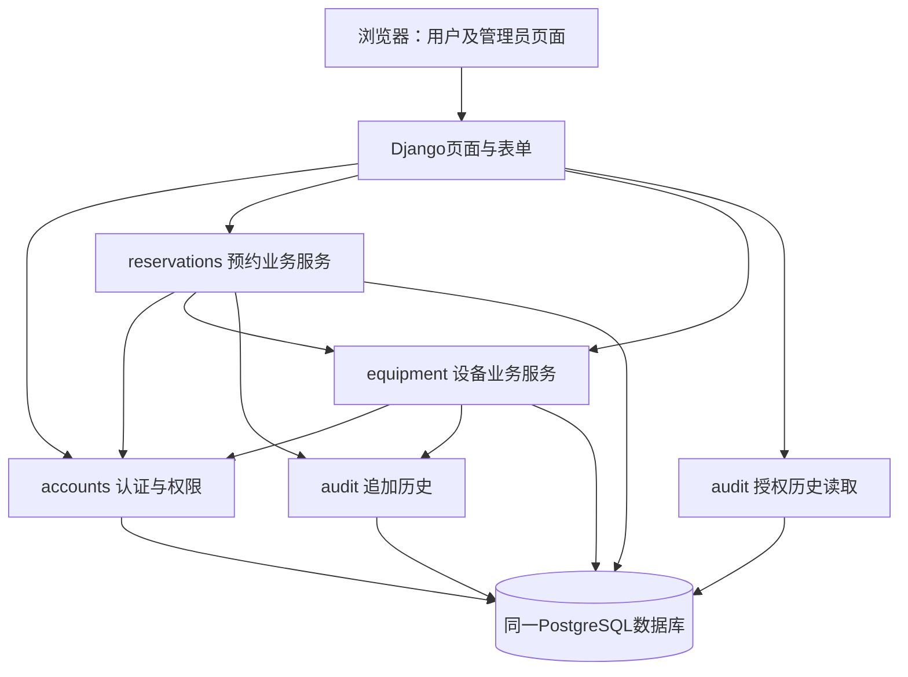

# 实验室设备预约管理系统架构草稿

## 1. 用途、来源和证据边界

本文件是 M2 第一轮Architecture课程交付版。负责人已人工批准定稿；罗思婕和周何馨已分别提交真实审核，意见处置见[审核意见处理记录](../../docs/team/m2-architecture-review-disposition.md)。BMAD原生契约见[ARCHITECTURE-SPINE.md](architecture/architecture-bmad-lab-booking-system-2026-11-05/ARCHITECTURE-SPINE.md)，逐次讨论见[memlog](architecture/architecture-bmad-lab-booking-system-2026-11-05/.memlog.md)，课程五要素决策证据见[根目录decision-log.md](../../decision-log.md)。AD-1～AD-8与ADR-001～ADR-008一一对应，编号稳定。

依据：[定稿PRD](PRD.md)、[Product Brief](product-brief.md)、[根目录决策日志](../../decision-log.md)、[课程基线](../../docs/course-requirements.md)及本次真实Coaching对话。M1材料已读取，原审查与决定不追改。老师2026-11-05通知优先：取消老师阶段门禁和实验B，保留实验A、5ADR、18FR/2NFR及其他未取消课程要求。未来Epic/Story、project-context、两个Sprint与测试证据仍待对应工作流，不在本次生成。

下列ADR记录架构约束、真实候选及取舍，不宣称三位成员共同投票批准。用户明确接受或有条件接受的决定按证据标注；模块命名、候选集合固定、初始化细节等仍为AI实现建议，具体状态见Deferred。未安装或检查本机技术环境，未运行功能、并发、权限或时间测试；补丁版本未固定，本文不构成可复现运行证明。

## 2. 架构形态、模块与数据归属

采用必要分层的模块化单体：同源浏览器页面、一个Django应用进程体系、一个本机PostgreSQL服务。以下模块划分和调用规则是AI细化建议，尚未单独人工确认。

| 模块 | 职责与数据归属 | 允许依赖 |
| --- | --- | --- |
| accounts | 预置账号、会话登录、固定业务角色和归属策略 | Django认证；不依赖预约或设备服务 |
| equipment | 设备主数据、唯一编号、状态维护及设备锁获取 | accounts、audit、公共时间/事务辅助 |
| reservations | 申请、查询、审批、取消、FR-018及冲突规则；拥有预约状态写入 | accounts、equipment、audit、公共时间/事务辅助 |
| audit | 预约与设备状态历史的追加及授权读取；不自行触发业务变更 | 账号/对象关联模型；不调用上游业务服务 |
| 页面与表单 | 参数解析、格式校验、调用服务、模板展示 | 各业务服务；不直接写业务模型 |

箭头表示允许调用方向；equipment不得反向调用reservations，以免循环依赖。设备改状态本身不自动处理预约，受影响预约通过reservations查询和管理员人工取消处理。跨模块操作共享同一外层事务，辅助函数不能提前提交；事务结束及数据构造完成后才渲染模板，不让惰性查询在模板中重新触发业务读取。

核心数据为账号、设备、预约、操作历史。预约关联申请人及具体设备；设备编号唯一且不可变，引用关系阻止业务删除。预约设备和时段不可编辑；状态只有待审核、已批准、已拒绝、已取消、已失效。设备只有可用、维修、停用。无独立占用表、完成状态、异常状态或重开路径。申请时间、申请人、时段保留在预约；处理原因以历史为来源。业务服务对历史只追加和读取，不提供更新或删除。

## 3. 技术版本与Windows部署设计（未安装核验）

| 项目 | 草稿系列约束 | 核验结论与后续事项 |
| --- | --- | --- |
| Python | 3.13.x、标准64位发行 | Django5.2兼容Python3.13；具体补丁及Windows可获取安装包待核验 |
| Django | 5.2 LTS | 维持该LTS系列，补丁在实际安装兼容性确认后固定 |
| PostgreSQL | 17.x | 符合Django5.2要求的14及以上；本机服务与测试均使用该系列 |
| psycopg | 3.x且至少3.1.8 | 仍须选实际支持Python3.13及Windows的补丁；AI建议使用psycopg[binary]以避免本机编译 |
| 时区数据 | zoneinfo使用的tzdata | Windows IANA数据来源须验证；AI建议显式记录并锁定tzdata依赖 |
| 页面 | Django Templates、HTML/CSS、必要JavaScript | 不增加前端构建平台，不引入React/Vue |

官方核验是兼容性文档核对，不等于本机环境验证。安装时记录Python完整版本、Windows版本与架构、PostgreSQL服务器版本、Django/psycopg/tzdata及实际依赖版本。不得把3.13.x或3.x直接当作可复现锁文件；依赖文件及后续project-context应固定同一组实测补丁。Windows安装包、wheel可用性、连接、迁移和第二台机器复现均待后续授权执行。

计划部署：Windows本地Python虚拟环境运行Django，以本地回环连接PostgreSQL；浏览器访问本机runserver。runserver仅用于开发与本机演示，不宣称生产部署。数据库与浏览器不需云服务。无Docker、Redis、Celery、消息队列、微服务、后台扫描和额外部署平台。

初始化设计（AI建议，尚无脚本或命令实现）：

1. 安装约定的64位Python及PostgreSQL；记录安装来源、服务器版本、服务名称、端口和数据库编码UTF-8。
2. 建立venv，按未来锁定依赖安装；可以直接调用虚拟环境解释器，避免依赖PowerShell激活脚本策略。
3. 创建专用业务数据库与非超级用户项目角色；另设独立测试数据库/测试角色，测试角色可在明确隔离的本地实例创建测试库，业务运行角色无需CREATEDB权限。
4. 本地环境变量配置数据库名、用户名、口令、主机端口及Django密钥；仅提交无真实密钥的示例和字段说明，真实配置与数据库导出不入Git。缺少必需配置明确报错，不静默退回SQLite。
5. 执行未来Django迁移并创建预置账号。初始化按固定账号标识幂等创建，重复执行不重置既有口令、角色、预约或历史；检测不一致时报告人工处理。密码由本地配置/交互提供，使用Django密码哈希。
6. 重建仅针对清楚命名的专用演示/测试数据库，明确目标并由操作者显式执行；正常启动绝不自动清库。迁移和账号初始化可重复执行，已有历史不会因重跑丢失。
7. 启动本机runserver；后续README列出新电脑完整步骤与常见服务未启动、端口占用、连接失败排查。当前不创建这些实现或宣称启动成功。

## 4. ADR记录（全部待正式审核）

### ADR-001 / AD-1：技术栈与本机部署

- **背景、关联：** 约58名计划用户、三人课程项目，要求易部署、测试和评审机复现；关联全部FR、NFR-001/002及课程启动要求。
- **真实候选：** Django模板+PostgreSQL；Spring Boot服务端页面；独立前后端；SQLite；Docker/云部署；无Docker本机服务。
- **采用方案：** 用户初步确定Python3.13.x、Django5.2LTS、PostgreSQL17.x、psycopg3.x、模块化单体，Windows+venv，本机runserver限演示；补丁后续实测锁定。
- **被否决方案及理由：** Spring Boot对当前项目没有明显收益；独立前后端增加接口、认证与联调；SQLite不作为本项目正式或并发测试数据库；Docker/云及额外服务增加无需求支撑的部署成本。不是断言这些方案一般不可靠。
- **影响：** 每台评审机需安装和初始化PostgreSQL；不能通过切换SQLite规避部署失败；实际依赖须可复现。binary发行及初始化流程属AI建议待审。
- **可验证性：** 后续按README在另一台Windows机器安装、迁移、初始化、启动；保存完整版本与输出。当前仅官方文档兼容性核验。
- **来源：** 用户技术栈初步方向及本轮Windows版本组合消息；memlog对应direction/version条目。

### ADR-002 / AD-2：会话、业务角色与单一业务入口

- **背景、关联：** FR-001/002、FR-009～017、NFR-002要求服务端角色及归属隔离，查询失效不能成为越权写入入口。
- **真实候选：** Django会话+统一业务服务；复杂自建认证/额外权限框架；页面各自实现规则；Django Admin直接管理业务模型。
- **采用方案：** 用户接受Django认证会话、服务统一权限与事务，管理员用专门页面；预置账号初始化，不开放注册。固定业务角色必须唯一明确，申请人由登录账号确定，不能信任表单账号字段。具体角色存储方式留待审核确认，不由is_staff/is_superuser推导业务管理员。
- **被否决方案及理由：** 自建认证及新框架增加成本；页面分散规则容易不一致；Admin编辑绕过设备锁、失效及历史。AI建议首版不启用Admin URL，用户已决定不把它作为业务入口，但具体关闭方式待审。
- **影响：** 所有入口含直接URL/伪造提交均先授权；学生教师只读/取消本人，管理员不能提交预约；普通占用查询仅返回区间。保留Django会话及CSRF防护，不增加账号管理业务。
- **可验证性：** NFR-002逐项测试直接访问、换对象编号、伪造申请人、普通用户审核维护、管理员申请等；每项检查拒绝、无泄露、业务及历史无变化，合法对照单列。
- **来源：** 用户权限边界及Django Admin明确取舍消息。

### ADR-003 / AD-3：设备行作为一致性互斥点

- **背景、关联：** FR-005/007/008、FR-010～018、NFR-001；只查不存在的冲突预约无法阻止同时插入。
- **真实候选：** 按设备行锁；数据库排斥约束；Serializable及重试；只查后写。
- **采用方案：** 用户接受设备为单位；短atomic事务中设备先锁、预约后更新、历史最后写。所有申请/审批/取消/失效/设备状态变化共用协议，持锁至提交；锁后重读，不使用旧对象。AI建议显式维持Read Committed。多设备按主键升序逐个锁，禁止反向预约先锁再设备。普通只读无无谓写锁。
- **被否决方案及理由：** 只查后写不能保证并发；排斥约束暂不首选，因动态失效仍需统一服务且迁移/异常处理复杂；Serializable重试增加复杂度，暂不采用。排斥约束保留未来复审条件，不声称已实现数据库层重叠约束。
- **影响：** 同设备不同时段短暂串行，不同设备尽量互不阻塞。所有写入口必须守约，直接SQL/Admin绕过无法靠此方案保证。事务不渲染页面、不等待输入、不调用外部服务；不用skip_locked把跳过当空闲。数据库死锁/锁失败回滚并明确报错，不能伪装成冲突或成功，不承诺绝无死锁。
- **可验证性：** 真实独立连接验证20请求竞争和六类交错；另测不同时段及不同设备合法申请。NFR出现数据库错误或无结果仍失败。
- **来源：** 用户按设备加锁选择、六类交错及固定锁顺序讨论。

### ADR-004 / AD-4：锁后唯一业务判定时刻

- **背景、关联：** FR-006/008/010/012～014/018、T-02、NFR-001；锁等待可能跨越开始或结束边界。
- **真实候选：** 请求到达时间、事务开始时间、事务提交时间、锁后实际采样。
- **采用方案：** 用户原则接受：所有相关设备锁取得、状态重新读取后，独立调用clock_timestamp()采样一次t_decision；事务内所有业务时间判断统一使用它。正式运行不可从客户端或普通配置注入。
- **被否决方案及理由：** 请求/事务开始时间可能过期；CURRENT_TIMESTAMP固定为事务开始时间，不适合作等待后的时钟；要求提交前完成增加边界实现复杂度。用户明确不以提交时间判断。
- **影响：** 判定尚未开始且其他条件满足、提交成功，即使提交跨开始仍有效；判定已到开始且仍待审核则只能失效。已批准不按FR-018失效，管理员可在判定尚未结束时取消。提交失败全部回滚且不返回成功。
- **可验证性：** 开始前/相等/之后的可控时间规则测试；真实数据库等锁跨开始及判定后提交跨开始测试，保存实际时间和状态；不要求线程偶然精确命中相等。
- **来源：** 用户t_decision补充约束及T-02指定覆盖消息。

### ADR-005 / AD-5：授权范围内按需失效与查询事务

- **背景、关联：** FR-002/004/007～009/011/018、NFR-001/002；查询可能写状态，不能越权、遗漏历史或误锁全系统。
- **真实候选：** 周期后台扫描；只在页面显示虚拟失效而不落库；跨设备逐个提交；一个范围内短事务整体提交。
- **采用方案：** 用户有条件接受一个请求一个短事务一个t_decision；先授权和范围限定，仅锁相关待审核记录所属设备；锁后检查、失效与历史一起提交，动态状态筛选在失效后。本人仅本人；设备占用仅目标设备/日期；管理员按本次实际范围，不顺便扫描无关设备。
- **AI细化待审：** 进入查询时按授权和稳定过滤条件固定本次候选记录ID及其设备，候选中有待审核记录的设备按序锁定；重读只处理固定候选，不把并发新增的未锁设备记录扩进结果。结果体现本次候选范围及判定时刻，不承诺全库瞬时快照；下一次访问可见新申请。候选中待审核即使当时尚未到点也需锁后判断，不能凭锁前时间跳过。尚未结束/有效/待审核等动态过滤在收尾后执行，已结束的待审核候选也须失效。无待审核候选则无额外设备锁。
- **被否决方案及理由：** 后台扫描在范围外；虚拟显示不满足持久化历史；逐设备提交产生多个判定时刻及部分提交；无条件锁全部设备造成无关等待。管理员主动查全部时相关设备仍可能很多，用户已接受该边界，不偷偷截断或新增分页承诺。
- **影响：** 查询失败可能整体回滚；合法失效后批准/取消业务拒绝仍需提交失效和历史，不能通过抛出导致整笔回滚的异常表达该拒绝。未授权请求不更新业务状态或业务历史。批量查询所持设备锁随相关范围增长。
- **可验证性：** 多设备多归属和多状态列表；未授权访问到期记录不改数据；已结束待审核收尾；并发新记录不混入未锁结果；重复访问不重复失效；无关设备操作不被人为设备锁阻塞。
- **来源：** 用户查询范围有条件接受及历史设计确认；候选冻结是本草稿AI实现建议，待审核。

### ADR-006 / AD-6：当前状态与追加式历史共同提交

- **背景、关联：** FR-009/012～018，NFR-001/002；原因及历史必须可查，不能因简化遗漏操作者或系统失效依据。
- **真实候选：** 当前状态+独立操作历史；单独占用表；仅覆盖最后原因；记录每次普通查询/失败；完整事件溯源。
- **采用方案：** 用户接受预约当前状态加独立历史，无占用表。每次实际审批、拒绝、取消、失效及设备状态变化写历史。每条历史记录必须关联且只关联一个实际存在的预约或设备；对象类型须与关联对象一致，不得有无效或悬空关联。预约、设备和操作历史不得通过正常业务操作物理删除。数据库必须提供相应关联完整性约束；具体数据模型可在后续设计中选择可靠实现，不在本轮预定两个可空外键或其他特定方案。最小字段：对象类型/编号、动作、前后状态、执行者类型与账号、适用原因、t_decision、实际变更记录时间。系统失效执行者为系统，原因固定“开始时间已到仍待审核”，不冒充触发用户的人工操作。预约创建保留申请人/设备/时段/申请时间。
- **被否决方案及理由：** 占用表增加同步副本；只存最后原因不能追溯；普通查询/无变化失败历史没有当前需求；事件溯源增加无必要复杂度（AI备选，不冒充用户曾逐项否决）。
- **影响：** 原因从历史读取，不另设可独立修改的重复原因。历史时间不声称提交时间，不倒填成预约开始时间。数据库关联完整性约束须确保历史记录恰好指向一个有效预约或设备且对象类型相符；具体约束形式留待数据模型设计。无业务物理删除及历史编辑接口；状态与历史写入任一步或提交异常一起回滚；重复失效不重复写历史。设备故障仅改变设备状态，原预约保留，由管理员按FR-014处理。
- **可验证性：** 检查每次真实转换历史数量、主体/前后状态/原因；拒绝和管理员取消空原因不执行动作；模拟历史写入和提交异常；失效+业务拒绝正常提交；设备维修/恢复不复活或自动取消预约。
- **来源：** 用户明确接受最小历史方案及四项保留原则；2026-11-10用户接受本ADR补充，理由为支持FR-015追溯、保持单对象关联及控制复杂度，具体数据库实现延后至数据模型设计。

### ADR-007 / AD-7：带时区时间点与北京时间业务规则

- **背景、关联：** FR-004/006～014/018、T-02，PRD第3节已固定Asia/Shanghai。
- **真实候选：** 带时区时间点、统一转换；直接保存无时区北京时间；依赖主机/浏览器时区解释。
- **采用方案：** 用户接受USE_TZ=True、TIME_ZONE=Asia/Shanghai；输入服务端按该时区解释并校验，同日/整点/至少1小时/23:00上限后转换；PostgreSQL timestamptz保存时间点，比较使用一致基准；所有页面显示北京时间。
- **被否决方案及理由：** 无时区值让含义依赖入口/服务器配置；浏览器本地解释可能改变业务日期和失效结论。用户明确否决直接保存无时区北京时间。
- **影响：** timestamptz内部统一时间点，不存原始时区名称，工具显示受会话时区影响；证据含UTC偏移/时区标签。不得对UTC值直接截日期当业务日期，不截断t_decision到整点。新申请开始严格晚于判定；22:00～23:00合法，23:00～次日00:00拒绝；相邻区间无冲突，跨设备同人同时预约允许。
- **可验证性：** 10点保存重读仍显示10点；同日/整点/23点边界；主机与数据库会话异时区；开始相等失效及对应历史。Windows的IANA时区数据依赖待核验。
- **来源：** 用户统一时区取舍及五类测试取证要求。

### ADR-008 / AD-8：真实数据库与双层时间验证

- **背景、关联：** NFR-001/002、FR-008/018、T-01～04及课程真实证据要求；设计推导不能当测试结果。
- **真实候选：** 仅模拟时间；依靠线程碰巧命中整点；SQLite替代事务测试；可控规则时间+真实PostgreSQL集成。
- **采用方案：** 用户接受双层验证：单元测试用测试专用时间精确验证前/等/后；真实PostgreSQL独立连接验证锁、时钟、提交及回滚。NFR-001标准竞争与边界交错分组，NFR-002合法对照和未授权分母分开。技术负责人实现/运行，周何馨跟踪T-02设计，未指定技术负责人姓名。
- **被否决方案及理由：** 仅模拟不能证明锁/数据库行为；线程碰巧相等不稳定；SQLite不能替代本方案的真实PostgreSQL验证；不改系统时钟、不新增时间管理或后台扫描。
- **影响：** 测试库与业务库分离；规则时间控制不暴露给接口或普通配置。纯单元测试不声称证明回滚；集成需要实际数据库。采用TransactionTestCase等适合事务验证的方式，不能让普通TestCase外层事务掩盖锁使用错误。
- **可验证性：** 第6节验证计划；保存机器/版本/输入/启动分布/判定时刻/预期实际/最终数据历史。所有结果待运行，不添加性能/稳定性阈值。
- **来源：** 用户双层验证最终取舍及本轮测试数据库约束。

## 5. 关键运行协议与边界推演（不是测试结果）

申请服务：授权→锁设备→重读→采样→相关待审核失效→检查设备可用与FR-006→按startA < endB且startB < endA检查有效预约→创建待审核→提交。相同/交叠/包含均拒绝，相邻允许；同设备不同时段等待后仍按规则成功，不因串行错误判冲突。唯一编号和必要外键/字段完整性约束由数据库承担，但重叠规则主保证来自统一设备锁协议。

处理服务：授权和归属→锁设备→重读→采样→目标待审核按需失效→按当前状态执行动作。取消先成功则批准不复活；批准先成功后取消仍按本人开始前/管理员结束前条件。已批准开始后只能管理员在结束前取消，不能用拒绝撤销。

设备服务：授权→锁设备→重读→采样→修改设备状态与历史→提交。停用先提交则后续申请/批准拒绝；申请先成功则保留，查询同时展示设备当前状态，管理员人工处理；恢复不复活终态。设备描述修改不得从旧表单回写旧状态。

异常：业务拒绝若已发生合法失效，正常提交该转换后返回拒绝；数据库异常/提交失败从事务边界外处理，全部回滚、不给成功响应。未知结果需明确失败/待核查，不自动重试创建造成重复；不增加业务幂等承诺。短事务和固定顺序降低死锁风险，不声称数据库永不死锁。

## 6. FR/NFR一致性核对及验证计划

以下为AI文档核对与待运行计划，不是成员正式审核或测试报告。18条FR、2条NFR编号及目标未改。

| 需求 | 架构落点 | ADR | 后续验证重点 |
| --- | --- | --- | --- |
| FR-001 | accounts/预置初始化 | 001、002 | 有效无效凭据与会话访问，无注册 |
| FR-002 | 服务权限、归属、字段投影 | 002、005 | 直接访问/换ID，拒绝无泄露无业务变更 |
| FR-003 | equipment查询 | 001、002 | 编号名称类别位置说明和三种状态 |
| FR-004 | reservations设备日期占用 | 003、005、007 | 失效后占用、相邻、隐私、空闲不保证提交 |
| FR-005 | reservations申请 | 002、003、004 | 本人关联、成功待审核即时占用、失败原因 |
| FR-006 | 时间校验及clock | 004、007 | 整点同日至少1小时23点上限、未来及严格晚于判定 |
| FR-007 | 设备锁内冲突查询 | 003、005、007 | 相交包含拒绝、相邻及同人跨设备允许 |
| FR-008 | 所有状态写入统一协议 | 003、004、005 | 六类交错、无复活、停用先后、不承诺公平 |
| FR-009 | 本人查询与原因投影 | 002、005、006 | 本人全部历史、预约和设备当前状态分开 |
| FR-010 | 本人取消 | 002、003、004、006 | 本人、开始前、待审核/批准；到点拒绝 |
| FR-011 | 管理员查询及设备筛选 | 002、005 | 先失效后筛选目标设备尚未结束有效记录，完整历史可查 |
| FR-012 | 批准 | 003、004、006 | 开始前、待审核、设备可用、不重复创建 |
| FR-013 | 拒绝 | 003、004、006 | 开始前待审核、非空原因、释放与申请人可见 |
| FR-014 | 管理员取消 | 002、003、004、006 | 待审核开始前/批准结束前，必须原因 |
| FR-015 | audit共同事务 | 002、006 | 主体/时间/对象/前后状态/原因、恰好关联一个存在且类型相符的预约或设备、数据库关联完整性、禁止删除 |
| FR-016 | equipment主数据 | 002、003、006 | 重复编号拒绝、编号不改、无物理删除、关联保留 |
| FR-017 | 设备状态维护及人工处置 | 003、006 | 禁新申请/批准、保留既有预约、恢复不复活、无自动处罚 |
| FR-018 | 范围失效、clock与audit | 003～008 | 已结束待审核收尾、相等边界、重复不重复、未授权不改、历史关联完整 |
| NFR-001 | PostgreSQL并发集成 | 003、004、008 | 20请求×10轮每轮恰好1成功19冲突；边界交错另组 |
| NFR-002 | 真实角色/归属权限用例 | 002、005、008 | 所有未授权三项断言通过率100%；合法对照单列 |

NFR-001标准夹具：设备可用、每轮无有效冲突，合法未来同设备同区间，20已登录授权请求通过统一启动点且各用独立连接，记录实际启动分布；10轮用隔离数据。查询及数据库最终记录核对恰好1条待审核占用、19个明确冲突；全部拒绝、异常、无返回均不达标。不得复用同一连接把并发悄悄变串行。容量/连接配置需满足实际运行，不先给未经测量的性能承诺。

T-02：单元规则用可控时间精确覆盖开始前/等/后、已批准结束边界；真实数据库覆盖等锁跨开始、锁后采样、判定后提交跨开始、异常状态历史共同回滚、合法失效后审批拒绝仍保留。测试可协调执行顺序，不修改系统时钟、不让普通配置替换正式时间来源。证据明确区分模拟时间与真实采样。

NFR-002：学生甲/乙、教师、管理员及未登录，覆盖详情/占用/取消/审核/维护/筛选/历史/管理员提交。每个未授权用例同时满足拒绝、无受限详情泄露、预约设备占用及业务历史不变，分母为列明的未授权用例总数，目标100%；合法对照单独成功。Django会话技术数据不等同于业务状态，但不得以此为借口漏查业务失效写入。

跟踪：周何馨跟踪T-01交错场景、T-02时间取证、T-03成对权限案例、T-04稳定竞争与边界组隔离，具体技术实现由后续实际技术负责人完成；不虚构已分派姓名或运行结果。原节点保留：T-01相关Story ready前，T-02相关ADR批准/边界用例确定前，T-03权限设计验收前，T-04并发首次运行前。

核对结论：设计方向覆盖18FR/2NFR，无意图上的新增FR/NFR。尚存实现风险为所有写入口守约、查询候选范围、提交异常、Windows实际依赖安装及权限矩阵完整性，需成员审核和真实测试后判断，不能据文档覆盖宣布达标。

## 7. Deferred与后续验证

- R-01：AI建议的accounts/equipment/reservations/audit模块和调用方向、角色唯一表示方式需确认；不新增权限框架。
- R-02：固定查询候选ID、不扩入并发新记录的范围语义需确认；若未来要求强全局快照或分页，再评估锁范围，不能静默改成全库串行。
- R-03：psycopg[binary]、tzdata、非超级用户业务角色/独立测试角色、初始化幂等不覆盖密码与历史是AI实现建议，待审核；补丁及安装包/wheel待实机核验。
- R-04：历史字段与FR-015/018对应、系统执行者、两种时间、业务拒绝提交与数据库异常回滚需两位成员重点检查。
- R-05：首版不启用Admin URL是AI建议，已确认的是“不承担业务操作且不开放直接编辑”，不虚构已批准具体关闭方式。

当前不生成project-context、Epic/Story、Sprint或代码，不执行实验A但保留其真实条件；不做实验B。生产服务器、云/容器、性能可用率指标、排斥约束和复杂优化不在本轮；只有出现真实需求/风险并经团队确认才复审。

## 8. Finalization与核验边界

2026-11-10负责人已人工核对最终审查并批准本Architecture定稿。最终Reviewer Gate包括spine lint（0项发现）、rubric walker、技术现实性审查及adversarial lens；未发现Critical或High。原中等问题“历史记录对象关联不明确”由人工接受的D-012及AD-6/ADR-006补充解决。审核意见逐项处理见[处理记录](../../docs/team/m2-architecture-review-disposition.md)。

本轮未安装环境、未运行软件或测试；T-01～T-04维持未完成。不得把Reviewer Gate、文档映射或课程核对写作软件测试通过。

## 9. 官方核验来源与Git证据

2026-11-05本轮通过以下官方文档核验，主版本系列有兼容依据，未宣称本机可用，网页当前补丁号不作为已固定版本：

- [Django5.2与Python兼容](https://docs.djangoproject.com/en/5.2/faq/install/)：支持Python3.13。
- [Django5.2数据库后端](https://docs.djangoproject.com/en/5.2/ref/databases/)：PostgreSQL14+，psycopg3.1.8+；Read Committed及连接设置。
- [Django支持周期](https://www.djangoproject.com/download/)：5.2为LTS，具体补丁安装时重新核验。
- [psycopg官方安装](https://www.psycopg.org/psycopg3/docs/basic/install.html)：Windows/Python3.13/PostgreSQL17支持范围及binary安装方式。
- [PostgreSQL17支持政策](https://www.postgresql.org/support/versioning/)、[Windows安装入口](https://www.postgresql.org/download/windows/)：本机安装仍待执行。
- [PostgreSQL17行锁](https://www.postgresql.org/docs/17/explicit-locking.html)、[隔离级别](https://www.postgresql.org/docs/17/transaction-iso.html)、[时间函数](https://www.postgresql.org/docs/17/functions-datetime.html)、[时间类型](https://www.postgresql.org/docs/17/datatype-datetime.html)。
- [Django时区](https://docs.djangoproject.com/en/5.2/topics/i18n/timezones/)、[Python3.13 zoneinfo](https://docs.python.org/3.13/library/zoneinfo.html)：Windows时区数据应实际检查。
- [Django行锁与事务测试注意](https://docs.djangoproject.com/en/5.2/ref/models/querysets/#select-for-update)、[认证](https://docs.djangoproject.com/en/5.2/topics/auth/default/)、[Windows安装](https://docs.djangoproject.com/en/5.2/howto/windows/)。

草稿生成前只读获取的本地HEAD为[cca8aa7](https://github.com/yatongwu578-hub/bmad-lab-booking-system/commit/cca8aa7c60de7a0e3853e91ee58e1472dda7304c)，origin配置为本项目GitHub URL；未联网验证该提交可达性。M1第二轮证据提交为[63d6fac](https://github.com/yatongwu578-hub/bmad-lab-booking-system/commit/63d6fac8bb815412e2a2e82c058748a5b9e54a97)。本次架构草稿未提交，不能提供其Git提交链接。负责人检查并自行提交后，再由罗思婕、周何馨正式审核。
