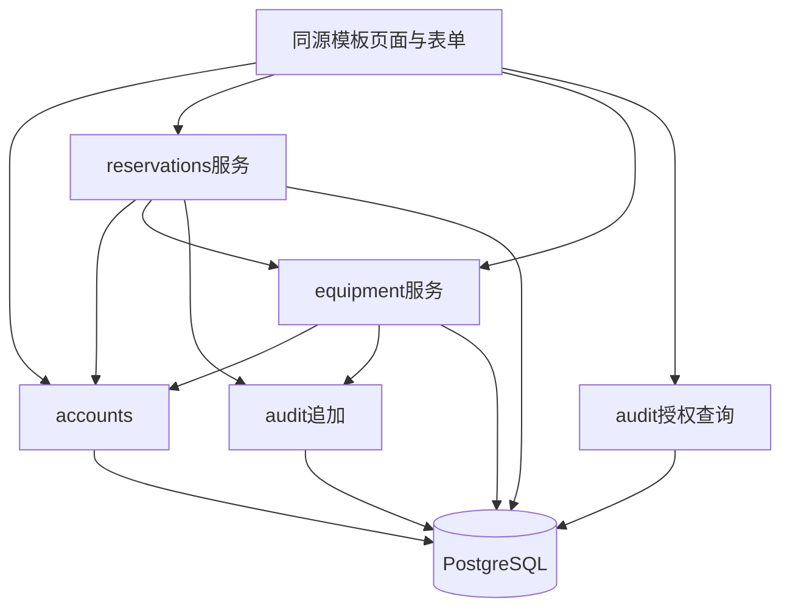
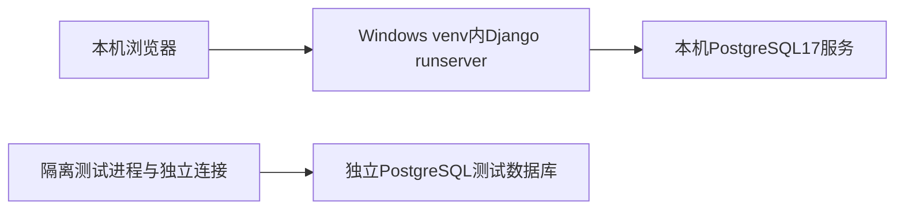
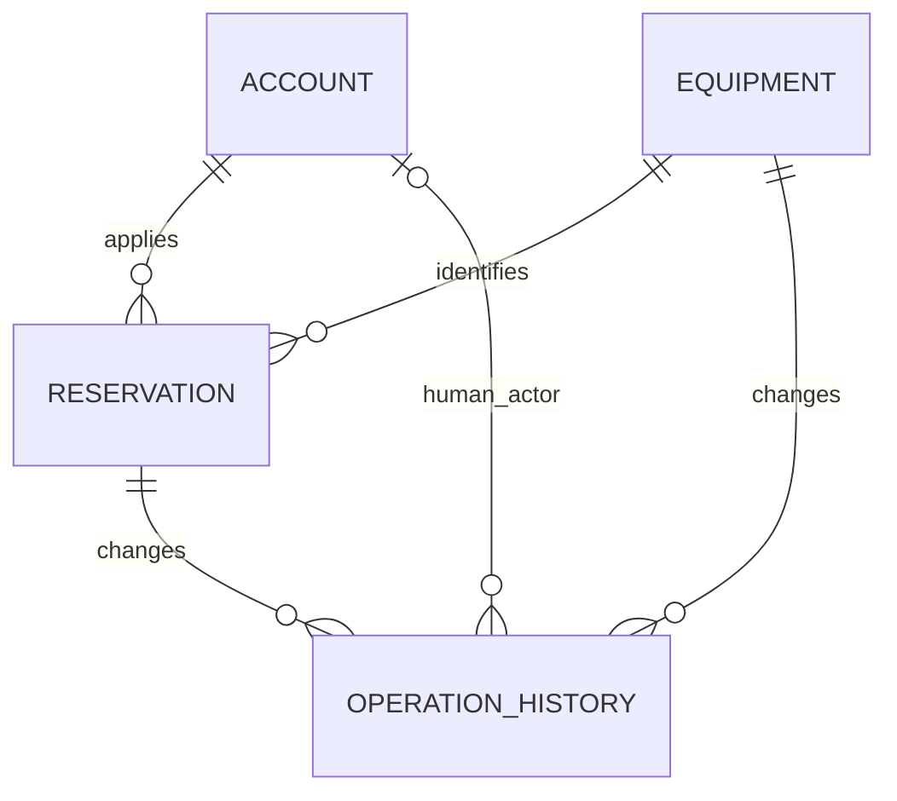

# Architecture Spine — 实验室设备预约管理系统

本文件是讨论产物的draft收敛稿；AD-1～AD-8对应课程稿ADR-001～008。方向已有用户逐项反馈，但整稿尚未由负责人及两位成员正式审核，不标记正式ADOPTED，不作为立即开发授权。理由、备选和证据见[memlog](.memlog.md)及[课程稿](../../architecture.md)。AI实现细化须按Deferred确认。

## Design Paradigm

分层模块化单体：页面/表单→业务服务→Django ORM→同一PostgreSQL。模块候选为accounts、equipment、reservations、audit；目录与角色表示是AI建议待审，尚无代码。

调用方向不可反转；equipment不调用reservations服务。设备状态变化不自动更改预约，受影响预约由管理员从预约查询入口人工处理。辅助服务加入调用方事务，不提前提交。页面不得直接写业务状态或在渲染中延迟执行业务查询。

## Invariants & Rules

### AD-1 — 模块化单体和本机PostgreSQL

- **Binds:** all；课程可复现启动要求。
- **Prevents:** 前后端重复规则、不同数据库行为及演示环境漂移。
- **Rule:** Python3.13.x、Django5.2LTS、psycopg3.x、PostgreSQL17.x，Django Templates+HTML/CSS/必要JavaScript，Windows64位venv及本机数据库。业务与并发集成都用PostgreSQL。补丁安装核验后统一固定，当前未安装验证。runserver仅开发/本机演示；无Docker、云、Redis、Celery、队列、微服务及周期任务。

### AD-2 — 服务端权限和单一业务入口

- **Binds:** FR-001/002、FR-009～017、NFR-002。
- **Prevents:** 换对象越权、Admin直写、普通查询触发越权失效。
- **Rule:** 使用Django会话与预置账号；页面调用统一业务服务。先验证角色和归属，再执行任何业务写入，锁后复核。学生教师仅管理本人；管理员不申请。占用响应不含他人详情。业务角色不由staff/superuser自动豁免；Admin不提供预约/设备/历史业务编辑，历史不可手改。账号初始化不增加注册或账号管理功能。

### AD-3 — 设备先锁、状态和历史同事务

- **Binds:** FR-005/007/008/010～018、NFR-001。
- **Prevents:** 重叠插入、取消后复活、申请与停用无序、状态历史部分保存。
- **Rule:** 申请、审批、拒绝、取消、失效和设备状态维护共用显式短事务；先锁设备，再读/改预约，再追加历史。锁后重读，禁止旧对象覆盖。多设备按稳定主键升序逐个锁；禁止先锁预约后设备。Read Committed为AI配置建议。持锁至提交，不等待用户/外部调用/模板渲染。数据库异常或提交失败全部回滚且不返回成功；不把锁失败伪装为业务冲突。不使用skip_locked推断空闲。没有数据库排斥约束防线的承诺。

### AD-4 — 锁后唯一t_decision

- **Binds:** FR-006/008/010/012～014/018、T-02。
- **Prevents:** 等锁使用旧时间、失效与审批采用不同判定时刻。
- **Rule:** 取得本操作全部设备锁并重读后，单独采样一次PostgreSQL clock_timestamp()；本次业务判断复用t_decision，不采用请求、事务开始或提交时间。若判定早于开始且合法、提交成功，提交跨开始仍有效；待审核判定已到开始只能失效，不能批准/拒绝/取消。已批准不被FR-018失效，管理员取消须判定尚未结束。正式时间不得由客户端或普通配置替换。

### AD-5 — 授权范围内查询失效

- **Binds:** FR-002/004/007～009/011/018、NFR-001/002。
- **Prevents:** 无关全库锁、漏掉已结束待审核、未授权失效写入、多个判定时刻。
- **Rule:** 一次查询一个范围内短事务及一个t_decision；只处理授权相关记录，只锁其中涉及待审核的设备。锁后失效和历史整体提交，再做待审核/有效/尚未结束动态筛选。本人仅本人、占用仅目标设备日期、管理员仅实际查询范围。管理员全范围查询可能涉及多设备，不能伪称绝无广泛等待。AI候选实现固定初始授权记录ID、锁其待审核设备、重读不扩入并发新记录；无待审核则不额外加设备锁。失效后的审批业务拒绝保留失效与历史，数据库异常则回滚。重复访问不重复转换。

### AD-6 — 状态、历史和人工故障处置

- **Binds:** FR-009/012～018、NFR-001/002。
- **Prevents:** 重复占用副本、原因丢失、系统失效伪作人工操作、故障自动取消。
- **Rule:** 预约保留申请人/设备/时段/申请时间/当前状态，不另维护占用表。真实审批/拒绝/取消/失效和设备状态变化与历史同事务。历史包含对象类型与ID、动作、前后状态、执行者类型与账号、适用原因、t_decision与实际记录时间；系统失效原因为“开始时间已到仍待审核”，执行者为系统。拒绝和管理员取消原因非空。无变化失败和普通查询不写转换历史；历史只追加授权读取，原因从历史读取。设备维修停用禁新申请/批准，不自动取消既有预约；恢复不复活终态。业务不物理删除设备/预约/历史。

### AD-7 — 时间点存储与Asia/Shanghai业务日

- **Binds:** FR-004/006～014/018、T-02。
- **Prevents:** UTC日期错作业务日、无时区混比、浏览器改变日期。
- **Rule:** USE_TZ=True、TIME_ZONE=Asia/Shanghai；服务端按该时区解释输入、判断同日/整点/至少1小时/结束不晚于23:00、开始严格晚于t_decision。存timestamptz时间点，一致基准比较，页面显示北京时间；证据带时区偏移。相交判据startA < endB且startB < endA，首尾相接不冲突；同人跨设备允许。不提供编辑/重开及跨日预约。

### AD-8 — 双层验证与真实结果分离

- **Binds:** NFR-001/002、FR-008/018、T-01～04。
- **Prevents:** SQLite替代并发、模拟时间冒充实钟、全部拒绝掩盖错误、设计冒充通过。
- **Rule:** 纯规则单元用测试专用可控时间；真实PostgreSQL独立连接集成验证锁后采样/等待跨界/判定后提交跨界/异常回滚及合法失效后业务拒绝仍提交。标准竞争20请求×10轮，各轮1成功19冲突、1条待审核有效占用；无结果或异常失败。权限未授权用例拒绝+无泄露+无业务变化须100%，分母明确、合法对照单列。时间交错与标准竞争分组。保存输入、启动分布、环境版本、判定时间、预期实际、最终数据历史。不得改系统时钟或开放模拟时间接口；当前均未运行。

## Consistency Conventions

| Concern | Convention |
| --- | --- |
| 设备及预约标识 | 设备唯一编号不可修改；预约关联具体设备和当前申请人，不自动同型号分配 |
| 状态 | 设备可用/维修/停用；预约待审核/已批准/已拒绝/已取消/已失效；终态不重开 |
| 时间 | 内部带时区时间点，业务与显示Asia/Shanghai，保留判定时刻精度 |
| 结果 | 明确区分业务拒绝和数据库异常；提交前不返回成功，用户看到的空闲不保证稍后提交 |
| 数据所有权 | reservations唯一拥有预约状态写入；equipment拥有设备状态；audit由同事务追加 |
| 原因及隐私 | 普通用户仅FR-009原因和本人内容；管理员完整授权历史；占用查询只投影区间 |
| 配置 | 真实口令和密钥不入Git；缺配置不静默退回SQLite；测试与业务数据库分离 |

## Stack

当前只有系列选择和官方文档兼容依据，尚无实机验证与补丁锁定。不是最终可复现依赖清单。

| Name | Version |
| --- | --- |
| Python | 3.13.x，补丁待安装核验 |
| Django | 5.2 LTS，补丁待安装核验 |
| PostgreSQL | 17.x，补丁待安装核验 |
| psycopg | 3.x且至少3.1.8，实际Python3.13/Windows发行待核验 |
| Windows | 64位，具体系统版本待记录 |
| tzdata | Windows时区数据候选依赖，补丁待核验 |

## Structural Seed

ER图为关联概念，不规定通用外键实现；历史必须关联到真实预约或设备，系统执行者可无账号。原始外键及校验形式待实现设计，不允许悬空对象。

初始化候选：venv和锁定依赖→专用数据库与角色→本地秘密配置→迁移→幂等预置账号→本机演示。重复初始化不覆盖既有密码/角色/历史；重建只针对操作者明确指定的隔离数据库。业务角色非超级用户，独立测试角色权限仅限测试用途；这些实施细化待审核。

## Capability → Architecture Map

| Capability / Area | Lives in | Governed by |
| --- | --- | --- |
| FR-001/002 | accounts、全部服务边界 | AD-1/2/5/8 |
| FR-003 | equipment查询 | AD-1/2 |
| FR-004 | reservations占用查询 | AD-2/3/5/7 |
| FR-005～008 | reservations申请与冲突 | AD-2/3/4/5/7/8 |
| FR-009/010 | reservations本人查询取消 | AD-2/3/4/5/6/7 |
| FR-011～014 | reservations管理员页面与服务 | AD-2/3/4/5/6/7 |
| FR-015 | audit、各写入服务 | AD-2/3/6 |
| FR-016/017 | equipment维护、reservations人工处置查询 | AD-2/3/6 |
| FR-018 | reservations失效、clock、audit | AD-2/3/4/5/6/7/8 |
| NFR-001/002 | 隔离PostgreSQL测试设计 | AD-2/3/4/5/8 |

## Deferred

- 正式审核及Finalize：负责人检查、提交后两位成员审核；本次无Reviewer Gate执行或批准结论。
- AI实现建议待确认：模块调用方向与角色表示、固定查询候选集合语义、Admin URL关闭方式、binary/tzdata、数据库角色和初始化重置细节。对应课程稿R-01～05，不默认为人工批准。
- 补丁锁定、Windows安装包及wheel、数据库初始化与第二台电脑复现：后续获准环境验证后记录；当前不得据本稿宣称可运行。
- 实际单元/集成/权限/NFR运行与证据：技术负责人实现运行，周何馨跟踪T-02及既有质量待办；没有结果。
- Epic/Story、project-context、Sprint、实验A按后续独立工作流执行，不在此创建；实验B取消。
- 生产部署、云/容器、排斥约束、全局快照/分页和性能优化：出现真实需求或风险再由团队决定；不增加FR/NFR承诺。