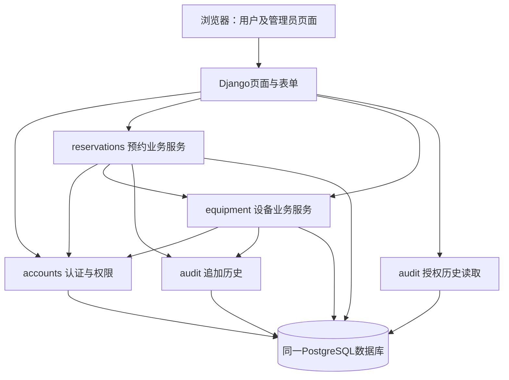

# 实验室设备预约管理系统 - Epic/Story拆分草稿

## 概述

Step-01需求清单及Step-02三个Epic、依赖顺序、FR映射、NFR落实和T-01～T-04安排已获负责人明确批准。负责人已正式批准Epic 1～3故事设计完成检查及Step-03结束，并允许进入Step-04。Step-04首次发现的FR-015批准历史验收覆盖问题已按负责人授权补齐2.5 AC-6及2.6 AC-1并完整复核，当前开放问题为0，等待负责人审核本次复核结果，详见[Step-04验证报告第9节](epics-step-04-validation.md#9-v-01修复及第二次完整step-04复核当前结果)。Story 1.1～1.4、2.1～2.8和3.1均保持draft；不代表三名成员共同表决、团队审核已完成或软件已通过测试，不执行Finalize。

## 需求清单

### 功能需求

## 4. 功能需求

FR 全局编号保持稳定，后续重排章节不重编号，删除后不复用。以下均为本轮范围内需求，供独立审核；测试断言描述预期行为，不代表测试已执行。

### 4.1 登录与访问控制（UJ-1、UJ-2、UJ-3）

#### FR-001 预置账号登录

三类角色通过预置账号登录，成功后获得对应角色权限；无效凭据不能访问受保护业务。不提供自主注册。

#### FR-002 执行角色和归属权限

所有业务访问均执行上表权限。学生或教师即使直接指定他人的预约记录，也不能读取其受限详情或取消；普通用户不能审核或维护设备，管理员不能提交预约。拒绝未授权操作时不得改变业务数据。

### 4.2 设备与占用查询（UJ-1、UJ-2）

#### FR-003 查看设备列表与详情

登录用户可查看设备唯一编号、名称、类别、位置、说明及当前状态，区分可用、维修和停用设备。

#### FR-004 查询设备日期内的占用时段

登录用户选择设备和日期后可查看有效占用时段，区分被占用与可申请时间。按 FR-018 检查相关待审核申请；已拒绝、已取消、已失效预约不阻止新申请。展示空闲不保证稍后提交必定成功。普通用户查询他人占用时不显示其预约详情。

### 4.3 申请与冲突（UJ-1、UJ-2）

#### FR-005 提交具体设备预约

学生、教师为一件具体设备选择日期、开始时间和结束时间后提交，申请关联当前本人账号。成功后生成可查询的待审核预约并立即占用；失败须说明冲突、时间无效、设备不可用或权限不足等对应原因，不产生有效占用预约。

#### FR-006 校验预约时间

允许今天尚未开始的时段及未来日期，不设置额外提前天数或开放时段限制。开始、结束均为整点，同一自然日内结束，至少 1 小时，结束不晚于该日 23:00；开始严格晚于提交判定时刻。

可转化为断言的边界：未来日期 10:00–11:00、22:00–23:00合法；10:30–11:30、起止相等、开始已到或已过、23:00–次日00:00均拒绝。

#### FR-007 阻止重叠有效占用

提交时按 FR-018 检查相关待审核记录的失效条件，再按第 3 节冲突定义判断有效占用，冲突则拒绝；时间检查、状态更新和冲突判断必须保持一致。同设备 10:00–11:00 与 11:00–12:00可同时存在；相同、部分相交、包含或被包含的区间均冲突。

同一用户可以在同一时间段预约不同设备；冲突仅按具体设备唯一编号及有效预约时间判断，不增加人级重叠限制。

#### FR-008 在并发和状态变化下保持冲突规则

并发提交不能绕过 FR-007。申请与停用、批准与取消等操作交错时，结果必须符合某一先后顺序下的业务规则，不能覆盖已发生的取消或产生重叠有效占用。页面先前显示可用，提交时已不可用，须拒绝；停用后保留此前成功预约供人工处理。

按需失效检查与批准、拒绝、取消及冲突判断交错时，同样遵守此规则。判定时刻已到开始时间的待审核记录只能进入已失效，不能批准、拒绝或改为已取消；已批准记录不适用待审核失效规则。具体事务、锁、数据库及并发实现留待架构阶段。

不额外承诺严格先到先得或同时竞争请求的优先顺序；不增加候补、排队或优先级机制。有效合法竞争仍须满足 NFR-001 每轮恰好1个成功的目标，不能以不承诺公平性为由全部拒绝。

### 4.4 我的预约与取消（UJ-1、UJ-2）

#### FR-009 查询本人预约及处理结果

学生、教师可查询本人全部预约及设备、时段、当前状态；拒绝或管理员取消的原因在系统内可见。历史记录不因时间经过或设备停用而消失，不依赖外部通知。

查询时按 FR-018 检查本人相关待审核记录，符合条件时返回已失效这一最终状态，并保留原设备、时段和申请历史。

本人预约列表/详情须同时显示设备当前状态（可用、维修或停用）和预约状态，二者明确区分；设备状态不是申请时的历史快照。设备维修或停用时不能仅以预约“已批准”暗示设备仍可用；不自动将已批准预约改为异常、取消或失效。验收：同一已批准记录在设备改为维修/停用后查询，预约状态保留且设备当前状态更新，其他用户仍不能读取其详情。

#### FR-010 取消本人尚未开始的预约

学生、教师仅可将自己尚未开始的待审核或已批准预约改为已取消，成功后释放对应占用并保留历史。到达开始时间后不得取消；已拒绝、已取消或已失效不能再次转为有效占用。

### 4.5 管理员审核与处理（UJ-3）

#### FR-011 查询申请和预约详情

管理员可查看待审核申请及全部预约详情，包括申请人、设备、时段、状态和已有处理原因，支持人工处理长期待审核申请及停用影响。

查询及处理前按 FR-018 更新符合条件的待审核记录，不把已到开始时间的申请继续返回为可审核。

管理员可按具体设备编号筛选受影响预约，查看该设备尚未结束的待审核及已批准记录，以处理维修和停用影响；先按 FR-018 检查失效条件再返回结果。验收：准备多设备、多状态及已结束记录，筛选结果仅含目标设备且尚未结束的有效记录，符合失效条件的待审核记录转为已失效而不继续混入待处理结果；管理员仍可按原权限查询完整历史。普通用户不能使用此入口获取他人受限详情。

#### FR-012 批准待审核预约

管理员仅可批准尚未开始且设备当前可用的待审核预约，状态改为已批准，占用持续、不重复创建预约。维修或停用期间不得批准，恢复可用后仍须满足尚未开始等条件；已拒绝、已取消、已失效或已批准不能再次批准。处理时重新判定时间，不能依据页面旧状态批准已到开始时间的待审核申请。

#### FR-013 拒绝待审核预约

管理员仅可拒绝尚未开始的待审核预约，必须填写非空原因；成功后改为已拒绝并释放占用，申请人可见原因。到达开始时间后按 FR-018 转为已失效，不能再批准或拒绝。

#### FR-014 管理员取消预约

管理员可取消尚未开始的待审核预约，或尚未结束的已批准预约（包括已经开始但尚未结束的已批准预约）；必须填写非空原因。成功后改为已取消、释放占用，申请人可见原因，历史保留。已到开始时间的待审核申请按 FR-018 进入已失效，不再用取消收尾；结束时刻及之后不得取消已批准预约。撤销已批准预约使用取消，不使用拒绝。

#### FR-015 保留处理操作记录

批准、拒绝、取消及设备状态变更须保留操作人、时间、对象、变更前后状态和适用原因；管理员拒绝或取消必须有原因。管理员可查阅记录，普通用户只能查看 FR-009 授权内容。不能通过业务操作物理删除预约和相关处理历史。

按需失效须留存状态变更时间、对象、前后状态及“开始时间已到仍待审核”的系统判定原因，区分系统失效与管理员人工操作；不能把触发查询的用户记为人工批准者或取消者。

### 4.6 设备维护（UJ-3）

#### FR-016 新增与维护设备信息

管理员维护设备唯一编号、名称、类别、位置、说明和状态。重复编号不能新增；已有设备编号不可修改，不提供物理删除。修改名称等描述信息不得使既有预约失去设备关联。

#### FR-017 设置维修、停用与恢复可用

管理员可在可用、维修、停用间改变设备状态。维修或停用生效后立即禁止新申请，不自动取消既有预约、不删除历史；管理员人工检查受影响预约，必要时按 FR-014 取消。恢复可用不复活已拒绝或已取消预约。

设备状态改变本身不触发已批准预约失效；待审核申请仍独立适用 FR-018。恢复可用也不复活已失效申请。

首版不设置故障预约人工处理的强制期限或自动处罚机制。管理员负责人工检查及按规则处理，取消原因与操作记录按 FR-014/015 保存；不新增故障超时自动取消、提醒或处罚功能。

### 4.7 按需失效与收尾（UJ-1、UJ-2、UJ-3）

#### FR-018 按需检查并收尾已到开始时间的待审核申请

在有权限的预约记录查询（含本人记录、管理员列表/详情、设备占用查询）、管理员处理申请时检查相关记录；提交预约进行冲突判断时也须对相关待审核记录执行同一时间规则。判定时刻大于或等于预约开始时间且状态仍为待审核时，将其更新为已失效并释放原预约区间，保留历史，用户可查最终状态。无查询或处理发生时，不要求后台周期扫描或到点即时写回，但后续业务访问不能使用未经时间检查的过期待审核状态作出决定。

开始时间之前仍按 FR-012/013 批准或拒绝；开始时间及之后的待审核记录只能进入已失效，不能批准、拒绝或取消。已批准、已拒绝、已取消、已失效记录不因本规则再变更状态；重复查询不重复生成失效转换。查询触发的系统失效不能扩大 FR-002 的访问权限，未授权访问仍拒绝且不改业务数据。

时间检查、状态更新、释放占用和冲突判断必须一致，防止并发下失效后又被批准、重复占用或遗漏冲突。此为业务结果约束，不指定事务、数据库或调度技术。不新增自动候补、自动签到处罚、临时锁定或周期性后台任务。

验收断言（待实现）：开始前合法审核成功；恰到开始时刻及之后的待审核记录在查询/处理时变为已失效且不可批准/拒绝/取消；查询预约结束后的历史记录时，也须按需检查并收尾；重复查询保持已失效；失效释放原区间，新的合法未来重叠申请不再被该记录阻止；已批准预约不被误失效；并发查询、审核、失效及冲突判断结果满足 FR-008，无失效后复活或重叠有效占用，保留可查历史与系统失效记录。新申请仍须满足 FR-006，释放不意味着可以补约已开始的时段。

### 非功能需求

## 6. 非功能需求与验证条件

以下两条已由操作者明确接受，均为待实现验证的验收目标。

### NFR-001 并发一致性

- **条件**：设备可用；每轮开始无冲突有效占用；20 个已登录且有申请权限的请求，使用同一合法未来时段、同一设备，并以统一启动点同时提交。每轮使用无冲突的新测试数据，连续 10 轮。
- **指标**：每轮恰好 1 个申请成功，产生 1 条待审核有效占用；其余 19 个明确报告冲突；10/10 轮满足，不产生重叠有效占用。全部拒绝或出现无结果请求均不达标。
- **验证**：自动化并发测试保存各请求输入、启动记录、返回结果及最终预约查询结果，检查 FR-005、FR-007、FR-008。报告记录机器、运行环境与实际请求启动时间分布；不把“20 并发”表述为响应速度承诺。

- **本次决定的补充验收**：覆盖 FR-018 在开始前、恰到开始时及开始后与查询、管理员审核和新申请冲突判断交错的情形；所有覆盖用例须符合 FR-008/018，无过期待审核获批、失效后复活或重叠有效占用，保存判定时刻、操作结果、最终状态与占用记录。保留原20请求、10轮阈值，不以这些测试证明性能达标。

### NFR-002 权限隔离

- **条件**：预置学生甲、学生乙、教师、管理员账号，并准备不同归属与状态的预约。测试未登录访问、他人详情读取、他人预约取消、普通用户设备维护与审核、管理员提交预约等未授权路径，同时测试各角色合法路径，覆盖直接访问业务操作。
- **指标**：所有未授权用例均拒绝，不泄露受限详情，不改变业务数据及有效占用；预期通过率 100%。合法对照路径按 FR 规则成功，避免以拒绝全部操作掩盖权限错误。
- **验证**：自动化权限测试比对返回内容与操作前后记录，保存账号角色、对象归属、输入、预期及实际结果；覆盖 FR-001、FR-002、FR-009 至 FR-017。后续测试设计据权限矩阵列出完整用例，当前不声称已通过。

- **测量口径**：按第3节权限矩阵及直接指定他人对象的路径列明全部未授权用例，报告实际用例总数、通过数及失败明细；通过率为满足拒绝、无泄露、无业务数据变化三项断言的用例数/未授权用例总数，须为100%。合法对照路径单独列出并满足对应 FR，不混入未授权用例分母。覆盖新增的管理员设备筛选、本人预约设备状态及 FR-018 查询触发检查，未授权请求不得借失效检查改变数据。

系统还须遵守课程约束：后续按 README 能在评审机器启动。此处不新增未经确认的响应时间、可用率或运维指标。

团队本轮决定仅保留 NFR-001、NFR-002：两者均按“条件—指标—验证”定义。响应时间、持续负载、容量、稳定性和可用率未纳入首版 NFR，不作为隐含承诺。验收须核对约定 FR、这两条 NFR 及课程启动约束，不据两项通过宣称所有质量属性达标。

NFR-001、NFR-002 通过只能证明约定条件下的并发一致性和权限隔离，不代表响应速度、持续负载或整体质量已达标。第 8 节使用便利指标可测，但当前属于成功度量，不是新增的第三条 NFR。性能、稳定性及扩展质量门禁建议已完成取舍，首版不增加这些指标，见第10节。

### 附加要求

以下为已批准Step-01清单，保留正式来源的原文要求，不修改来源文件。PRD及Architecture段落中的“本轮”属于原文件历史语境，不作为本工作流进度。Architecture早期延期细节的当前状态以本清单所载project-context第4节为准；R-01/R-02/R-05已有后续确认，R-03及显式Read Committed仍待原节点确认。

Starter：正式架构没有指定现成starter或脚手架命令；后续首个实现切片须考虑必要环境准备，不能在本阶段执行初始化。R-03建议不升级为已批准事项。

课程及后续拆分要求：
- 至少3 Epic、12 Story；PPT第25页的3 Epic、9 Story为教学示例，正式数量要求依据课程基线及负责人本轮确认。
- Epic按用户价值组织，依赖仅指向此前能力；每条Story应适合单个开发任务上下文，且不依赖未来Story。
- Story保留编号、角色-需求-价值、可测试Given/When/Then验收、FR/NFR、ADR/PC技术约束、模块、前置Story依赖以及后续Test/证据的追溯位置。不预填尚不存在的Story、Test或结果。
- 两个真实Sprint的分配留待后续规划，不在此处分配。
- 实验A后续从真实故事选择两个难度相当且可独立测试的故事；说明可比依据，不削弱故事、不预设结果。X提供PRD/ADR/PC/故事卡，Y全新干净会话仅一句功能需求；同人同日同宿主同模型、相同评审标准；五项真实度量及实验局限按课程基线保留。
- T-01～T-04未完成，周何馨继续按原节点跟踪；具体技术负责人未指定。R-03、实际补丁、Windows环境、数据库及第二台机器复现均未验证。
- 完整草稿先由负责人检查并提交GitHub，再安排罗思婕业务覆盖审核、周何馨验收与质量风险审核；不冒充审核已发生，不在团队审核前Finalize。
- 当前不编写代码、不执行软件测试、不创建sprint-status.yaml、不自动commit/push。

#### 3. 术语与权限

- **设备状态**：可用、维修、停用。只有可用设备接受新申请。
- **统一业务时区**：Asia/Shanghai。所有预约日期、整点、开始/结束边界、查询展示及服务端时间判断均按此口径，客户端不得自行解释为其他时区。
- **预约状态**：待审核、已批准、已拒绝、已取消、已失效。待审核申请在判定时刻大于或等于开始时间时，按 FR-018 在业务访问时进入已失效；无后台定时扫描。
- **有效占用预约**：尚未开始的待审核预约或已批准预约，在其所申请的时间区间内阻止同设备重叠申请；已拒绝、已取消、已失效不占用。不能因尚未触发查询而把符合失效条件的旧待审核记录继续计为有效占用。
- **尚未开始**：操作判定时刻严格早于预约开始时间；**尚未结束**：操作判定时刻严格早于预约结束时间。
- **时间冲突**：同设备两个有效占用区间满足 `开始A < 结束B 且 开始B < 结束A`；首尾相接不冲突。

| 操作 | 学生、教师 | 管理员 |
| --- | --- | --- |
| 登录、查看设备和占用时段 | 允许 | 允许 |
| 提交预约 | 允许 | 不允许 |
| 查看预约详情 | 仅本人 | 全部 |
| 取消预约 | 本人、尚未开始、待审核或已批准 | 待审核须尚未开始；已批准须尚未结束；均须原因 |
| 批准、拒绝 | 不允许 | 符合审核条件时允许 |
| 维护设备、查看操作记录 | 不允许 | 允许 |

未登录者无上述业务访问权限。普通用户看到他人的占用区间，不获得申请人或申请详情。

#### 5. 预约状态转换与业务边界

| 原状态 | 动作与条件 | 结果 | 占用变化 |
| --- | --- | --- | --- |
| 无预约 | 学生或教师合法提交，无冲突、设备可用 | 待审核 | 建立占用 |
| 待审核 | 管理员批准，尚未开始、设备可用 | 已批准 | 保持 |
| 待审核 | 管理员拒绝，尚未开始、原因非空 | 已拒绝 | 释放 |
| 待审核、已批准 | 本人取消，尚未开始 | 已取消 | 释放 |
| 待审核 | 管理员取消，尚未开始、原因非空 | 已取消 | 释放 |
| 已批准 | 管理员取消，尚未结束、原因非空 | 已取消 | 释放 |
| 待审核 | 查询/处理/冲突判断时，判定时刻大于或等于开始时间 | 已失效 | 释放原区间 |
| 任意预约状态 | 设备维修、停用或恢复 | 预约状态不变 | 不自动改变 |
| 任意预约状态 | 单纯时间经过、无业务访问 | 不要求后台立即写回；业务访问时按 FR-018 检查 | 不能将已满足失效条件的待审核记录计为有效占用 |

表外状态转换不允许。拒绝、取消和失效均为终止处理，不提供重新打开、修改预约时段或变更预约设备；如需调整，按允许条件取消后重新申请。首版增加已确认的“已失效”，不增加“已完成”“异常”等状态。设备停用不等于预约已取消，用户仍需查询人工处理结果。

不支持直接编辑任何预约，不允许重新打开已拒绝、已取消或已失效申请。需要修改内容时重新提交；符合既定规则时可先取消原申请。新申请独立接受 FR-005～008 校验，不能继承原申请的占用或审核结果。

占用仅作用于原申请区间。待审核记录到达开始时间后按 FR-018 失效，不占用原区间剩余部分，更不会占用后续时段；历史状态通过按需检查收尾。失效条件及取消边界按人工决定 D-007 调整，不再沿用旧稿“开始后保留待审核供取消”的规则。

#### 7. 范围与明确不做

范围内为预置账号登录、权限控制、设备与占用查询、申请及冲突检查、本人记录与取消、管理员审核与取消、设备维护、按需失效收尾和相关处理留痕。能力分布在访问与查询、预约处理、管理维护多个领域，18 条 FR 提供真实的后续拆分基础；本轮不创建 Epic 或 Story，不通过增加扩展功能凑足课程要求。后续须在架构完成后核验至少 3 Epic、12 Story 的合理拆分。

明确排除项：在线支付、采购报销、智能推荐、自动候补、自动签到处罚、危险设备资格认证、离线补录、跨天及周期预约、复杂数据分析、临时锁定、周期性后台扫描/调度任务、独立手机 App、微信小程序、外部短信邮件微信通知。原简报“不做自动过期释放”已由人工决定 D-007 调整为允许 FR-018 的按需失效检查，未授权其他自动释放或故障自动取消策略。

本轮还确认不做自主注册、管理员预约及设备物理删除。未引入同型号自动分配、自动异常标记或自动推荐替代设备。用户只能在系统内查看审核与变更结果。

#### 8. 预期成功度量

沿用简报业务目标，均未实测，不将课程演示等同于实际上线。

| 目标 | 预期指标与测量方式 | 关联 |
| --- | --- | --- |
| 预约透明度 | 若实际上线，一个月后授权范围内预约记录及状态可查询率 100%；以已产生记录与授权查询结果核对 | FR-004、FR-009、FR-011 |
| 管理效率 | 对相同 20 条预约记录，核对耗时较原方式降低至少 50%；使用同任务内容分别计时，保留原方式基线 | FR-011 至 FR-015 |
| 并发一致性 | 20 请求同设备同时间竞争，最多 1 条有效占用；本轮 NFR-001 进一步要求每轮恰好 1 个成功，连续 10 轮 | FR-007、FR-008 |
| 使用便利 | 至少 3 名潜在用户试用，至少 2 人在 3 分钟内独立完成查询及申请，记录任务起止和是否受帮助 | FR-003 至 FR-006 |

制衡要求：不得通过泄露他人详情提高可查询率，不得省略原因和操作记录缩短管理耗时，不得拒绝全部申请满足“最多 1 条”。实际演示、试用与上线指标分别记录。

#### 2. 架构形态、模块与数据归属

采用必要分层的模块化单体：同源浏览器页面、一个Django应用进程体系、一个本机PostgreSQL服务。以下模块划分和调用规则是AI细化建议，尚未单独人工确认。

| 模块 | 职责与数据归属 | 允许依赖 |
| --- | --- | --- |
| accounts | 预置账号、会话登录、固定业务角色和归属策略 | Django认证；不依赖预约或设备服务 |
| equipment | 设备主数据、唯一编号、状态维护及设备锁获取 | accounts、audit、公共时间/事务辅助 |
| reservations | 申请、查询、审批、取消、FR-018及冲突规则；拥有预约状态写入 | accounts、equipment、audit、公共时间/事务辅助 |
| audit | 预约与设备状态历史的追加及授权读取；不自行触发业务变更 | 账号/对象关联模型；不调用上游业务服务 |
| 页面与表单 | 参数解析、格式校验、调用服务、模板展示 | 各业务服务；不直接写业务模型 |

箭头表示允许调用方向；equipment不得反向调用reservations，以免循环依赖。设备改状态本身不自动处理预约，受影响预约通过reservations查询和管理员人工取消处理。跨模块操作共享同一外层事务，辅助函数不能提前提交；事务结束及数据构造完成后才渲染模板，不让惰性查询在模板中重新触发业务读取。

核心数据为账号、设备、预约、操作历史。预约关联申请人及具体设备；设备编号唯一且不可变，引用关系阻止业务删除。预约设备和时段不可编辑；状态只有待审核、已批准、已拒绝、已取消、已失效。设备只有可用、维修、停用。无独立占用表、完成状态、异常状态或重开路径。申请时间、申请人、时段保留在预约；处理原因以历史为来源。业务服务对历史只追加和读取，不提供更新或删除。

#### 3. 技术版本与Windows部署设计（未安装核验）

| 项目 | 技术系列约束 | 核验结论与后续事项 |
| --- | --- | --- |
| Python | 3.13.x、标准64位发行 | Django5.2兼容Python3.13；具体补丁及Windows可获取安装包待核验 |
| Django | 5.2 LTS | 维持该LTS系列，补丁在实际安装兼容性确认后固定 |
| PostgreSQL | 17.x | 符合Django5.2要求的14及以上；本机服务与测试均使用该系列 |
| psycopg | 3.x且至少3.1.8 | 仍须选实际支持Python3.13及Windows的补丁；AI建议使用psycopg[binary]以避免本机编译 |
| 时区数据 | zoneinfo使用的tzdata | Windows IANA数据来源须验证；AI建议显式记录并锁定tzdata依赖 |
| 页面 | Django Templates、HTML/CSS、必要JavaScript | 不增加前端构建平台，不引入React/Vue |

官方核验是兼容性文档核对，不等于本机环境验证。安装时记录Python完整版本、Windows版本与架构、PostgreSQL服务器版本、Django/psycopg/tzdata及实际依赖版本。不得把3.13.x或3.x直接当作可复现锁文件；依赖文件及后续project-context应固定同一组实测补丁。Windows安装包、wheel可用性、连接、迁移和第二台机器复现均待后续授权执行。

计划部署：Windows本地Python虚拟环境运行Django，以本地回环连接PostgreSQL；浏览器访问本机runserver。runserver仅用于开发与本机演示，不宣称生产部署。数据库与浏览器不需云服务。无Docker、Redis、Celery、消息队列、微服务、后台扫描和额外部署平台。

初始化设计（AI建议，尚无脚本或命令实现）：

1. 安装约定的64位Python及PostgreSQL；记录安装来源、服务器版本、服务名称、端口和数据库编码UTF-8。
2. 建立venv，按未来锁定依赖安装；可以直接调用虚拟环境解释器，避免依赖PowerShell激活脚本策略。
3. 创建专用业务数据库与非超级用户项目角色；另设独立测试数据库/测试角色，测试角色可在明确隔离的本地实例创建测试库，业务运行角色无需CREATEDB权限。
4. 本地环境变量配置数据库名、用户名、口令、主机端口及Django密钥；仅提交无真实密钥的示例和字段说明，真实配置与数据库导出不入Git。缺少必需配置明确报错，不静默退回SQLite。
5. 执行未来Django迁移并创建预置账号。初始化按固定账号标识幂等创建，重复执行不重置既有口令、角色、预约或历史；检测不一致时报告人工处理。密码由本地配置/交互提供，使用Django密码哈希。
6. 重建仅针对清楚命名的专用演示/测试数据库，明确目标并由操作者显式执行；正常启动绝不自动清库。迁移和账号初始化可重复执行，已有历史不会因重跑丢失。
7. 启动本机runserver；后续README列出新电脑完整步骤与常见服务未启动、端口占用、连接失败排查。当前不创建这些实现或宣称启动成功。

#### 4. ADR记录（架构已正式审核并定稿；延期实现细节见第7节）

##### ADR-001 / AD-1：技术栈与本机部署

- **背景、关联：** 约58名计划用户、三人课程项目，要求易部署、测试和评审机复现；关联全部FR、NFR-001/002及课程启动要求。
- **真实候选：** Django模板+PostgreSQL；Spring Boot服务端页面；独立前后端；SQLite；Docker/云部署；无Docker本机服务。
- **采用方案：** 用户初步确定Python3.13.x、Django5.2LTS、PostgreSQL17.x、psycopg3.x、模块化单体，Windows+venv，本机runserver限演示；补丁后续实测锁定。
- **被否决方案及理由：** Spring Boot对当前项目没有明显收益；独立前后端增加接口、认证与联调；SQLite不作为本项目正式或并发测试数据库；Docker/云及额外服务增加无需求支撑的部署成本。不是断言这些方案一般不可靠。
- **影响：** 每台评审机需安装和初始化PostgreSQL；不能通过切换SQLite规避部署失败；实际依赖须可复现。binary发行及初始化流程属延期AI实现建议，在环境初始化前确认，见R-03。
- **可验证性：** 后续按README在另一台Windows机器安装、迁移、初始化、启动；保存完整版本与输出。当前仅官方文档兼容性核验。
- **来源：** 用户技术栈初步方向及本轮Windows版本组合消息；memlog对应direction/version条目。

##### ADR-002 / AD-2：会话、业务角色与单一业务入口

- **背景、关联：** FR-001/002、FR-009～017、NFR-002要求服务端角色及归属隔离，查询失效不能成为越权写入入口。
- **真实候选：** Django会话+统一业务服务；复杂自建认证/额外权限框架；页面各自实现规则；Django Admin直接管理业务模型。
- **采用方案：** 用户接受Django认证会话、服务统一权限与事务，管理员用专门页面；预置账号初始化，不开放注册。固定业务角色必须唯一明确，申请人由登录账号确定，不能信任表单账号字段。具体角色存储方式作为延期实现细节，在Epic/Story及project-context准备前确认，见R-01；不由is_staff/is_superuser推导业务管理员。
- **被否决方案及理由：** 自建认证及新框架增加成本；页面分散规则容易不一致；Admin编辑绕过设备锁、失效及历史。AI建议首版不启用Admin URL，用户已决定不把它作为业务入口，具体关闭方式作为延期实现细节在Epic/Story及project-context准备前确认，见R-05。
- **影响：** 所有入口含直接URL/伪造提交均先授权；学生教师只读/取消本人，管理员不能提交预约；普通占用查询仅返回区间。保留Django会话及CSRF防护，不增加账号管理业务。
- **可验证性：** NFR-002逐项测试直接访问、换对象编号、伪造申请人、普通用户审核维护、管理员申请等；每项检查拒绝、无泄露、业务及历史无变化，合法对照单列。
- **来源：** 用户权限边界及Django Admin明确取舍消息。

##### ADR-003 / AD-3：设备行作为一致性互斥点

- **背景、关联：** FR-005/007/008、FR-010～018、NFR-001；只查不存在的冲突预约无法阻止同时插入。
- **真实候选：** 按设备行锁；数据库排斥约束；Serializable及重试；只查后写。
- **采用方案：** 用户接受设备为单位；短atomic事务中设备先锁、预约后更新、历史最后写。所有申请/审批/取消/失效/设备状态变化共用协议，持锁至提交；锁后重读，不使用旧对象。AI建议显式维持Read Committed。多设备按主键升序逐个锁，禁止反向预约先锁再设备。普通只读无无谓写锁。
- **被否决方案及理由：** 只查后写不能保证并发；排斥约束暂不首选，因动态失效仍需统一服务且迁移/异常处理复杂；Serializable重试增加复杂度，暂不采用。排斥约束保留未来复审条件，不声称已实现数据库层重叠约束。
- **影响：** 同设备不同时段短暂串行，不同设备尽量互不阻塞。所有写入口必须守约，直接SQL/Admin绕过无法靠此方案保证。事务不渲染页面、不等待输入、不调用外部服务；不用skip_locked把跳过当空闲。数据库死锁/锁失败回滚并明确报错，不能伪装成冲突或成功，不承诺绝无死锁。
- **可验证性：** 真实独立连接验证20请求竞争和六类交错；另测不同时段及不同设备合法申请。NFR出现数据库错误或无结果仍失败。
- **来源：** 用户按设备加锁选择、六类交错及固定锁顺序讨论。

##### ADR-004 / AD-4：锁后唯一业务判定时刻

- **背景、关联：** FR-006/008/010/012～014/018、T-02、NFR-001；锁等待可能跨越开始或结束边界。
- **真实候选：** 请求到达时间、事务开始时间、事务提交时间、锁后实际采样。
- **采用方案：** 用户原则接受：所有相关设备锁取得、状态重新读取后，独立调用clock_timestamp()采样一次t_decision；事务内所有业务时间判断统一使用它。正式运行不可从客户端或普通配置注入。
- **被否决方案及理由：** 请求/事务开始时间可能过期；CURRENT_TIMESTAMP固定为事务开始时间，不适合作等待后的时钟；要求提交前完成增加边界实现复杂度。用户明确不以提交时间判断。
- **影响：** 判定尚未开始且其他条件满足、提交成功，即使提交跨开始仍有效；判定已到开始且仍待审核则只能失效。已批准不按FR-018失效，管理员可在判定尚未结束时取消。提交失败全部回滚且不返回成功。
- **可验证性：** 开始前/相等/之后的可控时间规则测试；真实数据库等锁跨开始及判定后提交跨开始测试，保存实际时间和状态；不要求线程偶然精确命中相等。
- **来源：** 用户t_decision补充约束及T-02指定覆盖消息。

##### ADR-005 / AD-5：授权范围内按需失效与查询事务

- **背景、关联：** FR-002/004/007～009/011/018、NFR-001/002；查询可能写状态，不能越权、遗漏历史或误锁全系统。
- **真实候选：** 周期后台扫描；只在页面显示虚拟失效而不落库；跨设备逐个提交；一个范围内短事务整体提交。
- **采用方案：** 用户有条件接受一个请求一个短事务一个t_decision；先授权和范围限定，仅锁相关待审核记录所属设备；锁后检查、失效与历史一起提交，动态状态筛选在失效后。本人仅本人；设备占用仅目标设备/日期；管理员按本次实际范围，不顺便扫描无关设备。
- **延期AI实现细节（R-02）：** 进入查询时按授权和稳定过滤条件固定本次候选记录ID及其设备，候选中有待审核记录的设备按序锁定；重读只处理固定候选，不把并发新增的未锁设备记录扩进结果。结果体现本次候选范围及判定时刻，不承诺全库瞬时快照；下一次访问可见新申请。候选中待审核即使当时尚未到点也需锁后判断，不能凭锁前时间跳过。尚未结束/有效/待审核等动态过滤在收尾后执行，已结束的待审核候选也须失效。无待审核候选则无额外设备锁。
- **被否决方案及理由：** 后台扫描在范围外；虚拟显示不满足持久化历史；逐设备提交产生多个判定时刻及部分提交；无条件锁全部设备造成无关等待。管理员主动查全部时相关设备仍可能很多，用户已接受该边界，不偷偷截断或新增分页承诺。
- **影响：** 查询失败可能整体回滚；合法失效后批准/取消业务拒绝仍需提交失效和历史，不能通过抛出导致整笔回滚的异常表达该拒绝。未授权请求不更新业务状态或业务历史。批量查询所持设备锁随相关范围增长。
- **可验证性：** 多设备多归属和多状态列表；未授权访问到期记录不改数据；已结束待审核收尾；并发新记录不混入未锁结果；重复访问不重复失效；无关设备操作不被人为设备锁阻塞。
- **来源：** 用户查询范围有条件接受及历史设计确认；候选冻结仍为AI实现建议，已作为R-02延期至Epic/Story及project-context准备前确认，不影响本轮架构定稿。

##### ADR-006 / AD-6：当前状态与追加式历史共同提交

- **背景、关联：** FR-009/012～018，NFR-001/002；原因及历史必须可查，不能因简化遗漏操作者或系统失效依据。
- **真实候选：** 当前状态+独立操作历史；单独占用表；仅覆盖最后原因；记录每次普通查询/失败；完整事件溯源。
- **采用方案：** 用户接受预约当前状态加独立历史，无占用表。每次实际审批、拒绝、取消、失效及设备状态变化写历史。每条历史记录必须关联且只关联一个实际存在的预约或设备；对象类型须与关联对象一致，不得有无效或悬空关联。预约、设备和操作历史不得通过正常业务操作物理删除。数据库必须提供相应关联完整性约束；具体数据模型可在后续设计中选择可靠实现，不在本轮预定两个可空外键或其他特定方案。最小字段：对象类型/编号、动作、前后状态、执行者类型与账号、适用原因、t_decision、实际变更记录时间。系统失效执行者为系统，原因固定“开始时间已到仍待审核”，不冒充触发用户的人工操作。预约创建保留申请人/设备/时段/申请时间。
- **被否决方案及理由：** 占用表增加同步副本；只存最后原因不能追溯；普通查询/无变化失败历史没有当前需求；事件溯源增加无必要复杂度（AI备选，不冒充用户曾逐项否决）。
- **影响：** 原因从历史读取，不另设可独立修改的重复原因。历史时间不声称提交时间，不倒填成预约开始时间。数据库关联完整性约束须确保历史记录恰好指向一个有效预约或设备且对象类型相符；具体约束形式留待数据模型设计。无业务物理删除及历史编辑接口；状态与历史写入任一步或提交异常一起回滚；重复失效不重复写历史。设备故障仅改变设备状态，原预约保留，由管理员按FR-014处理。
- **可验证性：** 检查每次真实转换历史数量、主体/前后状态/原因；拒绝和管理员取消空原因不执行动作；模拟历史写入和提交异常；失效+业务拒绝正常提交；设备维修/恢复不复活或自动取消预约。
- **来源：** 用户明确接受最小历史方案及四项保留原则；2026-11-10用户接受本ADR补充，理由为支持FR-015追溯、保持单对象关联及控制复杂度，具体数据库实现延后至数据模型设计。

##### ADR-007 / AD-7：带时区时间点与北京时间业务规则

- **背景、关联：** FR-004/006～014/018、T-02，PRD第3节已固定Asia/Shanghai。
- **真实候选：** 带时区时间点、统一转换；直接保存无时区北京时间；依赖主机/浏览器时区解释。
- **采用方案：** 用户接受USE_TZ=True、TIME_ZONE=Asia/Shanghai；输入服务端按该时区解释并校验，同日/整点/至少1小时/23:00上限后转换；PostgreSQL timestamptz保存时间点，比较使用一致基准；所有页面显示北京时间。
- **被否决方案及理由：** 无时区值让含义依赖入口/服务器配置；浏览器本地解释可能改变业务日期和失效结论。用户明确否决直接保存无时区北京时间。
- **影响：** timestamptz内部统一时间点，不存原始时区名称，工具显示受会话时区影响；证据含UTC偏移/时区标签。不得对UTC值直接截日期当业务日期，不截断t_decision到整点。新申请开始严格晚于判定；22:00～23:00合法，23:00～次日00:00拒绝；相邻区间无冲突，跨设备同人同时预约允许。
- **可验证性：** 10点保存重读仍显示10点；同日/整点/23点边界；主机与数据库会话异时区；开始相等失效及对应历史。Windows的IANA时区数据依赖待核验。
- **来源：** 用户统一时区取舍及五类测试取证要求。

##### ADR-008 / AD-8：真实数据库与双层时间验证

- **背景、关联：** NFR-001/002、FR-008/018、T-01～04及课程真实证据要求；设计推导不能当测试结果。
- **真实候选：** 仅模拟时间；依靠线程碰巧命中整点；SQLite替代事务测试；可控规则时间+真实PostgreSQL集成。
- **采用方案：** 用户接受双层验证：单元测试用测试专用时间精确验证前/等/后；真实PostgreSQL独立连接验证锁、时钟、提交及回滚。NFR-001标准竞争与边界交错分组，NFR-002合法对照和未授权分母分开。技术负责人实现/运行，周何馨跟踪T-02设计，未指定技术负责人姓名。
- **被否决方案及理由：** 仅模拟不能证明锁/数据库行为；线程碰巧相等不稳定；SQLite不能替代本方案的真实PostgreSQL验证；不改系统时钟、不新增时间管理或后台扫描。
- **影响：** 测试库与业务库分离；规则时间控制不暴露给接口或普通配置。纯单元测试不声称证明回滚；集成需要实际数据库。采用TransactionTestCase等适合事务验证的方式，不能让普通TestCase外层事务掩盖锁使用错误。
- **可验证性：** 第6节验证计划；保存机器/版本/输入/启动分布/判定时刻/预期实际/最终数据历史。所有结果待运行，不添加性能/稳定性阈值。
- **来源：** 用户双层验证最终取舍及本轮测试数据库约束。

#### 5. 关键运行协议与边界推演（不是测试结果）

申请服务：授权→锁设备→重读→采样→相关待审核失效→检查设备可用与FR-006→按startA < endB且startB < endA检查有效预约→创建待审核→提交。相同/交叠/包含均拒绝，相邻允许；同设备不同时段等待后仍按规则成功，不因串行错误判冲突。唯一编号和必要外键/字段完整性约束由数据库承担，但重叠规则主保证来自统一设备锁协议。

处理服务：授权和归属→锁设备→重读→采样→目标待审核按需失效→按当前状态执行动作。取消先成功则批准不复活；批准先成功后取消仍按本人开始前/管理员结束前条件。已批准开始后只能管理员在结束前取消，不能用拒绝撤销。

设备服务：授权→锁设备→重读→采样→修改设备状态与历史→提交。停用先提交则后续申请/批准拒绝；申请先成功则保留，查询同时展示设备当前状态，管理员人工处理；恢复不复活终态。设备描述修改不得从旧表单回写旧状态。

异常：业务拒绝若已发生合法失效，正常提交该转换后返回拒绝；数据库异常/提交失败从事务边界外处理，全部回滚、不给成功响应。未知结果需明确失败/待核查，不自动重试创建造成重复；不增加业务幂等承诺。短事务和固定顺序降低死锁风险，不声称数据库永不死锁。

#### 6. FR/NFR一致性核对及验证计划

以下保留AI文档核对与待运行计划；成员正式审核及定稿结论见第8节和审核意见处理记录，本节不构成运行测试报告。18条FR、2条NFR编号及目标未改。

| 需求 | 架构落点 | ADR | 后续验证重点 |
| --- | --- | --- | --- |
| FR-001 | accounts/预置初始化 | 001、002 | 有效无效凭据与会话访问，无注册 |
| FR-002 | 服务权限、归属、字段投影 | 002、005 | 直接访问/换ID，拒绝无泄露无业务变更 |
| FR-003 | equipment查询 | 001、002 | 编号名称类别位置说明和三种状态 |
| FR-004 | reservations设备日期占用 | 003、005、007 | 失效后占用、相邻、隐私、空闲不保证提交 |
| FR-005 | reservations申请 | 002、003、004 | 本人关联、成功待审核即时占用、失败原因 |
| FR-006 | 时间校验及clock | 004、007 | 整点同日至少1小时23点上限、未来及严格晚于判定 |
| FR-007 | 设备锁内冲突查询 | 003、005、007 | 相交包含拒绝、相邻及同人跨设备允许 |
| FR-008 | 所有状态写入统一协议 | 003、004、005 | 六类交错、无复活、停用先后、不承诺公平 |
| FR-009 | 本人查询与原因投影 | 002、005、006 | 本人全部历史、预约和设备当前状态分开 |
| FR-010 | 本人取消 | 002、003、004、006 | 本人、开始前、待审核/批准；到点拒绝 |
| FR-011 | 管理员查询及设备筛选 | 002、005 | 先失效后筛选目标设备尚未结束有效记录，完整历史可查 |
| FR-012 | 批准 | 003、004、006 | 开始前、待审核、设备可用、不重复创建 |
| FR-013 | 拒绝 | 003、004、006 | 开始前待审核、非空原因、释放与申请人可见 |
| FR-014 | 管理员取消 | 002、003、004、006 | 待审核开始前/批准结束前，必须原因 |
| FR-015 | audit共同事务 | 002、006 | 主体/时间/对象/前后状态/原因、恰好关联一个存在且类型相符的预约或设备、数据库关联完整性、禁止删除 |
| FR-016 | equipment主数据 | 002、003、006 | 重复编号拒绝、编号不改、无物理删除、关联保留 |
| FR-017 | 设备状态维护及人工处置 | 003、006 | 禁新申请/批准、保留既有预约、恢复不复活、无自动处罚 |
| FR-018 | 范围失效、clock与audit | 003～008 | 已结束待审核收尾、相等边界、重复不重复、未授权不改、历史关联完整 |
| NFR-001 | PostgreSQL并发集成 | 003、004、008 | 20请求×10轮每轮恰好1成功19冲突；边界交错另组 |
| NFR-002 | 真实角色/归属权限用例 | 002、005、008 | 所有未授权三项断言通过率100%；合法对照单列 |

NFR-001标准夹具：设备可用、每轮无有效冲突，合法未来同设备同区间，20已登录授权请求通过统一启动点且各用独立连接，记录实际启动分布；10轮用隔离数据。查询及数据库最终记录核对恰好1条待审核占用、19个明确冲突；全部拒绝、异常、无返回均不达标。不得复用同一连接把并发悄悄变串行。容量/连接配置需满足实际运行，不先给未经测量的性能承诺。

T-02：单元规则用可控时间精确覆盖开始前/等/后、已批准结束边界；真实数据库覆盖等锁跨开始、锁后采样、判定后提交跨开始、异常状态历史共同回滚、合法失效后审批拒绝仍保留。测试可协调执行顺序，不修改系统时钟、不让普通配置替换正式时间来源。证据明确区分模拟时间与真实采样。

NFR-002：学生甲/乙、教师、管理员及未登录，覆盖详情/占用/取消/审核/维护/筛选/历史/管理员提交。每个未授权用例同时满足拒绝、无受限详情泄露、预约设备占用及业务历史不变，分母为列明的未授权用例总数，目标100%；合法对照单独成功。Django会话技术数据不等同于业务状态，但不得以此为借口漏查业务失效写入。

跟踪：周何馨跟踪T-01交错场景、T-02时间取证、T-03成对权限案例、T-04稳定竞争与边界组隔离，具体技术实现由后续实际技术负责人完成；不虚构已分派姓名或运行结果。原节点保留：T-01相关Story ready前，T-02相关ADR批准/边界用例确定前，T-03权限设计验收前，T-04并发首次运行前。

核对结论：设计方向覆盖18FR/2NFR，无意图上的新增FR/NFR；本轮架构已完成成员审核及负责人定稿确认。尚存实现风险为所有写入口守约、查询候选范围、提交异常、Windows实际依赖安装及权限矩阵完整性，需后续实现核验和真实测试后判断，不能据文档覆盖宣布达标。

#### 3. 具体开发约束

以下PC编号保持稳定；每条包含禁止行为、必须做法、正式依据及待执行检查。检查方法不是已通过结果。第4节中尚未确认的细节不得借本节升级为已决定事项。

##### PC-001 本地部署边界

- **禁止／必须：** 不引入Docker、云端必需服务、Redis、Celery、消息队列、微服务或独立前端；采用Windows本地venv、Django模板和本机PostgreSQL，runserver仅用于开发演示。
- **依据与理由：** ADR-001/AD-1、Architecture第3节；三人课程项目优先控制部署和集成成本，并满足评审机器按README启动的要求。
- **检查：** 核对依赖、配置及启动说明；后续在另一台Windows机器按README安装、迁移、初始化并启动，保存完整版本与实际输出。当前未验证。

##### PC-002 真实PostgreSQL及测试隔离

- **禁止／必须：** 不将业务或并发事务集成数据库改为SQLite，不在配置缺失时静默回退；业务和并发集成均使用PostgreSQL 17.x，测试库与业务库分离。纯规则单元测试不能冒充数据库验证。
- **依据与理由：** ADR-001/008、NFR-001；设备锁、数据库时钟及事务结论需要真实目标数据库证据。
- **检查：** 核对数据库配置、实际服务器版本和测试目标；集成报告记录独立连接及最终数据。数据库角色的具体设置依R-03确认。

##### PC-003 所有状态写入口共用设备锁协议

- **禁止／必须：** 不只查冲突后直接写入，不先锁预约再锁设备，不用加锁前旧对象覆盖状态，不用`skip_locked`把跳过视为空闲。申请、批准、拒绝、取消、失效及设备状态变化均经统一业务服务和短事务：先锁设备行，锁后重读，再修改预约或设备状态，最后追加历史，持锁至提交；多设备按主键升序逐个锁。跨模块辅助函数不得提前提交；事务中不等待输入、调用外部服务或渲染模板。修改设备描述不得从旧表单回写旧状态。
- **依据与理由：** FR-005/007/008/010～018、ADR-003及Architecture第5节；用同一设备互斥点防止并发插入、终态覆盖和停用交错。Read Committed的确认状态见第4节。
- **检查：** 枚举所有业务写入口并审查调用和事务边界；真实独立连接验证申请竞争、批准/取消/失效/停用交错，并检查不同设备和同设备不同时段的合法申请。不承诺严格公平或永不死锁。

##### PC-004 锁后唯一业务判定时刻

- **禁止／必须：** 不以请求到达、事务开始、提交时间或客户端时间作判定，不以`CURRENT_TIMESTAMP`代替锁后实际时钟；取得本操作全部相关设备锁并重新读取状态后，独立调用一次PostgreSQL `clock_timestamp()`取得`t_decision`，本事务全部业务时间判断复用它。正式运行不得由客户端或普通配置替换时间来源。
- **依据与理由：** FR-006/008/010/012～014/018、ADR-004；锁等待可能跨越预约边界，不能沿用旧时间。
- **检查：** 审查采样位置和复用路径；测试专用可控时间覆盖开始前、相等、之后及已批准结束边界；真实数据库验证等锁跨开始、锁后采样、判定早于开始但成功提交跨开始仍有效。证据区分规则模拟与真实采样，不改系统时钟。

##### PC-005 授权范围内按需失效及查询候选

- **禁止／必须：** 不增加定时任务或后台扫描，不仅在页面虚拟显示失效，不扫无关设备。先授权并按稳定条件固定本次候选记录ID及其设备；候选中有待审核记录的设备按主键升序锁定，锁后重读并统一判定，失效与历史在一次范围内短事务中提交，再做待审核、有效、尚未结束等动态筛选。不得凭锁前时间跳过尚未到点的待审核候选，也不得漏掉已结束但仍待审核的候选。无待审核候选不额外锁设备。
- **禁止／必须：** 本人查询限本人；设备占用限目标设备/日期；管理员限本次实际授权范围。未授权请求不得触发业务状态或业务历史变化。重读不扩入并发新增记录；明确结果对应本次候选范围及判定时刻，新增记录下次查询可见，不声称全库实时快照。管理员主动广泛查询可涉及较多相关设备，不锁无关设备、不静默截断或增加分页。
- **依据与理由：** FR-002/004/007～009/011/018、ADR-005；候选冻结细节由本次负责人R-02有条件接受。减少无关锁，同时保持失效和历史一致。此机制不替代提交预约时锁后重新检查相关失效、冲突和有效占用。
- **检查：** 用多设备、多归属、多状态及已结束待审核记录核对初始候选与返回范围；验证并发新增不混入未锁结果、重复查询不重复转换、未授权访问不改数据，以及提交仍执行完整冲突检查。

##### PC-006 具体设备与区间冲突

- **禁止／必须：** 不自动分配同型号设备，不增加人级重叠限制、缓冲时间、候补、排队或优先级。按具体设备唯一编号及`startA < endB && startB < endA`判断有效占用；申请成功即待审核并占用，冲突判断前按FR-018处理相关待审核记录。首尾相邻允许，同人同时预约不同设备允许；页面显示空闲不保证稍后提交成功。
- **依据与理由：** Brief、PRD第3节、FR-005/007/008及D-008；资源是具体实物，不能擅自扩展分配或公平性规则。
- **检查：** 验证相同、相交、包含及被包含均冲突，相邻允许，同人跨设备允许；无效占用状态不阻塞新的合法未来申请。数据库负责设备编号唯一且不可修改，检查重复编号拒绝。

##### PC-007 维修停用保留预约并人工处置

- **禁止／必须：** 不因维修或停用自动取消既有预约，不自动把已批准改为异常或失效，不因恢复可用复活终态。维修/停用后拒绝新申请及批准，既有预约保留供管理员按FR-014人工处理，待审核仍独立适用FR-018。本人查询同时区分预约状态与设备当前状态；不新增故障处理期限、超时取消、提醒或处罚。
- **依据与理由：** FR-008/009/011/012/014/017、ADR-003/006、D-009；设备状态与预约状态不能混为一谈。
- **检查：** 验证停用先提交与申请先成功两种顺序、维修/恢复不复活、设备筛选范围正确、本人页面状态同步且详情权限不变。

##### PC-008 服务端角色、归属及单一业务入口

- **禁止／必须：** 不只靠隐藏按钮授权，不信任表单中的申请人，不由`is_staff/is_superuser`推导或豁免业务角色。使用Django会话及一个明确业务角色字段区分学生、教师、管理员；统一业务服务先检查角色与对象归属，再执行副作用，锁后复核。学生教师仅按规则管理本人，管理员不能提交预约；普通占用查询不返回他人受限详情，保留会话及CSRF防护。
- **禁止／必须：** 页面接收参数、调用服务、展示结果，不直接写业务模型；遵守第4节已确认模块调用方向。首版不挂载Django Admin URL；管理员从专用业务页面处理，业务数据和历史不向Admin开放直接编辑；预置账号经初始化创建，不增加注册或账号管理业务。自定义User/Profile及字段实现仍待数据模型设计。
- **依据与理由：** FR-001/002/004/009～017、ADR-002/005及本次R-01/R-05确认；防止授权分散和绕过锁、失效、历史的双入口。
- **检查：** 审查全部URL、表单和服务入口；验证直接访问、换对象ID、伪造申请人、普通用户审核维护、管理员申请均受控；核对未挂载Admin URL及无业务直写旁路，合法对照单列。

##### PC-009 历史关联完整且与状态共同提交

- **禁止／必须：** 不编辑或删除业务历史，不通过正常业务物理删除预约、设备和历史。每条历史恰好关联一个实际存在的预约或设备，对象类型一致且无悬空关联，由数据库约束保证；不提前指定两个可空外键或其他具体模型。保留对象类型/编号、动作、前后状态、执行者类型与账号、适用原因、`t_decision`及实际变更记录时间；预约创建保留申请人、设备、时段和申请时间。
- **禁止／必须：** 实际批准、拒绝、取消、失效及设备状态变化追加历史并与状态同事务提交；原因从历史读取，不另建可独立修改的重复原因。系统失效执行者为系统，原因固定“开始时间已到仍待审核”，不冒充触发用户的人工操作；记录时间不声称提交时间，不倒填预约开始时间。普通查询及无变化失败不额外记作状态转换，重复失效不重复记历史。
- **依据与理由：** FR-015/018、ADR-006、D-012；对象可追溯、单对象关联、状态和审计数据一致是已接受约束。
- **检查：** 核对每次转换的记录数量、字段及主体；验证数据库拒绝零对象、双对象、悬空或类型不符的关联，业务路径无物理删除/历史编辑；历史写入失败时状态共同回滚。具体约束机制实现后实测。

##### PC-010 NFR-001真实竞争验收

- **禁止／必须：** 不通过全部拒绝、同一连接串行、模拟并发或伪造结果满足指标，不将异常、无返回请求算作明确冲突。真实PostgreSQL中，设备可用且每轮无有效冲突，20个已登录有权限请求以同一合法未来设备/区间统一启动，各用独立连接，连续10轮隔离数据；每轮恰好1成功、19明确冲突，最终恰好1条待审核有效占用，10/10轮满足。边界交错另组，不能污染标准竞争条件。
- **依据与理由：** NFR-001、FR-005/007/008/018、ADR-008；不能用拒绝全部申请或伪并发掩盖一致性问题。
- **检查：** 保存机器、完整环境版本、请求输入、实际启动时间分布、全部结果及最终预约/占用记录；逐轮核对1与19，任何数据库错误或无结果都不达标。不把该测试解释为响应速度或整体性能证明。

##### PC-011 NFR-002权限验收及合法对照

- **禁止／必须：** 不拒绝全部操作掩盖权限错误，不把合法对照混入未授权分母。按权限矩阵列明学生甲/乙、教师、管理员、未登录及不同归属状态用例；每个未授权用例同时满足拒绝、无受限详情泄露、预约/设备/有效占用/业务历史不变，全部通过率100%；合法对照单列并按对应FR成功。
- **依据与理由：** NFR-002、FR-001/002/009～018、ADR-002/005/008；查询失效也可能越权写数据，必须检查全部副作用。
- **检查：** 保存角色、对象归属、输入、预期/实际响应、操作前后数据、实际未授权总数、通过数及失败明细；包括直接URL、他人详情/取消、普通用户维护/审核、管理员申请、设备筛选、本人设备状态及查询失效。Django会话技术数据不冒充业务状态，也不能成为漏查业务变化的理由。

##### PC-012 北京时间及预约时间边界

- **禁止／必须：** 不存含义不明的无时区业务时间，不依赖浏览器/主机本地解释，不直接截UTC日期判断业务同日，不截断`t_decision`到整点。采用`USE_TZ=True`、`TIME_ZONE=Asia/Shanghai`、PostgreSQL `timestamptz`；输入由服务端按北京时间解释和校验，页面统一显示北京时间。开始结束整点、同一自然日、至少1小时、结束不晚于23:00、开始严格晚于判定时刻；允许今天未来时段及未来日期，不新增提前天数或开放窗口。
- **依据与理由：** PRD第3节、FR-006、ADR-007及D-008；统一时间点和业务日期，避免时区漂移改变失效或冲突结论。
- **检查：** 验证22:00～23:00合法、非整点/零时长/跨日/开始已到拒绝，保存重读显示一致、主机和数据库会话异时区仍正确；证据带UTC偏移或时区标签，Windows时区数据可用性待核验。

##### PC-013 状态转换与禁止编辑重开

- **禁止／必须：** 不增加已完成/异常等状态，不直接编辑预约设备或时段，不重新打开已拒绝、已取消、已失效申请。按PRD第5节状态表执行：本人只能开始前取消待审核/已批准；管理员批准须开始前待审核且设备可用，拒绝须开始前待审核且非空原因，取消待审核须开始前、取消已批准须结束前且非空原因；已批准撤销用取消，不用拒绝。待审核判定达到开始时间只能失效，已批准不按FR-018失效。修改内容重新申请，独立接受原有校验。
- **依据与理由：** FR-008/010/012～014/018、PRD第5节、D-007/008；防止终态复活或擅自扩展业务路径。
- **检查：** 按角色、原状态、开始/结束前相等后及原因建立转换断言；验证表外转换拒绝、批准不重复创建、终态不复活、新申请不继承旧占用或审核结果。

##### PC-014 区分业务拒绝与数据库失败

- **禁止／必须：** 不用导致整笔回滚的异常表达“已合法失效后业务动作被拒绝”；发生合法失效时，正常提交失效及历史，再返回批准/取消等动作的业务拒绝。数据库异常、历史写入或提交失败则整体回滚，从事务边界外处理，不返回成功，不把锁失败伪装成冲突。结果未知须明确失败/待核查，不自动重试创建造成重复，不新增业务幂等承诺。
- **依据与理由：** ADR-005/006、Architecture第5节；失效收尾与后续动作的拒绝不同于数据库事务失败。
- **检查：** 验证到点待审核被失效后批准/取消拒绝，失效与历史仍留存；注入历史写入及提交异常，核对状态与历史共同回滚、响应无成功，并检查无盲目创建重试。

#### 4. Deferred处理及后续确认节点

本节记录本次后续确认，不追改已定稿Architecture或历史审核。架构中的“待确认”是其定稿时状态；本次接受的细节以本节和当前会话人工意见为依据，不声称架构原文当时已批准。

| 项目 | 当前状态 | 后续事项与节点 |
| --- | --- | --- |
| R-01 模块与角色 | 本次负责人接受四模块、架构现有调用方向及一个明确业务角色字段；PC-008执行 | User或关联Profile、模型字段实现留待数据模型设计，相关账号模型实现前确定；不新增权限框架 |
| R-02 查询候选 | 本次负责人有条件接受；PC-005保留完整条件 | Story验收须覆盖初始待审核候选不遗漏、已结束收尾、先授权、锁后重读、范围声明、并发新增下次可见及提交独立冲突重检；尚未实现验证，不承诺全局快照，不增加分页 |
| R-03 环境与初始化 | 待环境初始化前确认和验证，不能标已安装/通过 | 确认`psycopg[binary]`、显式`tzdata`、非超级用户业务角色/独立测试角色、初始化不覆盖已有密码角色历史及重置边界；核验补丁、安装包/wheel、Windows时区数据、连接迁移及第二台机器复现 |
| R-04 历史设计 | 继承D-012及ADR-006，不重复决策 | 数据模型实现前选定可靠关联和数据库约束机制；实现后真实验证PC-009/014的关联完整性、原子性、重复失效及回滚，尚无结果 |
| R-05 Admin入口 | 本次负责人接受首版不挂载Admin URL；PC-008执行 | 实现后核对路由清单、无业务直写旁路及专用页面权限；初始化创建预置账号，不增加账号管理 |

R-01已接受的职责与调用方向如下，不据此声称目录或代码已创建：

| 模块/入口 | 职责及允许依赖 |
| --- | --- |
| accounts | 预置账号、会话登录、固定业务角色和归属策略；依赖Django认证，不依赖预约或设备服务 |
| equipment | 设备主数据、状态及设备锁；依赖accounts、audit、公共时间/事务辅助，不反向调用reservations |
| reservations | 申请、查询、审批、取消、FR-018及冲突规则；拥有预约状态写入，依赖accounts、equipment、audit、公共时间/事务辅助 |
| audit | 历史统一追加及授权读取；依赖账号/对象关联模型，不调用上游业务服务、不自行触发业务变更 |
| 页面/表单 | 参数解析、格式校验、调用业务服务和展示，不直接写业务模型；数据构造完成且事务结束后渲染，不在模板惰性执行新的业务读取 |

补充未决项：ADR-003/AD-3中的显式Read Committed仍为AI配置建议，本次人工意见没有明确接受该隔离级别。不得写为已批准或已配置；在相关事务Story ready前确认实际隔离级别并核对PC-003/005的查询与加锁语义。不新增ADR编号，也不因此自行修改Architecture。

T-01～T-04仍未完成。周何馨继续按既有记录跟踪：T-01相关Story ready前固定交错场景；T-02沿原记录节点核定时间边界及取证，本轮不以架构已定稿倒填完成；T-03权限设计/验收前补成对案例及实际路由；T-04并发设计/首次运行前隔离标准竞争与边界组。具体技术负责人姓名未指定，不虚构分派。

### UX设计要求

本轮无独立UX设计输入；负责人明确确认不增加或虚构UX文档。现有界面行为以PRD和Architecture为依据。

### FR覆盖映射

“主交付”表示首次完整交付对应能力；“关联”表示新增入口或场景继续落实、复用和验证，不重复实现。跨Epic需求按以下边界共同完成。

| FR | 主交付Epic | 跨Epic覆盖与边界 |
| --- | --- | --- |
| FR-001 | Epic 1 | 预置账号登录；Epic 2、3复用身份会话。 |
| FR-002 | Epic 1、2、3 | 各Epic新增入口同步落实角色和归属权限，不以登录替代全部授权。 |
| FR-003 | Epic 1 | 设备列表与详情；Epic 3验证状态转换后展示当前状态。 |
| FR-004 | Epic 2 | 日期内占用、隐私投影、按需失效及空闲不承诺提交成功。 |
| FR-005 | Epic 2 | 具体设备申请、可用性检查、本人关联；Epic 3验证状态转换交错。 |
| FR-006 | Epic 2 | 北京时间、整点、同日、至少1小时、23:00上限、严格未来。 |
| FR-007 | Epic 2 | 相同/交叠/包含冲突，相邻及同人跨设备允许，失效后重检。 |
| FR-008 | Epic 2、3 | Epic 2在相关Story落实锁、事务和申请/审核/取消/失效交错；Epic 3补齐设备状态转换交错，不反向补救Epic 2基本一致性。 |
| FR-009 | Epic 2 | 本人全部历史、原因、预约状态及设备当前状态；Epic 3验证故障状态转换后仍正确。 |
| FR-010 | Epic 2 | 本人开始前合法取消、释放及历史。 |
| FR-011 | Epic 2 | 管理员查询及设备筛选，先失效后动态筛选；Epic 3复用于故障处置。 |
| FR-012 | Epic 2 | 批准、锁后时间及设备可用性检查；Epic 3验证设备转换交错。 |
| FR-013 | Epic 2 | 开始前待审拒绝、非空原因、释放及原因可见。 |
| FR-014 | Epic 2 | 管理员合法取消及原因；Epic 3复用，不新建旁路。 |
| FR-015 | Epic 2、3 | Epic 2交付预约/系统失效历史及共同事务；Epic 3补齐设备状态转换历史的写入与管理员授权读取，见Story 3.1 AC-2/4/8。 |
| FR-016 | Epic 1、3 | Epic 1负责新增、基础信息维护、编号与关联保护、必要状态字段和只读展示；Epic 3负责维修/停用/恢复状态转换。 |
| FR-017 | Epic 3 | 状态转换、保留既有预约和人工处置；此前Epic已实现现有状态下的可用性判断。 |
| FR-018 | Epic 2、3 | Epic 2覆盖规定的查询/处理/冲突检查入口并实现完整按需失效；Epic 3故障查询处理复用同一规则。 |

| 质量要求/待办 | 落点与后续验证要求（全部未执行） |
| --- | --- |
| NFR-001 | Epic 2：真实PostgreSQL、20个授权请求、独立连接、统一启动、10轮隔离数据，每轮恰好1成功19明确冲突，10/10轮满足；边界交错另组。Epic 3补齐设备转换交错并作相关回归。 |
| NFR-002 | Epic 1登录/目录/维护，Epic 2预约归属/审核/取消/历史/查询失效，Epic 3设备转换/故障处置。各入口未授权均须拒绝、无泄露、业务数据/占用/历史不变，100%通过；合法对照单列。 |
| T-01 | Epic 2、3相关Story ready前固定交错、顺序和状态/占用/历史断言。 |
| T-02 | Epic 2、3保留开始前/等/后、已批准结束边界、等锁跨开始、锁后采样、判定后提交跨开始及回滚取证；沿原节点跟踪，不倒填完成。 |
| T-03 | 从Epic 1起逐步形成实际路由和成对权限案例；NFR-002设计/验收前补全，合法对照及分母分开。 |
| T-04 | Epic 2并发设计/首次运行前固定标准竞争夹具；Epic 3扩展状态交错组，保持数据及统计隔离。 |

R-03、实际补丁、Windows环境、数据库与第二台机器复现均待确认/验证；显式Read Committed仍须在相关事务Story ready前确认。T-01～T-04由周何馨按原节点跟踪，具体技术负责人未指定。

## Epic列表

### Epic 1：安全访问与可信设备目录

**用户价值与目标：** 学生、教师和管理员以正确身份访问系统、查看可信设备资料；管理员建立和维护设备目录。交付预置登录、当前入口权限、设备列表详情、新增与基础信息维护、唯一编号和关联保护。

**FRs covered：** FR-001、FR-002、FR-003、FR-016；FR-002随新增入口继续落实，FR-016状态转换由Epic 3补齐。

**依赖：** 无前置Epic。后续实现前按R-03确认必要环境与初始化，不在规划阶段执行。

**独立交付边界：** 完成登录、目录维护与查询即可使用。允许建立必要状态字段和只读展示，不提前实现维修、停用、恢复或故障预约处置完整流程。

**技术落点：** accounts、equipment及页面/表单；ADR-001/002及适用数据完整性约束，PC-001/002/003/008/009/011/014。设备描述编辑不得覆盖旧状态；不挂载Admin URL。具体Story按适用性细化追溯。

### Epic 2：预约申请、审核与个人管理闭环

**用户价值与目标：** 学生教师完成占用查询、合法申请、结果查询及取消；管理员完成批准、拒绝、取消与历史查询；到点待审按需失效，形成独立可用的完整预约闭环。

**FRs covered：** FR-004～FR-015、FR-018，落实预约入口FR-002。

**依赖：** Epic 1的身份、权限和设备目录，不依赖Epic 3。

**独立交付边界：** 设备可用性、时间与冲突检查、FR-018、设备锁和事务、相关状态交错、历史共同提交均须在Epic 2相应Story首次交付时落实。已有维修/停用状态须阻止申请和批准，不能把这些检查推迟到Epic 3。管理员设备筛选、本人当前设备状态显示同样在此交付。

**技术落点：** reservations编排并复用accounts、equipment、audit；ADR-002～008及相关PC。锁后t_decision、授权候选范围、动态过滤及数据库失败语义从相关能力首次实现起生效。NFR-001标准竞争及NFR-002相关权限纳入Story验收或明确验证任务。

### Epic 3：设备维修停用与受影响预约人工处置

**用户价值与目标：** 管理员维修、停用、恢复设备，并查询受影响预约、按原因人工取消；申请人区分设备当前状态与预约结果，历史保持可追溯。

**FRs covered：** FR-017；补齐FR-016状态维护，关联FR-002/003/008/009/011/012/014/015/018。

**依赖：** Epic 1设备目录和Epic 2的查询、审核/取消、按需失效及历史能力。只能复用或扩展此前能力，不反向要求已交付Story依赖Epic 3才能正常工作。

**独立交付边界：** 完成设备状态转换到受影响预约人工处置。维修停用本身不自动取消既有预约，不使已批准失效；待审核仍独立遵守FR-018，恢复不复活终态。不增加故障期限、自动提醒或处罚。

**技术落点：** equipment负责设备状态，reservations负责受影响预约查询与处理，equipment不反向调用reservations；复用audit和既有服务。遵守ADR-002～008，重点PC-003/005/007/009/013/014；补齐设备转换交错及权限/历史回归。

**当前进度：** Story 3.1已获负责人批准并保存，保持draft。负责人明确接受的设备状态历史授权读取及状态转换与查询交错验证已落实，随后正式批准Epic 3整体设计检查及Step-03结束，允许进入Step-04。Story 3.2不作为独立Story保存；组合验收仅引用既有Story，不重复实现。Step-04首次发现的1项FR-015批准历史覆盖问题已授权修复并复核关闭；当前文档检查开放问题为0，等待负责人审核，未Finalize。

**批准与后续组织：** 负责人在当前会话明确选择C批准上述三个Epic及映射，并追加三项边界；不冒充三名成员共同表决。依赖仅由前到后：Epic 1 → Epic 2 → Epic 3，Epic 3也直接复用Epic 1。当前不分配Sprint、不生成代码、不运行软件测试、不自动commit/push。至少12 Story在Step-03按Epic逐条讨论形成；所有故事完成后再作整体一致性检查，保持draft，真实团队审核前不Finalize。实验A候选留待真实Story形成后评估，不提前削弱故事或确定结果。

## Epic 1: 安全访问与可信设备目录

学生、教师和管理员以正确身份访问设备目录，管理员维护基础信息；只实现当前需要的实体及入口，不提前实现Epic 3状态转换与故障处置。以下仅记录逐条获批的Story。

### Story 1.1: 使用预置账号登录并获得明确业务身份

As a 学生、教师或实验室管理员，
I want 使用预置账号登录，并由服务端确认我的业务角色，
So that 我能够以正确身份进入受保护系统，为后续设备查询和管理提供可靠的访问基础。

| 项目 | 内容 |
| --- | --- |
| 状态 | draft；负责人已批准故事设计，不等于ready、实现完成或测试通过 |
| 人工确认 | 负责人在当前会话要求修正AC-3，并明确完成修正后批准Story 1.1；不代表三名成员共同表决 |
| FR | FR-001；FR-002的身份识别和未登录访问控制部分 |
| NFR | NFR-002的登录及当前入口权限部分，不代表完整权限矩阵或全部权限测试已完成 |
| ADR | ADR-001、ADR-002；测试隔离遵守ADR-008 |
| PC | PC-001、PC-002、PC-008、PC-011 |
| 涉及模块 | accounts、登录页面/表单、会话及必要项目配置 |
| 前置Story | 无 |
| 必要准备 | 本故事所需最小Windows启动环境、账号模型、预置账号初始化及登录配置；R-01/R-03按下述节点确认 |

**范围：** 本故事自行提供仅登录后可访问的基础业务页面，展示当前账号与业务身份。下文AC-1/2所称“登录结果页面”均指此页面，不依赖设备目录或后续Story。仅创建本故事需要的账号/认证实体，设备、预约及审计实体在后续确有需要时创建。

**Acceptance Criteria:**

**AC-1：三类预置账号合法登录**

**Given** 已按确认后的初始化方案准备学生、教师、管理员预置账号，三者分别具有明确的业务角色
**When** 分别通过登录表单提交各自正确的凭据
**Then** 每个账号均建立有效的Django认证会话，能够访问受保护的登录结果页面
**And** 页面显示当前登录账号及其服务端业务角色，刷新后仍由该会话识别为同一账号。

**AC-2：无效凭据不能获得访问权**

**Given** 请求尚未登录
**When** 分别提交不存在的账号、错误密码或缺少必填凭据的表单
**Then** 每种情况均登录失败，不建立认证会话，并显示失败或校验提示
**And** 随后直接访问受保护的登录结果页面仍不能获得其受保护内容。

**AC-3：未登录不能访问本故事的基础业务页面**

**Given** 本故事已提供当前账号与业务身份展示页，该基础业务页面仅登录后可访问，且当前请求没有有效认证会话
**When** 绕过登录表单，直接请求该基础业务页面
**Then** 请求被拒绝访问或引导登录，不返回任何已登录账号的受保护内容
**And** 不执行设备、预约或处理历史的业务写入；本断言不依赖尚未实现的设备目录页面、业务实体或后续Story。

**AC-4：客户端不能改变业务身份**

**Given** 某预置账号的服务端业务角色为学生、教师或管理员
**When** 使用正确凭据登录，并在提交参数中伪造其他账号标识或不同业务角色
**Then** 额外参数被忽略或拒绝；若登录成功，会话身份只能对应通过凭据验证的账号，业务角色只能来自服务端记录
**And** is_staff、is_superuser不能代替或覆盖明确的业务角色。

**AC-5：登录保留CSRF防护**

**Given** 浏览器提交登录表单所需的正常CSRF流程已配置
**When** 分别提交有效CSRF凭据，以及缺失或无效CSRF凭据的登录请求
**Then** 有效请求按账号凭据正常判定，缺失或无效请求被CSRF防护拒绝
**And** 被拒绝的请求不建立认证会话、不改变业务角色。

**AC-6：预置身份没有额外业务入口**

**Given** 当前应用路由和预置账号已配置
**When** 检查路由并直接尝试访问Django Admin入口及自主注册入口
**Then** Django Admin URL未挂载，自主注册入口不存在
**And** 三类账号通过本故事的登录入口使用系统，不需要开放Admin或账号管理业务。

**AC-7：最小登录切片可在约定环境运行**

**Given** R-03中本故事需要的环境及初始化事项已获确认，实际依赖补丁已核验并记录
**When** 按本故事提供的Windows启动说明完成必要迁移、预置账号初始化并启动应用
**Then** 可在浏览器完成AC-1～AC-6所述登录流程，数据库使用PostgreSQL 17.x
**And** 缺少必需数据库配置时明确报错，不静默回退SQLite；真实密码和密钥不进入Git。

**后续测试与证据要求（均未执行）：**

- 对应1.1-AC-1～1.1-AC-7建立测试/检查记录，保存输入类别、预期/实际响应、会话结果及服务端角色断言；不保存明文密码或会话密钥。
- 本Story的NFR-002未授权用例同时检查拒绝、无受限内容泄露及无业务变化，合法登录对照单列；不宣称覆盖尚未实现的预约与设备权限。未授权通过率按PC-011实际用例分母统计，目标100%，尚无结果。
- T-03从本Story登记实现后的实际路由和成对案例，不编造路由；T-01～T-04整体仍为未完成。
- 保存实际Windows、Python、Django、PostgreSQL及依赖版本和启动输出；登录切片证据不代表完整系统或第二台机器复现已通过。

**进入ready前及实现前确认节点：**

- R-01的User/Profile具体实现必须在Story 1.1进入ready且首次数据库迁移之前由负责人确认，目前未确认。
- R-03环境、依赖补丁、数据库角色及初始化行为仍须按原节点确认和验证；AC-7是验收条件，不是Windows环境已运行成功的证据。
- Story保持draft，不标记ready、done或测试通过。FR-018、NFR-001及完整业务权限在Epic 2相关Story落实，不作为本Story的未来依赖。

### Story 1.2: 管理员新增具体设备基础档案

As a 实验室管理员，
I want 为每件具体设备建立具有唯一编号的基础档案，
So that 师生后续能够识别具体实物，管理员能够维护可信的设备目录。

| 项目 | 内容 |
| --- | --- |
| 状态 | draft；负责人已批准故事设计，不等于ready、实现完成或测试通过 |
| 人工确认 | 负责人在当前会话接受新增默认可用，并要求区分已确认失败与提交结果未知、不得伪装编号重复；完成AC-7修正后批准本Story，不代表三名成员共同表决 |
| FR | FR-016的新增及唯一编号部分；FR-002的设备新增权限 |
| NFR | NFR-002仅新增设备入口及合法对照，不代表完整NFR-002已验证通过 |
| ADR | ADR-001、ADR-002；数据库唯一性及事务边界关联ADR-003，验证遵守ADR-008 |
| PC | PC-001、PC-002、PC-006的编号约束、PC-008、PC-011、PC-014的数据库失败处理 |
| 涉及模块 | equipment、accounts权限检查、设备新增表单及成功确认页面 |
| 前置Story | Story 1.1；实施时须已完成其登录和角色能力，目前不冒充已实现 |

**已确认范围：** 新增设备默认可用，新增表单及成功页面只读展示状态。维修、停用、恢复留给Epic 3；不能通过基础信息修改绕过正式状态转换。此确认不改变已有预约规则。本Story自行提供新增成功确认页面，不依赖后续设备列表；只创建所需设备实体，不提前建立预约实体或实现故障处置。

**Acceptance Criteria:**

**AC-1：管理员成功新增具体设备**

**Given** 管理员已登录，设备编号EQ-001尚不存在
**When** 提交编号、名称、类别、位置和说明均有效的设备资料
**Then** 数据库恰好新增一条对应设备记录，保存提交的基础信息，初始状态为“可用”
**And** 成功页面显示该设备编号、基础信息及只读状态，重新读取数据库所得内容一致。

**AC-2：重复编号不得新增或覆盖**

**Given** 已存在编号为EQ-001的设备
**When** 管理员再次使用EQ-001提交不同名称或其他资料
**Then** 明确提示编号重复，不新增设备
**And** 原设备全部字段保持不变，不把新增操作转换成更新。

**AC-3：缺少设备编号时拒绝创建**

**Given** 管理员已登录
**When** 提交缺少设备编号或编号为空字符串的新增表单
**Then** 返回明确的编号校验错误，不显示新增成功
**And** 数据库不产生该次申请对应的设备记录。

**AC-4：新增权限在服务端执行**

**Given** 分别使用未登录请求、学生账号和教师账号，并准备合法新增资料
**When** 直接访问新增表单或直接提交新增请求
**Then** 所有未授权请求均被拒绝访问或引导登录，不获得管理员新增页面的受限内容
**And** 不新增或修改设备，不触发预约及处理历史的业务写入；管理员合法对照按AC-1成功。

**AC-5：新增操作保留CSRF防护**

**Given** 管理员具有有效登录会话
**When** 使用缺失或无效CSRF凭据直接提交合法新增资料
**Then** 请求被拒绝，不新增设备
**And** 使用有效CSRF凭据的合法对照仍可成功，不能通过拒绝全部新增请求满足权限检查。

**AC-6：并发重复编号仍唯一**

**Given** EQ-002尚不存在，两个管理员请求使用独立数据库连接
**When** 同时提交编号均为EQ-002的合法新增请求
**Then** 最终恰好保存一条EQ-002设备记录，一个请求成功，另一个明确报告编号重复
**And** 数据库唯一约束阻止重复记录，不能仅依靠提交前查询。

此项验证既有编号唯一性要求，不替代NFR-001的20请求、10轮预约竞争验收。

**AC-7：区分已确认失败、提交结果未知及编号重复**

**Given** 管理员提交合法新增资料
**When** 数据库写入或提交异常，且已确认本次事务失败或回滚
**Then** 不返回新增成功，不留下本次操作的部分创建结果。

**Given** 提交过程中连接中断，实际提交结果未知
**When** 服务向管理员反馈本次操作结果
**Then** 明确提示结果待核查，不直接声称创建失败、已回滚或没有持久化记录，也不返回已确认成功
**And** 不自动重试创建，避免重复操作；后续核查以真实持久化结果为准。

**Given** 发生数据库异常
**When** 判断是否应返回业务上的编号重复
**Then** 只有已确认对应设备编号唯一约束冲突时才报告编号重复，连接故障、其他数据库错误或结果未知不得伪装成编号重复。

**技术与后续验证要求（均未执行）：**

- equipment业务服务执行新增，页面不直接写模型，按明确业务角色先授权。新增默认可用已获负责人确认，基础信息修改不能成为设备状态转换旁路。
- 新设备插入前无对应设备行可锁，编号竞争由数据库唯一约束及事务处理保证，不以提交前查询代替约束，不虚构锁住不存在设备行。
- 对应1.2-AC-1～1.2-AC-7建立测试记录；唯一约束、并发及回滚使用真实PostgreSQL取证。AC-7分别验证已确认失败、提交结果未知，以及数据库错误不误报重复；未知分支不预断持久化是否发生。
- NFR-002本Story仅新增权限：逐项检查拒绝、无泄露及无业务变化，目标100%，合法对照单列；不代表完整NFR-002已完成。T-03登记实现后的实际路由和成对案例，不虚构路由。
- 保存输入、角色、预期/实际响应、设备前后数据、数据库异常分类依据及并发结果，不保存真实凭据。T-01～T-04仍未完成。
- R-01账号模型仍按Story 1.1进入ready、首次迁移前由负责人确认的节点执行；R-03环境及依赖仍待原节点确认和验证，不冒充已实现或已运行成功。
- 状态保持draft，不标记ready、done，不填写实际测试通过结果。

### Story 1.3: 查看设备目录与具体设备详情

As a 学生、教师或实验室管理员，
I want 查看设备列表及具体设备的基础信息和当前状态，
So that 我能够识别需要的设备及其可用、维修或停用状态，为后续申请或管理作出判断。

| 项目 | 内容 |
| --- | --- |
| 状态 | draft；负责人已批准故事设计，测试及实际运行验证均待执行 |
| 人工确认 | 负责人在当前会话批准用户故事、映射、依赖及六条AC，要求保留AC并补充测试与职责边界；不代表三名成员共同表决 |
| FR | FR-003；FR-002的设备查询访问控制部分 |
| NFR | NFR-002仅设备列表/详情读取权限及合法对照，不代表完整权限隔离测试已通过 |
| ADR | ADR-001、ADR-002；普通只读查询边界关联ADR-003 |
| PC | PC-001、PC-003的普通只读边界、PC-008、PC-011；状态展示遵守PC-007相关边界 |
| 涉及模块 | equipment查询服务、accounts身份检查、列表及详情模板 |
| 前置Story | Story 1.1、Story 1.2；实施时须已完成登录及设备实体能力，目前不冒充已实现 |

**范围：** 读取设备基础资料及当前状态。按日期查询占用、预约申请和FR-018触发入口属于Epic 2；维修、停用、恢复操作属于Epic 3。维修/停用记录通过测试夹具准备，验证本故事无需等待Epic 3，也不为准备测试数据增加业务状态修改入口。

**Acceptance Criteria:**

**AC-1：三类登录用户可以查看设备列表**

**Given** 已准备编号不同、状态分别为可用、维修、停用的三条设备记录
**When** 学生、教师、管理员分别登录并访问设备列表
**Then** 每个角色均能看到这三件设备，列表至少展示唯一编号、名称、类别、位置和当前状态
**And** 每行信息对应正确设备，三种状态均明确展示，维修或停用设备不被误标为可用。

**AC-2：详情对应选定设备**

**Given** 已登录用户可以访问设备列表，目标设备具有已知的编号、名称、类别、位置、说明和状态
**When** 从列表进入该设备详情，或直接访问其详情入口
**Then** 展示目标设备的上述六项信息，与数据库中本次查询读取的记录一致
**And** 不误用另一设备的资料，不把设备状态解释为预约状态或“提交必定成功”的承诺。

**AC-3：空目录具有明确结果**

**Given** 当前没有设备记录，用户已登录
**When** 访问设备列表
**Then** 返回正常的空列表页面，并明确提示暂无设备
**And** 不展示虚构设备，不因记录为空而产生服务器异常。

**AC-4：不存在的设备不会返回错误对象**

**Given** 用户已登录，请求的设备标识不存在
**When** 直接访问该设备详情
**Then** 明确返回设备不存在的结果，不展示其他设备作为替代
**And** 不创建设备或改变已有设备资料。

**AC-5：未登录不能直接读取设备资料**

**Given** 请求没有有效登录会话，数据库存在可查询设备
**When** 分别直接访问设备列表和已存在设备的详情入口
**Then** 请求被拒绝访问或引导登录，不返回受保护的设备资料
**And** 不改变业务数据；三类已登录用户的合法对照分别按AC-1、AC-2成功。

**AC-6：重复查询保持只读**

**Given** 已准备三种状态的设备，并保存查询前的设备记录
**When** 登录用户重复读取设备列表和详情
**Then** 查询后的设备数量、编号、基础信息和状态均与查询前一致
**And** 不新增状态转换历史，不触发设备恢复、停用或预约处理；普通设备主数据读取不获取无必要的设备写锁。

**后续测试与证据要求（均待执行）：**

- 对应1.3-AC-1～1.3-AC-6建立测试记录，保存角色、夹具、请求、预期/实际响应及查询前后数据；覆盖三类角色合法访问、未登录直接访问、三状态、空目录和不存在设备。
- AC-1/AC-6三状态使用测试夹具准备，不要求本Story实现状态修改入口，不为展示维修/停用提前实现Epic 3状态转换和故障处置业务。
- 本Story仅设备基础信息与当前设备状态。可用不等于指定时间段无预约冲突，日期占用查询及实际可预约性由Epic 2负责。
- 普通设备列表/详情保持只读，不触发FR-018失效处理，不无必要获取设备写锁，不以本Story承担预约查询事务。
- NFR-002本Story仅设备读取权限：未授权同时满足拒绝、无受限内容泄露、无业务变化，目标100%；合法对照单列，不据此宣称完整NFR-002已通过。
- T-03补充实现后的实际路由及成对案例；T-01～T-04未完成，R-01/R-03按既定节点确认。测试夹具及验收描述不代表环境或功能已验证成功。
- Story保持draft，所有软件测试及实际运行验证待执行，不标记ready、done或通过。

### Story 1.4: 管理员维护设备基础信息并保护设备身份

As a 实验室管理员，
I want 修改设备名称、类别、位置和说明，同时保持设备唯一身份和当前状态，
So that 设备资料能够及时更新，并持续关联同一件实物，不破坏后续预约与历史追溯。

| 项目 | 内容 |
| --- | --- |
| 状态 | draft；负责人已批准故事设计，软件测试及环境验证均未执行 |
| 人工确认 | 负责人在当前会话有条件批准，要求修正AC-2：业务编号不可改、伪造请求整体拒绝、数据库保证唯一，不预定触发器或列级权限；完成修正后批准本Story，不代表三名成员共同表决 |
| FR | FR-016的基础信息维护、编号不可修改、无物理删除及关联保护；FR-002的维护权限 |
| NFR | NFR-002仅基础信息编辑入口及合法对照，不代表完整权限测试已通过 |
| ADR | ADR-002、ADR-003；身份与关联保护遵守ADR-006，数据库验证遵守ADR-008 |
| PC | PC-003、PC-006的编号约束、PC-008、PC-009的关联及删除边界、PC-011、PC-014 |
| 涉及模块 | equipment、accounts权限检查、编辑表单及设备详情页面 |
| 前置Story | Story 1.1、1.2、1.3；实施时须已完成对应能力，目前不冒充已实现 |

**范围：** 仅编辑名称、类别、位置和说明。编号、设备状态只读；维修/停用/恢复仍由Epic 3交付。只修改既有设备记录，不通过删除重建实现编辑。

**本次编号保护澄清：** 正式PC-006原文保留；本Story按负责人本次明确边界落实为正常业务操作中编号不可修改、编辑页面与服务端共同限制、数据库保证编号唯一。撤去前次草案对业务数据库角色直接更新编号也必须被数据库拒绝的预设，不强制触发器或列级权限。如后续认为必须增加此类机制，先说明必要性及成本并由负责人确认，不据本Story批准自动引入复杂机制。

**Acceptance Criteria:**

**AC-1：管理员成功修改基础信息**

**Given** 管理员已登录，目标设备存在
**When** 提交合法的新名称、类别、位置和说明
**Then** 更新原设备对应字段，详情页面及重新读取数据库所得内容一致
**And** 设备主键、唯一编号和当前状态保持不变，设备记录总数不变。

**AC-2：正常业务操作不能修改已有编号**

**Given** 已存在编号为EQ-001的设备，管理员打开其编辑页面
**When** 查看可编辑字段
**Then** 设备编号为只读，不属于允许修改的字段。

**Given** 已存在编号为EQ-001的设备，并已保存其全部字段
**When** 管理员通过伪造编辑请求提交不同编号，即使同时提交其他合法基础信息
**Then** 服务端拒绝整个非法修改，明确提示设备编号不可修改
**And** 原设备所有字段保持不变，不部分保存其他变更；不得以删除重建绕过编号保护。

**Given** 数据库已存在设备记录
**When** 检查设备编号约束并尝试写入重复编号
**Then** 数据库唯一约束拒绝重复编号，不仅依靠提交前查询。编号不可通过正常业务操作修改；不预先强制触发器或列级权限机制。

**AC-3：编辑入口不能改变设备状态**

**Given** 目标设备处于可用、维修或停用状态
**When** 管理员通过基础信息编辑请求伪造不同设备状态
**Then** 拒绝该非法修改，不部分保存该请求中的其他变更
**And** 设备状态保持原值，不产生状态转换历史或预约处理。

**AC-4：服务端限制编辑权限并保留CSRF防护**

**Given** 已存在目标设备和合法编辑资料
**When** 未登录请求、学生或教师直接访问编辑表单或提交修改
**Then** 均拒绝访问或引导登录，不泄露编辑入口的受限内容，不改变业务数据
**And** 管理员使用有效CSRF凭据的合法对照按AC-1成功；管理员缺失或使用无效CSRF凭据时拒绝修改。

**AC-5：目标不存在时不创建替代记录**

**Given** 管理员已登录，请求的设备标识不存在
**When** 访问编辑页面或直接提交修改
**Then** 明确返回设备不存在的结果
**And** 不创建设备、不修改其他设备，也不把编辑操作转换成新增。

**AC-6：旧表单不能覆盖当前设备状态**

**Given** 管理员打开编辑表单时设备可用，随后测试夹具模拟另一已提交事务将其状态改为维修或停用
**When** 管理员提交仅包含合法基础信息的修改
**Then** 基础信息按提交更新，设备状态保留数据库中的维修或停用值
**And** 设备写入在短事务中先锁设备、锁后重读，仅更新允许的基础字段，不从旧对象回写状态。

该场景通过夹具及独立事务验证，无需实现Epic 3的状态修改入口。

**AC-7：基础维护不提供设备物理删除**

**Given** 系统存在目标设备
**When** 检查基础维护入口，并尝试通过业务请求删除该设备
**Then** 不存在可执行设备物理删除的业务路径，请求不能删除设备
**And** 正常编辑始终保留原设备主键及编号，不采用删除后重新创建的方式。

**AC-8：准确处理数据库失败与提交结果未知**

**Given** 管理员提交合法修改，且已确认本次事务失败或回滚
**When** 返回处理结果
**Then** 不返回修改成功，本次变更不部分持久化。

**Given** 提交过程中连接中断，实际提交结果未知
**When** 返回处理结果
**Then** 提示结果待核查，不直接声称修改成功、已回滚或原值必然未变
**And** 不自动重试覆盖数据，不把连接、锁或其他数据库异常伪装成编号重复。

**后续测试与证据要求（均待执行）：**

- 对应1.4-AC-1～1.4-AC-8建立测试记录，保存角色、输入、预期/实际响应及设备前后数据；编号伪造请求检查原设备全部字段不变，数据库唯一性独立验证，不预设触发器/列级权限。
- 使用真实PostgreSQL验证数据库唯一约束、设备锁、旧表单状态保护及事务异常；状态夹具不增加业务状态转换入口。
- 当前以主键不变、原记录原位更新验证设备身份保护；Epic 2创建预约实体时增加既有预约关联的集成回归。本Story不依赖未来预约实体才能交付，不提前创建全部关联表。
- NFR-002仅本编辑入口：未授权同时检查拒绝、无泄露、无业务变化，目标100%；合法对照单列。T-03继续登记实现后的实际路由及成对案例。
- R-01/R-03保持既定确认节点；显式Read Committed仍在相关事务Story进入ready前确认。T-01～T-04均未完成；软件测试及环境验证未执行。
- Story保持draft，不标记ready、done或测试通过。本次只保存故事设计，尚未批准转入Epic 2。

#### Epic 1故事设计完成检查（待负责人确认）

本节是BMAD Step-03第4节的单Epic文档检查，不是Step-04整体最终验证、软件测试、就绪批准或Finalize。只检查Epic 1四条已获负责人设计批准的Story，当前停在转入Epic 2的人工确认处。

| Story | 负责人批准及保存情况 | 编号AC数 | 前置Story |
| --- | --- | --- | --- |
| 1.1 | 已按指定修正AC-3并保存；设计获批，draft | 7 | 无 |
| 1.2 | 已确认默认可用、修正AC-7并保存；设计获批，draft | 7 | 1.1 |
| 1.3 | 已保留六条AC、补充职责边界并保存；设计获批，draft | 6 | 1.1、1.2 |
| 1.4 | 已按本次条件修正AC-2并保存；设计获批，draft | 8 | 1.1、1.2、1.3 |

合计4条Story、28条编号AC；部分AC含多个Given/When/Then场景，此数字不是实际测试用例数或通过数。四条均有标题、角色/需求/价值、FR/NFR/ADR/PC、模块、前置依赖、可测试验收及后续证据要求。符合负责人本轮明确的PPT第25页字段要求与安装版Story模板的故事核心结构；全项目最终格式和覆盖核对仍留待全部故事形成。

| FR | Epic 1内可测试覆盖 | 项目级剩余责任 |
| --- | --- | --- |
| FR-001 | 1.1 AC-1～6：三角色预置登录、无效凭据、未登录受控、角色来源、CSRF、无注册/Admin入口 | 当前设计覆盖该FR；未实现验证 |
| FR-002 | 1.1身份及当前入口；1.2 AC-4/5新增权限；1.3 AC-1/2/5合法读取与未登录拒绝；1.4 AC-4编辑权限及CSRF；每条保留未授权无业务变化和合法对照 | Epic 2/3新增入口继续落实预约归属、审核、取消、状态转换等权限，不宣称本FR已全项目完成 |
| FR-003 | 1.3 AC-1/2三角色列表/详情及六字段、三状态，AC-3/4空目录与不存在对象，AC-5/6访问控制和只读 | 当前设计覆盖该FR；三状态由夹具准备，状态转换另属Epic 3 |
| FR-016 | 1.2 AC-1/2/3/6新增、默认可用及数据库唯一；1.4 AC-1/2/3/6/7原位编辑、编号不变、禁止状态旁路/旧状态覆盖、无物理删除 | 设备状态转换属Epic 3；预约实体创建后由Epic 2追加关联集成回归。身份/原位更新当前即可验证，不以未来实体为本Story完成条件 |

覆盖结论：Epic 1分配的登录、设备查询、新增和基础维护均已有具体验收落点，未发现该范围内遗漏。FR-002/FR-016是跨Epic需求，不能把Epic 1范围覆盖写成完整项目需求已实现或已验收。

依赖检查：1.1无前置，1.2仅依赖1.1，1.3依赖1.1/1.2，1.4依赖1.1/1.2/1.3；无循环、未来Story或后续Epic反向依赖。实施时前置Story须实际完成，当前设计批准不冒充实现完成。登录结果页与设备目录价值不同；新增成功确认与全目录查询复用展示组件即可，不要求两套详情实现；新增、读取与编辑权限重复验收属于各入口保护，非人为拆碎功能。

独立交付检查：Epic 1具备登录→新增→查询→基础编辑的使用闭环。状态数据通过夹具验证，旧表单场景由独立事务模拟，不需要Epic 3业务入口。设备主数据查询不触发FR-018、不获取无必要写锁；占用及可预约性由Epic 2交付。保留原设备身份不依赖尚不存在的预约表，后续集成回归是新实体引入时的验证责任。当前未发现必须等待Epic 2/3才能交付Epic 1已承诺能力的问题。

NFR适用检查：NFR-001的20请求、10轮、每轮1成功19冲突仍由Epic 2相关故事及Epic 3交错回归落实，Epic 1不声称覆盖；1.2双请求编号唯一测试不替代它。NFR-002分别落到登录、新增、读取、编辑的未授权拒绝/无泄露/无业务变化及独立合法对照，目标100%，实际路由、用例分母、测试及结果尚未产生，不声称全部权限已验证。

ADR/PC适用检查：ADR-001/PC-001/002为本地运行和真实数据库基础；ADR-002/PC-008/011覆盖身份、入口权限、CSRF及无Admin旁路；ADR-003/PC-003覆盖只读无无谓锁、编辑锁后重读，新增编号竞争使用数据库唯一约束；ADR-006/PC-009在本Epic落实身份关联和无业务删除边界，不提前实现预约审计实体；ADR-008约束后续数据库证据。PC-006仅其编号部分在此适用，按本次人工确认落实业务不可改、数据库唯一，不预设触发器/列级权限；PC-007仅当前状态展示/保持边界；PC-014处理新增/编辑异常。ADR-004/005/007及PC-004/005/010/012/013涉及的预约判定、失效、并发和业务时间规则按后续适用Story落实，全局技术/时区基线仍继承，不能因此移除约束。

| 后续事项 | 未完成状态及节点 |
| --- | --- |
| R-01 | User/Profile具体实现由负责人在1.1进入ready、首次数据库迁移前确认；四模块和明确角色字段原则已有确认，不重复写成全部未决 |
| R-03 | 环境初始化前确认binary/tzdata、数据库角色、初始化/重置边界；补丁、Windows、连接迁移、第二台机器复现待核验 |
| Read Committed | 仍为待确认建议，相关事务Story ready前确认实际隔离级别；1.4使用设备写事务也须遵守，不写成已配置 |
| T-01 | 相关Story ready前固定交错及状态/历史断言；1.4已给旧表单保护验收方向，不代表全部交错场景已完成 |
| T-02 | 沿原节点核定时间边界和真实取证；不因Architecture已定稿倒填完成，Epic 1无预约时间判定入口 |
| T-03 | 四条Story均提出入口权限及合法对照要求；实际路由、完整成对案例及后续权限矩阵仍待形成 |
| T-04 | 并发设计/首次运行前分离标准竞争与边界组；1.2设备编号测试不计作预约标准竞争完成 |

周何馨继续按既有记录跟踪T-01～T-04，技术负责人姓名未指定。所有软件测试、运行及环境验证未执行。结论仅为Epic 1故事设计已形成可供负责人确认的完整范围；四条保持draft，等待负责人批准检查结论及转入Epic 2。全项目至少3 Epic/12 Story的要求仍须后续故事完成后核验；当前只有4条获批设计，不预设实验A故事或结果，不分配Sprint、不Finalize、不commit/push。

**后续人工确认记录：** 负责人在当前会话明确表示已检查四条Story、28条编号AC及完整总结，正式批准Epic 1故事设计完成检查并允许按Step-03进入Epic 2。确认FR-001/003及FR-016的Epic 1范围已覆盖，FR-002其余入口仍需落实；设备状态转换留Epic 3。四条Story保持draft，NFR-002仅部分入口设计覆盖；R-01/R-03/Read Committed/T-01～T-04沿原节点处理，均不冒充完成。上述检查时“等待批准”保留为当时状态，本记录补充实际后续确认，不代表三名成员共同表决。

## Epic 2: 预约申请、审核与个人管理闭环

学生、教师完成占用查询、具体设备申请、本人结果查询与取消，管理员完成审核、拒绝、取消和处理历史查询。主要覆盖FR-004～FR-015、FR-018，逐入口落实FR-002；NFR-001真实20请求/10轮竞争、NFR-002权限及T-01～T-04均须落到相应故事验收和后续验证。

**独立交付边界：** 可用性、时间、冲突、锁与事务、按需失效、状态交错和历史在各相关Story首次交付时生效，不推迟至Epic 3。状态转换遵守PRD原规则，失效仅授权业务访问按需执行，无后台扫描。依赖仅指向此前获设计批准的Story，实施时前置能力须实际完成，不反向依赖Epic 3。

**当前进度：** Story 2.1～2.8已按负责人逐条批准保存，生命周期仍为draft；负责人已正式批准Epic 2故事设计完成检查并同意进入Epic 3。该批准仅针对故事设计，不代表开发或测试完成。无独立UX设计输入，按正式PRD/Architecture及已确认PC执行。不分配Sprint、不编写业务代码、不运行软件测试、不Finalize或commit/push。

### Story 2.1: 提交具体设备预约并获得可靠申请结果

As a 学生或教师，
I want 为具体设备提交合法时段的预约，并获得明确、可查询的申请结果，
So that 我能够建立可靠的待审核占用，避免与他人的有效预约冲突。

| 项目 | 内容 |
| --- | --- |
| 状态 | draft；负责人已批准故事设计，不等于ready、done或测试通过 |
| 人工确认 | 负责人在当前会话有条件批准，明确AC-10最小结果查询、AC-11完整NFR-001和提交核心开发范围；完成范围明确且无新实质冲突后批准追加，不代表三名成员共同表决 |
| FR | FR-005/006/007；FR-008/018在本故事入口的行为；FR-015的系统失效历史；FR-002；FR-009仅最小本人申请结果查询 |
| NFR | NFR-001标准竞争及当前入口交错验证；NFR-002的申请与本人结果读取权限，均未运行 |
| ADR | ADR-002～008；部署继承ADR-001 |
| PC | PC-002～006、PC-008～014；继承PC-001部署与PC-007设备可用性边界 |
| 涉及模块 | reservations、equipment设备锁及状态读取、accounts、audit、申请表单及本人结果页面 |
| 前置Story | 已获设计批准的1.1～1.4；实施时须已完成对应能力，不反向依赖后续Story或Epic 3 |

**明确范围：** 提供申请表单、提交服务、提交成功后的申请结果展示，以及按记录编号读取本人申请结果的最小入口。AC-10不包含完整本人预约列表、历史浏览或取消功能；但该最小查询必须在合法授权范围内执行FR-018及必要历史记录。完整日期占用查询、本人列表/历史、管理员审批/拒绝/取消和设备维修管理页面留待后续Story。

提交必需的权限、时间、设备可用性、设备锁、冲突检查、FR-018、事务和历史在本Story完整交付，不为缩小工作量后推核心一致性规则。此时才创建所需预约、失效历史实体及数据库约束。其他状态通过测试夹具准备，不增加业务旁路。

**粒度评估：** 本Story偏大，但在既定模块化单体中仍围绕一次可靠申请这一业务结果，限定一条提交服务、一个最小本人结果入口、必要模型与验证，当前未发现必须拆分的新实质冲突。实现前须确认R-01/R-03/R-04和隔离级别；若具体关联约束、环境或测试夹具成本显示明显超出单次开发任务，先说明拆分方案及验收/依赖影响并由负责人确认，不能拆出不安全的临时提交实现、删减验收或把一致性推迟至Epic 3。

**Acceptance Criteria:**

**AC-1：成功提交立即形成待审核占用**

**Given** 学生或教师已登录，具体设备可用，申请时段合法且无重叠有效占用
**When** 提交预约
**Then** 恰好创建一条关联当前登录账号和目标设备的待审核预约，保存时段及申请时间，返回记录标识和明确成功结果
**And** 事务提交后该记录立即阻止同设备重叠申请；本人可读取申请结果，不需要等待管理员批准才占用。

**AC-2：申请权限和申请人由服务端确定**

**Given** 分别准备学生、教师、管理员和未登录请求
**When** 直接提交预约，或在表单中伪造申请人
**Then** 仅学生、教师的合法请求可成功，成功记录只能归属通过认证的当前账号；管理员和未登录请求拒绝
**And** 未授权请求不得触发失效、预约或历史写入；缺失/无效CSRF凭据的提交同样拒绝，合法对照单列。

**AC-3：严格执行FR-006时间边界**

**Given** 业务时间统一按Asia/Shanghai解释，设备可用且无冲突
**When** 提交下列时段
**Then** 分别得到对应结果：

| 输入条件 | 预期 |
| --- | --- |
| 今天尚未开始或未来日期，整点、同日、至少1小时、结束≤23:00 | 时间校验通过 |
| 未来日期10:00～11:00、22:00～23:00 | 时间校验通过 |
| 10:30～11:30、起止相等、结束早于开始 | 拒绝 |
| 开始等于或早于t_decision | 拒绝 |
| 23:00～次日00:00或其他跨自然日区间 | 拒绝 |

**And** 不增加提前天数、开放窗口或缓冲时间；客户端时区不能改变上述业务日期和判断。

**AC-4：锁后检查设备当前可用性**

**Given** 用户此前看到设备可用
**When** 提交时取得设备锁并重读，设备已为维修或停用
**Then** 明确报告设备不可用，不创建新预约
**And** 若申请先成功、设备随后停用，既有预约仍保留，不被本故事自动取消或失效。

设备变更先后顺序通过独立事务夹具验证，不要求Epic 3业务入口已实现。

**AC-5：准确判断区间冲突**

**Given** 同设备存在已批准预约或尚未开始的待审核预约
**When** 提交相同、部分相交、包含或被包含的合法区间
**Then** 按startA < endB且startB < endA拒绝冲突，不创建新预约，不泄露他人受限详情
**And** 首尾相邻允许；同一用户同时预约不同设备允许；已拒绝、已取消、已失效记录不阻止新的合法申请。

**AC-6：冲突判断前持久化相关待审失效**

**Given** 目标设备的相关待审核记录已满足t_decision >= 开始时间
**When** 授权申请在锁内检查失效并重新判断冲突
**Then** 将该记录更新为已失效并释放原区间；若其余条件满足，新的合法未来重叠申请可以成功
**And** 每次实际失效恰好追加一条系统历史，包含对象、前后状态、系统执行者、固定原因“开始时间已到仍待审核”、t_decision及实际记录时间；重复检查不重复转换，已批准记录不误失效。

释放不允许补约已经开始的时段，新申请仍须满足AC-3。

**AC-7：锁与唯一判定时刻贯穿申请事务**

**Given** 申请可能等待设备锁，并可能在等待中跨越开始时间
**When** 执行提交
**Then** 按“先授权 → 短事务锁设备 → 重读 → 独立调用一次clock_timestamp()取得t_decision → 失效/校验/冲突/创建 → 提交”的顺序执行，相关业务时间判断复用该时刻
**And** 不采用请求到达时间、事务开始时间或客户端时间；判定早于开始且最终提交成功时，即使提交跨开始仍按既定规则有效；判定已到开始则拒绝该新申请。

持锁至提交，不使用skip_locked将跳过视为空闲，事务内不渲染页面或等待外部输入。

**AC-8：合法失效与后续业务拒绝分别处理**

**Given** 授权提交已合法收尾相关待审核记录，随后发现设备不可用、时间无效或仍有其他有效冲突
**When** 返回申请拒绝结果
**Then** 不创建新预约，但已发生的合法失效及其历史正常提交
**And** 不通过导致整笔回滚的异常表达这类业务拒绝。

**AC-9：数据库失败和提交结果未知准确反馈**

**Given** 创建预约或写入失效历史时发生异常，且确认事务失败/回滚
**When** 返回结果
**Then** 本事务的新预约、失效转换及历史共同回滚，不返回成功，不留下部分结果。

**Given** 提交中连接中断，实际提交结果未知
**When** 返回结果
**Then** 提示待核查，不直接断言申请失败、没有记录或已回滚
**And** 不自动重试创建；数据库、锁异常或未知结果不得伪装成业务冲突。

**AC-10：最小本人申请结果查询仍执行权限及按需失效**

**Given** 学生或教师已成功提交本人申请
**When** 查看提交成功后的结果，或按记录编号读取本人申请结果
**Then** 返回本人该记录的设备、时段和当前预约状态；不要求本Story提供完整本人预约列表、历史浏览或取消功能
**And** 合法查询相关待审核记录时，到达或超过开始时间即按授权范围、设备锁和统一判定时刻持久化失效与历史，返回最终状态。

**Given** 目标是已结束但仍待审核的本人记录，或此前已按需失效的记录
**When** 读取或重复读取该记录的最小申请结果
**Then** 已结束待审同样收尾为已失效，重复读取不重复生成失效历史。

**Given** 其他普通用户直接指定该记录编号
**When** 尝试读取其受限申请结果
**Then** 拒绝、无受限详情泄露且无业务变化，不得以失效检查扩大权限。

该查询仅处理授权目标候选，不扩入并发新增记录，不扫描无关设备。没有待审核候选时不额外获取设备写锁。

**AC-11：完整保留NFR-001标准竞争条件**

**Given** 真实PostgreSQL中使用同一台可用设备和同一合法未来时段，每轮开始均无有效冲突；20个已登录有申请权限的请求使用独立数据库连接，并通过统一启动点并发申请，各轮测试数据有效隔离
**When** 连续执行10轮标准竞争
**Then** 每轮恰好1个成功、19个明确冲突，最终恰好1条待审核有效占用，10/10轮满足
**And** 保存真实启动分布、请求输入、全部响应、最终预约及占用记录；全部拒绝、模拟并发、数据库异常或无结果请求均不达标，不据此宣称响应速度达标。

当前仅形成验收设计，不填写实际运行或测试通过结果；标准竞争与边界交错分组。

**后续验证与证据要求（全部待执行）：**

- 对应2.1-AC-1～2.1-AC-11建立测试记录，保存输入、预期/实际响应、最终预约及历史；最小结果页不包含完整本人列表、历史浏览、取消或管理页面。
- 时间规则用测试专用时钟精确覆盖前/等/后；真实数据库另行验证等锁跨开始、锁后采样、提交跨界及共同回滚，不修改系统时钟，不由普通接口/配置替换正式时钟。
- 失效历史由数据库保证恰好关联一个存在且类型相符的对象，验证无对象、悬空或不合法关联被拒绝；具体模型机制按R-04在实现前确定，不预定两个可空外键。
- NFR-002覆盖申请及最小本人结果入口，未授权同时满足拒绝、无泄露、无业务变化，目标100%，合法对照独立；不宣称完整权限矩阵已完成。
- T-01：ready前固定申请竞争、申请/失效/本人查询及设备状态夹具交错；未来审批/取消入口交错由对应Story继续承担。
- T-02：固定时间边界、真实采样及回滚取证；T-03：补实际申请/结果路由及成对权限案例；T-04：同一设备/同一合法未来区间的标准20请求10轮与边界组保持数据及统计隔离。
- R-01、R-03、R-04及Read Committed保持真实待确认/验证状态，遵守既定节点；T-01～T-04尚未完成。业务拒绝保留合法失效、确认数据库失败共同回滚、未知提交待核查三者不能混淆。
- 状态保持draft，不标记ready、done或测试通过；不编写业务代码、不运行软件测试、不分配Sprint、不Finalize、不commit/push。

### Story 2.2: 查询具体设备在指定日期的占用时段

As a 学生、教师或实验室管理员，
I want 查看具体设备在指定日期的有效占用区间，
So that 我能够了解该日期的占用情况，为申请或管理作出判断，同时保护他人的预约详情。

| 项目 | 内容 |
| --- | --- |
| 状态 | draft；负责人已批准故事设计，测试及运行验证待执行 |
| 人工确认 | 负责人在当前会话有条件批准，要求AC-3/4固定候选及锁后判定一致、AC-1/7区分设备状态/日期占用/最终提交结果；完成说明后批准追加，不代表三名成员共同表决 |
| FR | FR-004；FR-018在设备占用查询入口的行为；FR-002；FR-015的系统失效历史 |
| NFR | NFR-001相关查询/申请/失效交错；NFR-002的占用查询权限和信息隔离，均待真实验证 |
| ADR | ADR-002～008；部署继承ADR-001 |
| PC | PC-003～006、PC-008/009/011/012/014；设备状态含义遵守PC-007 |
| 涉及模块 | reservations占用查询、equipment、accounts、audit、设备日期选择及结果模板 |
| 前置Story | 1.1～1.4、2.1；实施时须已完成对应能力 |

**范围：** 增加设备和日期的占用查询入口，复用2.1的时间、失效及历史机制；处理本入口候选冻结、授权范围和结果投影。管理员完整预约详情、本人列表和各类处理操作留给后续Story。不新增全局锁、后台扫描或复杂缓存。

**三层展示语义：** 设备当前状态仅为可用/维修/停用；指定日期有效预约占用情况为被有效预约占用/未被有效预约占用；最终能否预约须提交时按FR-005～008重新判断。无有效占用不证明设备可用，也不证明时段满足FR-006，不能直接展示为保证可预约。查询只反映本次固定候选及判定口径，不是全数据库实时快照。

**Acceptance Criteria:**

**AC-1：按具体设备和业务日期返回有效占用**

**Given** 已登录用户选择设备A和某个北京时间日期，夹具包含不同设备、日期和预约状态
**When** 查询该设备当日占用
**Then** 仅返回设备A在该业务日期内的有效占用区间，并区分被有效预约占用与未被有效预约占用的区间
**And** 尚未开始的待审核及已批准预约按既定规则计入；已拒绝、已取消、已失效不计入；其他设备和日期的记录不混入。设备当前状态独立展示，无有效占用不等于满足FR-006或保证提交成功。

**AC-2：先完成按需失效，再生成占用结果**

**Given** 目标设备/日期内存在已到开始时间仍待审核的记录，包括已经结束的待审核记录
**When** 合法用户查询占用
**Then** 按FR-018将相关记录持久化为已失效、释放占用并追加系统失效历史，随后生成结果，不继续将它们显示为有效占用
**And** 已批准记录不误失效，重复查询不重复产生失效转换或历史；普通查询无实际转换时不新增状态历史。

**AC-3：固定授权候选、锁后重读并统一判定**

**Given** 请求已通过授权，在加锁前按授权范围、目标设备和日期等稳定条件固定本次候选记录ID，候选中包含待审核记录
**When** 在一个短事务中取得目标设备锁
**Then** 重新读取固定候选ID对应的最新状态，随后独立采样一次数据库clock_timestamp()作为t_decision，再执行FR-018检查、失效及历史写入，最后执行有效状态等动态筛选
**And** 不凭锁前时间跳过尚未到点的待审候选，不提前排除已结束待审记录，不扫描或锁定无关设备；无待审核候选时不额外获取设备写锁。

**AC-4：冻结范围之外的并发新增留待下次查询**

**Given** 本次查询已在加锁前固定候选记录ID，另一连接随后提交新的目标设备预约
**When** 锁后重读、收尾和返回本次结果
**Then** 只处理初始固定候选ID，不临时加入候选范围之外的并发新增记录；不把结果描述成全数据库实时快照，也不承诺后续申请必定成功
**And** 下一次查询重新确定候选范围，能够纳入该新增记录并按当前规则判断；正式提交仍按Story 2.1锁后重新检查最新状态和时间冲突。

**AC-5：允许合法占用查询，同时隔离详情**

**Given** 学生、教师、管理员分别已登录，目标日期包含他人的预约
**When** 使用本故事的占用入口查询
**Then** 均可读取授权设备/日期的占用区间，不因预约归属不同而错误拒绝查询
**And** 该入口不返回他人的申请人身份、受限预约详情或处理原因；管理员完整详情由独立管理入口承担。

**Given** 请求未登录
**When** 直接调用占用查询入口
**Then** 拒绝访问或引导登录，不返回受保护的占用内容，也不触发失效或业务历史变化。

**AC-6：空结果和无效输入具有明确行为**

**Given** 用户已登录，设备和日期有效，但收尾后没有有效占用
**When** 查询
**Then** 正常显示该日期无有效预约占用，不虚构记录。

**Given** 用户已登录，但设备不存在，或日期缺失/格式无效
**When** 查询
**Then** 返回明确的不存在或参数校验结果，不冒用其他设备/日期，不扫描记录或改变业务数据。

**AC-7：设备状态、日期占用与最终预约判断分开**

**Given** 查询显示某区间无有效预约占用
**When** 用户查看结果及设备当前状态
**Then** 页面分别表达设备可用/维修/停用和该日期是否有有效预约占用；维修/停用不能仅因无占用显示为可正常申请，过去/非整点/跨日等不符合FR-006的时间也不能仅因无占用显示为保证可预约
**And** 最终提交必须按FR-005～008和Story 2.1重新判断。若其他请求在查询后成功占用该区间，本人的提交明确报告冲突，不依据旧结果绕过校验。

不增加临时锁定、候补或额外开放时间规则。

**AC-8：失效与历史原子提交，异常结果如实反馈**

**Given** 查询需要对候选执行失效和历史写入，且已确认数据库事务失败/回滚
**When** 返回查询结果
**Then** 本事务相关转换及历史共同回滚，不返回伪装为正常成功的占用结果。

**Given** 提交时连接中断，实际提交结果未知
**When** 返回结果
**Then** 明确提示结果待核查，不直接断言失效已提交或已经回滚，不将数据库异常伪装成无占用，也不直接声称查询正常成功。

**后续验证与证据要求（全部待执行）：**

- 对应2.2-AC-1～2.2-AC-8保存角色、设备/日期、加锁前固定候选ID、锁后重读状态、实际锁范围、唯一判定时刻、响应、最终状态及历史。
- 日期筛选按Asia/Shanghai解释，证据带时区，不直接截UTC日期。验证已结束待审、锁前未到点而锁后到点、重复失效及已批准不误失效。
- 真实PostgreSQL独立连接验证候选冻结、查询/申请交错、无关设备不被额外锁定及整体回滚；精确时间规则用测试专用时钟，真实锁等待另行取证。
- NFR-002检查未登录拒绝、无泄露、无业务变化并单列三角色合法对照；合法读取他人占用区间不等于允许读取其详情，不宣称完整权限矩阵已验证。
- T-01补查询/申请/失效交错；T-02补时间及事务取证；T-03补实际路由和投影案例；T-04继续分离标准竞争与边界组。Story 2.1的真实PostgreSQL、独立连接、20并发10轮、每轮1成功19冲突的NFR-001验收保持不变。
- R-02有条件接受的候选方案按ADR-005及PC-005完整落实，不新增全局锁/后台扫描/复杂缓存；R-01/R-03/R-04及Read Committed按既定节点处理，T-01～T-04未完成。
- Story保持draft，NFR-001/NFR-002须在后续真实测试验证；当前不填写通过结果，不编码、不运行软件测试、不分配Sprint、不Finalize、不commit/push。

### Story 2.3: 查询本人全部预约及处理结果

As a 学生或教师，
I want 查看本人全部预约、当前状态和相关处理原因，
So that 我能够了解申请结果与历史，并区分预约状态和设备当前状态。

| 项目 | 内容 |
| --- | --- |
| 状态 | draft；负责人已批准故事设计，测试及实际运行验证待执行 |
| 人工确认 | 负责人在当前会话批准用户故事、映射、依赖及AC-1～8，要求保留八条AC并补充本人候选范围，不代表三名成员共同表决 |
| FR | FR-009；FR-002；FR-018在本人列表/详情入口的行为；FR-015授权原因读取及系统失效历史 |
| NFR | NFR-002的本人记录隔离；NFR-001相关查询/失效交错，均未实际测试通过 |
| ADR | ADR-002～008；部署继承ADR-001 |
| PC | PC-003～005、PC-007～009、PC-011～014 |
| 涉及模块 | reservations、accounts、equipment当前状态读取、audit原因读取与失效历史、本人列表及详情模板 |
| 前置Story | 1.1～1.4、2.1、2.2；实施时须已完成对应能力 |

**范围：** 将2.1最小结果查询扩展为本人全部预约列表及详情，复用既有查询、失效和历史机制。拒绝、取消等记录及历史通过一致测试夹具准备，不要求先实现后续处理操作；不提供本人取消、管理员审批/拒绝/取消或设备状态维护，不开放管理员完整操作历史浏览。

**已确认的本人候选范围：** “全部”指本次授权候选范围内的本人预约及历史，不扫描或锁定系统全部设备。先由服务端确认登录身份并确定本人候选ID，再处理涉及FR-018的相关设备；多设备按固定主键升序，不锁无关设备。已结束但仍待审核的本人记录不得提前过滤；其他用户记录不得因本次本人查询被失效或修改。范围以固定候选为准，并发新增的本人记录允许下一次重新查询时显示，不声称全数据库实时快照。

**Acceptance Criteria:**

**AC-1：查询本人全部预约并保留历史**

**Given** 学生或教师已登录，夹具包含本人不同日期、设备及五种预约状态的记录，也包含他人的记录
**When** 打开本人预约列表及其中一条详情
**Then** 列表包含本次候选范围内的全部本人记录，展示设备、时段和收尾后的当前预约状态，详情对应正确记录
**And** 不因记录已结束、处于终态或设备维修/停用而隐藏、删除历史；不混入他人记录。

**AC-2：设备当前状态与预约状态分别展示**

**Given** 本人有已批准预约，关联设备通过测试夹具分别处于可用、维修或停用状态
**When** 查询列表和详情
**Then** 同时明确显示预约状态与设备当前状态，设备状态来自本次读取，不使用申请时快照
**And** 维修/停用不自动将已批准预约改为异常、取消或失效，也不能仅凭“已批准”暗示设备仍可用。

**AC-3：展示授权范围内的处理原因**

**Given** 本人的已拒绝预约或管理员取消预约具有有效关联的处理历史和原因
**When** 查询本人记录
**Then** 显示对应拒绝或管理员取消原因，内容与历史来源一致
**And** 不伪造原因、不另建可独立修改的重复原因字段，也不向普通用户开放管理员完整操作历史。

**AC-4：本人查询完整执行按需失效**

**Given** 本人候选中存在开始前、恰到开始或开始后的待审核记录，包括已经结束但仍待审核的记录
**When** 合法查询列表或详情
**Then** 开始前仍保持待审核；t_decision >= 开始时间的记录持久化为已失效并释放占用，追加系统失效历史，返回最终状态
**And** 保留原设备、时段及申请历史；已批准及其他终态不误改，重复访问不重复生成失效历史。

**AC-5：先限定本人候选，再按序加锁和统一判定**

**Given** 请求已通过身份及归属检查，并在加锁前固定本次本人候选记录ID及相关设备
**When** 候选中有待审核记录分布在多台设备
**Then** 仅将这些待审候选所属设备按主键升序锁定，重读固定候选，随后独立采样一次clock_timestamp()作为统一t_decision，在一个短事务中完成必要失效和历史
**And** 不提前过滤已结束待审记录，不处理他人候选，不锁无关设备；没有待审核候选时不额外获取设备写锁。

**AC-6：不能通过参数或对象编号越权**

**Given** 学生甲、学生乙或教师分别拥有预约，部分他人记录已达到失效时间
**When** 用户伪造列表归属参数，或直接指定他人预约编号读取详情
**Then** 列表只能按当前登录账号限定本人范围，伪造参数被拒绝或不能扩大范围；他人详情访问拒绝且不泄露受限内容
**And** 不因越权请求触发他人记录失效或历史写入。未登录直接访问同样拒绝，合法本人查询作为独立成功对照。

**AC-7：固定候选及空结果具有明确行为**

**Given** 本次查询已固定候选，另一连接随后创建新的本人预约
**When** 返回本次列表
**Then** 不临时扩入新增记录；下次查询重新确定候选后可见，不将结果描述为全数据库实时快照。

**Given** 用户没有本人预约，或请求的详情记录不存在
**When** 查询对应入口
**Then** 分别显示明确的无预约结果或记录不存在/不可访问结果，不展示其他用户的记录作为替代。

**AC-8：失效与历史整体提交，失败结果准确反馈**

**Given** 一次本人列表查询涉及多个相关设备的失效，历史写入或提交发生异常且确认事务失败/回滚
**When** 返回结果
**Then** 本次相关状态与历史整体回滚，不能部分提交或返回正常成功列表。

**Given** 提交中连接中断，实际提交结果未知
**When** 返回结果
**Then** 提示结果待核查，不声称转换已成功或必然回滚，不用旧列表伪装正常成功。

**后续测试与证据要求（全部待执行）：**

- 对应2.3-AC-1～2.3-AC-8保存角色、归属、服务端确认的本人候选ID、相关设备集合、实际锁顺序、判定时刻、响应及状态/历史前后数据。
- 使用五状态、多设备、多归属、已结束待审及处理原因夹具；设备变化通过夹具准备，不提前实现Epic 3。
- 专门验证同设备其他用户的到期待审记录不因本人查询被修改；全部本人候选不等于系统全部设备，相关锁范围只包含待审候选所属设备。
- 北京时间展示/判定遵守ADR-007/PC-012，可控时间覆盖前/等/后，真实PostgreSQL独立连接验证锁、固定候选、交错及整体回滚。
- NFR-002按未授权实际用例分母统计，拒绝/无泄露/无业务变化三项同时满足，目标100%；合法对照单列，不宣称整体权限已通过。
- T-01补本人查询/申请/失效交错；T-02补时间及回滚取证；T-03补实际列表/详情路由和成对案例；T-04分组及2.1完整NFR-001标准保持不变。
- R-01/R-03/R-04/Read Committed按既定节点处理，R-02候选方案遵守PC-005。T-01～T-04未完成，NFR-001/NFR-002尚未实际测试通过。
- Story保持draft，不标记ready/done或测试通过；不编码、不运行软件测试、不分配Sprint、不Finalize、不执行Git提交或推送。

### Story 2.4: 取消本人尚未开始的预约

As a 学生或教师，\
I want 在预约开始前取消本人待审核或已批准的预约，\
So that 我能够调整安排、释放设备占用，并保留可查询的处理记录。

| 项目 | 内容 |
| --- | --- |
| 状态 | draft；负责人已批准故事设计，测试及实际运行验证待执行 |
| 人工确认 | 负责人在当前会话正式批准现有AC-1～AC-8，无需修改；不代表三名成员共同表决 |
| FR | FR-010；FR-002；FR-008申请/取消/查询交错；FR-015取消历史；FR-018目标待审核记录按需失效 |
| NFR | NFR-002本人取消权限及无副作用；NFR-001取消与申请/查询/失效交错，均待真实验证 |
| ADR | ADR-002～008；部署继承ADR-001 |
| PC | PC-003～009、PC-011～014；沿用PC-005候选及锁协议 |
| 涉及模块 | reservations、accounts、equipment锁与当前状态、audit、本人预约详情/取消入口 |
| 前置Story | 1.1～1.4、2.1～2.3；实施时须已完成对应能力 |

**范围：** 学生和教师取消本人仍未开始的待审核或已批准预约。管理员取消、审批/拒绝和设备维修/停用业务由后续Story处理；可用测试夹具准备既有状态，不形成对未来Story的依赖。成功取消释放占用但保留原预约及历史。

**Acceptance Criteria:**

**AC-1：本人合法取消待审核或已批准预约**

**Given** 学生或教师已登录，目标预约归属当前账号，状态为待审核或已批准，且`t_decision`严格早于预约开始时间\
**When** 用户提交取消并完成合法事务\
**Then** 原记录转为已取消，明确返回成功结果，并释放该有效预约占用\
**And** 保留原预约编号、申请人、设备、时段及历史；后续新的合法申请仍按Story 2.1重新检查。

**AC-2：按锁后状态和同一判定时刻执行取消边界**

**Given** 预约在取消请求到达前后可能被并发处理\
**When** 服务端取得目标设备锁、重读最新记录并取得唯一`t_decision`\
**Then** 仅当最新状态为待审核或已批准且`t_decision < start`时允许本人取消；待审核记录在`t_decision >= start`时按FR-018转为已失效并拒绝取消；已批准记录在`t_decision >= start`时拒绝本人取消且不得标记为已失效\
**And** 已拒绝、已取消、已失效记录不得重新转换；已批准记录不能仅因设备后来维修/停用改变本人取消的时间条件。

| 锁后最新状态 | 判定时刻 | 本人取消结果 |
| --- | --- | --- |
| 待审核 | `t_decision < start` | 可取消 |
| 待审核 | `t_decision >= start` | 按FR-018失效，不转已取消 |
| 已批准 | `t_decision < start` | 可取消 |
| 已批准 | `t_decision >= start` | 拒绝，不失效 |
| 已拒绝/已取消/已失效 | 任意 | 拒绝再次转换 |

**AC-3：权限、归属和请求保护**

**Given** 未登录用户、学生/教师请求他人记录、管理员使用本人取消入口，或请求缺少/提供无效CSRF凭据\
**When** 直接调用本人取消操作\
**Then** 拒绝请求，不泄露他人预约详情\
**And** 不改变预约、设备状态、有效占用或历史；越权请求不得触发到期待审核记录失效。合法本人请求作为独立成功对照。不存在的记录返回明确不存在/不可访问结果且不改其他数据。

**AC-4：锁、重读、唯一业务时刻及提交范围**

**Given** 用户已通过身份和归属检查，操作可能等待设备锁并跨越预约开始时间\
**When** 执行取消\
**Then** 在短事务中先锁目标设备，再重读目标预约和当前权限/状态，然后独立采样一次数据库`clock_timestamp()`作为`t_decision`，用同一时刻完成到期失效或取消判定并持锁至提交\
**And** 不使用锁前页面、请求到达时间、事务开始时间、客户端时间或事务提交时间替代判定时刻；若`t_decision`在开始前且合法取消提交成功，即使提交跨过开始时间仍按该判定处理。不得先锁预约再锁设备。

**AC-5：合法取消与历史在同一事务留痕**

**Given** 当前用户合法取消其待审核或已批准预约\
**When** 状态转换及历史写入提交\
**Then** 恰好产生一条与该既有预约关联的取消历史，记录真实操作账号、对象、前后状态、`t_decision`、实际记录时间及必要的操作类型\
**And** 状态及历史共同提交；本人取消不强制新增PRD未要求的取消理由字段，不物理删除预约或历史。系统按需失效历史仍使用系统执行者和既定固定原因，不伪装成本人取消。

**AC-6：到期待审核先失效，业务拒绝仍保留合法失效**

**Given** 授权取消请求的目标为`t_decision >= start`的待审核记录，包括已结束但仍待审核的记录\
**When** 服务端在既定设备锁和判定时刻下处理\
**Then** 将记录改为已失效、释放占用并追加恰好一条系统历史，取消操作返回业务拒绝\
**And** 已确认的合法失效及历史正常提交，不因后续取消被拒而整体回滚；重复访问不重复失效，也不写取消历史。若目标为已批准记录，则不得作上述失效转换。

**AC-7：取消与申请、查询并发时保持统一锁协议**

**Given** 独立数据库连接并发执行本人取消、Story 2.1新申请，或Story 2.2/2.3查询与按需失效\
**When** 操作竞争同一设备或相关记录\
**Then** 各操作遵守设备锁、锁后重读、同一判定时刻、共同事务及确定的多设备加锁顺序，不产生重叠有效占用、重复状态转换或重复历史\
**And** 取消先提交时，之后合法新申请可重新竞争；申请先依据原有效预约判定时，取消不会追改已返回的业务结果，也不要求申请自动重试。该故事不实现管理员取消或设备状态转换。

**AC-8：数据库失败与提交结果未知分别处理**

**Given** 取消状态或关联历史写入发生异常，且已确认事务失败/回滚\
**When** 返回处理结果\
**Then** 本次取消、相关失效转换及历史按事务边界整体回滚，不返回成功，不留下部分结果。

**Given** 提交期间连接中断，实际提交结果未知\
**When** 返回处理结果\
**Then** 提示结果待核查，不断言取消失败、成功或没有持久化记录，不自动重试\
**And** 数据库或锁错误不得伪装为业务冲突。

**后续验证与证据要求（全部待执行）：**

- 对应2.4-AC-1～2.4-AC-8保存登录角色、服务端确认的归属、锁前/锁后状态、设备锁顺序、唯一`t_decision`、请求/响应、占用变化和历史前后数据。
- 使用测试夹具覆盖待审核/已批准/终态、开始前/等于/开始后、等锁跨开始、判定早于开始而提交跨开始；不将真实软件测试或运行验证标记为已完成。
- 使用真实PostgreSQL独立连接验证取消与申请、占用查询、本人列表/详情及按需失效的交错；确认取消释放占用、已批准开始后不失效、待审核到期不误取消，且合法失效后业务拒绝仍提交历史。
- NFR-002记录实际取消权限案例分母；每条未授权案例同时核对拒绝、无泄露、预约/设备/占用/历史无变化，合法本人取消单列对照；不宣称完整NFR-002已通过。
- T-01在Story ready前固定取消/申请/查询/失效交错及最终状态、占用和历史断言；T-02保留判定时刻与跨界证据；T-03补实际本人取消路由及成对权限案例；T-04保持NFR-001标准20并发、10轮竞争与边界组分离。
- R-01、R-03、R-04及Read Committed按既定节点确认；T-01～T-04尚未执行。R-03环境未验证，不声称Windows成功运行。
- Story保持draft；测试及真实运行均待执行。不编写代码、不执行软件测试、不分配Sprint、不Finalize、不commit/push。

### Story 2.5: 管理员查询预约详情并按设备筛选

As a 实验室管理员，\
I want 查询预约详情和处理原因，并按具体设备筛选受影响的预约，\
So that 我能够跟进待审核申请、查看预约历史并处理设备影响。

| 项目 | 内容 |
| --- | --- |
| 状态 | draft；负责人已批准故事设计，测试及实际运行验证待执行 |
| 人工确认 | 负责人在当前会话批准原有AC-1～AC-8，并补充AC-2的结束时间边界及AC-3/4的候选和锁范围；不代表三名成员共同表决 |
| FR | FR-011、FR-002；查询入口中的FR-018按需失效；FR-015授权历史读取 |
| NFR | NFR-002管理员查询授权与普通用户信息隔离；NFR-001查询及预约交错，均待真实验证 |
| ADR | ADR-002～008；部署继承ADR-001 |
| PC | PC-003～009、PC-011～014；候选范围、加锁和判定时刻遵循既定规则 |
| 涉及模块 | reservations、accounts、equipment、audit、管理员预约列表/详情及设备筛选 |
| 前置Story | 1.1～1.4、2.1、2.2；不依赖2.3、2.4或未设计的管理员处理Story |

**范围：** 提供管理员预约查询、单条详情、按具体设备筛选及授权范围内的已有处理原因查询。管理员完整预约查询与按设备筛选采用不同结果范围：完整历史查询可按授权范围读取全部预约记录；设备筛选仅返回目标设备尚未结束的有效待审核及已批准记录。查询触发的FR-018处理按固定候选和相关设备锁协议执行。本故事不实现批准、拒绝、管理员取消或设备状态维护；相应预约和处理历史可以由测试夹具准备。

**候选与事务边界：** 先完成管理员权限验证，再按授权查询条件确定本次固定候选记录ID；仅对本次FR-018处理涉及的设备获取必要锁，多设备按设备主键升序加锁。锁后重读固定候选，再统一采样一次数据库`clock_timestamp()`作为`t_decision`，然后执行按需失效、历史写入和动态筛选。已结束但仍待审核的候选必须先接受FR-018检查，不能提前过滤。事务不无条件锁定系统所有设备，不扫描或修改无关预约；并发新增留给下一次查询，不声称本次为全数据库实时快照。

**Acceptance Criteria:**

**AC-1：管理员查询预约详情及历史状态**

**Given** 管理员已登录，数据包含不同申请人、设备、时间及五种预约状态\
**When** 查询预约记录或打开授权详情\
**Then** 返回所选记录的申请人、设备、时段、当前预约状态及已有处理原因\
**And** 终态或已结束记录仍可按授权范围查询，不因历史查询而删除或改写。

**AC-2：按设备筛选尚未结束的受影响预约**

**Given** 多台设备存在待审核、已批准、已拒绝、已取消和已失效预约，目标设备也包含已结束记录\
**When** 管理员按具体设备编号筛选，且相关按需失效和筛选使用本次事务统一的`t_decision`\
**Then** 仅返回目标设备上状态有效且预约结束时间严格晚于`t_decision`的待审核或已批准预约\
**And** 所有本次固定候选中的待审核记录（包括已结束但仍待审核的记录）先按FR-018检查；到达开始时间的记录转为已失效后不进入受影响预约结果。已拒绝、已取消、已失效及结束时间小于或等于`t_decision`的记录不进入该筛选结果，但仍可通过授权完整历史查询读取。筛选不扩大设备权限，不触发自动取消。

**AC-3：授权候选、必要设备锁及锁后统一判定**

**Given** 请求已通过管理员权限验证，并在加锁前按授权查询条件固定本次候选记录ID\
**When** 候选包含需要FR-018检查的待审核记录\
**Then** 只对本次失效处理涉及的相关设备获取必要锁；多设备按设备主键升序加锁；锁后重读固定候选记录，再独立采样一次数据库`clock_timestamp()`作为`t_decision`，用于失效、历史和动态筛选\
**And** 不把已结束待审核候选提前过滤；没有待审核候选时不额外获取设备写锁，不无条件锁定系统全部设备。

**AC-4：查询范围冻结且不处理无关预约**

**Given** 本次查询已确定授权候选范围，另一连接随后新增预约或其他设备记录\
**When** 当前查询完成收尾并返回\
**Then** 仅处理本次固定候选，不把并发新增临时加入当前结果，后续查询可重新确定候选\
**And** 不扫描或修改无关预约，不锁定无关设备，也不将当前结果描述为全数据库实时快照。

**AC-5：完整历史读取与设备筛选结果边界清晰**

**Given** 管理员分别进行授权完整历史查询和按具体设备筛选\
**When** 查询相同数据集\
**Then** 完整历史查询能够读取授权范围内的全部预约状态及已有处理原因；设备筛选仅返回符合AC-2条件的目标设备受影响预约\
**And** 筛选结果不冒充完整历史，历史查询也不因当前设备状态或预约终态隐藏已有记录。

**AC-6：处理原因和历史来源准确**

**Given** 业务管理员已通过服务端角色及目标预约访问授权，预约存在已持久化的批准、拒绝、本人或管理员取消、系统失效等实际状态转换历史\
**When** 通过既有管理员预约详情中的历史读取能力查看该预约的操作记录\
**Then** 返回授权范围内与原预约关联的完整实际转换历史，包括批准历史，准确展示对应预约、真实操作者或系统执行者、操作类型、变更前后状态、实际记录时间、业务判定时刻`t_decision`及适用原因；内容来自真实持久化记录，不由当前状态推测过去历史\
**And** 系统失效明确标识为系统处理及固定失效原因，不伪装为管理员操作；批准不强制新增原因字段，不伪造原因、不另建可独立修改的重复原因字段。历史读取本身保持只读，不修改预约状态或历史，不新增转换记录，不提供历史修改或物理删除路径；普通用户不能通过管理员历史入口读取他人记录，沿AC-7先拒绝且无业务副作用。

本AC的历史读取不构成新增FR-018触发点；若从已有预约详情入口访问，其既定授权、候选及按需失效仍按AC-2/3/4执行，合法失效与系统历史沿原事务协议提交。只读历史投影不得改写该入口既有收尾责任，也不为纯历史读取获取无必要的设备写锁。本次仅补齐原有历史读取，不创建独立审计系统、日志导出或新管理模块。

**AC-7：非管理员访问拒绝且无业务副作用**

**Given** 普通用户、未登录用户或伪造管理员身份的请求访问管理员列表、设备筛选或他人详情\
**When** 服务端处理请求\
**Then** 拒绝访问，不泄露预约详情、申请人身份或处理原因\
**And** 未授权请求不触发预约失效、状态变化或历史写入；管理员合法查询作为独立对照。合法权限在服务端验证，不以隐藏页面代替授权。

**AC-8：无匹配、数据库失败与提交结果未知准确处理**

**Given** 管理员使用有效查询条件但没有匹配记录\
**When** 执行列表或设备筛选\
**Then** 返回明确空结果，不替换为其他设备或记录。

**Given** 设备编号格式无效或详情记录不存在\
**When** 执行查询\
**Then** 返回明确参数错误或不存在结果，不改变业务数据。

**Given** FR-018状态更新或历史写入异常且确认事务失败/回滚\
**When** 查询操作返回\
**Then** 本事务内相关状态及历史整体回滚，不返回伪装成正常成功的结果。

**Given** 提交期间连接中断，实际提交结果未知\
**When** 查询操作返回\
**Then** 提示结果待核查，不声称失效已提交或必然回滚，也不将数据库异常伪装成空结果。

**后续验证与证据要求（全部待执行）：**

- 按AC保存操作者角色、授权条件、固定候选ID、相关设备及锁顺序、锁后状态、`t_decision`、响应及状态/历史前后数据。
- 使用多设备、多状态、已结束待审核、不同处理原因及结束时间在`t_decision`前/等于/后的夹具，验证完整历史与设备筛选的范围差异。
- 对应AC-6/7准备批准、拒绝、本人/管理员取消及系统失效的真实持久化历史夹具，核对目标预约完整转换记录及全部字段；批准历史与Story 2.6 AC-1写入字段一致。单独读取历史前后预约状态及历史不变、不新增转换；预约详情既有FR-018收尾另按AC-2/3/4核对，不把合法系统失效误写成历史读取副作用或跳过它。未授权直接URL/伪造参数读取拒绝、无泄露、无状态或历史变化，合法管理员对照单列。全部待真实PostgreSQL验证。
- 真实PostgreSQL独立连接验证候选冻结、必要锁范围、多设备锁顺序、并发新增留待下次查询、合法失效与历史原子性；不声称实时全库快照。
- NFR-002记录真实未授权案例分母，每条同时核对拒绝、无信息泄露、预约/设备/占用/历史无变化，合法管理员对照单列；不宣称完整权限矩阵已通过。
- T-01、T-02、T-03按既定节点补齐查询与失效交错、判定时刻和实际路由权限证据；T-04真实PostgreSQL 20并发/10轮标准竞争由Story 2.1承担，查询交错单独记录。NFR-001和NFR-002均未实际执行。
- R-01、R-03、R-04及Read Committed按既定节点处理；T-01～T-04尚未执行。Story保持draft，不填写测试通过结果。

### Story 2.6: 管理员批准待审核预约

As a 实验室管理员，\
I want 批准尚未开始且设备当前可用的待审核预约，\
So that 申请人能够获得明确的预约结果，同时保留一致的占用和操作记录。

| 项目 | 内容 |
| --- | --- |
| 状态 | draft；负责人已批准故事设计，测试及实际运行验证待执行 |
| 人工确认 | 负责人批准现有AC-1～AC-8并补充失效、业务拒绝、数据库失败和未知提交的事务边界；不代表三名成员共同表决 |
| FR | FR-012、FR-002；FR-008申请/批准/失效交错；FR-015操作历史；FR-018批准入口的按需失效 |
| NFR | NFR-002管理员权限及无副作用；NFR-001批准与并发申请/查询交错，均待真实验证 |
| ADR | ADR-002～008；部署继承ADR-001 |
| PC | PC-003～009、PC-011～014；按统一锁、判定时刻和事务协议执行 |
| 涉及模块 | reservations、accounts、equipment锁及当前状态、audit、管理员预约详情/批准操作 |
| 前置Story | 1.1～1.4、2.1、2.2、2.5；不依赖Epic 3 |

**范围：** 仅处理管理员批准既有预约记录。不创建第二条预约或新的占用记录。设备处于维修或停用时不允许批准；本Story不实现设备状态转换，也不实现管理员拒绝或取消。预约原时段和既有申请校验规则不因批准操作而改变。

**Acceptance Criteria:**

**AC-1：批准合法待审核预约并保持原占用**

**Given** 业务管理员已登录，目标记录仍为待审核、预约尚未开始、设备当前可用且原申请符合既定预约规则\
**When** 管理员批准该预约\
**Then** 原预约记录转为已批准，并返回明确结果\
**And** 原预约编号、设备、申请人和时段保持不变；原有效占用持续存在，不重复创建预约或占用。

**Given** 服务端已按既定权限、设备可用性、锁后重读及唯一`t_decision`确认原预约仍为尚未开始的待审核记录\
**When** 本次合法批准写入并完成数据库事务\
**Then** 原预约从待审核转为已批准，并在同一事务恰好追加一条关联原预约的真实批准操作历史；历史记录操作对象、操作类型“批准”、当前认证账号对应的真实操作者、变更前状态“待审核”、变更后状态“已批准”、本事务业务判定时刻`t_decision`及实际记录时间，沿PC-009保证有效单对象关联\
**And** 状态与批准历史共同提交；发生已确认的数据库事务失败时沿AC-8共同回滚，不留下部分状态或历史，不返回成功。保留原预约编号、设备、申请人和时段，不重复创建预约或有效占用；重复批准按AC-5拒绝且不产生重复批准历史。批准不强制新增原因字段，不改变既定权限、审批时间或设备可用性规则。若锁后待审核记录已到开始时间，则仅按AC-6失效并留存系统历史，批准被拒绝，不生成批准历史；提交结果未知仍按AC-8提示待核查而不预断或重试。

**AC-2：仅业务管理员可批准，服务端验证业务角色**

**Given** 请求来自业务管理员、学生、教师或未登录用户，并可能伪造操作者身份或预约归属\
**When** 请求批准预约\
**Then** 仅经服务端确认的业务管理员角色可继续；`is_staff`、`is_superuser`标记或伪造请求本身不能授予业务管理员权限，操作人取自当前认证账号\
**And** 未授权请求拒绝且不泄露受限详情、不改变预约、设备、占用或历史；缺失或无效CSRF凭据同样拒绝。

**AC-3：先授权、锁后重读并按唯一判定时刻处理开始边界**

**Given** 管理员批准请求可能在等待设备锁时跨越预约开始时间，且请求已通过业务角色授权\
**When** 执行批准\
**Then** 按统一协议先获取目标设备锁，再重读预约和设备最新状态，然后独立采样一次数据库`clock_timestamp()`作为`t_decision`\
**And** 仅当锁后记录仍待审核且`t_decision < start`时才可继续批准；若`t_decision >= start`，按FR-018执行合法失效并拒绝批准。已批准记录不得重复批准或误标为已失效。

**AC-4：最新设备状态不可用时拒绝批准**

**Given** 管理员打开页面时设备可用，但锁后重读时设备为维修或停用\
**When** 在设备锁内按唯一`t_decision`处理\
**Then** 拒绝批准，不将预约改为已批准，不新增占用或批准历史\
**And** 若设备之后恢复可用，只有预约仍为待审核、`t_decision < start`且符合既定申请规则时，后续重新提交的批准才可成功；本Story不提供状态转换入口。

**AC-5：其他预约状态不能再次批准**

**Given** 目标预约锁后状态为已批准、已拒绝、已取消或已失效，或目标记录不存在\
**When** 管理员提交批准\
**Then** 返回明确的不可处理或不存在结果\
**And** 不新增预约、不改变占用、不重复产生状态转换或历史；合法待审核请求仍按AC-1～AC-4判断。

**AC-6：待审核到期后的业务拒绝保留合法失效和系统历史**

**Given** 授权管理员请求批准的预约仍为待审核，且`t_decision >= start`\
**When** 服务端按AC-3的锁后判定执行\
**Then** 将预约转为已失效、释放占用并写入一条关联原预约的系统失效历史，批准请求以业务拒绝结束\
**And** 该合法失效状态和历史正常提交，不能因批准业务被拒绝而回滚；重复处理不重复失效或生成批准历史。系统历史标明系统执行者和固定失效原因。

**AC-7：批准、申请、查询及失效并发遵守统一协议**

**Given** 独立连接并发执行批准、Story 2.1申请，或Story 2.2/2.5查询及FR-018处理\
**When** 操作竞争同一设备或预约\
**Then** 各操作遵守设备锁、锁后重读、唯一`t_decision`、确定的多设备加锁顺序及事务边界\
**And** 批准不改变原预约区间、不重复增加占用；申请按锁后最新有效占用判断冲突，不依据旧查询结果绕过校验。

**AC-8：已确认数据库失败整体回滚，未知提交不臆断或重试**

**Given** 批准、合法失效或关联历史写入发生数据库事务异常，且已确认事务失败/回滚\
**When** 返回处理结果\
**Then** 本事务内的预约/设备相关状态及对应历史整体回滚，不返回成功、不留下部分结果。

**Given** 提交期间连接中断，实际提交结果未知\
**When** 返回处理结果\
**Then** 提示结果待核查，不断言批准成功或失败、不声称没有持久化记录，也不自动重试\
**And** 数据库或锁异常不得伪装成业务冲突。

**后续验证与证据要求（全部待执行）：**

- 按AC保存业务角色及授权结果、锁前/锁后预约和设备状态、设备锁、唯一`t_decision`、响应、占用及历史前后数据。
- 对应AC-1/5/6/8验证成功批准后原预约与恰好一条批准历史共同持久化，字段与Story 2.5 AC-6的授权读取一致；重复批准不重复预约、占用或批准历史。真实PostgreSQL中注入历史写入失败并确认状态/历史共同回滚；到期待审核仅失效且无批准历史；未知提交待核查且不重试。管理员读取及未授权读取对照由2.5既有入口承担，不新增服务。全部待执行。
- 使用夹具覆盖预约开始前/等于/开始后、待审核及其他终态、设备可用/维修/停用；验证维修或停用期间不批准，恢复后仍重新判断时间和申请规则。
- 使用真实PostgreSQL独立连接验证批准与申请、查询、FR-018失效的交错，以及合法失效业务拒绝仍提交、确认数据库故障共同回滚、提交结果未知时不重试。
- NFR-002记录未授权实际案例分母，并分别检查拒绝、无泄露及预约/设备/占用/历史无变化；合法管理员对照单列，不宣称完整权限测试已通过。
- NFR-001的20并发、10轮标准竞争仍由Story 2.1承担；批准交错单独留证，不冒充标准竞争测试结果。T-01～T-04均未实际执行。
- R-01、R-03、R-04及Read Committed按既定节点处理。Story保持draft，不填写测试通过或环境验证结果。

### Story 2.7: 管理员拒绝待审核预约

As a 实验室管理员，\
I want 拒绝尚未开始的待审核预约并记录非空原因，\
So that 申请人能够了解处理结果，预约占用和操作历史也能保持一致。

| 项目 | 内容 |
| --- | --- |
| 状态 | draft；负责人已批准故事设计，测试及实际运行验证待执行 |
| 人工确认 | 负责人有条件批准后，明确AC-3/5/7的授权、原因、失效及事务顺序并批准追加；不代表三名成员共同表决 |
| FR | FR-013、FR-002；FR-008拒绝/申请/失效交错；FR-015操作历史；FR-018拒绝入口的按需失效 |
| NFR | NFR-002管理员权限、原因信息授权及无副作用；NFR-001拒绝与申请/查询交错，均待真实验证 |
| ADR | ADR-002～008；部署继承ADR-001 |
| PC | PC-003～009、PC-011～014；遵循锁、判定时刻、历史和事务协议 |
| 涉及模块 | reservations、accounts、equipment锁、audit、管理员拒绝入口及本人结果/原因读取 |
| 前置Story | 1.1～1.4、2.1、2.2、2.3、2.5；不依赖2.6或Epic 3 |

**范围：** 管理员拒绝待审核预约，要求原因非空；拒绝后释放占用并保留历史，申请人可在本人预约详情查看原因。不实现管理员取消、设备维修/停用，也不改变批准规则。授权后的处理按同一协议排序：锁后重读并采样`t_decision`；若该请求在合法范围内触发FR-018失效，之后因拒绝原因无效或拒绝状态/时间条件不满足而被业务拒绝，已完成的合法失效及系统历史仍提交；真正的数据库事务异常则整体回滚。

**Acceptance Criteria:**

**AC-1：拒绝符合条件的待审核预约**

**Given** 业务管理员已通过授权检查，目标预约仍为待审核，且统一判定时刻`t_decision`严格早于开始时间\
**When** 管理员提交经合法性校验的非空拒绝原因并确认拒绝\
**Then** 原预约记录转为已拒绝，返回明确处理结果并释放该预约占用\
**And** 保留原预约、申请人、设备和时段，不创建替代预约或物理删除记录。

**AC-2：只有待审核且尚未开始的记录可拒绝**

**Given** 目标记录在请求期间可能被其他事务改变\
**When** 服务端锁后重读目标预约并以统一`t_decision`判断\
**Then** 仅当最新状态仍为待审核且`t_decision < start`时允许转为已拒绝\
**And** 已批准、已拒绝、已取消或已失效记录不能再次拒绝，不能重复产生状态转换或拒绝历史。

**AC-3：到期待审核按FR-018失效，而非转为拒绝**

**Given** 请求已通过管理员权限及目标预约访问授权，锁后记录仍为待审核且`t_decision >= start`\
**When** 服务端在既定设备锁协议内处理\
**Then** 将预约转为已失效、释放占用并写入一条关联原预约的系统失效历史，拒绝操作以业务结果拒绝结束\
**And** 合法失效及系统历史正常提交，不因拒绝动作被业务拒绝而回滚；重复处理不重复失效，也不产生拒绝历史。

**AC-4：未授权访问先拒绝且无副作用**

**Given** 请求未登录、操作者不是业务管理员，或当前操作者无权访问目标预约\
**When** 请求拒绝该预约\
**Then** 服务端在按需失效之前拒绝请求，不泄露受限详情\
**And** 不获取用于处理该预约的业务锁、不触发FR-018、不写历史，也不改变预约、设备或占用；合法管理员请求作为独立对照。`is_staff`、`is_superuser`及伪造请求不能绕过业务角色检查，CSRF缺失/无效同样拒绝。

**AC-5：拒绝原因非空，但无效原因不撤销已合法完成的失效**

**Given** 原因为空或仅包含空白字符\
**When** 业务管理员提交拒绝请求\
**Then** 不得产生已拒绝状态转换或拒绝历史，并返回原因必填的业务校验结果。

**Given** 请求已通过权限和目标访问授权，并依既定锁后重读及`t_decision`协议合法完成目标待审核预约的FR-018失效，随后拒绝动作因原因无效或状态/时间条件不满足而被业务拒绝\
**When** 事务处理结束\
**Then** 已完成的合法失效状态和对应系统历史仍提交，不得把该业务拒绝当作数据库异常整体回滚\
**And** 不产生拒绝状态转换或拒绝历史；若失效写入、系统历史写入或提交本身发生真正数据库事务异常，则按AC-8整体回滚。

**AC-6：拒绝原因及操作历史可授权追溯**

**Given** 管理员合法拒绝预约并提供非空原因\
**When** 状态及历史提交，申请人随后查询本人预约详情\
**Then** 预约为已拒绝，本人可读取与该预约关联且一致的拒绝原因\
**And** 历史记录准确包含管理员、对象、前后状态、操作类型、原因、`t_decision`及实际记录时间；不另建可独立修改的重复原因字段。

**AC-7：统一授权、校验和事务顺序**

**Given** 拒绝请求可能等待设备锁，并与申请、查询或按需失效并发\
**When** 服务端处理请求\
**Then** 先验证业务管理员身份及目标访问权限；未授权请求不得触发业务变化。授权后，取得目标设备锁、重读预约最新状态、独立采样一次数据库`clock_timestamp()`作为唯一`t_decision`，再按统一时刻检查FR-018失效、拒绝原因及拒绝状态/时间条件并写入相应历史\
**And** 多设备操作按设备主键顺序加锁；无效原因或拒绝条件不满足属于业务拒绝，若此前合法失效已完成则保留其状态和系统历史；不得使用客户端时间或锁前页面结果。

**AC-8：数据库异常整体回滚，未知提交结果不臆断**

**Given** 拒绝或失效状态写入、关联历史写入发生真正数据库事务异常，且确认事务失败/回滚\
**When** 返回处理结果\
**Then** 本事务内状态与对应历史整体回滚，不返回成功、不留下部分结果。

**Given** 提交期间连接中断，实际提交结果未知\
**When** 返回处理结果\
**Then** 提示待核查，不断言拒绝成功或失败、不声称没有持久化记录，也不自动重试\
**And** 数据库或锁异常不得伪装成业务冲突。

**后续验证与证据要求（全部待执行）：**

- 按AC保存业务角色及目标授权结果、原因校验结果、锁前/锁后状态、设备锁、唯一`t_decision`、响应、占用和历史前后数据。
- 使用夹具覆盖开始前、恰到开始、开始后、原因空/纯空白/合法非空，以及待审核和其他状态；重点验证授权请求对到期待审核记录执行合法失效后，原因无效或其他业务拒绝仍保留系统失效历史且不生成拒绝历史。
- 未登录、非业务管理员、目标无权访问及无效CSRF案例须断言在FR-018之前被拒绝且无任何业务副作用；合法请求单独作对照。
- 通过真实PostgreSQL独立连接验证拒绝与申请、查询和按需失效的交错；分别验证真正数据库故障共同回滚及提交结果未知时不臆断、不重试。
- NFR-002按实际未授权案例分母核对拒绝、无泄露、预约/设备/占用/历史无变化；NFR-001标准20并发、10轮由Story 2.1承担，拒绝交错另行留证。T-01～T-04均未实际执行。
- R-01、R-03、R-04及Read Committed按既定节点处理。Story保持draft，不填写测试通过或环境验证结果。

### Story 2.8: 管理员取消预约并记录原因

As a 实验室管理员，\
I want 在规则允许的时间内取消待审核或已批准的预约并填写原因，\
So that 我能够处理受影响的预约，同时让申请人了解处理结果并保留历史。

| 项目 | 内容 |
| --- | --- |
| 状态 | draft；负责人已正式批准故事设计，测试及实际运行验证待执行 |
| 人工确认 | 负责人在当前会话正式批准原有AC-1～AC-8，无需修改；不代表三名成员共同表决 |
| FR | FR-014、FR-002；FR-008取消/申请/审批/失效交错；FR-015操作历史；FR-018待审核预约按需失效 |
| NFR | NFR-002管理员权限、原因访问及无副作用；NFR-001取消与并发预约操作交错，均待验证 |
| ADR | ADR-002～008；部署继承ADR-001 |
| PC | PC-003～009、PC-011～014；遵循设备锁、统一判定时刻和事务协议 |
| 涉及模块 | reservations、accounts、equipment锁、audit、管理员预约详情/取消入口及本人结果读取 |
| 前置Story | 1.1～1.4、2.1、2.3、2.5、2.6；不依赖2.7或Epic 3 |

**范围：** 管理员可取消尚未开始的待审核预约，或结束时间尚未到达的已批准预约（包括已经开始的预约），并必须提供非空原因。取消释放占用并保留预约及历史。本Story不实现拒绝、设备维修/停用或其他设备状态转换；设备当前处于维修或停用不改变FR-014的取消时间条件。合法FR-018失效后若取消被业务拒绝，仍提交失效状态及系统历史；真正数据库异常整体回滚，未知提交结果待核查且不重试。

**Acceptance Criteria:**

**AC-1：管理员合法取消待审核或已批准预约**

**Given** 请求已通过业务管理员和目标预约访问授权，目标为待审核预约且`t_decision < start`，或已批准预约且`t_decision < end`，并提供合法非空原因\
**When** 管理员确认取消\
**Then** 原预约转为已取消，明确返回成功结果并释放其有效占用\
**And** 保留原预约编号、申请人、设备、时段和取消历史，不物理删除或创建替代预约。

**AC-2：待审核预约到达开始时间后按需失效**

**Given** 管理员已获授权，锁后目标预约仍为待审核，且`t_decision >= start`\
**When** 管理员提交取消请求\
**Then** 按FR-018将其转为已失效、释放占用并写入系统失效历史，取消操作以业务拒绝结束\
**And** 不把待审核预约转为已取消，也不写管理员取消历史；合法失效及系统历史仍须提交，重复处理不重复失效。

**AC-3：已批准预约的取消结束边界**

**Given** 锁后目标预约为已批准\
**When** 按统一`t_decision`判断其结束时间\
**Then** 仅当`t_decision < end`时允许取消，预约已经开始但尚未结束仍可取消\
**And** 当`t_decision >= end`时拒绝取消，已批准预约不得标记为已失效，也不产生取消状态变化或历史。

**AC-4：原因必填，业务拒绝与按需失效分别处理**

**Given** 取消原因为空或仅包含空白字符\
**When** 服务端处理已经通过授权检查的请求\
**Then** 不得产生已取消状态或管理员取消历史，并返回原因必填的业务校验结果。

**Given** 授权请求按锁后重读和统一`t_decision`协议已合法完成目标待审核预约的FR-018失效，之后取消因原因无效或取消状态/时间条件不满足而被业务拒绝\
**When** 本事务结束\
**Then** 已完成的合法失效状态和系统历史仍提交；不生成管理员取消历史\
**And** 若失效、历史写入或提交发生真正数据库事务异常，则按AC-8处理并整体回滚。

**AC-5：终态预约不能再次取消**

**Given** 目标记录已是已拒绝、已取消或已失效，或记录不存在\
**When** 管理员提交取消\
**Then** 返回明确的不可处理或不存在结果\
**And** 不改变预约、设备或占用，不重复生成状态转换或历史。

**AC-6：授权、设备锁、锁后重读与唯一判定时刻顺序一致**

**Given** 取消请求可能等待设备锁，且目标预约或设备状态可能并发变化\
**When** 服务端处理取消\
**Then** 先验证业务管理员身份及目标访问权限；未授权请求在FR-018之前拒绝。授权后按统一协议取得目标设备锁、重读预约、独立采样一次数据库`clock_timestamp()`作为`t_decision`，再处理FR-018、原因和取消状态/时间条件\
**And** 多设备按设备主键顺序加锁，不使用页面旧状态或客户端时间；设备维修或停用不额外改变FR-014取消时间规则。

**AC-7：取消原因及历史供授权用户查询**

**Given** 管理员合法取消待审核或已批准预约\
**When** 状态和历史提交，申请人随后查询本人预约\
**Then** 预约显示已取消，申请人可查看与该预约关联且准确的取消原因\
**And** 历史记录包含真实操作管理员、对象、前后状态、原因、`t_decision`和实际记录时间；状态与历史共同提交，系统失效原因不得记作管理员取消原因。

**AC-8：并发操作与异常提交保持一致**

**Given** 独立连接并发执行取消、Story 2.1申请、Story 2.6批准或相关预约查询\
**When** 操作竞争同一设备或预约\
**Then** 均遵守设备锁、锁后重读、统一`t_decision`、固定多设备加锁顺序和事务边界，不产生重复状态转换、历史或重叠有效占用。

**Given** 数据库事务异常已确认回滚\
**When** 取消、失效或历史写入失败\
**Then** 本事务内状态与历史整体回滚，不返回成功、不留下部分结果。

**Given** 提交期间连接中断，实际结果未知\
**When** 返回处理结果\
**Then** 提示待核查，不断言取消成功或失败、不声称没有持久化记录，也不自动重试。

**后续验证与证据要求（全部待执行）：**

- 按AC保存角色和授权结果、原因校验、锁前/锁后状态、设备锁、`t_decision`、响应、占用及历史前后数据。
- 覆盖待审核预约开始时间前/等于/之后，以及已批准预约开始前、开始后但结束前、结束时间等于/之后；验证设备维修或停用不改变取消规则。
- 通过真实PostgreSQL独立连接验证取消与申请、批准、查询及FR-018失效的交错，以及合法失效业务拒绝仍提交、数据库异常整体回滚、未知提交不臆断且不重试。
- NFR-002的未授权案例按实际分母检查拒绝、无泄露、预约/设备/占用/历史无变化；合法管理员和申请人查询作为独立对照，不声称整体权限已通过。
- NFR-001标准20并发、10轮要求仍由Story 2.1承担；取消交错单独留证。T-01～T-04尚未实际执行，R-01、R-03、R-04和Read Committed按既定节点处理。
- Story保持draft，不填写测试或环境验证通过结果。

## Epic 3: 设备维修停用与受影响预约人工处置

管理员通过设备状态转换阻止不可用设备的新申请及批准，保留既有预约，并复用Story 2.5筛选、2.8逐条取消和2.3本人结果查询完成故障人工处置。设备状态历史通过既有设备管理页面或详情授权读取，不新增独立日志管理系统。本Epic仅有Story 3.1，负责人已正式批准整体设计完成检查；Story仍为draft，后续最终验证及真实实施未完成。

### Story 3.1: 安全变更设备状态并保留预约

As a 实验室管理员，\
I want 将设备状态切换为可用、维修或停用，\
So that 我能够反映设备当前情况，同时防止状态变化破坏既有预约。

| 项目 | 内容 |
| --- | --- |
| 状态 | draft；负责人有条件批准后补充非法状态规则并批准保存，测试及实际运行验证待执行 |
| 人工确认 | 负责人确认用户价值、映射、依赖及AC-1～AC-8，要求AC-1增加状态枚举校验；进一步明确接受AC-2/4设备历史授权读取及AC-8后续查询交错验证补充并批准保存，随后正式批准Epic 3整体设计完成检查及进入Step-04；不代表三名成员共同表决或实施完成 |
| FR | FR-017；补齐FR-016设备状态维护；关联FR-002、003、008、009、012、014、015、018 |
| NFR | NFR-002状态维护权限及无副作用；NFR-001设备状态变更与预约操作并发交错，均待真实验证 |
| ADR | ADR-002、003、004、006、008；部署继承ADR-001 |
| PC | PC-001～004、PC-007～011、PC-013～014 |
| 涉及模块 | equipment状态转换、accounts业务角色、audit历史、reservations既有申请/审核/取消服务及设备状态展示 |
| 前置Story | 1.1～1.4、2.1～2.8；仅依赖此前已批准的Story，不依赖Epic 3的后续Story |

**范围：** 管理员将既有设备状态切换为可用、维修或停用，并记录设备状态变更历史；通过现有设备管理页面或设备详情读取目标设备已持久化的状态历史，复用audit授权读取能力。只修改设备状态，不重复实现设备基础资料编辑。维修或停用不取消或改写既有预约；恢复可用也不重开终态预约。预约筛选、申请、审批、取消及本人结果查询继续使用Epic 2既有入口和服务，不重复实现筛选、取消、历史读取或状态转换服务。不增加独立日志管理、全文检索、导出或其他PRD未要求的功能。

**Acceptance Criteria:**

**AC-1：管理员执行合法设备状态转换，拒绝非法状态**

**Given** 业务管理员已登录，目标设备存在，当前状态为可用、维修或停用\
**When** 管理员提交目标状态\
**Then** 仅接受可用、维修、停用这三种状态值；对三种合法状态之间的转换，按统一设备锁、锁后重读和事务协议处理\
**And** 设备状态实际改变时更新为目标状态并返回明确结果；若请求状态与当前状态相同，保持原状态且不重复写入状态转换历史。伪造请求提交其他状态值时，服务端拒绝，不改变设备状态，也不产生状态转换历史。

**AC-2：设备状态修改及完整设备历史读取均由服务端授权**

**Given** 请求来自业务管理员、学生、教师或未登录用户\
**When** 请求直接调用设备状态变更入口，或伪造操作者身份\
**Then** 仅服务端确认的业务管理员角色可修改状态；`is_staff`、`is_superuser`或伪造请求本身不能授予业务权限\
**And** 未授权请求拒绝且不泄露受限内容，不改变设备、预约、占用或历史；CSRF缺失或无效时同样拒绝。

**Given** 请求来自业务管理员、学生、教师或未登录用户，目标设备存在且具有状态变更历史\
**When** 通过设备管理页面、设备详情、直接URL或伪造参数请求读取目标设备的完整操作历史\
**Then** 服务端验证实际业务角色及目标访问权限，仅经授权的业务管理员可读取；学生、教师和未登录请求均拒绝，不以隐藏按钮代替授权，`is_staff`、`is_superuser`或伪造角色参数不能授予业务权限\
**And** 未授权读取不泄露设备完整操作历史或其他受限信息，不改变设备、预约、有效占用或历史，不触发FR-018；合法管理员读取作为独立成功对照。设备当前状态的既有合法展示权限不因此扩大为完整历史读取权限。

**AC-3：状态转换仅修改设备状态字段**

**Given** 管理员修改设备状态\
**When** 服务端提交转换\
**Then** 设备编号、名称、类别、位置、说明及设备预约关联保持不变\
**And** 此入口不提供设备物理删除，也不能修改编号或借旧表单覆盖其他设备字段。

**AC-4：状态转换与历史共同提交，管理员读取真实设备历史**

**Given** 设备状态可能被其他业务操作并发改变\
**When** 管理员提交合法状态转换\
**Then** 服务端先完成角色授权，再获取目标设备锁、重读最新设备状态，并独立采样一次数据库`clock_timestamp()`作为`t_decision`\
**And** 状态更新和一条关联该设备的历史记录在同一事务提交；历史准确记录操作人、对象、前后状态、操作类型、`t_decision`及实际记录时间。不得在锁前基于旧状态写回。

**Given** 业务管理员已通过服务端角色及目标设备访问授权，目标设备具有已持久化的状态变更历史\
**When** 通过现有设备管理页面或设备详情查看该设备的状态历史\
**Then** 仅展示与目标设备正确关联的真实历史，至少准确显示目标设备、操作人、操作类型、变更前状态、变更后状态、实际记录时间及业务判定时刻`t_decision`，与持久化记录一致，不通过当前状态推测或伪造过去的状态变化\
**And** 历史读取保持只读，不创建状态转换历史，不触发FR-018，不获取无必要的设备写锁；历史不得通过业务操作修改或物理删除。设备状态及关联历史仍共同提交或回滚；无历史时明确显示空结果，不补造转换记录。两种时间按既定业务时区展示，不将实际记录时间冒充提交时间。

**AC-5：维修或停用阻止之后的新申请和批准**

**Given** 设备转为维修或停用的事务已提交\
**When** 用户之后提交新预约，或管理员之后尝试批准该设备的待审核预约\
**Then** Epic 2既有服务锁后读取到设备当前状态，并明确拒绝新申请或批准\
**And** 不创建新预约、不新增有效占用；若设备状态转换与申请或批准同时发生，结果遵循设备锁取得顺序，不能绕过状态检查。

**AC-6：状态变化不自动处理既有预约**

**Given** 设备转为维修或停用时已有待审核或已批准预约\
**When** 设备状态变更提交\
**Then** 不自动取消、拒绝、失效或改写这些预约，也不因设备状态变更把已批准预约标记为失效\
**And** 待审核预约仍按FR-018在适用的授权业务访问中检查；设备状态变更本身不启动后台扫描或批量预约收尾。

**AC-7：恢复可用不复活终态预约，状态展示保持分离**

**Given** 设备状态恢复为可用，关联预约中包含待审核、已批准、已拒绝、已取消或已失效记录\
**When** 管理员或有权用户查看设备和预约\
**Then** 只更新设备当前状态，预约状态分别保持原值；已拒绝、已取消及已失效记录不复活\
**And** 既有设备详情及本人预约页面分别显示最新设备状态与预约状态，不将两种状态合并。

**AC-8：并发、事务失败与提交结果未知的处理准确**

**Given** 独立连接并发执行设备状态转换与预约申请、批准或取消\
**When** 操作竞争同一设备\
**Then** 状态转换和预约操作共同遵守设备锁、锁后重读、统一事务协议及确定的多设备锁顺序；既有预约不因维修或停用自动取消。

**Given** 状态更新、设备历史写入或提交发生数据库异常且确认事务失败/回滚\
**When** 返回操作结果\
**Then** 设备状态与对应历史整体回滚，不返回成功、不留下部分结果。

**Given** 提交期间连接中断，实际提交结果未知\
**When** 返回操作结果\
**Then** 提示待核查，不断言状态变更成功或失败、不自动重试\
**And** 不将数据库或锁异常伪装成业务拒绝。

**后续验证与证据要求（全部待执行）：**

- 按AC保存管理员授权结果、目标及提交状态值、锁前/锁后设备状态、`t_decision`、响应及设备状态/历史前后数据；非法枚举值与同状态请求均须核对没有转换历史。
- 对应AC-2/4验证设备历史读取：准备多设备及多次状态转换历史，核对只读取目标设备及全部规定字段，数据来自持久化历史而非当前状态推算；核对空历史结果、无修改/删除路径、重复读取无新增历史、不触发FR-018及不获取无必要的设备写锁。学生、教师、未登录、伪造参数和直接URL案例均检查拒绝、无泄露、无业务副作用，合法管理员对照单列。
- 通过真实PostgreSQL独立连接验证状态转换与Story 2.1申请、2.6批准、2.4/2.8取消之间两种锁序；分别核对预约操作先提交与状态转换先提交的预期结果。
- 对应AC-8增加状态转换与Story 2.2 AC-1～4/7/8、2.3 AC-2/4～8及2.5 AC-2～8的查询交错引用：分别覆盖设备状态变化先提交后查询，以及查询先固定授权候选范围、设备状态变化并发提交。查询涉及待审核预约时，沿用既有FR-018检查、必要设备锁、锁后重读、固定候选、动态筛选和事务协议；已结束待审核候选不得遗漏，并发新增不临时扩入。本条不重新实现查询服务。
- 查询交错分别核对设备当前状态与预约状态，不使用申请时设备快照，不因设备维修/停用误改已批准预约；读取范围和可见性遵循原Story，不增加全库瞬时快照或无必要写锁。设备状态变化与设备历史、合法FR-018失效与系统历史分别在各自事务内原子提交，重复查询或重复失效不产生重复转换历史。未授权查询必须先拒绝，不触发FR-018或其他业务状态变化。
- 各独立业务事务分别按既定协议采样自己的唯一`t_decision`，事务内复用，不要求不同请求共享同一判定时刻；真实PostgreSQL独立连接保存候选ID、设备锁顺序、锁前/锁后状态、各事务判定时刻、响应及最终设备/预约/占用/历史。设备历史纯读取沿AC-4保持只读，不为取证额外引入写锁或业务时间判定。
- 覆盖可用→维修、可用→停用、维修/停用→可用及其他合法状态切换；验证既有待审核/已批准记录不被自动改变，终态预约不复活。
- NFR-002记录未授权用例实际分母，逐项核对拒绝、无泄露、设备/预约/占用/历史无变化，并单列合法管理员对照。
- NFR-001原有真实PostgreSQL、20个独立连接、连续10轮、每轮1成功19明确冲突的标准竞争要求保持不变；状态交错另组，不冒充标准竞争已通过。
- T-01～T-04尚未实际执行；R-01、R-03、R-04和Read Committed继续按既定节点处理。Story保持draft，不填写测试或Windows环境验证结果。

#### Epic 3整体完成检查（补充已保存，待负责人正式批准）

本节为Step-03的Epic 3故事设计与组合验收引用检查，不是Step-04最终验证、实施就绪批准、软件测试或Finalize。负责人已明确接受本次两项补充并授权保存；这不等于批准Epic 3整体检查或允许进入Step-04。Story 3.1保留8条编号AC（AC-2/4含新增Given/When/Then场景），保持draft；不创建Story 3.2。

**人工取舍依据：** 负责人审阅Story 3.2候选后，不接受独立保存，认可组合验证价值。2.5已有设备筛选及按需失效，2.8已有管理员逐条取消/原因/时间边界/历史，2.3已有本人结果及原因读取，3.1已有设备状态转换；为三人课程项目避免重复开发和延后原Story责任。本次负责人进一步接受在3.1补齐FR-015设备历史授权读取，以及状态转换与查询交错验证。上述为本次真实人工决定摘要，不虚构候选全文、成员投票或额外会话归档。

| 检查项 | 设计覆盖及引用 | 当前结论 |
| --- | --- | --- |
| FR-017维修、停用、恢复 | 3.1 AC-1三状态转换及非法值拒绝；AC-5禁新申请/批准；AC-6保留预约、不误失效及无后台扫描；AC-7恢复不复活终态；2.5 AC-2/5筛选、2.8 AC-1～7人工处置 | 业务要求已有验收落点；不增加故障期限、自动取消、提醒或处罚，尚未实现验证 |
| FR-015设备状态历史 | 3.1 AC-4同事务写入、真实持久化历史及字段读取、只读与禁止修改/删除；AC-2授权读取；AC-1同状态请求不重复历史；AC-8异常回滚，查询交错后续验证检查原子性及无重复 | 上轮“只写入、缺管理员读取”的设计遗漏已按负责人批准补齐；不新增独立日志系统 |
| FR-018联动 | 2.2 AC-2～4、2.3 AC-4/5、2.5 AC-2～4先收尾后动态筛选，包含已结束待审核；2.8 AC-2/4/6到期待审失效及业务拒绝保留合法失效；3.1 AC-6不因设备变化批量收尾 | 复用Epic 2协议；设备历史读取本身不触发FR-018，已批准不误失效 |
| FR-002权限 | 3.1 AC-2状态修改及设备历史服务端授权；2.3 AC-6本人隔离；2.5 AC-7管理员查询权限；2.8 AC-6及其权限验证要求 | 未授权先拒绝、无泄露、无业务副作用；合法对照独立，实际NFR-002完整用例和结果待形成 |
| 独立用户价值与复用 | 3.1交付安全状态转换及设备历史；2.5筛选→2.8逐条人工取消→2.3本人读取结果；equipment不反向调用reservations，复用audit | 未发现需要新增独立Story的业务能力遗漏；设计闭环不等于代码已实现 |

**Epic 3集成验收引用清单（全部待后续验证）：**

| 组合场景 | 已有Story/AC引用 |
| --- | --- |
| 可用→维修/停用后，由管理员筛选受影响预约；不自动取消 | 3.1 AC-1/5/6；2.5 AC-2/5 |
| 筛选前处理FR-018，包括已结束待审核；收尾后再筛有效且尚未结束记录 | 2.5 AC-2～4；2.2 AC-2/3；2.3 AC-4/5 |
| 设备状态与预约状态分开；申请人查看本人处理结果及原因 | 3.1 AC-7；2.3 AC-1～4/6；2.8 AC-7 |
| 管理员逐条取消，原因非空，待审开始前/已批准结束前；维修停用不改变边界 | 2.8 AC-1～7；到期待审业务拒绝仍保留合法失效与系统历史 |
| 恢复可用不复活终态；后续申请/批准仍重新校验时间、状态和冲突 | 3.1 AC-7；2.1 AC-3～7；2.6 AC-3～5 |
| 状态转换与申请、批准、本人/管理员取消的两种先后顺序 | 3.1 AC-4/5/8及后续验证；2.1 AC-4/7～9；2.6 AC-3/4/7/8；2.4 AC-4/7/8；2.8 AC-6/8 |
| 状态转换与设备日期占用、本人预约及管理员筛选查询交错，含FR-018 | 3.1 AC-8后续查询交错验证；2.2 AC-1～4/7/8；2.3 AC-2/4～8；2.5 AC-2～8；各事务分别采样自己的唯一t_decision |
| 设备历史真实写入及授权只读查询，状态与历史原子性及重复检查无重复转换 | 3.1 AC-1/2/4/8及历史读取、查询交错后续验证；沿ADR-006、PC-009/014 |
| 未授权修改、查询、筛选、取消及设备历史读取均拒绝且无副作用 | 3.1 AC-2；2.3 AC-6；2.5 AC-7；2.8 AC-6及其权限验证；合法对照与未授权分母分开 |

上述仅建立组合引用，不复制或后推原Story的首次交付验收责任，不新增筛选、取消、历史读取或状态转换服务。状态转换及预约处理使用既定设备锁；纯设备历史读取不加无必要写锁。标准竞争与交错回归分组，均须真实PostgreSQL证据，不记录通过结论。

**跨Epic数量、依赖及追溯核对：** Epic 1有1.1～1.4共4条，Epic 2有2.1～2.8共8条，Epic 3仅3.1共1条，合计3 Epic、13 Story、103条编号AC；编号AC不等于实际测试用例数。依赖只指向已存在且排序更早的Story：1.1无前置；1.2←1.1；1.3←1.1/1.2；1.4←1.1～1.3；2.1←1.1～1.4；2.2←1.1～1.4/2.1；2.3←1.1～1.4/2.1/2.2；2.4←1.1～1.4/2.1～2.3；2.5←1.1～1.4/2.1/2.2；2.6←1.1～1.4/2.1/2.2/2.5；2.7←1.1～1.4/2.1/2.2/2.3/2.5；2.8←1.1～1.4/2.1/2.3/2.5/2.6；3.1←1.1～1.4/2.1～2.8。未发现循环、未来依赖或Epic 2反向依赖Epic 3；实施时前置能力仍须实际完成。

18条FR均保留既有映射，本次FR-015增加3.1授权读取落点；NFR-001标准竞争仍由2.1 AC-11承担（真实PostgreSQL、20独立连接、10轮、每轮1成功19明确冲突），Epic 3交错组不替代或污染它；NFR-002逐入口核对拒绝/无泄露/无业务变化，目标100%，合法对照单列。ADR-001～008及PC-001～014保留适用引用；本次重点ADR-002/003/004/006/008、PC-002/003/004/008/009/011/014，查询及时间展示通过2.2/2.3/2.5复用ADR-005/007及PC-005/012，不改变定稿约束。

| 未完成事项 | 真实状态与后续节点 |
| --- | --- |
| R-01 | 四模块及明确角色字段原则已接受；User/Profile具体实现仍在1.1进入ready、首次迁移前由负责人确认 |
| R-03 | 环境初始化前确认依赖/数据库角色/初始化与重置边界；补丁、Windows时区、连接迁移、第二台机器复现待核验 |
| R-04 | 沿D-012/ADR-006选择可靠关联及数据库约束机制；模型实现前确定，实现后验证单对象关联、原子性、幂等及回滚，尚无结果 |
| Read Committed | 仍是待确认建议，相关事务Story ready前确认实际隔离级别及锁/查询语义，不写成已配置 |
| T-01 | 相关Story ready前固定交错顺序及状态/占用/历史断言；本次引用清单不等于该事项完成 |
| T-02 | 沿原节点核定时间边界、锁后采样及真实取证，不因架构已定稿倒填完成 |
| T-03 | 权限设计/验收前补实际路由、成对案例和实际分母；包含设备历史读取入口 |
| T-04 | 并发设计/首次运行前隔离标准竞争与边界交错组的数据及统计；全部待执行 |

**补充保存时的文档检查结论（历史）：** 已按负责人明确批准保存两项补充，FR-015写入及授权读取均有可测试落点；在本次Epic 3检查范围内，未发现FR-017、FR-018及FR-002剩余业务遗漏或与ADR/PC冲突。所有运行、权限、并发及环境验证仍未执行。当时负责人仅批准补充修改，尚未正式批准本整体完成检查；当时epic3DesignCheck为pending_owner_approval，step03Approval为pending，currentStep为step-03-create-stories，等待正式批准后才进入Step-04。

**后续人工确认及Step-04首次记录（历史）：** 负责人在当前会话正式批准Epic 3的Story设计完成检查，同意结束Step-03并进入安装版BMAD 6.12.4 Step-04。确认设备历史及查询交错补充合理，不新增3.2，保留3 Epic/13 Story/103条编号AC及所有后续验证节点。Step-04首次逐项检查发现1项Medium验收覆盖问题：FR-015的成功批准历史写入及管理员读取尚缺明确AC；详情和最小建议见[验证报告首次记录](epics-step-04-validation.md)。该次检查未修改Story AC，未标记最终验证全部通过，保存draft等待负责人审核。

**V-01授权修复及第二次Step-04记录：** 负责人已人工审核首次0 Critical/0 High/1 Medium结果并授权最小修复。已在2.6 AC-1补齐成功批准历史的真实字段、同事务提交/确认失败回滚、无重复及与AC-6到期失效的分支一致性；在2.5 AC-6补齐批准等实际转换的管理员授权只读历史及字段，原详情入口FR-018责任保持不变，并追加两条Story的后续验证引用。未新增编号AC或Story。完整重跑Step-04六项检查后，V-01在文档验收层面关闭，当前0 Critical/0 High/0 Medium/0其他开放发现。详细复核与历史区分见[验证报告第9节](epics-step-04-validation.md#9-v-01修复及第二次完整step-04复核当前结果)。状态保持draft，step04Approval为pending；R-01/R-03/R-04/Read Committed和T-01～T-04仍按原节点待确认或验证，不执行Finalize、代码开发、软件测试、Sprint分配或Git提交推送。
